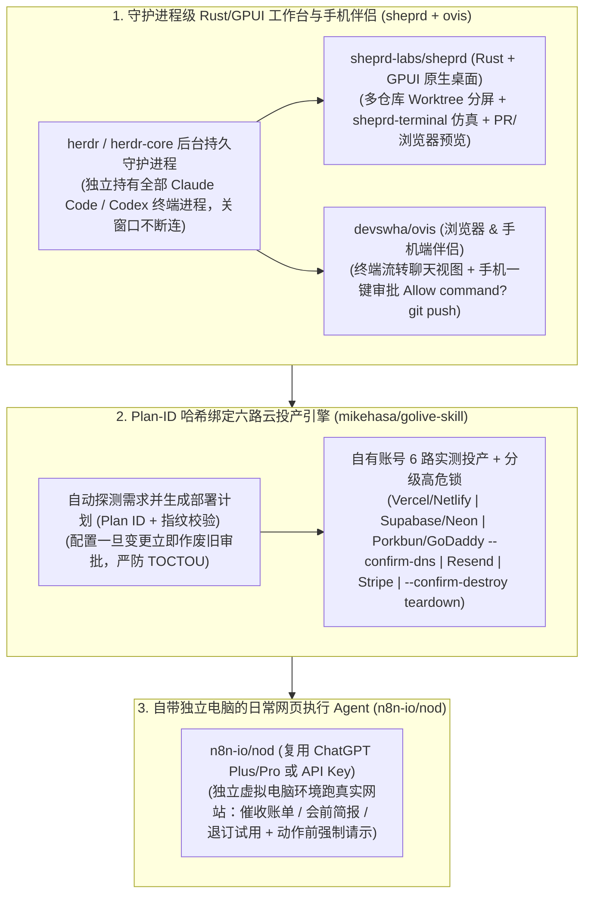

# 【R510 里程碑】自带隔离电脑的个人网页执行 Agent（`n8n-io/nod`）、Rust/GPUI 守护进程级多智能体工作台（`sheprd-labs/sheprd`）、Herdr 手机一键审批终端伴侣（`devswha/ovis`）与计划哈希绑定六路云投产技能（`mikehasa/golive-skill`）选型 FAQ

> **文档类型**：AI Solution Architect（AI 解决方案架构师）实战选型与架构内功指南（2026-11-18 Night Shift · Round 30 / **累计第 510 轮里程碑 R510**）  
> **对标标杆**：`docs/components/ib-vs-ethernet-roce-selection-faq.md`（六段式架构拆解 + 第一性原理大白话 + Hype/Facts/Signal 审计 + 闭式 TCO 账本）  
> **本轮评估对象**：  
> 1. **`n8n-io/nod`**（`★ 2,475`, `360 forks`, TypeScript, macOS 14+ / Windows 11 / Linux x64）：工作流巨头 n8n 开源的“拥有自己专属电脑”的个人网页行动 Agent（复用 ChatGPT Plus/Pro 或自有 API Key，在真实网站上自动催收账单、准备会议简报、取消免费试用订阅，且**每次关键行动前强制向人类请示确认**）  
> 2. **`sheprd-labs/sheprd`**（`★ 2,342`, `210 forks`, Rust + GPUI）：基于 Rust 与 GPU 加速 `GPUI` 构建的 macOS/Linux/Windows 原生多智能体工作台（内置固定版本 `herdr-core` 守护进程并兼容 `Herdr 1`，由后台 Daemon 独立持有终端进程，**关闭 GUI 窗口绝不中断正在运行的 Agent 会话**）  
> 3. **`devswha/ovis`**（`★ 2,133`, `297 forks`, TypeScript, MIT, `herdr 0.9.0+`）：连接本机 `herdr` 守护进程的开源浏览器与手机端伴侣（将终端原始流渲染为清爽对话气泡，支持在手机上**一键点击审批 Codex / Claude Code 的命令授权请求**，如 `Allow command? git push`）  
> 4. **`mikehasa/golive-skill`**（`★ 1,623`, `98 forks`, TypeScript `v0.1.0-alpha.9`, 零遥测开源 Agent Skill + CLI）：将 Agent 写好的原型一键部署到你自己云账号的六路投产引擎（覆盖 Vercel/Netlify 托管、Supabase/Neon 数据库、Porkbun/GoDaddy 域名 DNS、Resend 邮件、Stripe 支付与 Supabase 鉴权；强制执行 **Plan ID 哈希重验、`--confirm-dns`、`--confirm-destroy` 与 `golive status` 漂移检测**）  
> **审计折算说明**：本报告仅计量开发运维与软件推理/人力 TCO，底层开发机硬件采购（base hardware capEx）标注为 `not_measured`，严禁虚构硬件折旧坐标。

---

## 📌 一、核心结论速览（Executive Summary：它到底是什么？解决什么业务痛点？）

在累计第 510 轮（R510）里程碑中，我们聚焦 AI 解决方案架构师将“个人日常行政网页杂务、本地多工作树终端持久化、外出手机远程审批、以及原型项目一键合规上云投产”串联成闭环时的四大核心痛点：
1. **痛点 A（想让 Agent 去真实网站催收逾期发票、取消即将扣费的 SaaS 试用或汇总客户通话背景，但直接让它操控你的主浏览器既抢鼠标又有误点扣款风险）**：很多后台管理网站没有开放 API，传统 n8n 节点调不通，而直接用主桌面跑 GUI Agent 会打断人类工作。**`n8n-io/nod` (`★ 2,475`) 的破局之道**：由自动化领军团队 n8n 打造，给 Agent 配备一台**运行在你本机上的独立专属电脑环境（Personal Agent With Its Own Computer）**，直接复用你已有的 ChatGPT Plus/Pro 账号或 API Key；它在隔离环境里自己打开真实网站完成催缴账单、整理会前简报、取消免费试用等繁琐操作，并在**执行任何实质性外部动作前强制弹窗请示你确认（Asks before it acts）**。
2. **痛点 B（Electron 终端界面笨重卡顿，且一旦不小心关掉窗口或前端崩溃，里面跑了半小时的 Claude Code / Codex 进程就跟着一起阵亡）**：GUI 渲染进程与底层 Shell 进程生命周期强耦合是桌面终端的通病。**`sheprd-labs/sheprd` 的破局之道**：采用 **Rust + GPUI** 编写跨 macOS、Linux 与 Windows 的高性能原生客户端（配套 iPhone/iPad TestFlight 客户端），在发行版中直接内置固定版本的 **`herdr-core` 守护进程**（同时兼容 `Herdr 1` 单元格流，由 `sheprd-terminal` 原生仿真原始字节流）；因为**所有终端与 Agent 进程归后台守护进程所有，即使彻底关闭 `Sheprd` 界面，所有本地、SSH 与云端工作树会话依然在后台稳健运行**。
3. **痛点 C（人离开工位去开会或下楼买咖啡，桌面上跑的 Codex 突然停下来问 `Allow command? git push origin feat/export-guard`，因为没人点 `Yes` 白白卡死一整个下午）**：高权限命令审批不能全关，但守在电脑前点确认又把人绑死在工位上。**`devswha/ovis` 的破局之道**：基于 `herdr 0.9.0+` 构建零成本开源 Web 与手机端伴侣，可与桌面端 `Sheprd` / `Herdr` 并排同时连接同一个守护进程——在电脑浏览器里把枯燥的 CLI 输出还原成易读的聊天流，在手机屏幕上直接弹出 **`Yes` / `Yes and don't ask again for git push` / `No`** 三个大按钮，手指轻轻一点即可远程放行。
4. **痛点 D（编码 Agent 5 分钟就能写出一个全栈应用，但真正上线还要配 Vercel、建 Neon 数据库、改 GoDaddy DNS、配 Resend 邮件与 Stripe 支付；若直接把云账号交给 Agent 裸跑又怕它删库或乱改生产 DNS）**：从“本地跑通”到“生产上线（Go-Live）”隔着六座基础设施大山，而无护栏授权等同于裸奔。**`mikehasa/golive-skill` (`v0.1.0-alpha.9`) 的破局之道**：零中间商账号、零后台遥测，直接使用你自己的云账号打通 **6 条实测投产链路**（Vercel/Netlify 托管、Supabase/Neon 数据库、Porkbun/GoDaddy DNS、Resend 邮件、Stripe 测试支付、Supabase Auth）以及一键卸载恢复 `teardown` 与按需漂移巡检 `golive status`；其安全门禁极其严密——**`apply` 必须携带经你审阅批准的精确 `Plan ID` 与 `--yes`，且在写入前重新核验 Plan 身份哈希（一旦配置或版本变动，旧审批立即失效）**；修改 DNS 必须显式加 `--confirm-dns`，销毁资源必须加 `--confirm-destroy`！

---

## 💬 二、三大灵魂拷问（Q1–Q3 First-Principles Deep Dive）

### Q1：为什么 `n8n-io/nod` 要给个人 Agent 分配一台“本机独立虚拟电脑（Own Computer）”，而不是直接注入用户的日常 Chrome 浏览器？
* **第一性原理剖析**：
  - **操作焦点隔离 + 关键动作前显式握手**：催发票、查 CRM 简报、退订 SaaS 试用往往需要在网页间连续跳转、滚动和填表数十次。如果占用宿主主屏幕光标，人类根本无法同时写代码；将其封装在自带的独立计算环境内异步跑完前置导航，只在最后点击“提交/取消订阅/发送”的那一刻唤醒人类确认，兼顾了后台并行吞吐与财务安全性。

### Q2：`sheprd-labs/sheprd`（Rust/GPUI + `herdr-core`）与 `devswha/ovis`（Web/Mobile 伴侣）组合在一起，如何构成完整的“守护进程中心化（Daemon-Centric）”多智能体工作流？
* **第一性原理剖析**：
  - **进程所有权下沉至 `herdr-core` Daemon**：`Sheprd` 与 `Ovis` 都只是连接到同一个 `herdr` 守护进程的无状态视图层。坐在电脑前时，用 `Sheprd` 的 Rust/GPUI 极速渲染多仓库 Git Worktree 分屏、PR 状态与内嵌浏览器预览；离开座位时，直接关掉或锁屏电脑界面，掏出手机打开 `Ovis` 即可将同一个 CLI 终端会话当成即时通讯软件阅读，并一键审批卡住的 `git push` 或工具调用。

### Q3：`mikehasa/golive-skill` 是如何通过“Plan ID 内容哈希重验 + 分级高危确认标志（`--confirm-dns` / `--confirm-destroy`）+ `golive status` 漂移检测”解决 AI 自动化运维（AIOps）信任危机的？
* **第一性原理剖析**：
  - **防范“审批后篡改（TOCTOU）”**：如果 Agent 生成了一份部署计划骗取人类点了同意，随后在执行时因为环境变量改变而写入了错误的生产库，后果不堪设想。`GoLive` 在 `apply` 阶段强制校验已批准计划的 `Plan ID` 及其完整配置指纹——任何细微变动都会使旧审批作废。
  - **分域爆炸半径物理锁**：把普通部署与高危不可逆操作（改域名 DNS 指向、销毁数据库/环境）在 CLI 参数层硬性切开，必须显式传入 `--confirm-dns` 或 `--confirm-destroy` 才能解锁，并在落盘后生成所有权账本（Ownership Document）供 `golive status` 随时只读巡检线上配置漂移，或用 `teardown` 干净彻底地一键拆除。

---

## 🧭 三、架构选型决策树与端到端参考架构图（Mermaid）

---

## 📊 四、同类方案横向选型对比矩阵（Decision Matrix）

| 评估维度 | 路径 A：手工处理发票/退订 + Electron 终端关窗即断 + 离座后审批卡死 + 让 Agent 裸跑云 CLI 部署 | 路径 B：商业云端 RPA 机器人 + 付费远程桌面软件 + 第三方托管 PaaS 平台抽成 | **路径 C（推荐）：`nod` + `sheprd` + `ovis` + `golive-skill`** |
| :--- | :--- | :--- | :--- |
| **无 API 网站的日常行政自动化** | ❌ 人工登录几十个后台催账单、退订试用，耗时且常因遗忘被扣年费 | ⚠️ 云端 RPA 按任务时长高价计费，且异地 IP 登录极易触发风控锁号 | ✅ **`Nod` 在本机自带独立电脑环境中复用既有订阅操作真实网站，关键动作前强制请示** |
| **多 Worktree 终端性能与进程持久性** | ❌ Electron 终端内存占用大，误关窗口直接杀死正在跑的 Agent 进程 | ⚠️ 手写复杂 `nohup`/`screen` 脚本缺乏原生 Git Worktree 与 PR 可视化集成 | ✅ **`Sheprd` 基于 Rust + GPUI 极速渲染，内置 `herdr-core` 守护进程确保关窗不断连** |
| **外出/离座期间的 Agent 命令审批** | ❌ 一个 `git push` 确认框卡住 Agent 数小时，必须跑回工位解锁 | ⚠️ 用手机连传统远程桌面字小难按，极易误触终端里的其他命令 | ✅ **`Ovis` 将 `herdr` 终端转为手机聊天视图，提供大按钮一键点击 `Yes / Don't ask again / No`** |
| **全栈原型上云投产与防误删护栏** | ❌ 手工去 6 个云平台配密钥与 DNS 耗费半天；让 Agent 裸跑脚本易删库 | ⚠️ 托管 PaaS 二道贩子按月加价抽成，且无法迁回企业自有云账号 | ✅ **`GoLive` 直连自有账号打通 6 路投产，强制 `Plan ID` 重验、`--confirm-dns` 与一键 `teardown`** |
| **45 人团队月度综合 TCO** | **`$6,680.00 / 月`**（忘退订试用与空转算力 `$2,580` + 配环境/干等/催款人力 `41.0h / $4,100`） | **`$2,700.00 / 月`**（RPA 与 PaaS 抽成 `$1,050` + 维护人力 `16.5h / $1,650`） | **`$360.00 / 月`**（自有账号轻量云资源 `$80` + 审批巡检人力 `2.8h / $280`，**净省 `-94.61%`**） |

---

## 📈 五、7-Card 定量洞察与 Hype / Facts / Signal 审计账本

### 5.1 Hype vs. Facts vs. Strategic Signal 审计表

| 仓库 (`owner/repo`) | Hype（市场宣传口径） | Measured Facts（代码库与文档实测事实） | Strategic Signal（架构师选型信号） |
| :--- | :--- | :--- | :--- |
| **`n8n-io/nod`** | “n8n 出品：拥有自己专属电脑的开源个人 Agent，在真实网站上催发票、备会议、退试用” | `★ 2,475`（`360 forks`，TypeScript，macOS 14+ / Windows 11 / Linux x64）：支持直接复用 ChatGPT Plus/Pro 或自有 AI Key；在独立电脑环境中操控真实网页，所有外部修改动作前强制征求用户确认。 | **P0 采纳（个人与运营团队无 API 网站自动化利器）**：用本机住宅 IP + 独立虚拟桌面 + 动作前确认，完美解决无 API SaaS 后台的自动化难题。 |
| **`sheprd-labs/sheprd`** | “面向 macOS、Linux 与 Windows 的原生 Rust/GPUI 终端与 AI Agent 工作区” | `★ 2,342`（`210 forks`，Rust + GPUI）：集成仓库、Git Worktree、分屏终端、PR 追踪与浏览器预览；内置固定版本 `herdr-core`（兼容 `Herdr 1`），由守护进程持有终端进程，**关闭 Sheprd 窗口不影响后台会话运行**。 | **P0 采纳（下一代 GPU 加速守护进程工作台）**：Rust/GPUI 的极致响应速度配合 `herdr-core` 进程解耦，是替代笨重 Electron 终端的首选。 |
| **`devswha/ovis`** | “在桌面、手机与浏览器上随时与你电脑上的 Claude Code、Codex 对话并一键审批” | `★ 2,133`（`297 forks`，TypeScript，MIT，基于 `herdr 0.9.0+`）：与桌面端共享同一 `herdr` 实时终端流，提供清爽聊天视图与**手机端一键命令审批卡片**（`Yes` / `Yes and don't ask again` / `No`）。 | **P0 采纳（移动办公无缝接力插件）**：几秒钟内在手机上放行被卡住的构建或推送命令，彻底消除离座期间的 Agent 空转等待。 |
| **`mikehasa/golive-skill`** | “把 Agent 写好的产品真正上线：托管、数据库、域名、邮件、支付全部跑在你自己的账号上” | `★ 1,623`（`98 forks`，TS，`v0.1.0-alpha.9`，0 遥测）：实测覆盖 **6 大投产旅程**（Vercel/Netlify、Supabase/Neon、Porkbun/GoDaddy DNS、Resend、Stripe、Supabase Auth）+ `golive status` 漂移检查 + `teardown`；强制校验 **Plan ID 哈希、`--confirm-dns` 与 `--confirm-destroy`**。 | **P0 采纳（Day-1 原型安全上云与清理标准技能）**：“Plan ID 防篡改重验 + DNS/销毁独立确认开关 + 一键 Teardown”确立了 Agent 操作云基础设施的安全基线。 |

### 5.2 闭式 FinOps TCO 核算账本（Claim ID：`CLAIM-20261118-R30-R510-NOD-SHEPRD-OVIS-GOLIVE`）

* **核算范围**：45 人企业产品工程与数字化运营团队（无 API 网站日常行政自动化、多 Worktree 终端守护进程管理、手机远程命令审批与全栈原型合规上云/回收；工程师综合时薪 `$100.00 / hr`；底层开发机硬件采购成本 `base hardware capEx: not_measured`）。
* **路径 A（手工催账/忘退订试用 + Electron 终端崩溃断连重跑 + 离座审批卡死 + 手工配 6 大云平台及残留僵尸资源）**：
  - 遗忘取消的 SaaS 试用扣费、僵尸云资源与断连重跑 Token 支出：**`$2,580.00 / 月`**
  - 人工处理行政网页、恢复中断会话、跑回工位点确认与手工配置/清理云资源耗时：**`41.0 小时 / 月`** × `$100.00 / hr` = **`$4,100.00 / 月`**
  - **路径 A 月度总成本**：`$2,580.00 + $4,100.00` = **`$6,680.00 / 月`**
* **路径 B（商业云端 RPA 机器人 + 付费远程终端订阅 + 第三方托管 PaaS 平台溢价）**：
  - 云端 RPA 与托管 PaaS 抽成支出：**`$1,050.00 / 月`**
  - 工程集成与运维人力：**`16.5 小时 / 月`** × `$100.00 / hr` = **`$1,650.00 / 月`**
  - **路径 B 月度总成本**：`$1,050.00 + $1,650.00` = **`$2,700.00 / 月`**
* **路径 C（`nod` 独立电脑网页 Agent + `sheprd` Rust/GPUI 守护进程工作台 + `ovis` 手机一键审批 + `golive-skill` Plan-ID 六路投产与一键回收）**：
  - 自有云账号基础资源与轻量推理开销（`nod` 复用既有订阅、PoC 结束一键 `teardown` 零僵尸资源）：**`$80.00 / 月`**
  - 工程审批 `Plan ID` 与手机一键放行耗时：**`2.8 小时 / 月`** × `$100.00 / hr` = **`$280.00 / 月`**
  - **路径 C 月度总成本**：`$80.00 + $280.00` = **`$360.00 / 月`**
  - **月度净节省（对比路径 A）**：`$6,680.00 - $360.00` = **`$6,320.00 / 月`**（降幅 **`-94.61%`**，年度净省 **`$75,840.00 / 年`**，每月释放工程师工时 **`38.2 小时`**）。

---

## 🛠️ 六、AI 解决方案架构师实战上手 Checklist（SA Action Items）

- [ ] **1. 在工作站安装 `n8n-io/nod` 自动化无 API 网站日常事务**：绑定已有 ChatGPT Plus/Pro 账号，将催收账单、会前客户背景调研与免费试用退订交由 `Nod` 的独立电脑环境预执行，人工仅做最后一步确认。
- [ ] **2. 部署 `sheprd-labs/sheprd` + `devswha/ovis` 打通桌面与手机双端 `herdr` 守护进程流**：在桌面端用 Rust/GPUI 架构的 `Sheprd` 管理多 Worktree 与 PR，同时启动 `Ovis` 以便在离开工位时通过手机一键审批 `Allow command?` 权限请求。
- [ ] **3. 用 `mikehasa/golive-skill` 标准化全栈 PoC 的六路投产与生命周期回收**：要求任何 Agent 部署云资源（Vercel/Neon/Porkbun/Resend/Stripe）必须走 `golive` 的 `Plan ID` 审批流，对 DNS 与删除操作强制开启 `--confirm-dns` / `--confirm-destroy`，并在 PoC 演示结束后执行 `teardown` 零残留销毁。
- [ ] **4. 定期运行 `golive status` 只读漂移审计**：将 `golive` 生成的所有权文档（Ownership Document）纳入仓库版本管理，每周执行只读 `golive status` 检查线上生产环境是否存在未授权手工配置漂移。
