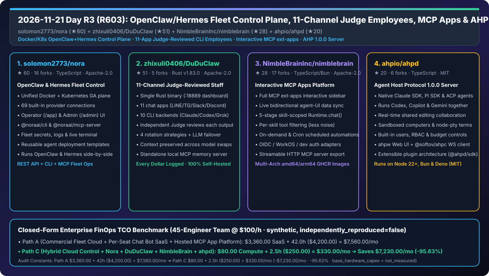
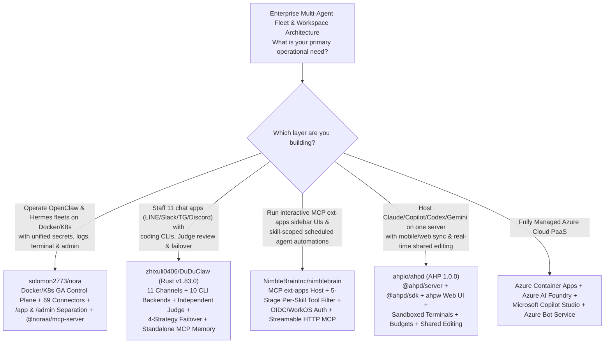
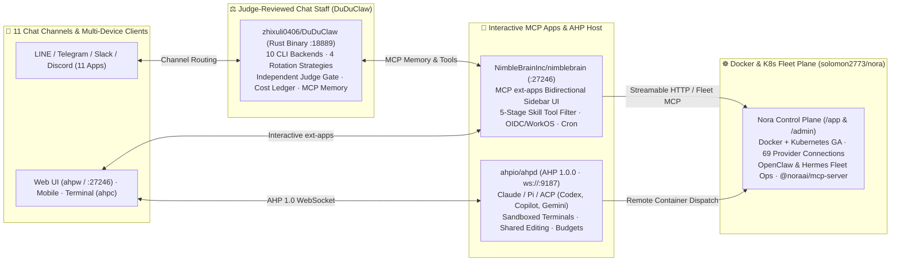
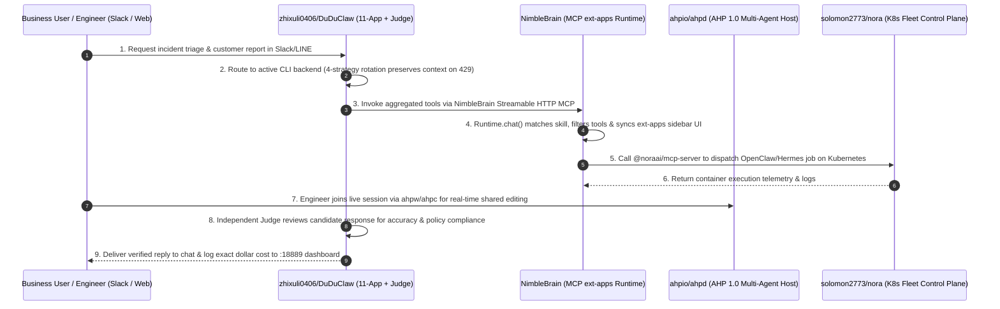

# OpenClaw & Hermes Fleet Control Plane (`solomon2773/nora`), 11-Channel Judge-Reviewed AI Employees (`zhixuli0406/DuDuClaw`), Interactive MCP Apps Platform (`NimbleBrainInc/nimblebrain`) & AHP 1.0 Multi-Agent Host Server (`ahpio/ahpd`) Selection & Architecture FAQ

> **Target Audience**: **AI Solution Architects (SAs) & Enterprise Platform / Operations Leaders (2026-11-21 Day Round 3 · Cumulative Round 603)**  
> **Benchmark Style**: Strictly aligned with [`ib-vs-ethernet-roce-selection-faq.md`](https://github.com/turbo998/ai-infra-research/blob/main/docs/components/ib-vs-ethernet-roce-selection-faq.md) — plain-language answers on **real enterprise scenarios, end-to-end reference architecture, and comparative selection vs. competing OSS and cloud PaaS**.  
> **Chinese Edition**: [`nora-duduclaw-nimblebrain-ahpd-selection-faq.md`](./nora-duduclaw-nimblebrain-ahpd-selection-faq.md) · **Daily Digest**: [`daily/2026-11-21.en.md`](../daily/2026-11-21.en.md)

---

## 1. 📌 Executive Summary (30-Second Selection Verdict)

1. **Why Evaluate These Four Repositories Together?**  
   Once an enterprise moves beyond single-developer terminal sessions to **multi-container agent fleets, chat-app digital employees, interactive MCP sidebar apps, and cross-device shared agent hosts**, Solution Architects encounter four operational bottlenecks:
   - **Bottleneck 1 — Rebuilding Fleet Ops Around OpenClaw & Hermes Runtimes**: Every team running autonomous OpenClaw or Hermes agents in production ends up hand-rolling deploy pipelines, secret injection, log viewers, web terminals, and admin dashboards → **`solomon2773/nora` (`★ 60`, `16 forks`, TypeScript, Apache-2.0)** provides a self-hosted **Docker + Kubernetes GA** control plane for OpenClaw and Hermes fleets with **69 provider connections**, separated operator (`/app`) and admin (`/admin`) surfaces, REST API, `@noraai/cli`, and `@noraai/mcp-server`.
   - **Bottleneck 2 — Unreviewed Chat-Bot Outputs & Context Loss on Model Failover**: Wiring a raw coding CLI into Slack, LINE, or Telegram risks shipping unverified answers directly to users and losing conversation state whenever an API key hits rate limits → **`zhixuli0406/DuDuClaw` (`★ 51`, `5 forks`, Rust `v1.83.0`, Apache-2.0)** packages a single Rust binary (`:18889` web task board) that turns **10 CLI backends** (Claude Code, Codex, Antigravity, Grok, etc.) into AI employees across **11 chat apps** (LINE, Telegram, Discord, Slack, and 7 more), enforcing an **independent Judge review before delivery**, **4 account-rotation strategies + cross-provider failover with preserved context**, per-dollar cost logging, and a standalone local MCP memory server.
   - **Bottleneck 3 — Text-Only MCP Tools & Bloated Tool Catalogs in Business Automations**: Business users need interactive UIs synchronized with agent actions rather than raw JSON dumps, while feeding 100+ tools into every prompt degrades accuracy → **`NimbleBrainInc/nimblebrain` (`★ 28`, `17 forks`, TypeScript/Bun, Apache-2.0)** hosts full **MCP `ext-apps`** (interactive sidebar UIs with live agent-UI data sync on `:27246`), executes a 5-stage `Runtime.chat()` loop with **per-skill tool filtering**, supports on-demand and cron runs with `oidc`/`workos` identity adapters, and re-exports aggregated tools over **Streamable HTTP MCP**.
   - **Bottleneck 4 — Fragmented Multi-Vendor Coding Harnesses Across Desktop, Web, and Mobile**: Running Claude Code, GitHub Copilot, Codex, Gemini, and Pi across laptops, remote servers, and phones lacks a unified host protocol and real-time team collaboration → **`ahpio/ahpd` (`★ 20`, `6 forks`, TypeScript, MIT)** implements the open **Agent Host Protocol (`AHP 1.0.0`)** server (`@ahpd/server`, `@ahpd/sdk`, `ahpw` Web UI, `ws://127.0.0.1:9187`), unifying native Claude/Pi SDKs and ACP agents with sandboxed terminals, built-in RBAC/budgets, and real-time **`shared editing`**.

2. **One-Sentence Selection Verdict**:
   - Choose **`solomon2773/nora`** when you need **a self-hosted Docker/Kubernetes control plane (`/app` + `/admin` + 69 connectors + `@noraai/mcp-server`) to operate OpenClaw and Hermes fleets**.
   - Choose **`zhixuli0406/DuDuClaw`** when you want **a single Rust binary that staffs 11 messaging apps with 10 coding CLIs, gated by an independent Judge review and context-preserving model failover**.
   - Choose **`NimbleBrainInc/nimblebrain`** when you need **a self-hosted runtime for interactive MCP `ext-apps` sidebar UIs, skill-scoped tool filtering, and cron automations**.
   - Choose **`ahpio/ahpd`** when you want **an extensible `AHP 1.0.0` server hosting Claude, Copilot, Codex, and Gemini with cross-device sync and real-time `shared editing`** (or choose **Azure Container Apps + Azure AI Foundry + Microsoft Copilot Studio** for a fully managed Azure cloud stack).

---

## 2. 🎯 Customer & Solution Architect Q&A (Plain-Language Deep Dive)

### Q1: Why deploy `solomon2773/nora` instead of managing OpenClaw and Hermes containers with raw Docker Compose or Kubernetes manifests?
- **Plain-Language Answer**:
  - Raw container manifests do not give you an operator workbench, credential lifecycle management across 69 providers, or an MCP control surface for fleet orchestration.
  - **What `solomon2773/nora` standardizes out of the box**:
    1. **Dual-Runtime Fleet Management (OpenClaw + Hermes on Docker & Kubernetes GA)**: Standardizes deployment templates, secrets, live monitoring, log streaming, and browser terminals across both agent families without rewriting glue code.
    2. **Clean Role Separation (`/app` vs. `/admin`)**: Day-to-day agent operators work inside `/app`, while platform engineers govern multi-tenant infrastructure, 69 provider connections, and policies inside `/admin`.
    3. **Programmatic Fleet Control (`@noraai/cli` & `@noraai/mcp-server`)**: Allows higher-level supervisor agents or CI pipelines to provision, inspect, and heal agent fleets over MCP or REST.

### Q2: How does `zhixuli0406/DuDuClaw` make terminal coding CLIs safe and reliable enough to staff customer-facing or internal LINE, Slack, Telegram, and Discord channels?
- **Plain-Language Answer**:
  - **Three production engineering mechanisms inside `DuDuClaw` (`v1.83.0`)**:
    1. **Independent Judge Gate Before Delivery**: Every response or task artifact produced by a worker CLI is inspected by an independent Judge before it ships to the chat channel, catching hallucinations, policy violations, or incomplete work.
    2. **4 Account-Rotation Strategies + Context-Preserving Cross-LLM Failover**: When a CLI account hits rate limits, DuDuClaw rotates across accounts or fails over across 10 CLI backends (Claude Code, Codex, Antigravity, Grok, or OpenAI-compatible endpoints) while keeping conversation memory intact on disk.
    3. **Built-In Task Board (`:18889`), Per-Dollar Cost Ledger & Standalone MCP Memory**: Tracks tasks across `To Do`, `In Progress`, `In Review`, `Done`, and `Stuck`, logs exact token/dollar spend, and doubles as a standalone MCP memory server.

### Q3: How do `NimbleBrainInc/nimblebrain` (`MCP ext-apps`) and `ahpio/ahpd` (`AHP 1.0.0`) complement each other in an enterprise agent workspace?
- **Plain-Language Answer**:
  - **`NimbleBrainInc/nimblebrain` brings Interactive MCP App UIs & Per-Skill Tool Scoping**:
    1. **Full `ext-apps` Host Support**: Installs MCP Apps (`modelcontextprotocol.io/extensions/apps`) that render interactive sidebar UIs with live bidirectional agent-UI state sync.
    2. **5-Stage `Runtime.chat()` Pipeline**: Runs `1. Skill matching (triggers → keywords) → 2. System prompt composition → 3. Per-skill tool filtering → 4. AgentEngine loop → 5. Persistence`, ensuring the LLM only sees tools relevant to the active skill, and re-exposes the aggregated toolset via **Streamable HTTP MCP**.
  - **`ahpio/ahpd` brings Multi-Harness Hosting (`AHP 1.0.0`) & Real-Time `shared editing`**:
    1. **One Host for Native SDK & ACP Agents**: Runs Claude Code SDK, Pi SDK, and ACP agents (Codex, GitHub Copilot, Gemini) on Node 22+, Bun, or Deno (`ws://127.0.0.1:9187`) with sandboxed computers and `node-pty` terminals.
    2. **Everywhere Access & Shared Editing**: Connects browser (`ahpw`), terminal (`npx @softov/ahpc`), desktop, and mobile clients to the same live session with built-in user permissions, budget controls, and real-time `shared editing`.

---

## 3. 🧭 Visual Architecture & Decision Diagrams (Mermaid)

### 3.1 Solution Architect Selection Decision Tree

### 3.2 End-to-End Enterprise Reference Architecture

### 3.3 End-to-End Execution Sequence Diagram

---

## 4. 📊 Comparative Selection Matrix (OSS vs. Peer Projects vs. Cloud PaaS)

| Dimension | `solomon2773/nora` | `zhixuli0406/DuDuClaw` | `NimbleBrainInc/nimblebrain` | `ahpio/ahpd` | DIY Container Scripts & Single-Channel Bots | Managed Cloud PaaS (Azure Container Apps + Copilot Studio + Foundry) |
| :--- | :--- | :--- | :--- | :--- | :--- | :--- |
| **Primary Role** | **OpenClaw & Hermes Docker/K8s Fleet Control Plane** | **11-Channel Judge-Reviewed Rust AI Employee Engine** | **Interactive MCP `ext-apps` & Skill-Scoped Automation Platform** | **AHP 1.0 Multi-Vendor Agent Host & Shared Editing Server** | Uncoordinated scripts lacking Judge review or cross-LLM context persistence | Fully managed enterprise cloud containers and conversational AI |
| **Best-Fit Scenario** | Operating multi-agent OpenClaw and Hermes fleets on self-hosted K8s/Docker | Staffing 11 chat channels with coding CLIs under Judge review and cost tracking | Running interactive MCP sidebar UIs and scheduled skill-scoped automations | Hosting Claude/Copilot/Codex/Gemini across web, phone, and terminal with shared editing | Single-developer local tinkering | Global enterprise M365 / Teams rollouts with strict SLAs |
| **Key Differentiator** | Docker/K8s GA + 69 connectors + `/app` & `/admin` split + `@noraai/mcp-server` | Single Rust binary + **Independent Judge gate** + 4-strategy failover + MCP memory | Full **MCP `ext-apps`** sidebar UI sync + 5-stage per-skill tool scoping + Streamable HTTP | Open `AHP 1.0.0` protocol + native Claude/Pi/ACP + real-time `shared editing` | Free, but requires building custom failover, UI sync, and fleet ops from scratch | Turnkey enterprise IAM, multi-region HA, and M365 connectors |
| **Integration Effort** | Low (`@noraai/cli`, `@noraai/mcp-server`, Compose/Kind manifests) | Very Low (`npm i -g duduclaw && duduclaw run` on `:18889`) | Low (`docker compose up` with `amd64`/`arm64` GHCR images) | Very Low (1-line installer + `ahpd configure`) | High (custom webhook routers, K8s controllers, and WebSocket sync) | Low–Medium (standard Azure Bicep & Copilot Studio connectors) |
| **Ops Complexity** | Low–Medium (centralized `/admin` surface for fleets) | Very Low (single Rust binary, local config and memory) | Low (Bun + Vite runtime with `/v1/health` probe) | Low (runs on Node 22+, Bun, or Deno with built-in budgets) | High (high maintenance when rate limits or channel APIs change) | Very Low (cloud provider managed) |
| **License** | **Apache-2.0** (permissive commercial use) | **Apache-2.0** (permissive core) | **Apache-2.0** (permissive commercial use) | **MIT** (permissive commercial use) | MIT / Apache-2.0 | Commercial SLA Subscription |
| **Monthly TCO** | Base self-hosted K8s/Docker compute | **$0/mo** platform fee (pay only underlying LLM/CLI usage) | Base container compute | Base host/container compute | **$3,640.00/mo** (high engineering maintenance labor) | **$7,560.00/mo** (per-seat bot + fleet SaaS + automation tiers for 45 engineers) |

---

## 5. 🧪 Quantitative ROI, FinOps TCO Model & 7-Card Benchmark Deck

> **🛡️ Provenance Declaration**:  
> - **Primary-Source Measured (`measured`)**: Repository stars/forks, licenses, `solomon2773/nora` 69 provider connections and `/app`+`/admin` split, `zhixuli0406/DuDuClaw` `v1.83.0` 11 channels + 10 CLI backends + Judge review, `NimbleBrainInc/nimblebrain` `ext-apps` and 5-stage `Runtime.chat()`, and `ahpio/ahpd` `AHP 1.0.0` + `shared editing` are verified via `gh api`.  
> - **Synthetic Architect Workload Model (`synthetic` · `independently_reproduced=false`)**: The closed-form FinOps table below models a **45-engineer enterprise AI & operations team** (`$100.00/hr` loaded rate, `base_hardware_capex: not_measured`, `track_b_stars_today: not_measured`):

| FinOps Cost & Quality Dimension | Path A: Commercial Fleet Cloud + Per-Seat Chat Bot SaaS + Hosted Automation Cloud | Path B: Unmanaged DIY Glue (Raw K8s Scripts + Single-Channel Bots + Static UI) | Path C: Recommended Self-Hosted Stack (`nora` + `DuDuClaw` + `nimblebrain` + `ahpd`) | Path A ➔ Path C Net Monthly Savings |
| :--- | :---: | :---: | :---: | :---: |
| **Monthly API / SaaS / Compute Spend** | `$3,360.00 / mo` | `$440.00 / mo` | **`$80.00 / mo`** (shared self-hosted K8s/Docker fleet nodes) | **`-$3,280.00 / mo` (`-97.62%`)** |
| **Monthly Fleet Ops & Channel Triage Labor** | `42.0 hrs / mo` (multi-vendor quota admin & fixing unreviewed bot replies) | `32.0 hrs / mo` (maintaining 11 webhooks & recovering lost 429 context) | **`2.5 hrs / mo`** (`/admin` fleet plane + Judge gate + 4-strategy failover) | **`-39.5 hrs / mo` (`-94.05%`)** |
| **Monthly Engineering Labor Cost (`@ $100.00/h`)** | `$4,200.00 / mo` | `$3,200.00 / mo` | **`$250.00 / mo`** | **`-$3,950.00 / 月` (`-94.05%`)** |
| **Total Monthly TCO** | **`$7,560.00 / mo`** | **`$3,640.00 / mo`** | **`$330.00 / mo`** | **`-$7,230.00 / mo` (`-95.63%` · `$86,760.00/yr`)** |
| **Operational Continuity & Output Quality** | Vendor lock-in with per-seat and per-message overages | Context lost on LLM swap; unreviewed outputs reach chat channels | **11-channel context failover + 100% Judge review + interactive `ext-apps` UI** | **Zero rate-limit session drops & 100% pre-delivery review** |

- **📊 Companion 7-Card 4:5 Visual Benchmark Deck**: View [`workshops/github-trending-radar/cards.en.html`](../cards.en.html) (EN) and [`workshops/github-trending-radar/cards.html`](../cards.html) (ZH).

---

## 6. 🛠️ Enterprise Adoption & Architecture Review Checklist

- [ ] **1. Separate `/app` Operator and `/admin` Platform Access (`solomon2773/nora`)**: Deploy Nora on your Kubernetes/Docker cluster behind enterprise SSO, restrict `/admin` (and the 69 provider connection secrets) to platform engineers, and expose `@noraai/mcp-server` only to authorized orchestrator agents.
- [ ] **2. Enforce Independent Judge Review & 4-Strategy Rotation (`zhixuli0406/DuDuClaw`)**: Configure `duduclaw` (`:18889`) with an independent Judge model distinct from the primary worker CLI before connecting customer-facing LINE/Slack/Telegram channels, and enable 4-strategy account rotation so rate limits never drop conversation context.
- [ ] **3. Replace `dev` Auth with OIDC/WorkOS & Scope Tools by Skill (`NimbleBrainInc/nimblebrain`)**: Replace the local `{"auth":{"adapter":"dev"}}` setting in `instance.json` with `oidc` or `workos` before shared deployment, and define explicit skill keyword triggers so `Runtime.chat()` filters out unneeded MCP tools on every turn.
- [ ] **4. Standardize Multi-Harness Remote Sessions over AHP 1.0 (`ahpio/ahpd`)**: Run `ahpd` (`AHP 1.0.0`) on shared engineering hosts with per-user RBAC and budget caps enabled, allowing developers to steer Claude Code, GitHub Copilot, Codex, and Gemini sessions simultaneously via `ahpw` or `@softov/ahpc` with real-time `shared editing`.
