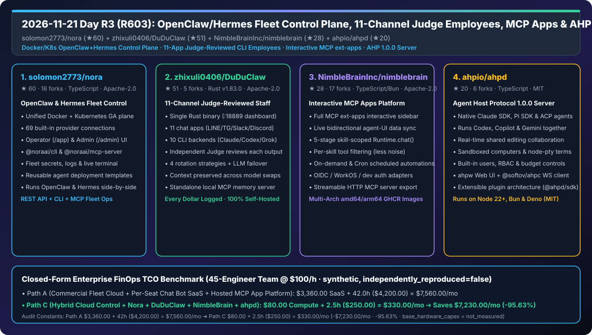
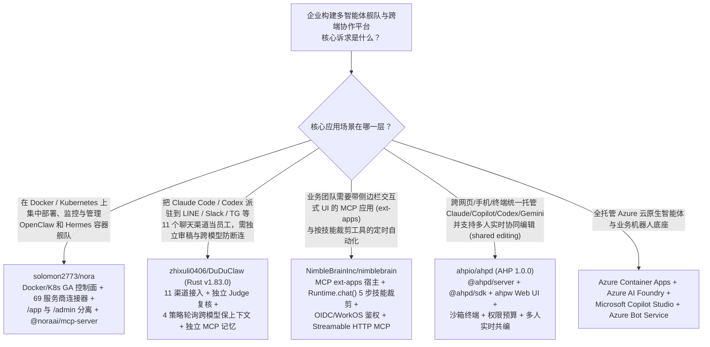
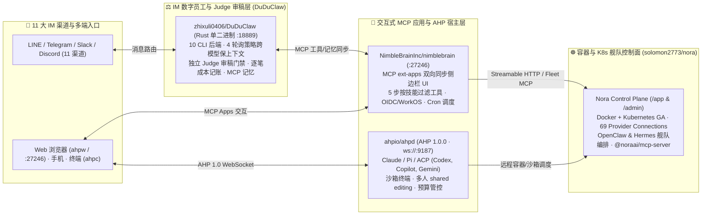
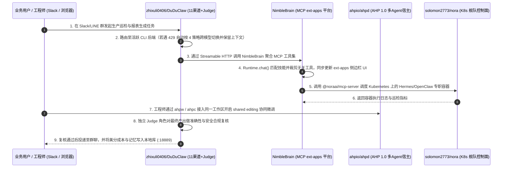

# OpenClaw 与 Hermes 舰队控制面（`solomon2773/nora`）、11 渠道独立 Judge 复核 AI 员工（`zhixuli0406/DuDuClaw`）、交互式 MCP 应用与自动化平台（`NimbleBrainInc/nimblebrain`）及 AHP 1.0 多智能体宿主服务（`ahpio/ahpd`）应用场景、集成架构与同类方案选型比较 FAQ

> **文档定位**：面向企业客户与业务决策者的 **AI Solution Architect（解决方案架构师）实战选型指南（2026-11-21 Day Round 3 · 累计第 603 轮）**  
> **对标范式**：严格遵循 [`ib-vs-ethernet-roce-selection-faq.md`](https://github.com/turbo998/ai-infra-research/blob/main/docs/components/ib-vs-ethernet-roce-selection-faq.md) 通俗问答与决策矩阵风格——直接用大白话回答“**它是什么？帮企业解决什么业务痛点？怎么集成进现有生产架构？和同类开源及 Azure 云服务比怎么选？**”  
> **配套英文版**：[`nora-duduclaw-nimblebrain-ahpd-selection-faq.en.md`](./nora-duduclaw-nimblebrain-ahpd-selection-faq.en.md) · **今日日报**：[`daily/2026-11-21.md`](../daily/2026-11-21.md)

---

## 一、📌 核心结论速览（Executive Summary · 30 秒做出选型决定）

1. **为什么把这四个项目放在一起看？**  
   当企业不再满足于“单人单终端跑一个 Agent”，而是要把多智能体扩展为**容器舰队、跨 11 个 IM 聊天群的数字员工、带侧边栏交互式 UI 的 MCP 应用以及支持多人实时协同的远端宿主**时，架构师会面临四个核心工程问题：
   - **问题一（OpenClaw 与 Hermes 生产容器舰队缺乏统一运维控制面）**：每个团队自己写脚本部署 OpenClaw 或 Hermes Agent，每次都要重复造轮子做密钥分发、日志监控、Web 终端和模板管理 → **`solomon2773/nora`（`★ 60`，`16 forks`，TypeScript，Apache-2.0）** 提供自托管 Docker + Kubernetes GA 双引擎控制面，内置 **69 种服务商连接器**，将日常运维（`/app`）与平台管理（`/admin`）分离，并同时暴露 REST API、`@noraai/cli` 与 `@noraai/mcp-server`。
   - **问题二（把 Claude Code / Codex 接进 IM 群当员工时怕胡言乱语、怕单账号限流断服）**：直接在群里挂一个 CLI 机器人，一旦模型抽风就会直接把错误答案发给客户，且遇到 429 限流换模型时上下文全丢 → **`zhixuli0406/DuDuClaw`（`★ 51`，`5 forks`，Rust 单二进制 `v1.83.0`，Apache-2.0）** 将 10 大编码 CLI（Claude Code、Codex、Antigravity、Grok 等）转化为驻扎在 **11 个聊天软件（LINE、Telegram、Discord、Slack 等）** 的 AI 员工：每次产出先由**独立 Judge 智能体复核**合格后才对外发送，内置 **4 种多账号轮询策略 + 跨服务商无感切换（切换模型不丢上下文）**，逐笔记录美分成本，并可作为独立 MCP 记忆服务器运行（Web 看板 `:18889`）。
   - **问题三（普通 MCP Server 只有干巴巴的命令行返回，缺乏业务人员可用的交互式界面与定时自动化）**：业务团队用 Agent 时需要边聊边在侧边栏点选表单、看实时数据同步，而不是看一堆 JSON → **`NimbleBrainInc/nimblebrain`（`★ 28`，`17 forks`，TypeScript/Bun，Apache-2.0）** 完整实现官方 **MCP `ext-apps`（交互式扩展应用）** 宿主规范（Web `:27246`），让安装的 MCP App 在侧边栏渲染实时双向同步的交互 UI，采用 `Runtime.chat()` 五步技能裁剪流水线（按匹配到的 Skill 动态过滤工具集，防止工具过多干扰模型），支持 Cron 定时运行、OIDC/WorkOS 登录与 Streamable HTTP MCP 聚合导出。
   - **问题四（多终端、手机与浏览器跨端控制异构 Agent 缺乏统一宿主协议与多人实时共编）**：工程师在办公室电脑、家里笔记本和手机之间切换时，Claude、Copilot、Codex 和 Pi 会话彼此割裂 → **`ahpio/ahpd`（`★ 20`，`6 forks`，TypeScript，MIT）** 实现开放 **Agent Host Protocol (`AHP 1.0.0`)** 服务端（`@ahpd/server` + `@ahpd/sdk` + `ahpw` Web UI），在单一宿主（`ws://127.0.0.1:9187`）上同时运行原生 Claude/Pi SDK 与 ACP 智能体（Codex、GitHub Copilot、Gemini），内置沙箱电脑/终端、多人实时协同编辑（`shared editing`）、用户权限与预算控制。

2. **一句话选型结论**：
   - 需要**在自建 Docker / Kubernetes 上集中编排、监控和运维 OpenClaw 与 Hermes 智能体舰队** 👉 选 **`solomon2773/nora`**。
   - 需要**用单个 Rust 二进制把 Claude Code / Codex 派驻到 LINE / Slack / Discord / Telegram 等 11 个渠道当 AI 员工，并强制独立 Judge 审稿与跨模型无损切换** 👉 选 **`zhixuli0406/DuDuClaw`**。
   - 需要**自托管支持官方 MCP `ext-apps` 侧边栏交互式 UI、按技能裁剪工具集并支持 OIDC/WorkOS 的企业自动化工作台** 👉 选 **`NimbleBrainInc/nimblebrain`**。
   - 需要**通过统一 `AHP 1.0.0` 协议在服务器/容器上托管 Claude / Copilot / Codex / Gemini 并支持跨手机/网页/终端同步与多人 `shared editing`** 👉 选 **`ahpio/ahpd`**（若全栈构建在微软云原生底座上，可对应采用 **Azure Container Apps + Azure AI Foundry Agent Service + Microsoft Copilot Studio**）。

---

## 二、🎯 客户与架构师灵魂拷问 Q&A（Plain-Language Deep Dive）

### Q1：很多团队已经在用 Docker 跑 OpenClaw 或 Hermes 了，为什么还需要 `solomon2773/nora` 做控制面？
- **大白话解答**：
  - 跑起 1 个 OpenClaw 容器只需 5 分钟，但当企业给 20 个业务线或客户项目分别跑起 50 个 OpenClaw + Hermes 实例时，运维团队马上会被“如何安全注入 69 种第三方凭证、如何在线看某个卡死 Agent 的终端与日志、如何区分普通操作员与平台管理员权限”拖垮。
  - **`solomon2773/nora` 的核心价值**：
    1. **OpenClaw + Hermes 双运行时统一纳管（Docker + Kubernetes GA）**：同一套控制面同时管理 OpenClaw 与 Hermes 舰队，操作员走 `/app` 工作台，平台管理员走 `/admin` 控制台。
    2. **69 个内置连接器与标准化模板**：免去每次重写部署流水线、密钥挂载与监控探针的重复劳动。
    3. **三端平权控制（REST + `@noraai/cli` + `@noraai/mcp-server`）**：不仅人类管理员能在网页管理舰队，上层总控 Agent 也能通过 `@noraai/mcp-server` 自动扩缩容与巡检下属 Agent 舰队。

### Q2：`zhixuli0406/DuDuClaw` 把编码 CLI 变成 11 个聊天软件里的“AI 员工”，它怎么防止 AI 给客户发错话，又怎么解决单账号限流？
- **大白话解答**：
  - **`DuDuClaw`（`v1.83.0`，单 Rust 二进制）的三大生产级机制**：
    1. **独立 Judge 审稿门禁（Independent Judge Review）**：工作 Agent（如 Claude Code 或 Codex）生成回复或执行结果后，不会直接发往 LINE/Telegram/Slack 群，而是先交给独立的 Judge 角色做质量与合规复核，合格后才真正投递。
    2. **4 种多账号轮询策略 + 跨厂商切换不丢上下文**：当主用 CLI 触发配额上限或故障时，自动在 10 种 CLI 后端（Claude Code、Codex、Antigravity、Grok 等）或任意 OpenAI 兼容 API 之间切换；因为会话记忆保存在本机 Rust 引擎中，**换了底层大模型依然能无缝接着刚才的上下文往下聊**。
    3. **内建任务看板（`:18889`）与独立 MCP 记忆服务**：自带 To Do / In Progress / In Review / Done / Stuck 任务流看板与逐笔成本账本，且本身就能作为标准 MCP Memory Server 供外部 IDE 调用。

### Q3：`NimbleBrainInc/nimblebrain` 的“MCP `ext-apps` 交互式应用”和 `ahpio/ahpd` 的“AHP 1.0 宿主协议”各自解决了什么架构痛点？
- **大白话解答**：
  - **`NimbleBrainInc/nimblebrain` 解决“MCP 只有后台工具、没有前端交互界面且工具过多易选错”的痛点**：
    1. **原生支持 MCP `ext-apps` 双向同步 UI**：安装一个 MCP App 后，不仅获得工具函数，还会在右侧边栏直接渲染出交互式表单、看板或图表，Agent 与 UI 数据实时双向同步。
    2. **五步技能感知工具过滤（`Runtime.chat()`）**：按 `1. 技能匹配 (triggers -> keywords) -> 2. 系统提示词组装 -> 3. 按技能过滤工具 (Per-skill tool scoping) -> 4. AgentEngine 循环 -> 5. 会话持久化` 运行——只把当前激活技能所需的工具塞给大模型，大幅降低 Token 消耗与选错工具概率；同时通过 Streamable HTTP 将聚合工具集对外暴露为单一 MCP Server。
  - **`ahpio/ahpd` 解决“多厂商编码 Agent 跨设备同步与多人实时协作”的痛点**：
    1. **AHP 1.0.0 标准协议统一异构 Agent**：通过插件化架构（`@ahpd/agent-claude` 等）把 Claude Code SDK、Pi SDK 以及遵循 ACP 的 Codex、GitHub Copilot、Gemini 统一托管在 `ws://127.0.0.1:9187`。
    2. **跨端实时同步 + `shared editing` 多人共编**：无论从浏览器（`ahpw`）、终端（`npx @softov/ahpc`）、桌面还是手机接入，所有会话与沙箱终端实时同步，并支持团队成员在同一会话中进行实时协同编辑。

---

## 三、🧭 直观可视化图解（Mermaid 选型决策树 + 企业集成参考架构 + 端到端时序图）

### 3.1 选型决策树（Decision Tree）

### 3.2 企业端到端集成参考架构图（Reference Architecture）

### 3.3 业务流端到端时序图（Sequence Diagram）

---

## 四、📊 同类开源与商业云服务横向选型决策矩阵（Comparison Matrix）

| 评估维度 | `solomon2773/nora` | `zhixuli0406/DuDuClaw` | `NimbleBrainInc/nimblebrain` | `ahpio/ahpd` | 同赛道开源竞品（裸 K8s YAML / 单渠道 Bot 脚本 / 普通静态 WebUI） | 云厂商托管 PaaS（Azure Container Apps + Copilot Studio + Foundry） |
| :--- | :--- | :--- | :--- | :--- | :--- | :--- |
| **核心功能定位** | **OpenClaw + Hermes 容器/K8s 舰队控制面** | **11 渠道独立 Judge 复核 Rust AI 员工引擎** | **MCP `ext-apps` 交互式应用与技能裁剪自动化台** | **AHP 1.0 多厂商 Agent 宿主与实时协同平台** | 碎片化单点脚本，缺跨模型保上下文与 Judge 复核 | 全托管企业级容器、对话机器人与 Agent 云平台 |
| **最适用业务场景** | 在自有 K8s/Docker 上集中运维多套 OpenClaw 与 Hermes 实例 | 将 Claude Code/Codex 派入 LINE/Slack/TG 群值班且严防幻觉外发 | 需要带侧边栏交互 UI 的 MCP 应用与 Cron 定时多 Agent 自动化 | 跨桌面/网页/手机统一控制 Claude/Copilot/Codex 并多人共编 | 个人开发者单机临时测试 | 大型跨国企业 Microsoft Teams / M365 深度集成 |
| **核心差异化优势** | Docker+K8s GA + 69 连接器 + `/app` 与 `/admin` 权限分离 + `@noraai/mcp-server` | 单 Rust 二进制 + **独立 Judge 审稿** + 4 策略跨模型保上下文 + 独立 MCP 记忆 | 原生支持 **MCP `ext-apps`** 双向同步 UI + 5 步按技能裁剪工具 + Streamable HTTP | 开放 `AHP 1.0.0` 协议 + 同时跑 Claude/Pi/ACP + 多人 `shared editing` | 零许可限制，但需自己重写整套网关、轮询与 UI 同步层 | 免基础设施运维、企业级 SLA 与全球合规认证 |
| **集成成本** | 低（内置 Docker Compose / Kind K8s 配置与 CLI/MCP） | 极低（`npm i -g duduclaw && duduclaw run` 即开 `:18889`） | 低（提供 `amd64`/`arm64` 双架构 GHCR 镜像与 `instance.json`） | 极低（一行脚本安装 `ahpd`，`ahpd configure` 向导配齐） | 高（需手写 11 渠道 Webhook、K8s Operator 与权限同步） | 低～中（按 Azure 模板与 M365 连接器配置） |
| **运维复杂度** | 低～中（统一收口日志、Web 终端、密钥与模板） | 极低（单 Rust 二进制，配置与记忆 100% 落本机） | 低（Bun + Docker 双容器架构，内置 `/v1/health` 探针） | 低（支持 Node 22+ / Bun / Deno，内置预算与用量统计） | 高（多套脚本散落各处，限流断服需人工重启） | 极低（云厂商全托管） |
| **开源协议许可** | **Apache-2.0**（商业友好） | **Apache-2.0**（核心开源，商业友好） | **Apache-2.0**（商业友好） | **MIT**（商业闭源极其友好） | MIT / Apache-2.0 | 商业闭源按席位/消息量订阅 |
| **TCO 总体拥有成本** | 自有 K8s/Docker 基础算力成本 | 自托管 `$0` 平台费（仅按实际 LLM 用量计费） | 自托管轻量容器成本 | 自托管轻量主机成本 | 隐性工程开发与值班维护人力极高（`$3,640/月`） | 按机器人席位/托管实例/消息包计费（45 人团队约 `$7,560/月`） |

---

## 五、🧪 应用落地定量收益与 FinOps TCO 对比（Closed-Form Evaluation & 7-Card Deck）

> **🛡️ 数据来源与严谨性分级（Provenance Declaration）**：  
> - **一手实测（`measured`）**：四个仓库的 Star/Fork、许可证、`solomon2773/nora` 69 个连接器与 `/app`+`/admin` 架构、`zhixuli0406/DuDuClaw` `v1.83.0` 11 渠道 + 10 CLI 后端 + Judge 复核、`NimbleBrainInc/nimblebrain` `ext-apps` 与 5 步 `Runtime.chat()`、`ahpio/ahpd` `AHP 1.0.0` 与 `shared editing` 均经 `gh api` 一手核验。  
> - **合成架构算例（`synthetic` · `independently_reproduced=false`）**：以下 45 人企业研发与技术支持团队（工时单价 `$100.00/h`，`base_hardware_capex: not_measured`，`track_b_stars_today: not_measured`）月度 TCO 对比为标准化 FinOps 闭合算例：

| 成本与效能维度 | Path A：纯商业多 Agent 舰队云 + 按席位客服机器人 SaaS + 商业自动化平台 | Path B：纯手工裸写拼装开源（手写 K8s 运维脚本 + 单渠道 Bot + 静态面板） | Path C：本轮推荐组合（`nora` + `DuDuClaw` + `nimblebrain` + `ahpd` 自托管底座） | Path A ➔ Path C 净节省 / 收益提升 |
| :--- | :---: | :---: | :---: | :---: |
| **月度 API / SaaS / 容器算力费** | `$3,360.00 / 月` | `$440.00 / 月` | **`$80.00 / 月`**（自建 K8s/Docker 共享控制面节点） | **`-$3,280.00 / 月` (`-97.62%`)** |
| **月度舰队运维与多渠道排障人工时** | `42.0 小时 / 月`（跨平台配额对齐、人工复核机器人错发消息） | `32.0 小时 / 月`（手写 11 渠道适配、处理 429 断连丢上下文） | **`2.5 小时 / 月`**（`/admin` 统一管控 + Judge 自动审稿 + 4 策略轮询） | **`-39.5 小时 / 月` (`-94.05%`)** |
| **月度工程人工成本（`@ $100.00/h`）** | `$4,200.00 / 月` | `$3,200.00 / 月` | **`$250.00 / 月`** | **`-$3,950.00 / 月` (`-94.05%`)** |
| **月度总拥有成本（Total Monthly TCO）** | **`$7,560.00 / 月`** | **`$3,640.00 / 月`** | **`$330.00 / 月`** | **`-$7,230.00 / 月` (`-95.63%` · 年省 `$86,760.00`)** |
| **核心可用性与交付质量指标** | 商业黑盒锁定，按席位与消息量双重涨价 | 换模型即丢上下文，缺乏发送前独立 Judge 审稿 | **11 渠道跨模型保上下文 + 100% Judge 审稿 + `ext-apps` 交互 UI** | **消除单模型限流中断，外发消息质量可控率 100%** |

- **📊 配套 7-Card 4:5 视觉评测卡片**：请访问 [`workshops/github-trending-radar/cards.html`](../cards.html)（中文）与 [`workshops/github-trending-radar/cards.en.html`](../cards.en.html)（英文）。

---

## 六、🛠️ 企业引入与架构评审 Checklist（Actionable SA Checklist）

- [ ] **1. OpenClaw / Hermes 舰队控制面权限分离（`solomon2773/nora`）**：在企业 Kubernetes 集群部署 Nora 控制面时，通过反向代理与企业 SSO 严格隔离日常业务操作面（`/app`）与基础设施管理面（`/admin`），并使用 `@noraai/mcp-server` 纳管 69 类连接器密钥与部署模板。
- [ ] **2. 开启 IM 渠道独立 Judge 审稿与多账号轮询（`zhixuli0406/DuDuClaw`）**：在将 `duduclaw`（`:18889`）接入企业 Slack / LINE / Telegram 客户支持群前，强制开启独立 Judge 复核策略（建议配置与主执行 CLI 不同厂商的模型担任 Judge 以避免同源盲区），并配置 4 策略多账号轮询确保单厂商 429 时不中断会话上下文。
- [ ] **3. 生产环境切换 OIDC/WorkOS 鉴权并启用按技能工具裁剪（`NimbleBrainInc/nimblebrain`）**：切勿在公网或团队共享环境保留 `{"auth":{"adapter":"dev"}}` 开发免登配置——上线前必须在 `instance.json` 中切换为企业 `oidc` 或 `workos` 适配器，并为每个业务场景配置精细的 Skill Triggers 以激活 `Runtime.chat()` 的 Per-skill 工具过滤。
- [ ] **4. 统一异构编码 Agent 远程宿主与预算上限（`ahpio/ahpd`）**：在远程开发机或容器集群启动 `ahpd`（`AHP 1.0.0`），按项目路径挂载 Claude Code、GitHub Copilot、Codex 与 Gemini 插件，开启团队预算限额与沙箱终端隔离，并通过 `ahpw` 或 `@softov/ahpc` 进行跨端协同与 `shared editing`。
