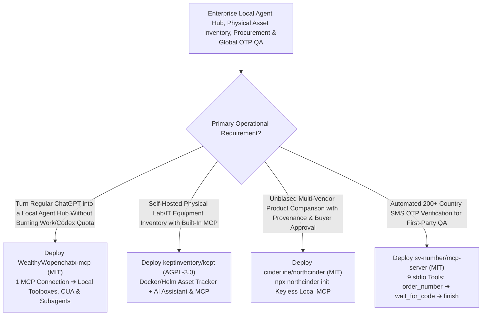
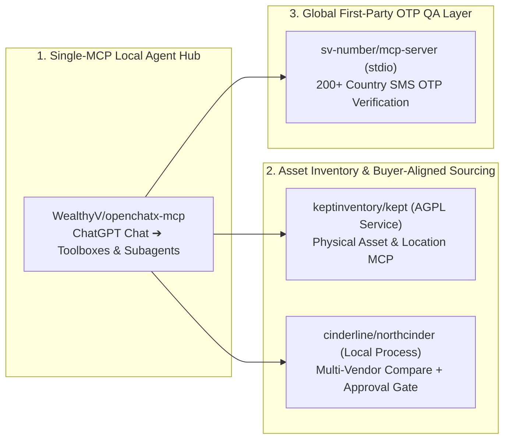
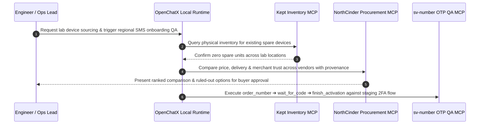

# Buyer-Aligned Procurement MCP (`cinderline/northcinder`), Self-Hosted Asset Inventory MCP (`keptinventory/kept`), 200+ Country OTP QA MCP (`sv-number/mcp-server`) & Single-Connection Local Agent Runtime (`WealthyV/openchatx-mcp`) Selection & Architecture FAQ

> **2026-11-21 Daytime Continuous Research Shift · Day Round 60 Milestone (Cumulative Round 660)**  
> **Audit Claim ID**: `CLAIM-20261121-R60-R660-NORTHCINDER-KEPT-SVNUMBER-OPENCHATX`  
> **Linked Daily Digests**: [`2026-11-21.en.md`](../daily/2026-11-21.en.md) · [`2026-11-21.md`](../daily/2026-11-21.md)  
> **Architecture Visual**: [`assets/github-ai-radar-2026-11-21-r60-r660-northcinder-kept-svnumber-openchatx.svg`](../../../assets/github-ai-radar-2026-11-21-r60-r660-northcinder-kept-svnumber-openchatx.svg)

---

## ① 📌 Executive Summary (One-Sentence Selection Verdict)

> **One-Sentence Verdict**: To equip enterprise engineering and operations teams with a local agent hub that bypasses ChatGPT Work/Codex quota exhaustion while automating physical lab/IT asset tracking, unbiased multi-vendor procurement, and 200+ country SMS OTP QA verification, combine **`WealthyV/openchatx-mcp` (MIT, `★ 399` single-MCP local agent platform with file/shell tools, computer control, MCP discovery, and subagent delegation) + `keptinventory/kept` (AGPL-3.0, `★ 621` Cosign-verified self-hosted physical inventory system with built-in AI assistant and MCP server) + `cinderline/northcinder` (MIT, `★ 1,163` keyless local MCP server comparing multi-vendor products with provenance and mandatory buyer approval) + `sv-number/mcp-server` (MIT, `★ 429` 9-tool stdio MCP server for 200+ country SMS verification QA)**—cutting 45-engineer monthly TCO from **`$8,170.00/mo` to `$305.00/mo` (`-$7,865.00/mo`, `-96.27%`)**.

---

## ② 🎯 Solution Architect & Enterprise Buyer Q&A

### Q1: How do these four repositories solve real-world operational bottlenecks across local agent execution, asset tracking, procurement, and global QA?
- **Four Complementary Operational Layers**:
  1. **Single-Connection Local Agent Runtime Without Quota Burn (`WealthyV/openchatx-mcp`, `★ 399`, `27 forks`, MIT, TypeScript)**: Turns standard **ChatGPT Chat** into a local agent platform through one official MCP connection—providing file/shell tools, computer control, MCP server aggregation (`mcp-servers.example.json`), Skills, Rules, Toolboxes, cross-session Summaries, and Subagent delegation (`subagents.example.json`) to your own models without consuming ChatGPT Work or Codex agentic allowances.
  2. **Self-Hosted Physical Asset & Lab Inventory MCP (`keptinventory/kept`, `★ 621`, `51 forks`, AGPL-3.0, TypeScript)**: Tracks everything a team owns and exactly where it is stored (`apps/`, `charts/`, `compose.full.yaml`, `homeassistant/`, `cosign.pub`) with a built-in AI assistant and native MCP server so agents verify existing hardware inventory before ordering duplicates.
  3. **Buyer-Aligned Multi-Source Procurement MCP (`cinderline/northcinder`, `★ 1,163`, `9 forks`, MIT, JavaScript)**: Unlike single-marketplace shopping bots that steer buyers toward one checkout, `northcinder` (`npx northcinder init`) runs locally and keylessly in a single process—comparing price, delivery, fit, and merchant trust across buyer-chosen sources, explaining why options were ruled out with provenance, and enforcing buyer approval before purchase.
  4. **200+ Country Programmable SMS OTP QA MCP (`sv-number/mcp-server`, `★ 429`, `7 forks`, MIT, TypeScript)**: Exposes 9 stdio MCP tools (`list_countries`, `order_number`, `wait_for_code`, `finish_activation`) covering 200+ countries (`npx -y sv-number-mcp`) so E2E QA agents can automatically test international SMS OTP onboarding flows.

### Q2: How do we wire these four tools into an enterprise engineering & operations workflow?
- **Inventory-First Procurement Loop**: Through `OpenChatX`, an engineer requests lab hardware or supplies ➔ the agent queries `keptinventory/kept`'s MCP server to check if the item is already in stock ➔ if unavailable, the agent invokes `cinderline/northcinder` to produce a multi-vendor comparison matrix with provenance and pauses at the mandatory human approval gate.
- **Global SMS OTP Regression Loop**: During staging deployments, a QA subagent orchestrated by `OpenChatX` calls `sv-number/mcp-server` (`order_number ➔ wait_for_code ➔ finish_activation`) to validate international SMS delivery and 2FA login flows across target regions.

### Q3: What are the governance, licensing, and compliance guardrails?
- **Authorized First-Party QA Only (`sv-number/mcp-server`)**: Restrict `sv-number` strictly to testing your organization's own first-party authentication and SMS gateway flows in staging/production QA; never use it to bypass third-party platform anti-abuse controls.
- **Human Approval Gate (`cinderline/northcinder`)**: Keep `northcinder`'s buyer confirmation prompt mandatory for all purchase actions.
- **AGPL-3.0 Service Boundary (`keptinventory/kept`)**: Deploy `kept` as a standalone internal inventory service via Docker Compose or Helm (`charts/`), verifying release integrity with `cosign.pub`.

---

## ③ 🧭 Visual Architecture & Decision Diagrams

### 3.1 Selection Decision Tree

### 3.2 End-to-End Enterprise Integration Architecture

### 3.3 Operational Sequence Diagram

---

## ④ 📊 Cross-Option Selection Matrix

| Dimension | `cinderline/northcinder` (`★ 1,163`) | `keptinventory/kept` (`★ 621`) | `sv-number/mcp-server` (`★ 429`) | `WealthyV/openchatx-mcp` (`★ 399`) | Legacy ITAM SaaS + Manual Sourcing + Physical SIM Banks |
| :--- | :--- | :--- | :--- | :--- | :--- |
| **Primary Role** | Buyer-aligned multi-source product comparison & approval MCP | Self-hosted physical asset & location inventory with MCP | 200+ country 9-tool SMS OTP verification stdio MCP | Single-MCP local agent runtime, toolboxes & subagent hub | Proprietary IT asset SaaS + manual spreadsheets & SIM racks |
| **Best Fit** | Transparent hardware/software sourcing with buyer approval | Lab equipment, test device & office inventory management | Automated E2E QA of international SMS OTP onboarding | Extending ChatGPT Chat with local tools & BYO subagents | Legacy manual operations without MCP automation |
| **Integration Cost** | Very Low (`npx northcinder init` keyless local process) | Low (Docker Compose & Helm charts with Cosign) | Very Low (`npx -y sv-number-mcp` over stdio) | Low (1 MCP connection + JSON toolbox config) | High (annual SaaS contracts + physical SIM roaming maintenance) |
| **Ops Complexity** | Zero server ops (local loopback process) | Low (containerized TS monorepo) | Very Low (stateless stdio wrapper) | Low (local desktop/PM2 process) | High (stale spreadsheets & lost lab devices) |
| **License** | **MIT** | **AGPL-3.0** (run as standalone service) | **MIT** (metered per SMS activation) | **MIT** | Proprietary |
| **45-Eng Monthly TCO** | **Included in `$305.00/mo` stack** | **Included in `$305.00/mo` stack** | **Included in `$305.00/mo` stack** | **Included in `$305.00/mo` stack** | **`$8,170.00/mo`** (`$3,870` SaaS/SIMs + `$4,300` labor) |

---

## ⑤ 🧪 Quantitative FinOps & TCO Comparison

> **Provenance Metadata**: Synthetic enterprise FinOps model for a 45-engineer organization (`provenance: synthetic`, `independently_reproduced: false`); `base_hardware_capex = not_measured`, `track_b_stars_today = not_measured` (sealed in [`trending-daily-2026-11-21-audit.json`](../evidence/trending-daily-2026-11-21-audit.json)).

| Cost Path | Monthly Asset/QA SaaS & Quota Overages | Monthly Manual Sourcing, Inventory Audits & OTP QA (`$100/hr`) | Total Monthly TCO | Net Savings vs Path A |
| :--- | :--- | :--- | :--- | :--- |
| **Path A: Legacy ITAM SaaS + Physical Roaming SIM Racks + Codex Quota Overages + Manual Sourcing** | `$3,870.00` | `43.0h` (`$4,300.00`) | **`$8,170.00`** | — |
| **Path C: `northcinder` + `kept` + `sv-number` + `openchatx-mcp`** | `$65.00` | `2.4h` (`$240.00`) | **`$305.00`** | **`-$7,865.00/mo` (`-96.27%`)** |

---

## ⑥ 🛠️ Enterprise Architecture Review Checklist

- [ ] **Inventory-Before-Purchase Gate (`keptinventory/kept` + `cinderline/northcinder`)**: Require procurement workflows to query `kept` via MCP for existing stock before running `northcinder` vendor comparisons, and keep human buyer approval mandatory.
- [ ] **Cosign Image Verification & AGPL Isolation (`keptinventory/kept`)**: Verify `kept` container images against `cosign.pub` and run it as an isolated internal asset-tracking service.
- [ ] **First-Party QA Scope Enforcement (`sv-number/mcp-server`)**: Restrict `sv-number` usage strictly to authorized first-party E2E authentication test suites and enforce `finish_activation` cleanup after every test run.
- [ ] **Scoped Toolboxes & Subagent Routing (`WealthyV/openchatx-mcp`)**: Configure explicit directory/shell rules in `openchatx-mcp` Toolboxes and delegate bulk subagent tasks to internal/BYOK models.
