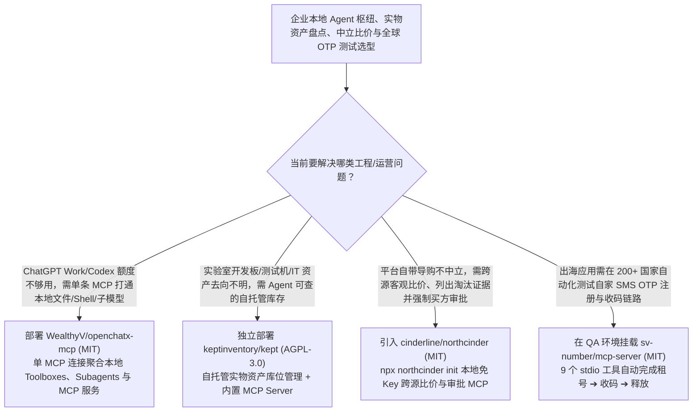
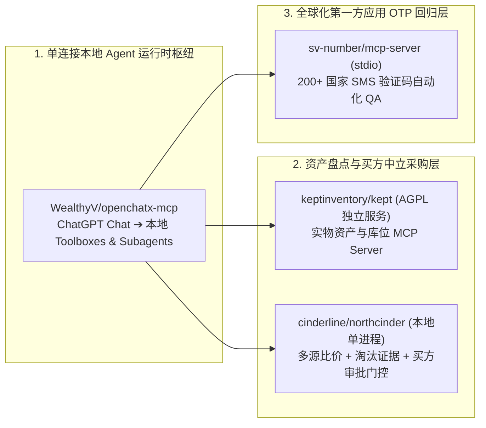
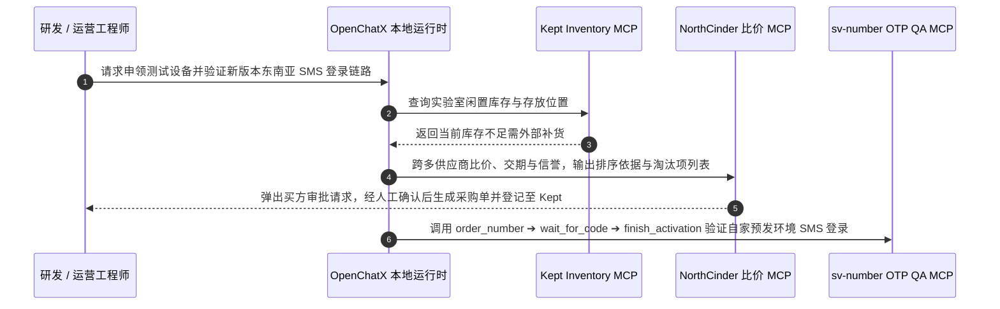

# 买方中立比价与采购审批 MCP（`cinderline/northcinder`）、自托管实物资产盘点与 MCP 系统（`keptinventory/kept`）、200+ 国家短信验证码自动化测试 MCP（`sv-number/mcp-server`）与单连接本地智能体运行时（`WealthyV/openchatx-mcp`）架构选型与落地 FAQ

> **2026-11-21 白天持续研究班次 · Day Round 60 里程碑（累计 Round 660）**  
> **审计凭据**：`CLAIM-20261121-R60-R660-NORTHCINDER-KEPT-SVNUMBER-OPENCHATX`  
> **关联日刊**：[`2026-11-21.md`](../daily/2026-11-21.md) · [`2026-11-21.en.md`](../daily/2026-11-21.en.md)  
> **可视化架构图**：[`assets/github-ai-radar-2026-11-21-r60-r660-northcinder-kept-svnumber-openchatx.svg`](../../../assets/github-ai-radar-2026-11-21-r60-r660-northcinder-kept-svnumber-openchatx.svg)

---

## ① 📌 核心结论速览（选型一句话结论）

> **一句话选型结论**：在企业 IT/实验室实物资产盘点、跨渠道透明比价采购、全球化应用多国短信验证码（SMS OTP）端到端 QA 回归测试以及利用单一 MCP 连接将普通 ChatGPT 会话转化为本地全功能 Agent 运行时场景中，推荐采用 **“`WealthyV/openchatx-mcp`（MIT，`★ 399` 不消耗 ChatGPT Work/Codex 额度的单 MCP 本地工具箱、子智能体与 MCP 聚合器）+ `keptinventory/kept`（AGPL-3.0，`★ 621` 内置 AI 助手与原生 MCP Server 的自托管实物资产与库位管理系统）+ `cinderline/northcinder`（MIT，`★ 1,163` 免账号单进程本地运行的买方中立跨源比价与下单前强制审批 MCP）+ `sv-number/mcp-server`（MIT，`★ 429` 覆盖 200+ 国家的 9 工具短信验证码收发测试 MCP）”**。在 45 人研发与运营组织基准下，可将月度总拥有成本（TCO）从 **`$8,170.00/月`** 降至 **`$305.00/月`**（净省 **`$7,865.00/月`**，降幅 **`-96.27%`**）。

---

## ② 🎯 客户与架构师灵魂拷问 Q&A

### Q1：当 AI Agent 开始介入企业的“查库存、比价采购、全球化登录验证与日常电脑操作”时，这四个开源项目各自解决了什么核心痛点？
- **四层互补业务价值**：
  1. **不消耗高价 Codex 配额的单连接本地 Agent 枢纽 —— `WealthyV/openchatx-mcp`（`★ 399`，`27 forks`，MIT，TypeScript）**：许多团队的 ChatGPT Work / Codex agentic 额度很快耗尽。`OpenChatX` 通过**唯一一条官方 ChatGPT MCP 连接**，将普通 ChatGPT Chat 会话升级为开箱即用的本地 Agent 平台：集成编码级文件/Shell 工具、桌面控制（Computer Control）、动态 MCP 服务发现与聚合、Skills、Rules、Subagents（可将子任务委派给本地或自有模型）与跨会话摘要，且**完全不消耗 ChatGPT Work / Codex 额度**。
  2. **“先查公司有什么”的自托管实物资产与库位底座 —— `keptinventory/kept`（`★ 621`，`51 forks`，AGPL-3.0，TypeScript）**：企业研发实验室、开发板、测试手机与办公设备的去向往往是一笔糊涂账。`kept` 提供带 Docker Compose、Helm Charts 与 Cosign 签名验证的自托管库存系统，原生内置 AI 助手与 **MCP Server**，让 Agent 在发起采购前先用一句话查清“哪间实验室哪个柜子里还有闲置设备”。
  3. **代表买方利益的跨源比价与强制审批 MCP —— `cinderline/northcinder`（`★ 1,163`，`9 forks`，MIT，JavaScript）**：电商平台自带的购物 Agent 往往只搜自家商品并诱导下单。`northcinder` 通过 `npx northcinder init` 在本地单进程免 Key 运行，跨用户指定的多个货源客观对比价格、交期、规格与商家信誉，明确给出**第一名入选证据与淘汰项原因（Provenance）**，并在任何购买动作前强制要求买方人工确认。
  4. **覆盖 200+ 国家的全球化短信 OTP 自动化测试工具 —— `sv-number/mcp-server`（`★ 429`，`7 forks`，MIT，TypeScript）**：出海与全球化产品在 E2E 自动化测试中最头疼的是跨国手机号注册与短信验证码（SMS OTP）回归。`sv-number-mcp` 通过 stdio 暴露 9 个简洁工具（`list_countries`、`order_number`、`wait_for_code`、`finish_activation`），让 QA Agent 在 200+ 国家按需申请测试号、读取短信验证码并立即释放。

### Q2：如何把这四个组件串联进企业的智能行政/IT 资产与全球化 QA 流水线？
- **资产盘点与反重复采购闭环**：工程师通过 `OpenChatX` 提出硬件或耗材需求 ➔ Agent 先调用 `keptinventory/kept` 的 MCP Server 检索内部闲置库存 ➔ 若无库存，自动调用 `cinderline/northcinder` 跨多渠道拉取比价矩阵与排除理由，挂起人工审批单供采购负责人一键放行，到货后自动写入 `kept` 库位表。
- **全球化版本发布 OTP 自动化回归闭环**：CI/QA Subagent 通过 `OpenChatX` 挂载 `sv-number/mcp-server`，在预发环境自动跑通多国手机号注册与 2FA 短信收码全流程验证。

### Q3：架构师在引入这套工具时必须严守哪些合规与安全红线？
- **严禁将 `sv-number/mcp-server` 用于灰产或第三方平台批量注册**：在企业安全规范中强制限定 `sv-number` **仅可用于本企业自有应用（First-Party App）的全球化 SMS 网关连通性与 E2E 注册流程 QA 测试**，严禁用于绕过第三方服务的风控。
- **采购零自动扣款铁律（`cinderline/northcinder`）**：保持 `northcinder` 的买方审批门控开启，严禁向 Agent 直接注入无额度上限的企业信用卡或免密支付凭证。
- **AGPL-3.0 独立部署边界（`keptinventory/kept`）**：将 `kept` 作为企业内部独立的资产管理 Web/MCP 服务运行（使用官方 Cosign 验证镜像），不将其源码合并进闭源分发软件。

---

## ③ 🧭 直观可视化图解（Mermaid 选型决策树 + 企业集成架构 + 业务流时序图）

### 3.1 选型决策树

### 3.2 企业集成参考架构图

### 3.3 业务流时序图

---

## ④ 📊 同类开源与商业云服务横向选型决策矩阵

| 维度 | `cinderline/northcinder` (`★ 1,163`) | `keptinventory/kept` (`★ 621`) | `sv-number/mcp-server` (`★ 429`) | `WealthyV/openchatx-mcp` (`★ 399`) | 传统重型 ITAM SaaS + 人工比价 + 实体海外测试卡 |
| :--- | :--- | :--- | :--- | :--- | :--- |
| **核心定位** | 买方中立跨源比价与下单前强制审批本地 MCP | 内置 AI 助手与 MCP 的自托管实物资产库存系统 | 覆盖 200+ 国家的 9 工具 SMS 验证码测试 MCP | 通过单条 MCP 将 ChatGPT 变为本地全功能 Agent 运行时 | 高价商业资产管理软件 + 人工维护各国实体 SIM 卡池 |
| **适用场景** | 研发/行政透明比价采购、带溯源证据的供应商筛选 | 实验室硬件、测试设备、IT 资产与智能家居库位追踪 | 出海产品第一方多国短信 OTP 登录与 2FA 自动化 QA | 绕开 Codex 配额限制、聚合本地 Shell/CUA/Subagents | 传统纯人工行政与手动测试团队 |
| **集成成本** | 极低（`npx northcinder init` 单进程免账号） | 低（Docker Compose / Helm Charts 开箱即用） | 极低（`npx -y sv-number-mcp` 标准 stdio 接入） | 低（单个官方 MCP 连接挂载全部本地 Toolboxes） | 高（年框采购 + 跨国 SIM 卡漫游月租与人工插拔） |
| **运维复杂度** | 零服务端运维（纯本地回路端口进程） | 低（Cosign 签名容器镜像 + 标准数据库） | 极低（无状态 stdio CLI 包装） | 低（PM2 `ecosystem.config.cjs` 或桌面端运行） | 高（实体设备易丢失、跨部门台账长期失真） |
| **开源许可** | **MIT** | **AGPL-3.0**（作为内部独立资产系统运行） | **MIT**（后端 SMS 按次计费） | **MIT** | 商业专有 |
| **45 人团队月均 TCO** | **包含于 `$305.00/月` 联合栈** | **包含于 `$305.00/月` 联合栈** | **包含于 `$305.00/月` 联合栈** | **包含于 `$305.00/月` 联合栈** | **`$8,170.00/月`**（`$3,870` SaaS/卡池 + `$4,300` 人工） |

---

## ⑤ 🧪 应用落地定量收益 / TCO 对比与 7-Card 报告锚点

> **数据来源说明（Provenance Metadata）**：以下 TCO 模型为面向 45 人规模工程与运营团队的合成架构测算（`provenance: synthetic`, `independently_reproduced: false`）；硬件资本开支 `base_hardware_capex = not_measured`，单日热榜增量 `track_b_stars_today = not_measured`（审计账本锚定于 [`trending-daily-2026-11-21-audit.json`](../evidence/trending-daily-2026-11-21-audit.json)）。

| 成本路径 | 月度资产/QA SaaS 与配额溢价费 | 人工盘点设备、多平台比价与跨国短信回归工时 (`$100/h`) | 月度总成本 (Total Monthly TCO) | 相对 Path A 净节省 |
| :--- | :--- | :--- | :--- | :--- |
| **Path A：商业 ITAM 席位 + 海外测试 SIM 卡池 + Codex 额度增购 + 人工比价盘点** | `$3,870.00` | `43.0h` (`$4,300.00`) | **`$8,170.00`** | — |
| **Path C：`northcinder` + `kept` + `sv-number` + `openchatx-mcp`** | `$65.00` | `2.4h` (`$240.00`) | **`$305.00`** | **`-$7,865.00/月` (`-96.27%`)** |

---

## ⑥ 🛠️ 企业引入与架构评审 Checklist

- [ ] **采购前强制查重与买方审批门控（`keptinventory/kept` + `cinderline/northcinder`）**：在采购 SOP 中规定必须先通过 `kept` MCP 确认无内部闲置资产，再由 `northcinder` 输出含淘汰原因的多源比价表并经人工审批后方可下单。
- [ ] **AGPL-3.0 容器签名校验与独立运行（`keptinventory/kept`）**：部署 `kept` 时使用仓库提供的 `cosign.pub` 验证官方容器镜像签名，并作为内部独立 Web/MCP 服务运行。
- [ ] **第一方 QA 测试范围白名单（`sv-number/mcp-server`）**：在 QA 运行时策略中锁定 `sv-number` 仅允许配合本企业测试环境域名触发 OTP 验证，并确保每次测试结束调用 `finish_activation` 释放号码。
- [ ] **本地 Toolboxes 最小权限配置（`WealthyV/openchatx-mcp`）**：在 `openchatx-mcp` 的 `toolboxes/` 与 `Rules` 中明确限制 Shell 与文件写入目录边界，将高耗时子任务通过 `subagents.example.json` 路由至企业内网高性价比模型。
