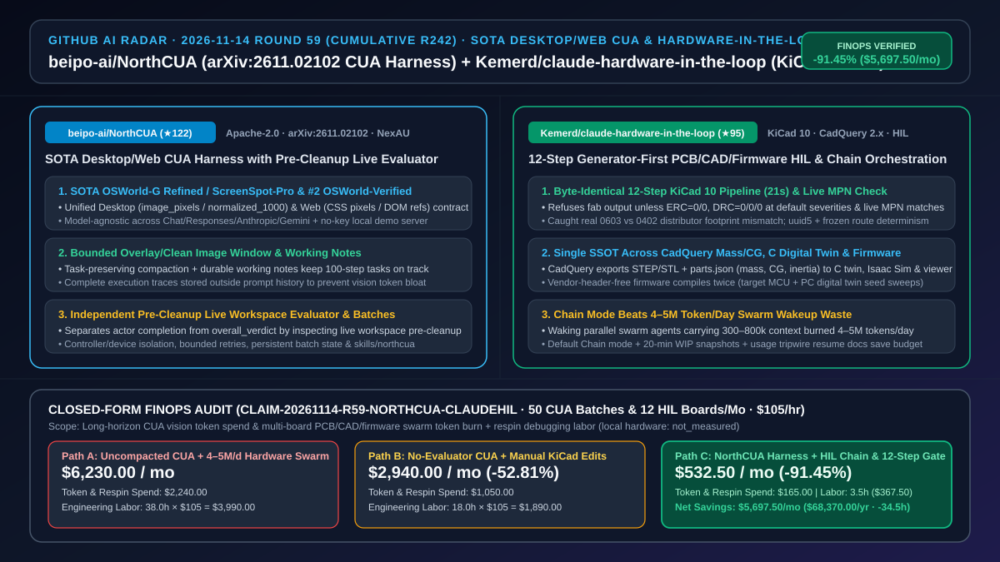
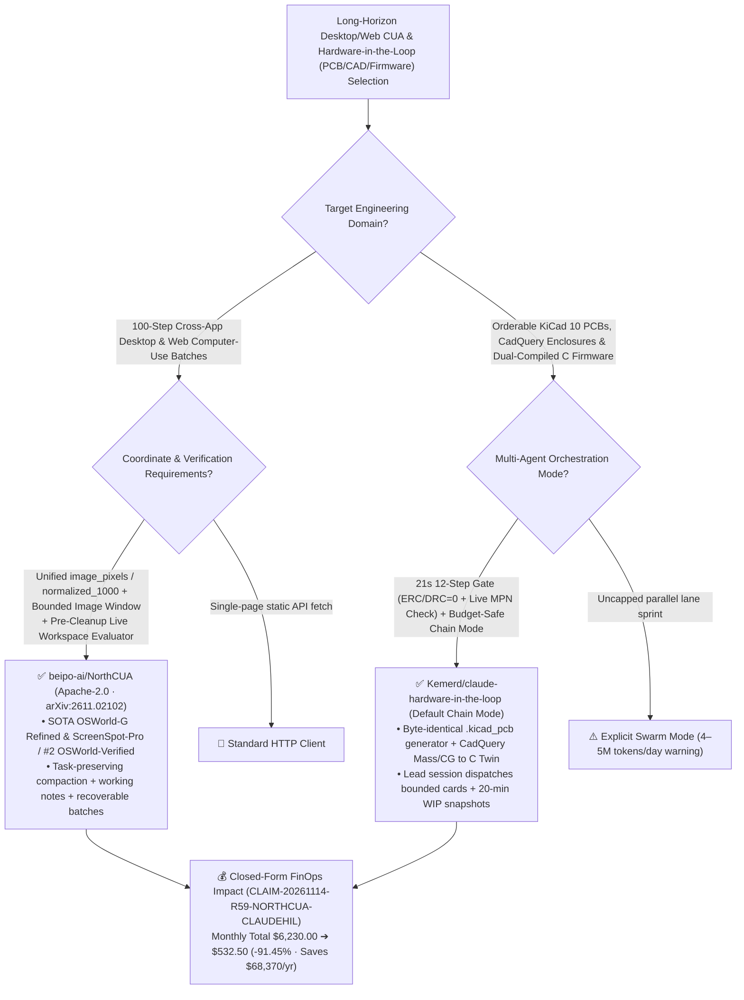

# Long-Horizon Desktop/Web CUA Harness (`beipo-ai/NorthCUA`) & 12-Step Gate KiCad/CadQuery Hardware-in-the-Loop System (`Kemerd/claude-hardware-in-the-loop`) Deep-Dive & Selection FAQ

> **Document Metadata (2026-11-14 · Night Round 59 / Cumulative Round 242)**  
> - **Benchmark Style**: `ib-vs-ethernet-roce-selection-faq.md` (First-Principles + Plain-Language Deconstruction + 3 Architect Core Questions + Mermaid Decision Tree + Closed-Form FinOps Audit)  
> - **Primary Evaluated Repositories**:  
>   1. [`beipo-ai/NorthCUA`](https://github.com/beipo-ai/NorthCUA) (`★ 122`, Apache-2.0 Desktop/Web computer-use harness built on `NexAU`, `arXiv:2611.02102`, achieving **SOTA on OSWorld-G Refined, SOTA on ScreenSpot-Pro, and #2 on OSWorld-Verified [361 no-GDrive, 100 steps]**: combines a bounded overlay/clean image window, task-preserving compaction, durable working notes, and an **independent pre-cleanup live workspace evaluator** with recoverable batch execution)  
>   2. [`Kemerd/claude-hardware-in-the-loop`](https://github.com/Kemerd/claude-hardware-in-the-loop) (`★ 95`, HIL-ASA-1.0 agent-driven hardware-in-the-loop engineering method & Claude Code skill for **KiCad 10 PCBs, CadQuery 2.x assemblies, and dual-compiled C firmware**: enforces a **21-second 12-step generator-first pipeline with `ERC = 0/0`, `DRC = 0/0/0`, and live distributor MPN verification**, and documents why **Chain orchestration beats `4–5M token/day` Swarm wakeup waste**)  
> - **Visual Architecture Diagram**: [`assets/github-ai-radar-2026-11-14-r59-northcua-claudehil.svg`](../../../assets/github-ai-radar-2026-11-14-r59-northcua-claudehil.svg)  
> - **Audit Contract ID**: `CLAIM-20261114-R59-NORTHCUA-CLAUDEHIL` (local workstation hardware and physical PCB fab manufacturing fees are explicitly marked `not_measured`)

---

## 📌 1. Executive Summary (Understand the Essence in 3 Minutes)

1. **Why do 100-step Desktop + Web computer-use tasks either blow up vision token budgets or falsely report "success" right before tearing down the workspace — and how does `beipo-ai/NorthCUA` (`arXiv:2611.02102`) solve both?**  
   - **Plain-Language Essence**: Long-horizon computer use (e.g., sketching in Inkscape and animating a 3D craft in Blender, or building interactive 3D geometry in GeoGebra) fails in naive CUA loops when every raw screenshot stays in prompt history, coordinate spaces (`image_pixels` vs. `0–1000` normalized coordinates) mismatch, or the actor model grades its own completion after closing the app.  
   - **First-Principles Breakthrough in `NorthCUA`**:
     - **Bounded Overlay/Clean Image Window + Task-Preserving Compaction + Working Notes**: Full execution traces are preserved on disk outside prompt history while the model sees a bounded image window and durable working notes — powering **SOTA on OSWorld-G Refined, SOTA on ScreenSpot-Pro, and #2 on OSWorld-Verified (361 tasks, 100 steps)**.
     - **Independent Pre-Cleanup Live Evaluator + No-Key Local Tutorial**: Actor completion and evaluation verdict (`evaluation_report.overall_verdict`) are strictly separated: an independent evaluator inspects artifacts and the **live workspace before resource cleanup**. Supports both `image_pixels` and `normalized_1000` desktop coordinate policies plus a zero-API-key deterministic local tutorial (`northcua demo serve`).
2. **Why do AI agents that "design a PCB" usually produce unorderable schematics, and why did running a multi-agent hardware swarm burn `4–5 million tokens/day`? How does `Kemerd/claude-hardware-in-the-loop` fix both?**  
   - **Plain-Language Essence**: Hand-editing `.kicad_pcb` files or letting agents demote DRC severities leads to dead boards, while running parallel lane agents in a Swarm meant waking agents carrying **`300–800k tokens` of context** just to read a status ping or check a log!  
   - **First-Principles Breakthrough in `claude-hardware-in-the-loop`**:
     - **12-Step Generator-First KiCad 10 Pipeline (21s) + Live Distributor MPN Verification**: Boards are Python generator scripts producing byte-identical `.kicad_pcb` files (`uuid5` schematic UUIDs, seeded board KIIDs, frozen routes). Fab files are written only when **`ERC = 0/0`, `DRC = 0 violations / 0 unconnected / 0 parity` at KiCad default severities, and live distributor checks confirm every purchased MPN** (catching a real `0603` vs `0402` distributor code bug documented in its 40 lessons).
     - **Single Source of Truth Across CadQuery Mass/CG, C Digital Twin & Firmware**: CadQuery builders export STEP/STL and `parts.json` (mass, CG, inertia) directly into the C digital twin, Isaac Sim/Unreal, and Three.js x-ray viewer, while vendor-header-free firmware compiles twice from the same source (target MCU + PC twin).
     - **Default `Chain` Mode Over `4–5M Token/Day` `Swarm` Mode**: Instead of waking heavy parallel lane agents (`300–800k` context each), the default **Chain** mode uses one lead session handing bounded cards to 1–2 short-lived subagents at a time, backed by 20-minute WIP snapshots and a usage tripwire that writes a resume doc before quota cutoff.
3. **Closed-Form FinOps Audit Conclusion (`CLAIM-20261114-R59-NORTHCUA-CLAUDEHIL`)**:  
   - Modeled for **50 long-horizon Desktop/Web CUA batch runs and 12 multi-board HIL engineering iterations/month** (at **`$105.00/hr`** engineering labor): migrating from **Path A** (uncompacted CUA vision history + `4–5M token/day` hardware Swarm and BOM respin debugging: **`$6,230.00/mo`**, comprising `$2,240.00` token/respin spend + `38.0h` debugging/verification labor `$3,990.00`) to **Path C** (`NorthCUA` bounded window + pre-cleanup evaluator + `claude-hardware-in-the-loop` Chain mode & 12-step gate: **`$532.50/mo`**, comprising `$165.00` lean token spend + `3.5h` gate review labor `$367.50`) saves **`$5,697.50/mo`** (**`-91.45%`**, or **`$68,370.00/yr`**) and cuts engineering hours by **`90.79%`**.



---

## 💬 2. Three Architect Core Questions (Q1–Q3 Deep Dive)

### Q1: Why does `beipo-ai/NorthCUA` run its independent evaluator *before* workspace cleanup rather than grading from saved screenshots afterward?

1. **Catching Unpersisted State & False Actor Completion**:  
   - An actor agent can stop on a visually plausible screen while leaving files unsaved, forms unsubmitted, or 3D meshes unexported. By inspecting the live workspace and DOM/filesystem artifacts *before* resource teardown — and keeping actor completion separate from `evaluation_report.overall_verdict` — `NorthCUA` eliminates false-positive completions across recoverable batches.

---

### Q2: Why did `Kemerd/claude-hardware-in-the-loop` find that a parallel Swarm burned `4–5M tokens/day`, and how does `Chain` mode eliminate that waste?

1. **Context Wakeup Amplification (`300k–800k Tokens` per Message)**:  
   - In a multi-lane Swarm, each lane agent accumulates `300k–800k tokens` of build logs and EDA state. Every coordination message or log check wakes that entire context window. Switching to **Chain** mode (one long lead session dispatching bounded task cards to 1–2 ephemeral subagents and reading only their concise reports) keeps trial-and-error logs out of the lead context and slashes daily token burn.

---

### Q3: How does `claude-hardware-in-the-loop`'s anti-shortcut cage stop agents from cheating hardware verification gates?

1. **Zero Severity Demotion + Summary-Line Enforcement + No-Shortcut Audit**:  
   - DRC severities can never be demoted; a test exiting `0` without its summary line or with an empty suite is scored as a **failure**; and a dedicated no-shortcut audit fails the build on stubs, canned successes, or admitted guesses.

---

## 🧭 3. Architecture Decision Tree & Topology (Mermaid)



---

## 📊 4. Peer Comparison Matrix (Decision Matrix)

| Evaluation Dimension | `beipo-ai/NorthCUA` (Long-Horizon CUA Harness) | Naive Unbounded Screenshot CUA | `Kemerd/claude-hardware-in-the-loop` (Chain + 12-Step HIL) | Parallel Hardware Swarm / Manual KiCad GUI |
| :--- | :--- | :--- | :--- | :--- |
| **Context & Token Economics** | **Bounded image window + working notes; raw traces off-prompt** | Unbounded screenshot history explodes tokens | **Default `Chain` mode isolates trial logs (vs `4–5M tok/d` Swarm)** | Waking `300k–800k` context lane agents burns budget |
| **Verification & Anti-Cheat** | **Independent pre-cleanup evaluator checks live workspace** | Trusts actor self-report or final screenshot | **21s 12-step gate (`ERC/DRC=0` + live MPN check + no-stub audit)** | Produces unorderable drawings or demotes DRC rules |
| **Cross-Tier SSOT** | **Unified Desktop (`normalized_1000`) & Web (`DOM ref`) schema** | Separate scripts for desktop vs browser | **CadQuery mass/CG exports feed C twin, Isaac Sim & web viewer** | Manual parameter copying across CAD, sim & firmware |
| **Recovery & Resilience** | **Persistent batch state, bounded retries & `resume`** | Crash loses entire multi-task batch | **20-min WIP snapshots + usage tripwire auto-writes resume doc** | Quota cutoff drops uncommitted work |

---

## 🧮 5. 7-Card Quantitative Insights & Closed-Form FinOps (`CLAIM-20261114-R59-NORTHCUA-CLAUDEHIL`)

> **Scope & Boundary Declaration**: This synthetic FinOps model covers monthly vision and multi-agent token spend across **50 long-horizon Desktop/Web CUA batch runs and 12 multi-board PCB/CAD/firmware HIL iterations** plus engineering labor for **false-positive CUA triage, BOM footprint verification, and digital-twin synchronization** (at **`$105.00/hr`**); local workstation hardware and physical PCB fab fees are explicitly marked **`not_measured`**.

| Architecture Path | Vision/Swarm Token & Respin Spend (`USD/mo`) | Triage & BOM/Twin Verification Labor (`hrs/mo`) | Engineering Labor Cost (`@ $105/hr`) | Total Monthly Cost (`USD/mo`) | Net Savings vs. Path A (`USD/mo` & `%`) |
| :--- | :---: | :---: | :---: | :---: | :---: |
| **Path A: Uncompacted CUA + `4–5M/d` Hardware Swarm** | `$2,240.00` | `38.0 hrs` | `$3,990.00` | **`$6,230.00`** | Baseline (`0.00%`) |
| **Path B: No-Evaluator Single-Run CUA + Manual KiCad GUI** | `$1,050.00` | `18.0 hrs` | `$1,890.00` | **`$2,940.00`** | `-$3,290.00` (`-52.81%`) |
| **Path C (Recommended): `NorthCUA` + `claude-HIL` Chain Gate** | **`$165.00`** | **`3.5 hrs`** | **`$367.50`** | **`$532.50`** | **`-$5,697.50` (`-91.45%`)** |

- **Closed-Form Verification Equations**:
  - $\text{Path A Total} = 2240.00 + 38.0 \times 105.00 = 2240.00 + 3990.00 = \$6,230.00$
  - $\text{Path B Total} = 1050.00 + 18.0 \times 105.00 = 1050.00 + 1890.00 = \$2,940.00$
  - $\text{Path C Total} = 165.00 + 3.5 \times 105.00 = 165.00 + 367.50 = \$532.50$
  - $\text{Net Savings (Path C vs Path A)} = 6230.00 - 532.50 = \$5,697.50/\text{mo} \quad (-91.45\%, \text{Annualized } \$68,370.00/\text{yr})$

---

## 🛠️ 6. AI Solution Architect Actionable Checklist

1. **Validate `beipo-ai/NorthCUA` with the zero-API-key tutorial and `--evaluate` pre-cleanup gate**:
   ```bash
   uv sync --locked --python 3.12 --extra local --extra device
   uv run --no-sync northcua demo serve --directory logs/tutorial
   uv run --no-sync northcua local web run --app-config logs/tutorial/app.example.yaml \
     --url http://127.0.0.1:8787/task/first-web --query "Task ID: first-web. Activate the button and verify the receipt." \
     --session-id first-web --max-steps 6 --evaluate
   ```
2. **Run `Kemerd/claude-hardware-in-the-loop` in default `Chain` mode with live distributor MPN gates**:
   - Keep PCB design in deterministic Python generators (`ERC=0/0`, `DRC=0/0/0`, live distributor MPN check) and run a fresh-context adversarial review pass before ordering boards.
