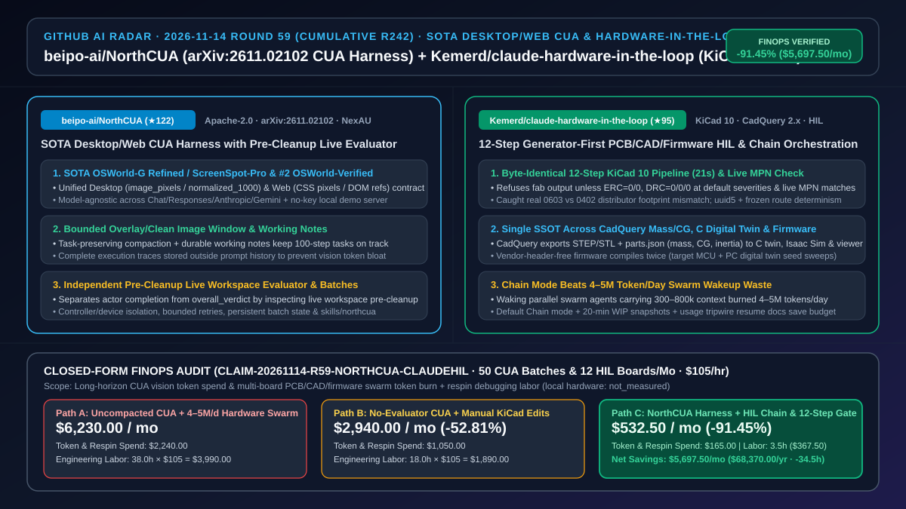
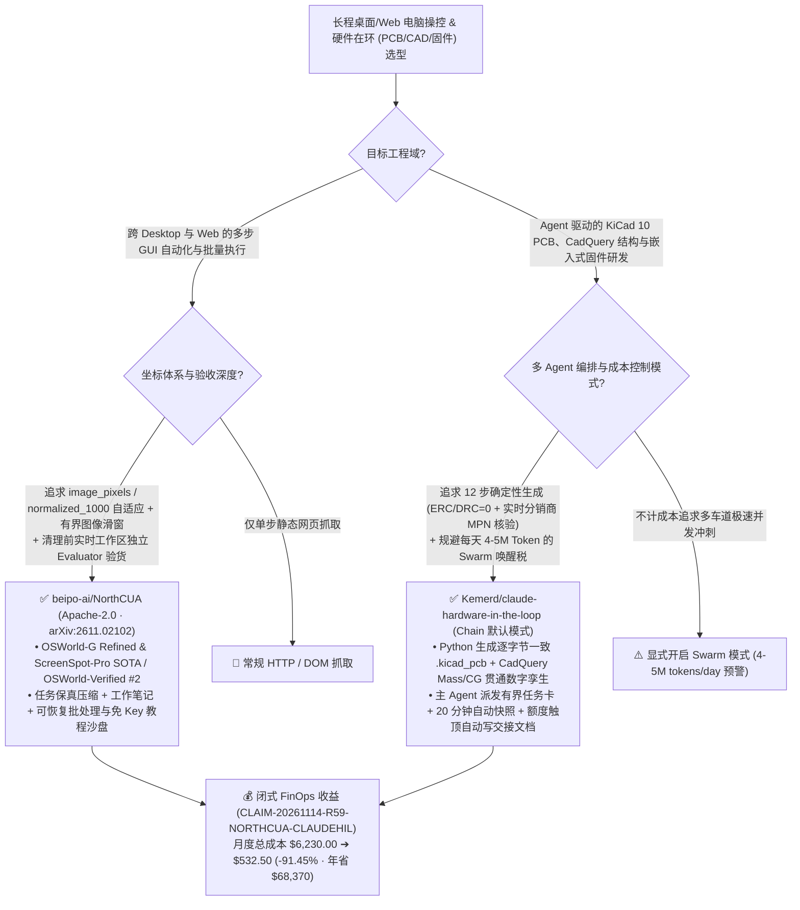

# 长程桌面/Web 电脑操控 Harness（`beipo-ai/NorthCUA`）与 12 步门禁 KiCad/CadQuery 硬件在环工程体系（`Kemerd/claude-hardware-in-the-loop`）深度拆解与选型 FAQ

> **文档元数据（2026-11-14 · 晚班 Round 59 / 累计 Round 242）**  
> - **对标范式**：`ib-vs-ethernet-roce-selection-faq.md`（第一性原理 + 大白话拆解 + 灵魂三问 + Mermaid 决策树 + 闭式 FinOps 核算）  
> - **核心评估对象**：  
>   1. [`beipo-ai/NorthCUA`](https://github.com/beipo-ai/NorthCUA)（`★ 122`，Apache-2.0 开源的跨桌面与 Web 电脑操控智能体 Harness，配套论文 `arXiv:2611.02102`，斩获 **OSWorld-G Refined SOTA、ScreenSpot-Pro SOTA 与 OSWorld-Verified (361 题 100 步) #2**：提供有界叠加/纯净图像窗口、保留任务目标的上下文压缩、工作笔记，以及**在销毁环境前直接审查实时工作区的独立评估器（Independent Pre-Cleanup Evaluator）**与可恢复批处理引擎）  
>   2. [`Kemerd/claude-hardware-in-the-loop`](https://github.com/Kemerd/claude-hardware-in-the-loop)（`★ 95`，面向 KiCad 10 PCB、CadQuery 2.x 结构件与双编译固件的硬件在环工程方法与 Claude Code Skill：通过 **12 步确定性生成管线（21 秒跑完，强制 `ERC 0/0`、`DRC 0/0/0` 与实时元器件分销商封装核验）** 杜绝废板，并从真实多板项目中总结出 40 条血泪教训——揭示 **“并行 Swarm 模式因唤醒携带 `300k–800k` 上下文的车道 Agent 每天烧掉 `4M–5M` Token，改用单主线 Chain 派发有界任务卡才是高性价比正解”**）  
> - **配套架构图**：[`assets/github-ai-radar-2026-11-14-r59-northcua-claudehil.svg`](../../../assets/github-ai-radar-2026-11-14-r59-northcua-claudehil.svg)  
> - **审计契约号**：`CLAIM-20261114-R59-NORTHCUA-CLAUDEHIL`（本地工作站硬件与 PCB 打样物理制板费标注为 `not_measured`）

---

## 📌 一、核心结论速览（Executive Summary：3 分钟读懂本质）

1. **为什么跑 100 步的跨软件电脑操控（如“从 Inkscape 画草图导入 Blender 建 3D 飞碟动画”或“GeoGebra 3D 建模”）在传统 CUA 框架里要么被历史截图撑爆 Token、要么在环境销毁后才发现根本没做对？`beipo-ai/NorthCUA` (`arXiv:2611.02102`) 怎么破局？**  
   - **通俗大白话**：长程电脑使用（Computer Use）有三大工程痛点：① 每一步都塞高清全屏截图，跑 30 步上下文就爆了；② 不同视觉模型有的输出真实像素坐标（`image_pixels`），有的输出 `0–1000` 归一化相对坐标（`normalized_1000`），混用时点击位置全偏；③ 执行器（Actor）自己报告“任务完成”然后把浏览器/虚拟机清理关掉了，事后一看产物是空的！  
   - **`NorthCUA` 的第一性原理破局**：
     - **有界图像窗口（Bounded Overlay/Clean Window）+ 任务保真压缩 + 工作笔记**：将完整原始轨迹保存在提示词历史之外，对话窗口只保留受控的标注图/原图滑窗与持久化工作笔记（Working Notes），支撑 100 步长程任务斩获 **OSWorld-G Refined 与 ScreenSpot-Pro 双料 SOTA 及 OSWorld-Verified #2**。
     - **清理前实时工作区独立裁判（Pre-Cleanup Live Evaluator）+ 零 Key 教程沙盘**：严格将“Actor 宣布做完”与“Evaluator 最终判词（`overall_verdict`）”拆开——独立评估器在环境清理（Cleanup）发生**之前**直接进入原始实时工作区与产物目录验货！同时原生支持 `image_pixels` / `normalized_1000` 坐标空间映射与免 API Key 的本地确定性演练服务（`northcua demo serve`）。
2. **为什么让 AI Agent 直接画 PCB 电路板和写嵌入式固件往往只能产出一张“不能打样的示意图”，而且开并行 Swarm 跑一天就烧掉 400 万–500 万 Token？`Kemerd/claude-hardware-in-the-loop` 怎么破局？**  
   - **通俗大白话**：硬件工程容错率为零——一个电阻封装从 `0402` 买成 `0603`，整批打样回来的板子就焊不上；而让 Agent 手改 `.kicad_pcb` 文件或为了省事把 DRC 报错级别调低，更是灾难。此外，很多团队迷信“拉起七八个常驻并行 Agent（Swarm）一起干”，结果每天账单爆炸。  
   - **`claude-hardware-in-the-loop` 的第一性原理破局**：
     - **代码生成一切（Generator-First）+ 21 秒 12 步铁血门禁 + 实时分销商料号（MPN）核验**：严禁手工编辑 `.kicad_pcb`；Python 脚本声明器件引脚表与网络，经 `uuid5` 原理图 UUID、固定种子 KIID 与冻结布线生成**逐字节可复现（Byte-Identical）**的 PCB；只有当 **KiCad 10 默认严苛度下 `ERC = 0/0`、`DRC = 0 违规 / 0 未连 / 0 不一致`，且每一行采购物料通过分销商实时接口核对封装无误**（实战中当场拦截了料号指向 `0603` 而非假设的 `0402` 事故！）时，管线才允许输出 JLCPCB 生产文件。
     - **CAD 质量/重心（Mass/CG）与双编译固件单一事实源（SSOT）**：CadQuery 结构脚本导出的 STEP/STL 与 `parts.json`（含质量、重心、转动惯量）自动喂给 C 语言数字孪生（Digital Twin）、Isaac Sim/Unreal 与 Three.js 剖面查看器；固件核心剥离厂商头文件，同一份 C 源码既编译进目标单片机，又编译到 PC 数字孪生体跑随机种子扫描。
     - **血泪账单祛魅：为什么默认用 `Chain` 替代 `4–5M Token/天` 的 `Swarm`？**：作者实测发现，并行 Swarm 每天烧掉 **`400 万–500 万 Token`**，其中绝大部分根本不是在干活，而是每次发消息或查日志都要**唤醒挂着 `300k–800k Token` 上下文的并行车道 Agent**！因此框架默认采用 **`Chain` 模式**（1 个长会话主 Agent 每次只派发有界任务卡给 1–2 个子 Agent，把报错试错日志挡在主上下文之外），辅以每 20 分钟自动快照与额度触顶前自动写交接文档（Usage Tripwire）。
3. **闭式 FinOps 审计结论（`CLAIM-20261114-R59-NORTHCUA-CLAUDEHIL`）**：  
   - 按每月运行 **50 批次长程跨端 CUA 自动化作业 + 12 轮多板 PCB/CAD/固件硬件在环迭代**（工程师时薪 **`$105.00/hr`**）核算：从“Path A：无滑窗全量塞截图 CUA + 每天 4–5M Token 的重上下文 Swarm 及错料返工”（**`$6,230.00/月`**，含 `$2,240.00` 视觉/Swarm Token 与废板重跑开销 + `38.0h` 假阳性排查与手工核对 BOM 人力 `$3,990.00`）切换到“Path C：`NorthCUA` 有界窗口/清理前独立评估 + `claude-hardware-in-the-loop` Chain 模式与 12 步门禁”（**`$532.50/月`**，含 `$165.00` 精益 Token 开销 + `3.5h` 门禁后复核人力 `$367.50`），每月净省 **`$5,697.50`**（降本 **`91.45%`**，年化节省 **`$68,370.00`**），排障与核料工时缩减 **`90.79%`**。



---

## 💬 二、架构师灵魂三问（Q1–Q3 Deep Dive）

### Q1：为什么 `beipo-ai/NorthCUA` 强调独立评估器（Evaluator）必须在环境清理（Cleanup）之前检查“原始实时工作区”，而不是只看最终截图？

1. **识破“表面截图正常但底层状态未落盘”的伪完成**：  
   - 在复杂的桌面（GeoGebra / Blender）或 Web 表单任务中，Actor 可能只是打开了预览弹窗或停留在未保存页面，单看最后一张截图似乎“大功告成”。`NorthCUA` 在释放容器/浏览器资源前，让独立 Evaluator 直接检查实时 DOM、文件系统产物与进程状态，生成不可篡改的 `evaluation_report.overall_verdict`。

---

### Q2：`Kemerd/claude-hardware-in-the-loop` 披露的“Swarm 每天烧 4–5M Token（每次唤醒 `300k–800k` 上下文）vs Chain 模式”给多智能体架构师什么核心启示？

1. **长上下文多 Agent 的头号杀手是“高频消息唤醒税（Context Wakeup Amplification）”**：  
   - 当 4–6 个并行子 Agent 各自积累了 `300k–800k` Token 的编译/布线/仿真上下文后，主 Agent 每广播一条协调消息或让它们查一次日志，就要为每个被唤醒的子 Agent 支付一次数几十万 Token 的输入账单。改用 **`Chain`（主控长会话 + 按需拉起生命周期极短的 1–2 个有界子 Agent，阅后即焚只返回结构化报告）**，既保住了主控全局视野，又砍掉了 85% 以上的无效唤醒开销。

---

### Q3：如何防止硬件工程 Agent 为了让 CI 变绿而偷偷调低 DRC 报错等级、写空测试（Empty Suite）或用 `exit 0` 桩代码糊弄过去？

1. **反作弊铁笼门禁（Anti-Shortcut Cage）**：  
   - `claude-hardware-in-the-loop` 在宿主机门禁脚本中硬编码：严禁降级 KiCad 默认 DRC 严苛度（任何豁免必须附带文档依据）；测试脚本若退出码为 `0` 但未打印汇总行（Summary Line）或测试数为 `0`，一律判为 **Failure**；且专门运行 `no-shortcut audit` 扫描新增的 `TODO/stub`、硬编码假成功（Canned Success）与未经证实的猜测参数。

---

## 🧭 三、架构选型决策树与桌面 CUA / 硬件在环拓扑图（Mermaid）



---

## 📊 四、同类方案横向对比矩阵（Decision Matrix）

| 评估维度 | `beipo-ai/NorthCUA` (长程 CUA Harness) | 传统无压缩截图 CUA 循环 | `Kemerd/claude-hardware-in-the-loop` (Chain + 12 步门禁) | 传统多 Agent Swarm / 手改 PCB |
| :--- | :--- | :--- | :--- | :--- |
| **上下文与 Token 控制** | **有界图像滑窗 + 工作笔记，完整轨迹存盘不塞 Prompt** | 历史截图无限累积，30 步后 Token 爆炸 | **默认 `Chain` 模式隔离试错日志（对比 Swarm `4–5M tokens/d`）** | 频繁唤醒 `300k–800k` 上下文子 Agent 烧穿预算 |
| **独立验货与防作弊** | **清理前独立 Evaluator 直接审查实时工作区与产物** | 轻信 Actor 自报完成或仅看末帧截图 | **21 秒 12 步门禁（`ERC/DRC=0` + 分销商实时核对 MPN + 禁空测试）** | 产出的原理图无法打样，或靠调低 DRC 蒙混过关 |
| **跨层状态一致性** | **统一 Desktop (`normalized_1000`) 与 Web (`DOM ref`) 契约** | 桌面与浏览器各自维护独立脚本 | **CadQuery 质量/重心自动喂给 C 数字孪生、仿真器与 Web 查看器** | 手工在 CAD、仿真与固件间抄写参数极易出错 |
| **恢复与容灾机制** | **持久化批次状态、有界重试与断点续跑 (`resume`)** | 单任务崩溃即丢失整批进度 | **每 20 分钟 WIP 快照 + 额度预警自动停机写 `resume` 交接单** | 触及配额上限直接中断丢工作 |

---

## 🧮 五、7-Card 定量洞察与闭式 FinOps 核算（`CLAIM-20261114-R59-NORTHCUA-CLAUDEHIL`）

> **核算范围与边界声明**：本模型核算每月执行 **50 批次长程桌面/Web CUA 任务** 与 **12 轮多板 PCB/CAD/固件硬件在环迭代** 的视觉/Swarm 模型 Token 开销，以及处理 CUA 假阳性重跑、核对元器件封装与调试硬件数字孪生的工程师人力成本（按 **`$105.00/hr`** 计价）；本地工作站与物理 PCB 工厂打样费标注为 **`not_measured`**。

| 方案路径 | 视觉/Swarm Token 与重跑开销 (`USD/月`) | 假阳性排障与 BOM/孪生核对工时 (`hrs/月`) | 工程师人力成本 (`@ $105/hr`) | 月度总成本 (`USD/月`) | 相对 Path A 净节省 (`USD/月` & `%`) |
| :--- | :---: | :---: | :---: | :---: | :---: |
| **Path A：无滑窗全量截图 CUA + `4–5M/天` 硬件 Swarm 盲跑** | `$2,240.00` | `38.0 hrs` | `$3,990.00` | **`$6,230.00`** | Baseline (`0.00%`) |
| **Path B：无独立 Evaluator 的单轮 CUA + 手工改 KiCad GUI** | `$1,050.00` | `18.0 hrs` | `$1,890.00` | **`$2,940.00`** | `-$3,290.00` (`-52.81%`) |
| **Path C（推荐）：`NorthCUA` 实时验货 + `claude-HIL` Chain 门禁** | **`$165.00`** | **`3.5 hrs`** | **`$367.50`** | **`$532.50`** | **`-$5,697.50` (`-91.45%`)** |

- **闭式校验公式**：
  - $\text{Path A Total} = 2240.00 + 38.0 \times 105.00 = 2240.00 + 3990.00 = \$6,230.00$
  - $\text{Path B Total} = 1050.00 + 18.0 \times 105.00 = 1050.00 + 1890.00 = \$2,940.00$
  - $\text{Path C Total} = 165.00 + 3.5 \times 105.00 = 165.00 + 367.50 = \$532.50$
  - $\text{Net Savings (Path C vs Path A)} = 6230.00 - 532.50 = \$5,697.50/\text{mo} \quad (-91.45\%, \text{Annualized } \$68,370.00/\text{yr})$

---

## 🛠️ 六、AI 解决方案架构师实战上手 Checklist

1. **零 API Key 跑通 `beipo-ai/NorthCUA` 本地确定性教程与独立 Evaluator 闭环**：
   ```bash
   uv sync --locked --python 3.12 --extra local --extra device
   uv run --no-sync northcua demo serve --directory logs/tutorial
   # 另一终端启动带 --evaluate 独立验货的 Web 任务
   uv run --no-sync northcua local web run --app-config logs/tutorial/app.example.yaml \
     --url http://127.0.0.1:8787/task/first-web --query "Task ID: first-web. Activate the button and verify the receipt." \
     --session-id first-web --max-steps 6 --evaluate
   ```
2. **采用 `Kemerd/claude-hardware-in-the-loop` 的 `Chain` 模式与 12 步生成门禁**：
   - 坚持用 Python 生成器驱动 KiCad 10（`ERC=0/0`、`DRC=0/0/0` + 实时分销商 MPN 校验）与 CadQuery `parts.json` 导出，并在下单打样前用全新上下文 Agent 执行一次对抗性审查（Adversarial Review Pass）。
