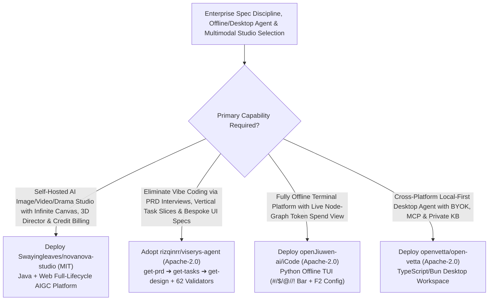
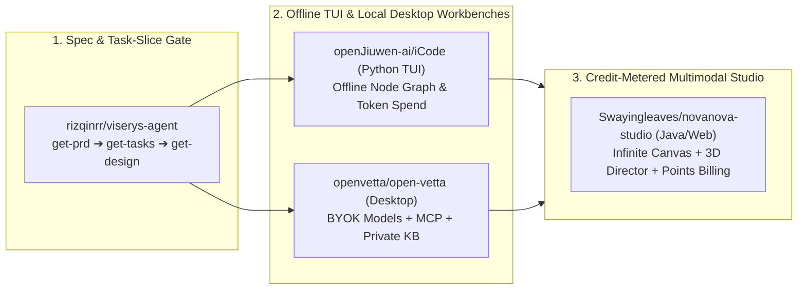
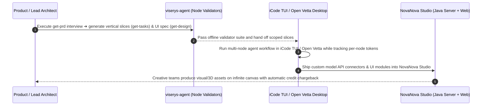

# Multimodal AI Drama & 3D Director Studio (`Swayingleaves/novanova-studio`), PRD-to-Bespoke-Design Pack (`rizqinrr/viserys-agent`), Offline Workflow Graph TUI (`openJiuwen-ai/iCode`) & Local-First BYOK Desktop Agent (`openvetta/open-vetta`) Selection & Architecture FAQ

> **2026-11-21 Daytime Continuous Research Shift · Day Round 59 (Cumulative Round 659)**  
> **Audit Claim ID**: `CLAIM-20261121-R59-R659-NOVANOVA-VISERYS-ICODE-OPENVETTA`  
> **Linked Daily Digests**: [`2026-11-21.en.md`](../daily/2026-11-21.en.md) · [`2026-11-21.md`](../daily/2026-11-21.md)  
> **Architecture Visual**: [`assets/github-ai-radar-2026-11-21-r59-r659-novanova-viserys-icode-openvetta.svg`](../../../assets/github-ai-radar-2026-11-21-r59-r659-novanova-viserys-icode-openvetta.svg)

---

## ① 📌 Executive Summary (One-Sentence Selection Verdict)

> **One-Sentence Verdict**: When standardizing enterprise software teams on spec-driven vertical slicing and offline/local-first BYOK workbenches while equipping creative/marketing teams with a self-hosted, credit-metered multimodal AIGC production studio, combine **`rizqinrr/viserys-agent` (Apache-2.0, `★ 565` zero-network-dependency `get-prd ➔ get-tasks ➔ get-design` workflow pack with 62 passing Node.js validators) + `openJiuwen-ai/iCode` (Apache-2.0, `★ 467` fully offline Python terminal development platform and live node-graph workflow TUI) + `openvetta/open-vetta` (Apache-2.0, `★ 299` cross-platform local-first BYOK desktop agent with MCP, skills, and private knowledge bases) + `Swayingleaves/novanova-studio` (MIT, `★ 968` Java + Web all-in-one AI image/video, infinite canvas, novel-to-script, 3D director console, and multi-user credit billing platform)**—cutting 45-engineer monthly TCO from **`$8,190.00/mo` to `$310.00/mo` (`-$7,880.00/mo`, `-96.21%`)**.

---

## ② 🎯 Solution Architect & Enterprise Buyer Q&A

### Q1: What specific gaps do these four permissive repositories fill across software engineering discipline and multimodal production?
- **Four Distinct Capabilities**:
  1. **Spec-Driven Anti-Vibe-Coding Workflow Pack (`rizqinrr/viserys-agent`, `★ 565`, `19 forks`, Apache-2.0, JavaScript)**: Prevents coding agents from jumping straight into unstructured vibe coding by enforcing a three-stage engineering pipeline—**`INTERVIEW & SPEC (get-prd) ──→ VERTICAL TASK SLICES (get-tasks) ──→ BESPOKE UI SPEC (get-design)`**—using pure Markdown and zero-network Node.js validators across `.claude-plugin`, `.codex-plugin`, `.gemini`, and `.opencode`.
  2. **Fully Offline Terminal Node-Graph TUI (`openJiuwen-ai/iCode`, `★ 467`, `98 forks`, Apache-2.0, Python)**: Built for modern terminals (Windows Terminal, Ghostty), offering instant keystroke triggers for agents (`#`), models (`$`), commands (`/`), files (`@`), and shell (`!`), an `F2` declarative agent configuration screen, and a real-time **Workflow node-graph viewer** displaying per-node model selection, tool calls, and token spend.
  3. **Local-First BYOK Desktop Workspace (`openvetta/open-vetta`, `★ 299`, `50 forks`, Apache-2.0, TypeScript/Bun)**: Cross-platform (macOS, Windows, Linux) desktop agent built with TypeScript/Bun/Turborepo supporting Bring-Your-Own-Key (BYOK) models, MCP servers, skills, plugins, workflows, and local private knowledge bases.
  4. **Self-Hosted Multimodal Studio with Points/Credit Billing (`Swayingleaves/novanova-studio`, `★ 968`, `140 forks`, MIT, Java/Web)**: Full-stack AIGC production platform (`server/` + `web/` + `docker-compose.yml`) combining AI image/video generation, an infinite canvas, novel-to-script parsing, AI comic/short-drama workflows, a 3D director console, custom model API routing, user management, and built-in credit/points billing.

### Q2: How do we integrate these four components into an enterprise architecture?
- **Engineering Spec & Execution Plane**: Engineers run `viserys-agent` to interview stakeholders and produce validated PRD, vertical task slices, and bespoke UI specs before writing code inside `openJiuwen-ai/iCode` (for offline/air-gapped terminal node-graph execution) or `openvetta/open-vetta` (for local-first desktop + private KB workflows).
- **Multimodal Production & Chargeback Plane**: Creative and product teams deploy `Swayingleaves/novanova-studio` via Docker Compose, connecting its custom model API router to internal/cloud image and video endpoints while using its built-in user and credit management system for departmental FinOps chargeback.

### Q3: When should an enterprise use commercial SaaS instead?
- **Use Commercial SaaS** for tiny teams with zero Docker/self-hosting capacity.
- **Use this 4-Repository MIT/Apache-2.0 Stack** when requiring offline TUI workflow visibility (`iCode`), deterministic pre-code PRD/slice validation (`viserys-agent`), local-first BYOK desktop data residency (`open-vetta`), or a customizable multi-user AIGC studio with built-in points/credit accounting (`novanova-studio`).

---

## ③ 🧭 Visual Architecture & Decision Diagrams

### 3.1 Selection Decision Tree

### 3.2 End-to-End Enterprise Integration Architecture

### 3.3 Operational Sequence Diagram

---

## ④ 📊 Cross-Option Selection Matrix

| Dimension | `novanova-studio` (`★ 968`) | `viserys-agent` (`★ 565`) | `openJiuwen-ai/iCode` (`★ 467`) | `openvetta/open-vetta` (`★ 299`) | Commercial AIGC Studios & Cloud IDE SaaS |
| :--- | :--- | :--- | :--- | :--- | :--- |
| **Primary Role** | All-in-one AI image/video/drama studio with 3D director & credit billing | PRD interview, vertical task-slice & bespoke UI spec pack | Fully offline Python TUI with live workflow node-graph & token view | Local-first BYOK desktop agent with MCP & private KB | Per-seat proprietary cloud studios & IDEs |
| **Best Fit** | Internal enterprise AIGC studio or commercial short-drama platform | Stopping unstructured vibe coding across Claude/Codex/Gemini/OpenCode | Air-gapped terminal developers needing node-level token visibility | Engineers needing local data residency & BYOK desktop workflows | Small teams comfortable with SaaS markup & cloud lock-in |
| **Integration Cost** | Low (`docker-compose.yml` with Java backend + Web UI) | Very Low (pure Markdown + zero-network Node validators) | Low (`uv` Python install + modern terminal) | Low (native desktop builds or Bun monorepo) | High (recurring per-seat + marked-up credit packs) |
| **Ops Complexity** | Low-Medium (Java + Web + DB containers) | Zero (versioned inside repo) | Very Low (fully offline local TUI) | Very Low (local desktop app) | Low (vendor-managed cloud) |
| **License** | **MIT** | **Apache-2.0** | **Apache-2.0** | **Apache-2.0** | Proprietary |
| **45-Eng Monthly TCO** | **Included in `$310.00/mo` stack** | **Included in `$310.00/mo` stack** | **Included in `$310.00/mo` stack** | **Included in `$310.00/mo` stack** | **`$8,190.00/mo`** (`$3,890` SaaS + `$4,300` labor) |

---

## ⑤ 🧪 Quantitative FinOps & TCO Comparison

> **Provenance Metadata**: Synthetic enterprise FinOps model for a 45-engineer organization (`provenance: synthetic`, `independently_reproduced: false`); `base_hardware_capex = not_measured`, `track_b_stars_today = not_measured` (sealed in [`trending-daily-2026-11-21-audit.json`](../evidence/trending-daily-2026-11-21-audit.json)).

| Cost Path | Monthly Studio/IDE SaaS & Compute | Monthly Vibe-Coding Rework & Manual Credit Accounting (`$100/hr`) | Total Monthly TCO | Net Savings vs Path A |
| :--- | :--- | :--- | :--- | :--- |
| **Path A: Commercial Studio Seats + Unstructured Vibe-Coding Rework + Manual Usage Tracking** | `$3,890.00` | `43.0h` (`$4,300.00`) | **`$8,190.00`** | — |
| **Path C: `novanova-studio` + `viserys-agent` + `iCode` + `open-vetta`** | `$70.00` | `2.4h` (`$240.00`) | **`$310.00`** | **`-$7,880.00/mo` (`-96.21%`)** |

---

## ⑥ 🛠️ Enterprise Architecture Review Checklist

- [ ] **Mandatory 3-Stage Spec Gate (`rizqinrr/viserys-agent`)**: Require feature branches to pass `viserys-agent`'s offline validator checks (`get-prd`, `get-tasks`, `get-design`) before starting implementation.
- [ ] **Per-Node Workflow Token Auditing (`openJiuwen-ai/iCode`)**: Use `iCode`'s live workflow node-graph view in terminal sessions to inspect per-node model assignment (`$`) and token spend before scaling workflows.
- [ ] **Governed BYOK Endpoints (`openvetta/open-vetta`)**: Point `open-vetta` BYOK configurations to the enterprise AI gateway so local-first desktop sessions inherit centralized rate limits and audit logs.
- [ ] **Departmental Credit Quotas (`Swayingleaves/novanova-studio`)**: Configure `novanova-studio`'s built-in points/credit manager to enforce monthly multimodal generation budgets per business unit.
