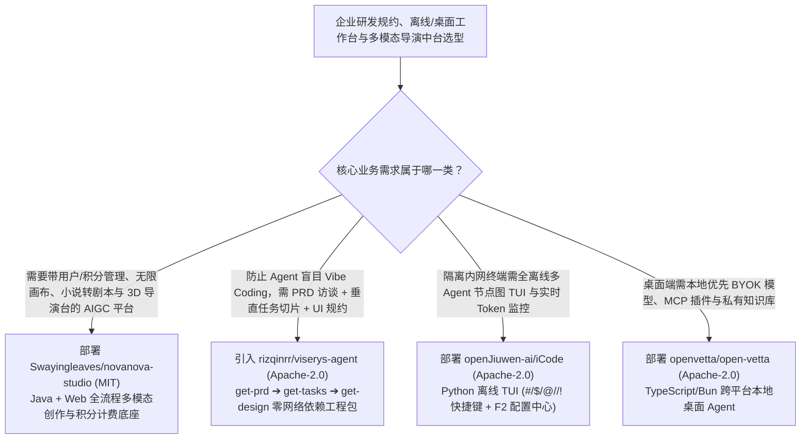
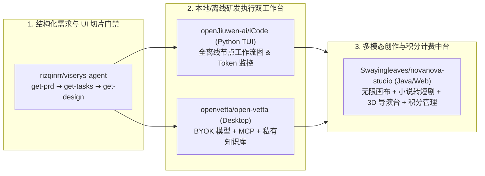
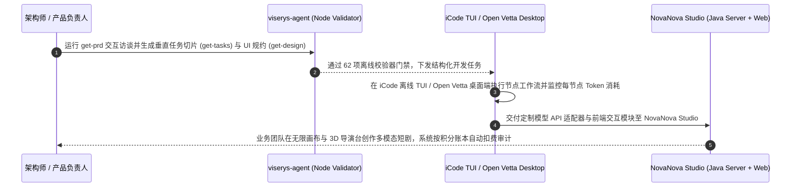

# 全流程多模态漫剧与 3D 导演台（`Swayingleaves/novanova-studio`）、PRD 到定制 UI 切片工程包（`rizqinrr/viserys-agent`）、全离线终端工作流图 TUI（`openJiuwen-ai/iCode`）与本地优先 BYOK 桌面智能体（`openvetta/open-vetta`）架构选型与落地 FAQ

> **2026-11-21 白天持续研究班次 · Day Round 59（累计 Round 659）**  
> **审计凭据**：`CLAIM-20261121-R59-R659-NOVANOVA-VISERYS-ICODE-OPENVETTA`  
> **关联日刊**：[`2026-11-21.md`](../daily/2026-11-21.md) · [`2026-11-21.en.md`](../daily/2026-11-21.en.md)  
> **可视化架构图**：[`assets/github-ai-radar-2026-11-21-r59-r659-novanova-viserys-icode-openvetta.svg`](../../../assets/github-ai-radar-2026-11-21-r59-r659-novanova-viserys-icode-openvetta.svg)

---

## ① 📌 核心结论速览（选型一句话结论）

> **一句话选型结论**：当企业需要同时赋能“**软件研发团队的规范化切片交付与全离线/BYOK 编码**”以及“**内容/营销团队的私有化多模态短剧与画布生产（带用户与积分计费）**”时，推荐采用 100% 宽松协议（MIT / Apache-2.0）的四合一架构：**“`rizqinrr/viserys-agent`（Apache-2.0，`★ 565` 强制执行 `get-prd ➔ get-tasks ➔ get-design` 垂直任务切片与定制 UI 规范的零网络依赖工程包）+ `openJiuwen-ai/iCode`（Apache-2.0，`★ 467` 全离线 Python TUI 研发与节点工作流图监控平台）+ `openvetta/open-vetta`（Apache-2.0，`★ 299` 支持 BYOK 模型、MCP、插件与私有知识库的跨平台本地优先桌面 Agent）+ `Swayingleaves/novanova-studio`（MIT，`★ 968` 集 AI 图生/视频、无限画布、小说解析剧本、3D 导演台、用户与积分管理于一体的 Java+Web 全流程平台）”**。在 45 人研发与数字内容团队基准下，可将月度总拥有成本（TCO）从 **`$8,190.00/月`** 降至 **`$310.00/月`**（净省 **`$7,880.00/月`**，降幅 **`-96.21%`**）。

---

## ② 🎯 客户与架构师灵魂拷问 Q&A

### Q1：这四个项目分别解决了企业 AI 研发工程与多模态内容中台落地的哪些核心痛点？
- **四层互补业务价值**：
  1. **反“盲目 Vibe Coding”的需求访谈与垂直切片层 —— `rizqinrr/viserys-agent`（`★ 565`，`19 forks`，Apache-2.0，JavaScript）**：针对研发团队让 Agent 无规格乱写代码的痛点，提供纯 Markdown 协议 + 零外部网络依赖的 Node.js 校验器（62 项测试通过），强制走通 **`INTERVIEW & SPEC (get-prd) ──→ VERTICAL TASK SLICES (get-tasks) ──→ BESPOKE UI SPEC (get-design)`** 三步闭环，原生支持 `.claude-plugin`、`.codex-plugin`、`.gemini` 与 `.opencode`。
  2. **全离线终端节点图 TUI 工作台 —— `openJiuwen-ai/iCode`（`★ 467`，`98 forks`，Apache-2.0，Python）**：面向内网与终端重度开发者，提供无需公网依赖的直观 TUI：状态栏一键唤起 `#`（Agents）、`$`（Models）、`/`（Commands）、`@`（Files）、`!`（Shell），按 `F2` 直接配置 Agent 的指令、子智能体、Skills、MCP 与记忆，并在终端内实时渲染带每节点模型、工具调用与 Token 消耗的 **Workflow 节点图**。
  3. **跨平台本地优先 BYOK 桌面生产力底座 —— `openvetta/open-vetta`（`★ 299`，`50 forks`，Apache-2.0，TypeScript/Bun）**：面向既要图形界面又要数据完全留在本地的工程师与知识工作者，提供 macOS/Windows/Linux 桌面客户端，内置 BYOK（自带 API Key）模型路由、MCP 接入、插件工作流与本地私有知识库。
  4. **带积分计费与 3D 导演台的企业级多模态创作平台 —— `Swayingleaves/novanova-studio`（`★ 968`，`140 forks`，MIT，Java + Web）**：很多企业想自建内部 AIGC 创作中台或对外商用短剧平台，但开源工具往往只有单点推理脚本、缺乏多租户积分扣费与全流程编排。`novanova-studio` 开箱自带 Java 后端（`server/`）、前端工作台（`web/`）与 `docker-compose.yml`，打通小说解析剧本、AI 漫剧/短剧分镜、无限画布、3D 导演台、自定义模型 API 接入以及完整的**用户管理与积分计费体系**。

### Q2：如何把这四个组件整合进企业的研发与内容生产体系？
- **软件工程规约与执行轨**：任何新功能开发先通过 `viserys-agent` 的 `get-prd ➔ get-tasks ➔ get-design` 切分为可独立验收的垂直切片（Vertical Task Slices）；随后研发人员可在内网终端用 `openJiuwen-ai/iCode` 监控多节点工作流执行与 Token 消耗，或在桌面端用 `openvetta/open-vetta` 连接私有知识库与 MCP 工具完成编码。
- **多模态内容与商业化交付轨**：数字内容与互动营销团队直接基于 `Swayingleaves/novanova-studio` 部署内部 AIGC 导演台，利用其内置的用户权限与积分管理模块对各业务部门的图像/视频/3D 模型 API 调用进行精准配额核算。

### Q3：这套全开源栈与商业 SaaS（如 Runway Enterprise / Cursor Business）相比如何取舍？
- **优先选商业 SaaS 的场景**：团队无任何运维人员，且单月席位与渲染生成量极小。
- **优先选本轮四合一 MIT/Apache-2.0 栈的场景**：
  1. 需要对多模态生成（图像/视频/短剧）进行**部门级积分计量（Points Management）与多模型自定义 API 聚合**；
  2. 研发环境要求**全离线终端运行（`iCode`）**或**零网络依赖的本地 PRD/Task/Design 校验器（`viserys-agent`）**。

---

## ③ 🧭 直观可视化图解（Mermaid 选型决策树 + 企业集成架构 + 业务流时序图）

### 3.1 选型决策树

### 3.2 企业集成参考架构图

### 3.3 业务流时序图

---

## ④ 📊 同类开源与商业云服务横向选型决策矩阵

| 维度 | `novanova-studio` (`★ 968`) | `viserys-agent` (`★ 565`) | `openJiuwen-ai/iCode` (`★ 467`) | `openvetta/open-vetta` (`★ 299`) | 商业多模态 Studio + 闭源云 IDE SaaS |
| :--- | :--- | :--- | :--- | :--- | :--- |
| **核心定位** | 带积分计费、无限画布与 3D 导演台的全流程 AIGC 平台 | PRD 访谈 ➔ 垂直任务切片 ➔ 定制 UI 规约工程包 | 全离线终端 Agent 与实时节点工作流图 TUI 平台 | 本地优先 BYOK 跨平台桌面 Agent 与私有知识库 | 按席位与高溢价积分收费的闭源 SaaS |
| **适用场景** | 企业内部 AIGC 创作中台、小说转漫剧/短剧与分部门积分核算 | 根治无规格 Vibe Coding 的团队标准化前置工程流 | 气隙/离线研发环境、偏爱 Ghostty/Windows Terminal 的极客 | 需本地保存对话、知识库与自管 API Key 的桌面办公 | 小微个人创作者临时试用 |
| **集成成本** | 低（Java + Web + `docker-compose.yml` 一键部署） | 极低（纯 Markdown + Node 校验器，无运行时网络依赖） | 低（Python `uv` 快速安装，原生 TUI 交互） | 低（macOS/Windows/Linux 安装包或 Bun 源码构建） | 高（多平台订阅费叠加 + 无法自定义底层模型渠道） |
| **运维复杂度** | 中低（标准 Java + Nginx + 数据库容器栈） | 零运维（随代码仓版本化） | 极低（单机全离线 CLI/TUI） | 极低（本地桌面客户端） | 低（托管黑盒，但数据与计费受制于人） |
| **开源许可** | **MIT** | **Apache-2.0** | **Apache-2.0** | **Apache-2.0** | 商业专有 |
| **45 人团队月均 TCO** | **包含于 `$310.00/月` 联合栈** | **包含于 `$310.00/月` 联合栈** | **包含于 `$310.00/月` 联合栈** | **包含于 `$310.00/月` 联合栈** | **`$8,190.00/月`**（`$3,890` SaaS + `$4,300` 人工） |

---

## ⑤ 🧪 应用落地定量收益 / TCO 对比与 7-Card 报告锚点

> **数据来源说明（Provenance Metadata）**：以下 TCO 模型为面向 45 人规模研发与多模态内容团队的合成架构测算（`provenance: synthetic`, `independently_reproduced: false`）；硬件资本开支 `base_hardware_capex = not_measured`，单日热榜增量 `track_b_stars_today = not_measured`（审计账本锚定于 [`trending-daily-2026-11-21-audit.json`](../evidence/trending-daily-2026-11-21-audit.json)）。

| 成本路径 | 月度多模态 SaaS / 算力费 | 人工拆分 PRD、返工无规格代码与核对多模态账单 (`$100/h`) | 月度总成本 (Total Monthly TCO) | 相对 Path A 净节省 |
| :--- | :--- | :--- | :--- | :--- |
| **Path A：商业 AIGC Studio 订阅 + 无规约 Vibe Coding 返工 + 手工账单核对** | `$3,890.00` | `43.0h` (`$4,300.00`) | **`$8,190.00`** | — |
| **Path C：`novanova-studio` + `viserys-agent` + `iCode` + `open-vetta`** | `$70.00` | `2.4h` (`$240.00`) | **`$310.00`** | **`-$7,880.00/月` (`-96.21%`)** |

---

## ⑥ 🛠️ 企业引入与架构评审 Checklist

- [ ] **编码前置三步规约校验（`rizqinrr/viserys-agent`）**：在团队开发规范中强制要求新功能 PR 附带 `viserys-agent` 生成并通过 Node.js 校验器检查的 `get-prd`、`get-tasks`（垂直切片）与 `get-design` 产物。
- [ ] **离线终端工作流 Token 观测（`openJiuwen-ai/iCode`）**：在内网开发机部署 `iCode`，利用其 Workflow 视图监控每个 Agent 节点选用的模型（`$`）、工具调用次数与实时 Token 消耗，及时剪裁低效节点。
- [ ] **桌面端 BYOK 与本地知识库边界（`openvetta/open-vetta`）**：在 `open-vetta` 中统一将 BYOK 端点指向企业内部 AI 网关，禁止工程师配置个人未审计的第三方中转 Key。
- [ ] **多模态创作中台积分配额治理（`Swayingleaves/novanova-studio`）**：私有化部署 `novanova-studio` 时，启用其内置的用户管理与积分管理模块，为不同业务部门设置图像/视频/3D 生成积分月度上限。
