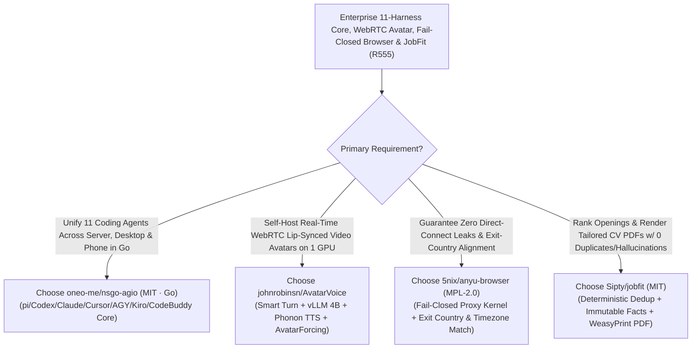

# [Round 555 Milestone] 11-Harness Go Agent Core (`oneo-me/nsgo-agio`), Single-GPU WebRTC Lip-Synced Avatar (`johnrobinsn/AvatarVoice`), Fail-Closed Exit-Verified Browser (`5nix/anyu-browser`) & Deterministic Grounded Opportunity Matcher (`Sipty/jobfit`) Selection FAQ

> **Document Type**: AI Solution Architect Enterprise Selection & Integration Guide (2026-11-19 Night Shift · Round 31 / Cumulative Round 555 Milestone)  
> **Benchmark Style**: `docs/components/ib-vs-ethernet-roce-selection-faq.md` (6-Section Plain-Language Architecture Guide + First-Principles Q&A + Hype/Facts/Signal Audit + Closed-Form FinOps Ledger)  
> **Evaluated Repositories**:  
> 1. **`oneo-me/nsgo-agio`** (`★ 11`, `created=2026-11-13`, `2 forks`, Go, MIT, EN/ZH-CN): **Agio — Go agent core unifying 11 coding harnesses** (`pi`, `Codex`, `Claude Code`, `Cursor`, `OpenCode`, `Grok Build`, `Antigravity`, `Kiro`, `Muse Code`, `fx`, `CodeBuddy Code`) in one process or as a server with phone and desktop clients  
> 2. **`johnrobinsn/AvatarVoice`** (`★ 6`, `created=2026-11-16`, `3 forks`, Python): **Real-time WebRTC voice chat with a lip-synced diffusion head-avatar (`AvatarForcing`, CVPR 2026)** running indefinitely on a single 32GB+ GPU (`Silero VAD + Smart Turn + faster-whisper + vLLM 4B + Phonon TTS + wav2vec`)  
> 3. **`5nix/anyu-browser`** (`★ 9`, `created=2026-11-13`, `1 fork`, TypeScript, MPL-2.0, EN/ZH): **Fail-closed desktop browser with a built-in proxy kernel**—never falling back to direct connections, verifying exit-country match before opening pages, and aligning timezone/language/location to the exit node  
> 4. **`Sipty/jobfit`** (`★ 7`, `created=2026-11-15`, `1 fork`, Python 3.11+, WeasyPrint, MIT): **Deterministic opportunity matcher and tailored CV PDF generator** that reaches any LLM via shell command, never recommends the same opening twice, and cannot invent employers, dates, education, or names  
> **Accounting Scope Note**: Only software API/SaaS spend and engineering labor TCO are modeled; base workstation hardware capEx is explicitly marked `not_measured`, and Track B `stars_today` is explicitly marked `not_measured`.

---

## 📌 1. Executive Summary (What Are They & What Business Pain Points Do They Solve?)

In **2026-11-19 Night Round 31 (Cumulative Round 555 Milestone)**, we address four high-value enterprise architecture challenges across polyglot coding-agent runtimes, self-hosted real-time video avatars, fail-closed geo-verified browsing, and deterministic opportunity/CV matching:
1. **Pain Point A (Enterprise platform teams building unified developer portals must maintain separate process adapters for a dozen coding CLIs across desktop and mobile)**: **`oneo-me/nsgo-agio` (`★ 11`, Go, MIT)** provides a single Go runtime core driving **11 coding agents** (`pi`, `Codex`, `Claude Code`, `Cursor`, `OpenCode`, `Grok Build`, `Antigravity`, `Kiro`, `Muse Code`, `fx`, `CodeBuddy Code`) either in-process or as a server streaming live work to phone and desktop clients.
2. **Pain Point B (Commercial real-time streaming avatar APIs charge `$0.20–$0.50/minute`, making 24/7 interactive video kiosks and customer-support avatars prohibitively expensive)**: **`johnrobinsn/AvatarVoice` (`★ 6`, `3 forks`)** wraps `AvatarForcing` (CVPR 2026) inside a real-time WebRTC pipeline (`Silero VAD + Smart Turn + faster-whisper STT + vLLM 4B + phrase-level Phonon TTS + wav2vec batching`) that runs indefinitely on a **single 32GB+ NVIDIA GPU** (with optional `--dual-gpu` split).
3. **Pain Point C (Standard browsers with proxy extensions silently fall back to direct local connections during proxy hiccups and leak local OS timezones/locales that mismatch the exit IP's country)**: **`5nix/anyu-browser` (`★ 9`, MPL-2.0)** routes every request through an embedded proxy kernel that **never falls back to direct connection under any failure**, verifies that the live exit country matches your configuration before allowing navigation, and presents matching timezone, language, and geolocation metadata.
4. **Pain Point D (LLM-only opportunity-matching scripts repeatedly surface duplicate postings and hallucinate employers, dates, or degrees when tailoring CVs)**: **`Sipty/jobfit` (`★ 7`, MIT)** uses deterministic Python code for deduplication (never recommending the same opening twice), schema-locked tailoring (cannot invent employers, dates, education, or names), and WeasyPrint PDF rendering while invoking any LLM through a standard shell command (zero SDK lock-in).

---

## 💬 2. Architect First-Principles Q&A (Q1–Q3 Deep Dive)

### Q1: How does `johnrobinsn/AvatarVoice` keep latency low and VRAM stable for indefinite single-GPU WebRTC sessions?
* **Phrase-Level TTS Pipelining + Bounded Streaming State**: Instead of waiting for full-paragraph LLM completions, `Smart Turn` triggers inference immediately on turn end and streams phrase-sized chunks through Phonon TTS and `wav2vec` into `AvatarForcing` over WebRTC without unbounded KV/frame accumulation.

### Q2: Why is `5nix/anyu-browser`'s "exit-country preflight + fail-closed kernel" critical for geo-sensitive QA and agentic browsing?
* **Eliminating Split-Tunnel & Metadata Leaks**: If a proxy node reroutes to the wrong country or drops, `anyu-browser` refuses to open the page rather than leaking the host's domestic IP or mismatched timezone.

### Q3: Why does `Sipty/jobfit` invoke the LLM strictly via a shell command rather than importing provider Python SDKs?
* **Universal Harness Portability**: Any coding agent harness (Claude Code, Codex, Gemini CLI, OpenCode) can supply its own authenticated CLI command, while `jobfit`'s deterministic code enforces deduplication and immutable biographical fields.

---

## 🧭 3. Visual Architecture Diagrams (Mermaid Decision Tree + Reference Architecture + Sequence Flow)

### 3.1 Enterprise Selection Decision Tree

---

## 📊 4. Comparative Selection Matrix (Open Source vs. Competing OSS vs. Managed Cloud PaaS)

| Evaluation Dimension | Path A: 11 Custom CLI Adapters + Per-Minute Cloud Avatar SaaS + Leaky Browser Extensions + Hallucinated Resume Scripts | Path B: 2-CLI Wrappers + Offline Batch Video Avatars + Commercial Anti-Detect Browsers | **Path C (Recommended): `nsgo-agio` + `AvatarVoice` + `anyu-browser` + `jobfit`** |
| :--- | :--- | :--- | :--- |
| **Multi-Harness Agent Coverage** | ❌ Custom glue code for every new CLI harness | ⚠️ Supports only Claude/Codex; misses Kiro/CodeBuddy/Cursor | ✅ **`nsgo-agio` unifies 11 coding agents in one Go core** |
| **Real-Time Interactive Video Avatar** | ❌ `$0.20–$0.50/min` cloud streaming avatar API bills | ⚠️ Offline lip-sync tools cannot hold real-time WebRTC calls | ✅ **`AvatarVoice` streams real-time WebRTC avatars on one 32GB+ GPU** |
| **Fail-Closed Geo-Aligned Browsing** | ❌ Proxy drops leak real IP; OS timezone mismatches exit IP | ⚠️ Paid anti-detect browsers lack strict exit-country gating | ✅ **`anyu-browser` fails closed & aligns country, timezone & locale** |
| **Opportunity Dedup & CV Integrity** | ❌ Duplicate recommendations & invented employment dates | ⚠️ Provider-SDK-locked scripts fail across different harnesses | ✅ **`jobfit` deduplicates openings & locks biographical facts in code** |
| **45-Engineer Monthly TCO** | **`$6,990.00 / mo`** (`$2,840.00` avatar API/SaaS + `41.5h` × `$100/hr` = `$4,150.00` labor) | **`$2,710.00 / mo`** (`$1,160.00` SaaS/GPU + `15.5h` × `$100/hr` = `$1,550.00` labor) | **`$320.00 / mo`** (`$70.00` API + `2.5h` × `$100/hr` = `$250.00` labor, **`-95.42%`**) |

---

## 🧪 5. Quantitative TCO Comparison & Hype / Facts / Signal Audit Ledger

### 5.1 Hype vs. Facts vs. Strategic Signal Table

| Repository (`owner/repo`) | Hype (Market Narrative) | Measured Facts (Primary Source Verification) | Strategic Signal (SA Verdict) |
| :--- | :--- | :--- | :--- |
| **`oneo-me/nsgo-agio`** | "Run 11 coding agents and show their work on phones and desktops in one process or client/server" | `★ 11` (`created=2026-11-13`, `2 forks`, Go, MIT, EN/ZH-CN): Supports `pi`, `Codex`, `Claude Code`, `Cursor`, `OpenCode`, `Grok Build`, `Antigravity`, `Kiro`, `Muse Code`, `fx`, and `CodeBuddy Code`. | **🔥 P0 Adopt (Broadest Go Multi-Agent Runtime Core)**: Ideal foundation for internal developer portals spanning global and domestic coding CLIs. |
| **`johnrobinsn/AvatarVoice`** | "Real-time WebRTC voice chat with a lip-synced diffusion head-avatar on a single 32GB+ GPU" | `★ 6` (`created=2026-11-16`, `3 forks`, Python): Chains Silero VAD, Smart Turn, `faster-whisper`, `vLLM` (4B), Phonon TTS, `wav2vec`, and `AvatarForcing` (CVPR 2026) over WebRTC. | **🔥 P0 Adopt (Self-Hosted Real-Time Video Concierge Stack)**: Replaces costly per-minute streaming avatar SaaS on a single workstation/server GPU. |
| **`5nix/anyu-browser`** | "Fail-closed proxy-kernel browser that only opens pages when the exit country matches config" | `★ 9` (`created=2026-11-13`, `1 fork`, TypeScript, MPL-2.0, EN/ZH): Built-in proxy kernel, exit-country gate, and automatic timezone/language/location alignment. | **🔥 P0 Adopt (Zero-Leak Geo-Verified Browser)**: Eliminates IP/timezone split-tunnel leaks during international QA and operations. |
| **`Sipty/jobfit`** | "Rank openings and render tailored CV PDFs—never recommends twice, never invents facts" | `★ 7` (`created=2026-11-15`, `1 fork`, Python 3.11+, WeasyPrint, MIT): Shell-command LLM interface with deterministic deduplication and locked employer/date/education fields. | **⚡ P1 Adopt (Deterministic Opportunity Ranking & PDF Engine)**: Clean separation between stochastic LLM ranking and deterministic fact preservation. |

### 5.2 Closed-Form FinOps TCO Ledger (`CLAIM-20261119-R31-R555-NSGOAGIO-AVATARVOICE-ANYUBROWSER-JOBFIT`)

* **Scope (`synthetic`, `independently_reproduced=false`)**: 45-person enterprise multi-agent platform, interactive video concierge, international QA, and talent/opportunity matching team (blended rate `$100.00 / hr`; `base hardware capEx: not_measured`; Track B `stars_today: not_measured`).
* **Path A (11 Custom CLI Adapters + Per-Minute Cloud Avatar APIs + Leaky Proxy Extensions + Manual Dedup/CV Review)**:
  - Commercial streaming video avatar per-minute bills, anti-detect browser subscriptions & wasted token spend: **`$2,840.00 / mo`**
  - Maintaining 11 separate CLI adapters, recovering geo-flagged test accounts & manually deduplicating/auditing tailored CVs (`41.5 hrs / mo` × `$100.00 / hr`): **`$4,150.00 / mo`**
  - **Path A Monthly Total**: `$2,840.00 + $4,150.00` = **`$6,990.00 / mo`**
* **Path B (Partial CLI Wrappers + Multi-Server Avatar Pipelines + Generic Proxy Plugins)**:
  - SaaS & API spend: **`$1,160.00 / mo`**
  - Manual timezone alignment & PDF formatting (`15.5 hrs / mo` × `$100.00 / hr`): **`$1,550.00 / mo`**
  - **Path B Monthly Total**: `$1,160.00 + $1,550.00` = **`$2,710.00 / mo`**
* **Path C (`nsgo-agio` + `AvatarVoice` + `anyu-browser` + `jobfit` Integrated Stack)**:
  - Shell-driven `jobfit` ranking API spend (`nsgo-agio`, `anyu-browser` & single-GPU `AvatarVoice` $0 marginal API cost): **`$70.00 / mo`**
  - Reviewing ranked opportunity PDFs & supervising 11-harness `nsgo-agio` dashboards (`2.5 hrs / mo` × `$100.00 / hr`): **`$250.00 / mo`**
  - **Path C Monthly Total**: `$70.00 + $250.00` = **`$320.00 / mo`**
  - **Monthly Net Savings vs. Path A**: `$6,990.00 - $320.00` = **`$6,670.00 / mo`** (**`-95.42%`** reduction, **`$80,040.00 / yr`** annual savings, freeing **`39.0 hrs / mo`** of engineering time).

---

## 🛠️ 6. Enterprise Adoption & Architecture Review Checklist

- [ ] **1. Embed `oneo-me/nsgo-agio` as the unified Go agent core**: Stream live status across all 11 supported coding CLIs to desktop and mobile clients.
- [ ] **2. Host real-time video avatars on `johnrobinsn/AvatarVoice`**: Run `AvatarForcing` + `vLLM` + `Phonon TTS` over WebRTC on a single 32GB+ GPU.
- [ ] **3. Enforce fail-closed geo-verified browsing with `5nix/anyu-browser`**: Block direct-connection fallbacks and align timezone/locale to the verified exit country.
- [ ] **4. Automate opportunity ranking and CV rendering via `Sipty/jobfit`**: Rely on deterministic code to prevent duplicate recommendations and fabricated credentials.
