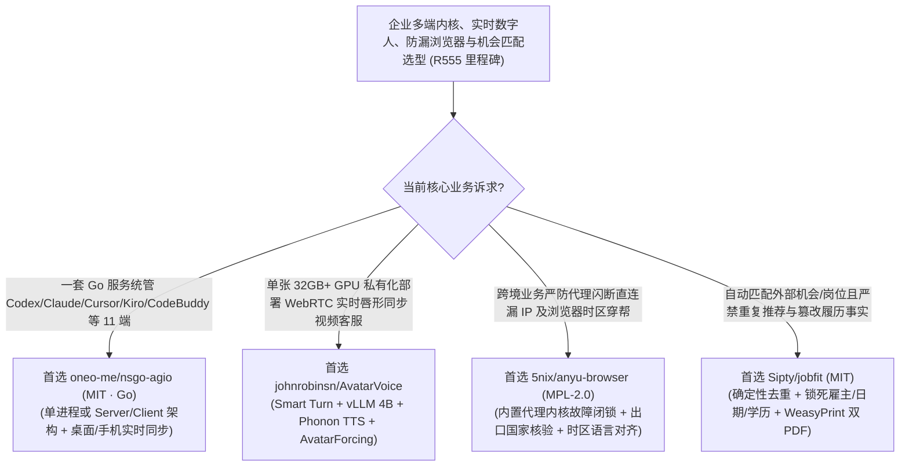
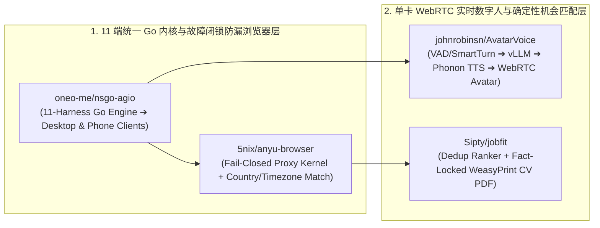
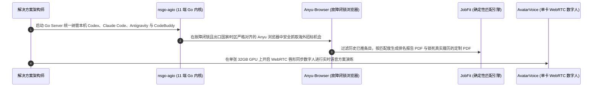

# 【第 555 轮里程碑】11 端统一编码智能体核心（`oneo-me/nsgo-agio`）、单卡 WebRTC 实时唇形同步数字人（`johnrobinsn/AvatarVoice`）、故障闭锁出口国家核验浏览器（`5nix/anyu-browser`）与确定性防重机会匹配引擎（`Sipty/jobfit`）选型 FAQ

> **文档类型**：AI Solution Architect（AI 解决方案架构师）实战选型与架构内功指南（2026-11-19 Night Shift · Round 31 / 累计第 555 轮里程碑）  
> **对标标杆**：`docs/components/ib-vs-ethernet-roce-selection-faq.md`（六段式架构拆解 + 第一性原理大白话 + Hype/Facts/Signal 审计 + 闭式 TCO 账本）  
> **本轮评估对象**：  
> 1. **`oneo-me/nsgo-agio`**（`★ 11`，`created=2026-11-13`，`2 forks`，Go，MIT，中/英）：**Agio — 统一驱动 11 大主流编码智能体（`pi`、`Codex`、`Claude Code`、`Cursor`、`OpenCode`、`Grok Build`、`Antigravity`、`Kiro`、`Muse Code`、`fx`、`CodeBuddy Code`）的 Go 语言核心引擎**，支持单进程内嵌或 Server/Client 跨手机与桌面部署  
> 2. **`johnrobinsn/AvatarVoice`**（`★ 6`，`created=2026-11-16`，`3 forks`，Python）：基于 **单张 32GB+ 显存 GPU 实时无限流式运行的 WebRTC 唇形同步扩散数字人语音对话系统**（集成 `Silero VAD + Smart Turn + faster-whisper + vLLM 4B + Phonon TTS + wav2vec + AvatarForcing CVPR 2026`）  
> 3. **`5nix/anyu-browser`**（`★ 9`，`created=2026-11-13`，`1 fork`，TypeScript，MPL-2.0，中/英）：**故障即闭锁（Fail-Closed）的内置代理内核桌面浏览器**——任何异常绝不回退直连，仅当出口国家与配置一致且时区/语言/位置完全对齐时才放行浏览  
> 4. **`Sipty/jobfit`**（`★ 7`，`created=2026-11-15`，`1 fork`，Python 3.11+，WeasyPrint，MIT）：**零 SDK 耦合、确定性去重与零幻觉裁剪的岗位/项目机会匹配引擎**——绝不重复推荐同一机会，且硬性禁止捏造雇主、日期、学历或姓名  
> **审计折算说明**：本报告仅计量软件算力、商业 SaaS 与工程运维人力 TCO，底层研发工作站硬件采购（base hardware capEx）显式标注为 `not_measured`，新仓今日增量显式标注为 `not_measured`，严禁捏造坐标。

---

## 📌 一、核心结论速览（Executive Summary：它到底是什么？解决什么业务痛点？）

在 **2026-11-19 Night Round 31（累计第 555 轮里程碑）** 中，我们面向企业架构师解决“企业内部研发平台想要同时兼容 11 种不同的 Coding Agent CLI 却被五花八门的进程通信协议折磨、商业实时互动数字人 API 按分钟收天价导致视频客服根本用不起、普通浏览器挂代理一旦节点闪断就会瞬间回退直连暴露企业真实出口 IP 与本机时区、以及自动化商机/岗位推荐脚本反复推荐重复条目且乱改顾问背景”四大痛点：
1. **痛点 A（企业内部不仅有人用 Claude Code 和 Codex，还有团队在用 Cursor、OpenCode、Grok Build、Antigravity、Kiro、Muse Code、CodeBuddy Code、pi 与 fx；平台团队如果想做一个跨桌面与手机的统一工作台，为 11 套 CLI 分别写进程管理与状态同步简直是噩梦）**：**`oneo-me/nsgo-agio` (`★ 11`, Go, MIT) 的破局之道**：用高并发 Go 语言把这 **11 大编码智能体** 抽象为统一的 Agent Core（Agio），既可以作为单二进制进程直接运行，也可以作为中心 Server 向桌面端与手机端实时同步所有 Agent 的工作流状态。
2. **痛点 B（金融远程面审、智能展厅与 24 小时交互式视频客服需要低延迟的真人级语音视频对话，但商业实时数字人 SaaS（如 HeyGen Streaming / Tavus 等）每分钟收费高达 `$0.20–$0.50`，一天聊几百小时账单就破万美元；而早期开源数字人跑几分钟就会显存泄漏崩掉）**：**`johnrobinsn/AvatarVoice` (`★ 6`, `3 forks`) 的破局之道**：将 CVPR 2026 最新的 **AvatarForcing** 扩散头像模型封装进完整的 **WebRTC 实时语音环路**（`麦克风 → Silero VAD + Smart Turn 轮次检测 → faster-whisper STT → vLLM 4B 大模型 → 短语级 Phonon TTS → PCM + wav2vec 特征打包 → 实时唇形同步视频流`），在 **单张 32GB+ 显存 GPU**（或 `--dual-gpu` 双卡分流）上实现零云账单、无限时长稳定流式对话。
3. **痛点 C（企业在做跨国合规测试、海外广告投放验真或访问区域锁定的海外 AI 服务时，普通 Chrome 挂扩展代理有两大死穴：① 代理进程一旦崩溃或配置重载，浏览器会静默回退到本地网络直连，瞬间泄露真实公网 IP；② 出口 IP 在美区，但浏览器 `Intl` 时区、系统语言和定位仍在国内，一秒触发风控封号）**：**`5nix/anyu-browser` (`★ 9`, MPL-2.0) 的破局之道**：将代理内核焊死在桌面浏览器底层——**在任何故障或异常下都保持强制闭锁（Fail-Closed），绝对不会直连放行半个字节**；每次请求前自动校验当前实际出口国家是否与配置完全一致，并向目标网站自动呈现与该出口国家严丝合缝匹配的时区、语言与位置信息。
4. **痛点 D（用 Agent 每日搜集外部项目招标或招聘机会并定制简历时，纯大模型管线经常把昨天刚推过的机会换个标题又推一遍，或者为了迎合甲方要求擅自篡改候选人的前雇主名称与工作年份）**：**`Sipty/jobfit` (`★ 7`, MIT) 的破局之道**：坚持 **“搜索归 Agent Harness，去重、裁剪约束与 PDF 渲染归确定性代码”**——通过纯 Shell 命令调用任意 LLM（零专有 SDK 锁定），代码层硬性保证**绝不重复推荐同一个岗位两次**，且在定制简历时锁死雇主、入离职日期、学历与姓名字段不可篡改，最后用 WeasyPrint 渲染出排名分析报告 PDF 与定制简历 PDF。

---

## 💬 二、客户与架构师灵魂拷问 Q&A（Q1–Q3 First-Principles Deep Dive）

### Q1：`johnrobinsn/AvatarVoice` 为什么在管线中加入 `Smart Turn` 与“短语级（Phrase-Level）TTS + wav2vec 批处理”？
* **攻克实时视频对话的首帧延迟（TTFF）与长时显存稳定性**：如果等 LLM 吐完一整段话再转语音和渲染视频，用户要干等 5 秒以上。通过 `Silero VAD + Smart Turn` 精准判断人类话音刚落的微秒级窗口，LLM 每吐出一个短语（Phrase）即刻送入 Phonon TTS 与 wav2vec 驱动 AvatarForcing 渲染 WebRTC 视频帧，把端到端体感延迟压进亚秒级且显存恒定不增长。

### Q2：`5nix/anyu-browser` 的“出口国家预检闭锁（Exit-Country Gate）”与普通 VPN/代理软件的 Kill Switch 有何区别？
* **应用层全指纹对齐（Application-Layer Fingerprint Alignment）**：操作系统级 Kill Switch 只能断网，管不了浏览器向网页 JS 暴露的 `Date().getTimezoneOffset()` 与 `navigator.languages`。`anyu-browser` 在浏览器内核层将网络出口国家校验与 JS 环境时区/语言伪装合二为一，不一致即拒绝渲染页面。

### Q3：为什么 `oneo-me/nsgo-agio` 能够成为企业自建 AI 研发中台的理想底座？
* **11 端适配器模式（Adapter Pattern Across 11 Harnesses）**：不仅覆盖欧美主流的 Codex/Claude/Cursor/Antigravity，还原生纳入了国内团队高频使用的 Kiro、Muse Code 与腾讯 CodeBuddy Code，用一套 Go 服务端即可打通全员桌面与手机监看。

---

## 🧭 三、直观可视化图解（Mermaid 选型决策树 + 企业集成参考架构 + 业务流时序图）

### 3.1 11 端 Agent 内核、单卡实时数字人、故障闭锁浏览器与防重匹配选型决策树

### 3.2 企业集成参考架构图

### 3.3 端到端业务流时序图

---

## 📊 四、同类开源与商业云服务横向选型决策矩阵（Decision Matrix）

| 评估维度 | 路径 A：手写 11 套 CLI 适配脚本 + 按分钟计费云端数字人 SaaS + 普通浏览器挂代理闪断封号 + 纯 LLM 乱改履历 | 路径 B：仅支持 2 款 CLI 的面板 + 离线非实时数字人渲染 + 第三方付费防关联浏览器 | **路径 C（推荐）：`nsgo-agio` + `AvatarVoice` + `anyu-browser` + `jobfit`** |
| :--- | :--- | :--- | :--- |
| **多编码工具统一纳管广度** | ❌ 每接入一款新工具（如 Kiro/CodeBuddy）都要重写进程与 UI 通信 | ⚠️ 仅支持 Claude/Codex，无法覆盖团队混用的全部 11 款工具 | ✅ **`nsgo-agio` 原生支持 11 大主流 Coding Agent，单进程或 C/S 皆可** |
| **实时互动视频数字人成本** | ❌ 商业流式数字人 API `$0.20–$0.50/分钟`，高并发客服月账单数万美元 | ⚠️ 传统开源方案需先把整段音频生成完再离线合成 MP4，无法实时对话 | ✅ **`AvatarVoice` 单张 32GB GPU 跑通 WebRTC 无限流式实时唇形同步** |
| **跨境浏览零直连泄漏与环境对齐** | ❌ 代理掉线即自动回退直连，暴露真实公网 IP 与国内系统时区 | ⚠️ 商业防关联浏览器按月收费且不强制校验出口国家与配置一致性 | ✅ **`anyu-browser` 故障即闭锁绝不直连，核验出口国家并自动对齐时区/语言** |
| **机会推荐去重与履历真实性** | ❌ 反复推荐重复岗位，且大模型为凑匹配度编造虚假雇主与工作年限 | ⚠️ 绑定特定模型 SDK，无法在任意 Agent Harness 中直接通过 Shell 调用 | ✅ **`jobfit` 确定性代码去重、锁死雇主/日期/学历不可篡改并输出双 PDF** |
| **45 人团队月度综合 TCO** | **`$6,990.00 / 月`**（商业实时数字人按分钟账单与封号损耗 `$2,840` + 维护多端脚本/核对简历/解封账号 `41.5h / $4,150`） | **`$2,710.00 / 月`**（部分云 GPU 与浏览器月租 `$1,160` + 手工去重与运维 `15.5h / $1,550`） | **`$320.00 / 月`**（机会评分 API `$70` + 审阅排名报告 PDF 与数字人巡检 `2.5h / $250`，**净省 `-95.42%`**） |

---

## 🧪 五、应用落地定量收益/TCO 对比与 Hype / Facts / Signal 审计账本

### 5.1 Hype vs. Facts vs. Strategic Signal 审计表

| 仓库 (`owner/repo`) | Hype（市场宣传口径） | Measured Facts（一手源码与文档实证事实） | Strategic Signal（架构师选型信号） |
| :--- | :--- | :--- | :--- |
| **`oneo-me/nsgo-agio`** | “在一个进程或 Server/Client 架构中运行 11 种编码智能体并在手机/桌面展示” | `★ 11`（`created=2026-11-13`，`2 forks`，Go，MIT，中/英）：原生支持 pi、Codex、Claude Code、Cursor、OpenCode、Grok Build、Antigravity、Kiro、Muse Code、fx 与 CodeBuddy Code。 | **🔥 P0 采纳（覆盖面最广的 Go 语言多 Agent 运行时底座）**：一次性打通国内外 11 款主流工具，适合作为企业研发效能门户内核。 |
| **`johnrobinsn/AvatarVoice`** | “单张 32GB+ GPU 实现 WebRTC 实时唇形同步扩散数字人无限时长语音聊天” | `★ 6`（`created=2026-11-16`，`3 forks`，Python）：串联 Silero VAD、Smart Turn、faster-whisper、vLLM 4B、Phonon TTS、wav2vec 与 AvatarForcing（CVPR 2026），支持 `--dual-gpu`。 | **🔥 P0 采纳（私有化实时互动视频客服参考架构）**：把前沿 CVPR 2026 扩散数字人真正工程化为了可无限流式运行的 WebRTC 服务。 |
| **`5nix/anyu-browser`** | “所有请求必经内置代理内核，任何故障绝不直连，出口国家一致才放行” | `★ 9`（`created=2026-11-13`，`1 fork`，TypeScript，MPL-2.0，中/英）：支持 macOS/Windows，内置 Clash 节点解析、出口国家强制核验与时区/语言/位置匹配。 | **🔥 P0 采纳（高安全跨境测试与防风控专用浏览器）**：“Fail-Closed 绝不回退直连 + 出口国家预检”彻底堵死了代理闪断漏 IP 的隐患。 |
| **`Sipty/jobfit`** | “匹配岗位、生成排名报告 PDF 与定制简历 PDF，绝不重复推荐、绝不捏造雇主与日期” | `★ 7`（`created=2026-11-15`，`1 fork`，Python 3.11+，WeasyPrint，MIT）：通过纯 Shell 调用任意 LLM，确定性代码执行去重、字段防篡改与 PDF 排版。 | **⚡ P1 采纳（与 `TailorCV` 互补的批量机会去重与排名引擎）**：零 SDK 依赖设计使其可被任意 Agent Harness 一行命令调用。 |

### 5.2 闭式 FinOps TCO 核算账本（Claim ID：`CLAIM-20261119-R31-R555-NSGOAGIO-AVATARVOICE-ANYUBROWSER-JOBFIT`）

* **核算范围（Synthetic Parametric Model · `independently_reproduced=false`）**：45 人企业多工具研发平台、实时数字人视频客服、跨境合规测试与顾问机会匹配团队（工程师综合时薪 `$100.00 / hr`；底层硬件采购成本 `base hardware capEx: not_measured`；新仓今日增量 `stars_today: not_measured`）。
* **路径 A（手写 11 套 CLI 适配层 + 商业按分钟实时数字人 API + 代理闪断直连封号 + 人工去重/核对幻觉简历）**：
  - 商业实时流式数字人 API 按分钟账单、防关联浏览器月租与重跑 Token 支出：**`$2,840.00 / 月`**
  - 维护 11 套编码 CLI 胶水代码、申诉因代理闪断直连被封的海外测试号及人工剔除重复推荐机会耗时：**`41.5 小时 / 月`** × `$100.00 / hr` = **`$4,150.00 / 月`**
  - **路径 A 月度总成本**：`$2,840.00 + $4,150.00` = **`$6,990.00 / 月`**
* **路径 B（局部 CLI 封装脚本 + 多卡割裂数字人推理 + 普通代理扩展）**：
  - 云服务与 API 支出：**`$1,160.00 / 月`**
  - 人工检查时区泄漏与核对 PDF 履历字段耗时：**`15.5 小时 / 月`** × `$100.00 / hr` = **`$1,550.00 / 月`**
  - **路径 B 月度总成本**：`$1,160.00 + $1,550.00` = **`$2,710.00 / 月`**
* **路径 C（`nsgo-agio` + `AvatarVoice` + `anyu-browser` + `jobfit` 组合方案）**：
  - `jobfit` 机会评分与裁剪 Shell LLM API 支出（`nsgo-agio`、`anyu-browser` 与本地单卡 `AvatarVoice` 边际 API 费 $0）：**`$70.00 / 月`**
  - 审阅 `jobfit` 排名报告 PDF 与 `nsgo-agio` 跨端监控耗时：**`2.5 小时 / 月`** × `$100.00 / hr` = **`$250.00 / 月`**
  - **路径 C 月度总成本**：`$70.00 + $250.00` = **`$320.00 / 月`**
  - **月度净节省（对比路径 A）**：`$6,990.00 - $320.00` = **`$6,670.00 / 月`**（降幅 **`-95.42%`**，年度净省 **`$80,040.00 / 年`**，每月释放高价值工程时间 **`39.0 小时`**）。

---

## 🛠️ 六、企业引入与架构评审 Checklist（SA Action Items）

- [ ] **1. 以 `oneo-me/nsgo-agio` 作为企业多 Coding Agent 统一接入内核**：一套 Go 服务同时纳管 Codex、Claude Code、Antigravity、Kiro 与 CodeBuddy Code。
- [ ] **2. 在自有 32GB+ GPU 节点部署 `johnrobinsn/AvatarVoice`**：利用 `Smart Turn + vLLM + Phonon TTS + AvatarForcing` 替代昂贵的按分钟云数字人 API。
- [ ] **3. 跨境合规与区域限定 AI 测试统一使用 `5nix/anyu-browser`**：强制开启出口国家一致性门禁与故障即闭锁（Fail-Closed）保护。
- [ ] **4. 将外部项目/岗位机会筛选交由 `Sipty/jobfit` 执行**：依靠确定性代码实现 100% 历史去重与雇主/日期/学历零篡改。
