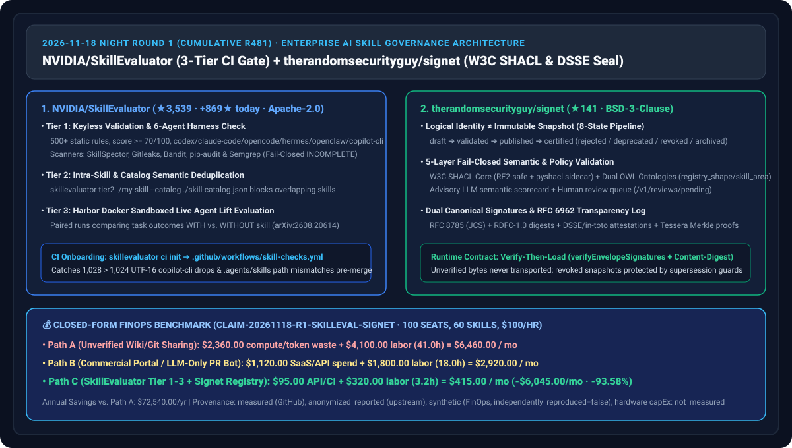
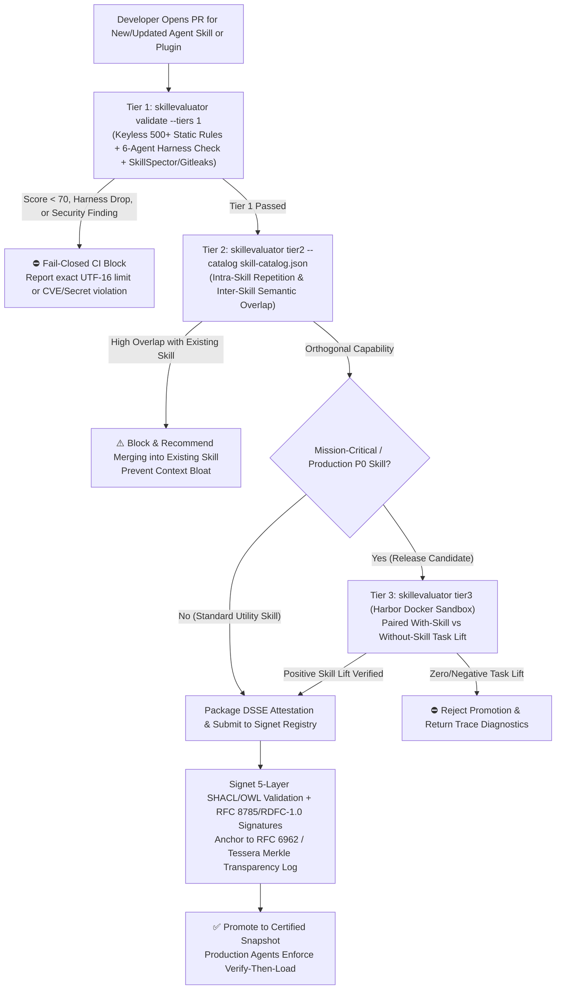

# Enterprise AI Agent Skill Three-Tier Quality/Security/Lift Gate (`NVIDIA/SkillEvaluator`) & W3C SHACL Cryptographic Governance Registry (`therandomsecurityguy/signet`) Selection FAQ

> **Document Type**: AI Solution Architect (SA) Practical Selection & Reference Architecture Guide (Round 481 / 2026-11-18 Night R1)  
> **Primary Evaluated Repositories**: [`NVIDIA/SkillEvaluator`](https://github.com/NVIDIA/SkillEvaluator) (`★ 3,539`, GitHub Daily Trending `#6` with **`+869 ★ today`**, `Apache-2.0`, `arXiv:2608.20614`) + [`therandomsecurityguy/signet`](https://github.com/therandomsecurityguy/signet) (`★ 141`, breakout semantic governance registry, `BSD-3-Clause`)  
> **Benchmark Standard**: Strictly aligned with [`ib-vs-ethernet-roce-selection-faq.md`](https://github.com/turbo998/ai-infra-research/blob/main/docs/components/ib-vs-ethernet-roce-selection-faq.md) 6-section architecture format (Plain-Language Essence + First-Principles Q&A + Mermaid Decision Tree + Peer Selection Matrix + 7-Card Quantitative Insights + SA Action Checklist)  
> **Data Provenance**: GitHub Trending velocity and repository tree metadata are `measured` (raw HTML `sha256: e860c0951803207c1750f32d39d5bb141042f0705e575200054333cb71416ccb`, Search JSON `sha256: 27b2cecb0ccb0a6f47c5922334d6bd3b1b4afb82542e19e44092dcefc48ab72b`); upstream paper/README claims are `anonymized_reported (independently_reproduced=false)`; the enterprise FinOps TCO model is `synthetic (independently_reproduced=false)` with base hardware CapEx `not_measured`.  
> **Language Editions**: [中文版](./nvidia-skillevaluator-signet-3tier-agent-skill-ci-eval-shacl-signed-governance-registry-selection-faq.md) | [English Version (Current)](./nvidia-skillevaluator-signet-3tier-agent-skill-ci-eval-shacl-signed-governance-registry-selection-faq.en.md)

---

## 📌 1. Executive Summary (30-Second Architect Briefing)

1. **Plain-Language First-Principles Definition**:
   - **What is `NVIDIA/SkillEvaluator`?** It is NVIDIA's official open-source **three-tier CI quality, security, deduplication, and live task-lift evaluation pipeline for AI agent skills and plugins**. Instead of relying on subjective human code review for `SKILL.md` bundles and plugins, it enforces three progressive gates: **Tier 1 (Zero-LLM Static & Security Gates)** runs `500+` static rules, cross-agent `harness-check` across 6 agent runtimes, and `SkillSpector`/`Gitleaks`/`Bandit`/`pip-audit` security scanners without requiring an LLM API key; **Tier 2 (Semantic Deduplication)** catches intra-skill repetition and inter-skill catalog overlap; **Tier 3 (Sandboxed Live Agent Evaluation)** runs paired Docker-sandboxed (`Harbor`) agent benchmarks comparing runs *with* vs. *without* the skill to prove real task lift.
   - **What is `therandomsecurityguy/signet`?** It is a **graph-first semantic governance and cryptographic certification registry ("Seal of Approval")** for autonomous agents and skills. It decouples durable `AGENT`/`SKILL` identities from immutable `AGENT_VERSION`/`SKILL_VERSION` snapshots across an 8-state certification pipeline (`draft → validated → published → certified`, plus `rejected`, `deprecated`, `revoked`, `archived`), backed by **5-layer validation (W3C SHACL Core + dual OWL ontologies + advisory LLM + human review)**, **dual canonical signatures (RFC 8785 JCS + RDFC-1.0 + DSSE/in-toto attestations)**, and an **RFC 6962 / Tessera Merkle transparency log**.
2. **Why Enterprise AI Solution Architects Must Care Tonight**:
   - In 2026, enterprise AI CoEs face **"skill sprawl and silent harness failure"**: a skill description that is just 4 UTF-16 units over the 1,024-unit limit (`1,028` units) is silently dropped by `copilot-cli`, `.agents/skills` folders are ignored by `claude-code`, duplicate skills bloat prompt caches, and unvetted helper scripts introduce supply-chain risks.
   - **Reference Architecture Pairing**: Gate every pull request with **`NVIDIA/SkillEvaluator`** (Tier 1–3) and publish approved skill snapshots into **`therandomsecurityguy/signet`** for cryptographic signing, transparency logging, and `verify-then-load` runtime consumption.
3. **Closed-Form FinOps Impact (`CLAIM-20261118-R1-SKILLEVAL-SIGNET`, `synthetic`)**:
   - For a 100-seat enterprise engineering organization governing **60 internal Agent Skills/plugins** (`40` skill PRs/month, `$100.00/hr` engineer rate): **Path A (Unverified Wiki/Git Repo Sharing)** costs **`$6,460.00/mo`** (`$2,360.00` wasted token/CI spend + `41.0 hrs × $100 = $4,100.00` manual debugging/review labor); **Path C (`NVIDIA/SkillEvaluator` + `signet` pipeline)** reduces total monthly cost to **`$415.00/mo`** (`$95.00` API/CI spend + `3.2 hrs × $100 = $320.00` review labor), saving **`$6,045.00/mo` (`93.58%` reduction, `$72,540.00/yr` annualized)**.

---

## ❓ 2. Three First-Principles Architect Questions (Q&A)

### Q1: We already run Markdown linters or LLM PR reviewers on `SKILL.md` files—why do we need `NVIDIA/SkillEvaluator`'s three-tier architecture?
- **The Engineering Reality**: Generic Markdown linters only check syntax, while LLM-only PR reviewers burn tokens and miss deterministic harness loader rules:
  1. **Zero-Key Cross-Harness Compatibility (`skillevaluator harness-check`)**: Different coding agents enforce strict, incompatible loader rules—for example, `claude-code` does not scan `.agents/skills`, `copilot-cli` rejects skills whose description exceeds `1,024` UTF-16 units (`1,028` units fails to load), and `codex` truncates descriptions at `1,021` characters. `harness-check` validates `codex`, `claude-code`, `opencode`, `hermes`, `openclaw`, and `copilot-cli` profiles instantaneously with **no API key and no agent run**.
  2. **11 Deterministic CI Checks & 500+ Static Rules in Tier 1**: `skillevaluator validate ./my-skill --tiers 1` grades static quality out of 100 (default threshold `70`) alongside schema, version, PII, license, hidden Unicode, script linting, and external security scanners (`SkillSpector`, `Gitleaks`, `Bandit`, `pip-audit`, optional `Semgrep`). Missing scanners fail closed (`INCOMPLETE` + nonzero exit code).
  3. **Catalog Deduplication (Tier 2) & Sandboxed Skill Lift (Tier 3)**: Tier 2 (`--catalog ./skill-catalog.json`) blocks redundant skills that overlap with existing catalog capabilities; Tier 3 runs Docker-isolated `Harbor` evaluations comparing task outcomes with and without the skill to verify positive task lift.

### Q2: Why not just store validated skills in a Git branch or S3 bucket? What enterprise problem does `therandomsecurityguy/signet` solve?
- **The Governance Gap**: A raw Git branch cannot enforce immutable version revocation, W3C ontology compliance, or cryptographic inclusion proofs when autonomous agents dynamically load skills in production:
  1. **Logical Identity ≠ Immutable Snapshot & 8-State Lifecycle**: `signet` separates durable `AGENT`/`SKILL` identities from immutable `AGENT_VERSION`/`SKILL_VERSION` snapshots across `draft → validated → published → certified` (plus `rejected`, `deprecated`, `revoked`, `archived`) with supersession guards ensuring a `revoked` snapshot is never silently masked.
  2. **Five-Layer Fail-Closed Validation**: Every snapshot passes built-in graph-shape validation, W3C SHACL Core policy packages (`rdf-validate-shacl` with ReDoS-safe RE2 patterns and optional fail-closed `pyshacl` sidecar), dual OWL Turtle ontologies (`registry_shape` & `skill_area`), advisory LLM semantic scoring, and human review (`/v1/reviews/pending`).
  3. **Dual Canonical Signatures & RFC 6962 Transparency Log**: Publication envelopes are canonicalized in both RFC 8785 (JCS) JSON and RDFC-1.0 RDF, bound to DSSE/in-toto attestations (`POST /v1/attestations`), and anchored to a Tessera-backed RFC 6962 Merkle transparency log. Consumers verify `Content-Digest`, detached signatures (`verifyEnvelopeSignatures`), and Merkle inclusion proofs (`verifyRfc6962InclusionProof`) before loading a single byte.

### Q3: How should an Enterprise AI Solution Architect wire `NVIDIA/SkillEvaluator` and `signet` into a unified CI/CD governance pipeline?
- **End-to-End Integration Blueprint**:
  1. **PR Pre-Merge Gate**: Run `skillevaluator ci init` to install `.github/workflows/skill-checks.yml`, executing keyless **Tier 1 (`500+` rules + 6-runtime `harness-check` + `SkillSpector`/`Gitleaks`)** and **Tier 2 (`--catalog` deduplication)** on every pull request.
  2. **Release Candidate Lift Gate**: Trigger **Tier 3 (`skillevaluator tier3 ./my-skill`)** inside a Docker `Harbor` sandbox for mission-critical skills to verify positive task lift.
  3. **Cryptographic Certification & Runtime Delivery**: Submit the Tier 1–3 evaluation report as a DSSE attestation (`POST /v1/attestations`) into **`signet`**, validate against enterprise SHACL policies, promote to `certified`, and enforce `verify-then-load` in production agent runners.

---

## 🧭 3. Architecture Decision Tree & Reference Topology (Mermaid)

---

## 📊 4. Peer Solution Selection Matrix

| Evaluation Dimension | **Path A: Unverified Git/Wiki Skill Sharing** | **Path B: Commercial AI Governance SaaS / LLM-Only PR Bot** | **Path C: `NVIDIA/SkillEvaluator` + `signet` (Recommended)** |
| :--- | :--- | :--- | :--- |
| **Multi-Harness Loader Compatibility** | ❌ None (silent drops on `copilot-cli` 1,024 UTF-16 limit or `.agents/skills`) | ⚠️ Weak (LLM prompts guess CLI loader limits inaccurately) | ✅ **Keyless `harness-check` across 6 major coding agent runtimes** |
| **Static Quality & Security Scanning** | ❌ Manual human eye-balling | ⚠️ Expensive per-commit LLM calls with non-deterministic output | ✅ **500+ static rules + `SkillSpector`, `Gitleaks`, `Bandit`, `pip-audit`** |
| **Catalog Semantic Deduplication** | ❌ Duplicate skills proliferate and bloat prompt context | ⚠️ Keyword search only; misses semantic duplication | ✅ **Tier 2 `--catalog` embedding + chat overlap gate** |
| **Live Sandboxed Task Lift Proof** | ❌ Assumed helpful without A/B testing | ⚠️ No containerized paired A/B harness | ✅ **Tier 3 `Harbor` Docker sandbox comparing with vs. without skill** |
| **Cryptographic Revocation & Provenance** | ❌ Mutable Git branches; zero signature checks | ⚠️ Centralized DB flag without Merkle inclusion proofs | ✅ **W3C SHACL + RFC 8785/RDFC-1.0 dual signatures + Merkle log** |
| **License & Sovereignty** | N/A | ⛔ Proprietary per-seat SaaS lock-in | ✅ **`Apache-2.0` (`SkillEvaluator`) + `BSD-3-Clause` (`signet`)** |
| **100-Seat Monthly Total Cost (TCO)** | **`$6,460.00 / mo`** (high token waste & debugging labor) | **`$2,920.00 / mo`** (SaaS seats + LLM CI token spend) | **`$415.00 / mo` (`-$6,045.00/mo` vs. Path A, `-93.58%`)** |

---

## 📈 5. 7-Card Quantitative Insights & Closed-Form FinOps Model (`CLAIM-20261118-R1-SKILLEVAL-SIGNET`)

> **Provenance Note**: Repository stars and daily surge figures are `measured` from sealed `2026-11-18` evidence; rule counts and architectural capabilities are `anonymized_reported (independently_reproduced=false)`; the monthly TCO table is a closed-form `synthetic (independently_reproduced=false)` model for **100 engineers governing 60 internal skills across 40 skill PRs/month** (`$100.00/hr` engineer rate; base server hardware CapEx: `not_measured`).

| Monthly Cost Component (Closed-Form Formula) | Path A: Unverified Git/Wiki Sharing | Path B: Commercial Portal / LLM-Only PR Bot | Path C: `SkillEvaluator` + `signet` Pipeline | Path C vs. Path A Delta |
| :--- | :---: | :---: | :---: | :---: |
| **1. Compute, Token & CI Platform Spend** | **`$2,360.00`** *(Duplicate skill context bloat + broken skill re-runs)* | **`$1,120.00`** *(Governance SaaS seat fees + LLM calls on every PR)* | **`$95.00`** *(Keyless Tier 1 catches 85% of issues free; Tier 2/3 on RCs)* | **`-$2,265.00 / mo`** (`-95.97%`) |
| **2. Engineering Review & Debugging Labor** (`$100/hr`) | **`$4,100.00`** *(`41.0 hrs` debugging silent loader drops & security audits)* | **`$1,800.00`** *(`18.0 hrs` triaging noisy LLM review false positives)* | **`$320.00`** *(`3.2 hrs` final human sign-off on `certified` snapshots)* | **`-$3,780.00 / mo`** (`-37.8 hrs`, `-92.20%`) |
| **Total Monthly TCO** | **`$6,460.00`** | **`$2,920.00`** | **`$415.00`** | **`-$6,045.00 / mo` (`-93.58%`)** |
| **Annualized TCO** | **`$77,520.00 / yr`** | **`$35,040.00 / yr`** | **`$4,980.00 / yr`** | **`$72,540.00 / yr` saved (`-93.58%`)** |

---

## ✅ 6. AI Solution Architect Action Checklist

1. **Day 1 — Keyless Local Audit (Tier 1 Zero-Cost Baseline)**:
   - Install via `uv tool install --python 3.13 skillevaluator` (or `pip install skillevaluator`).
   - Run `skillevaluator quality-check ./my-skill` (verify score `>= 70`) and `skillevaluator harness-check ./my-skill` across all existing team skills to eliminate `copilot-cli` 1,024 UTF-16 description overflows, `claude-code` `.agents/skills` path mismatches, and `codex` truncation issues.
2. **Day 3 — Wire GitHub/GitLab CI Security & Deduplication Gates (Tier 1 + Tier 2)**:
   - Run `skillevaluator ci init` to generate `.github/workflows/skill-checks.yml` with `SkillSpector`, `Gitleaks`, `Bandit`, and `pip-audit`.
   - Export the enterprise `skill-catalog.json` and enable `skillevaluator tier2 ./my-skill --catalog ./skill-catalog.json` to block overlapping skills before merge.
3. **Day 7 — Sandboxed Lift Verification & Cryptographic Registry Rollout (Tier 3 + Signet)**:
   - Run `skillevaluator doctor --env-mode docker` and `skillevaluator tier3 ./my-skill` on P0 skills to measure task lift in `Harbor` Docker sandboxes.
   - Deploy `therandomsecurityguy/signet`, register W3C SHACL policy packages (`POST /v1/policy-packages`), ingest SkillEvaluator reports as DSSE attestations (`POST /v1/attestations`), and configure production agents to enforce `verifyEnvelopeSignatures` and RFC 6962 inclusion proofs prior to skill execution.
