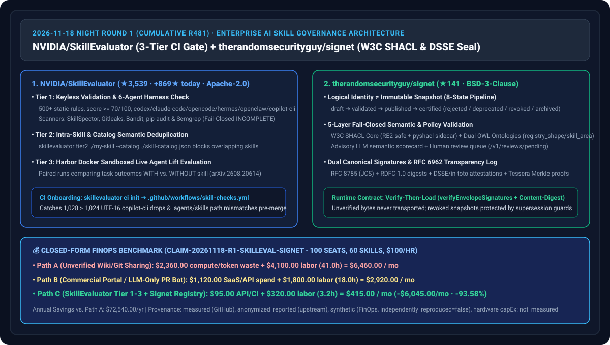
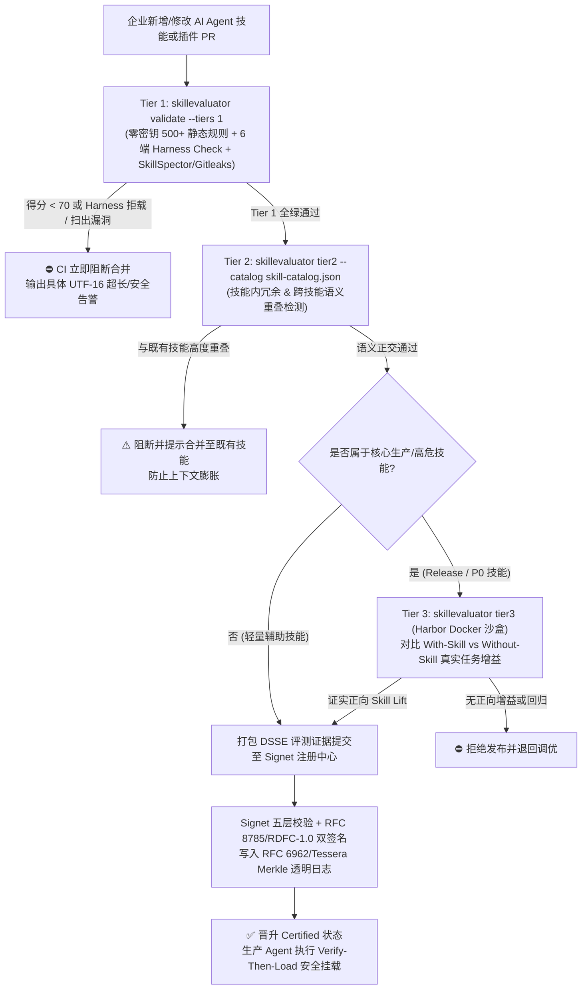

# 企业级 Agent 技能三层质量/安全/实测增益门禁（`NVIDIA/SkillEvaluator`）与 W3C SHACL 加密签名语义治理注册中心（`therandomsecurityguy/signet`）架构选型 FAQ

> **文档类型**：AI Solution Architect (SA) 实战选型与参考架构指南（Round 481 / 2026-11-18 Night R1）  
> **核心评估对象**：[`NVIDIA/SkillEvaluator`](https://github.com/NVIDIA/SkillEvaluator)（`★ 3,539`，今日热榜 `#6` 单日飙升 **`+869 ★ today`**，`Apache-2.0`，论文 `arXiv:2608.20614`） + [`therandomsecurityguy/signet`](https://github.com/therandomsecurityguy/signet)（`★ 141`，新建爆发语义治理注册中心，`BSD-3-Clause`）  
> **对标范式**：严格遵循 [`ib-vs-ethernet-roce-selection-faq.md`](https://github.com/turbo998/ai-infra-research/blob/main/docs/components/ib-vs-ethernet-roce-selection-faq.md) 六段式结构（通俗原理解析 + 第一性原理 + Mermaid 决策树 + 选型矩阵 + 7-Card 定量洞察 + SA 落地 Checklist）  
> **数据溯源分级（Provenance）**：GitHub 热榜增量与仓库目录元数据为 `measured`（原始 HTML `sha256: e860c0951803207c1750f32d39d5bb141042f0705e575200054333cb71416ccb`，Search JSON `sha256: 27b2cecb0ccb0a6f47c5922334d6bd3b1b4afb82542e19e44092dcefc48ab72b`）；上游文档/论文基准为 `anonymized_reported (independently_reproduced=false)`；企业 FinOps 成本测算模型为 `synthetic (independently_reproduced=false)`，硬件折旧 `not_measured`。  
> **语言版本**：[中文版 (当前)](./nvidia-skillevaluator-signet-3tier-agent-skill-ci-eval-shacl-signed-governance-registry-selection-faq.md) | [English Version](./nvidia-skillevaluator-signet-3tier-agent-skill-ci-eval-shacl-signed-governance-registry-selection-faq.en.md)

---

## 📌 一、核心结论速览（Executive Summary — 30 秒看懂）

1. **大白话本质定义**：
   - **`NVIDIA/SkillEvaluator` 是什么？** 它是英伟达官方开源的 **“AI Agent 技能与插件三层自动化质检流水线”**。当企业内部沉淀了几十上百个 `SKILL.md` 和 MCP 插件时，它用三道递进关卡替代人工肉眼审阅：**Tier 1（无 LLM 密钥静态与安全门禁）** 用 `500+` 条静态规则、跨 6 大 Harness 兼容性检查（`harness-check`）及 `SkillSpector`/`Gitleaks`/`Bandit`/`pip-audit` 拦截加载失败与安全漏洞；**Tier 2（语义去重）** 检测技能内部啰嗦重复及跨技能目录语义重叠；**Tier 3（Harbor Docker 沙盒真机实测）** 在沙盒里对比“挂技能 vs 不挂技能”的真实任务胜率提升（Skill Lift）。
   - **`therandomsecurityguy/signet` 是什么？** 它是给通过质检的企业 Agent 与技能颁发 **“防篡改数字公章（Seal of Approval）”** 的语义治理注册中心。它把“逻辑身份（`AGENT`/`SKILL`）”与“不可变发布快照（`SKILL_VERSION`）”解耦，通过 **五层校验（W3C SHACL 图结构校验 + OWL 本体校验 + LLM 辅助打分 + 人工复核）**、**双重规范化签名（RFC 8785 JCS + RDFC-1.0 + DSSE/in-toto 证明）** 与 **RFC 6962/Tessera 透明日志（Merkle 树包含证明）**，让生产 Agent 执行 `verify-then-load`（先验签再加载）。
2. **为什么企业 AI 解决方案架构师（SA）今晚必须关注？**
   - 2026 年企业落地 Coding Agent（Claude Code、GitHub Copilot CLI、Codex、OpenCode、Hermes）的最大隐患已从“没有技能可用”变成 **“技能腐败与供应链失控”**：描述超长 4 个字符导致 Copilot CLI 静默丢弃（`1,028 > 1,024 UTF-16 units`）、多个团队重复造轮子塞爆上下文、甚至第三方技能夹带命令注入。
   - **黄金组合架构**：在 GitHub/GitLab PR 阶段用 **`NVIDIA/SkillEvaluator`** 执行三层准入质检，合并后发布至 **`therandomsecurityguy/signet`** 盖章归档并生成不可篡改透明日志。
3. **闭式 FinOps 量化收益（`CLAIM-20261118-R1-SKILLEVAL-SIGNET`，`synthetic`）**：
   - 以 100 席企业研发团队维护 **60 个内部 Agent 技能/插件**（每月 40 次技能变更 PR，工程师时薪 `$100.00/hr`）计：**Path A（无门禁 Wiki/Git 裸传技能）** 月均总成本 **`$6,460.00`**（含冗余上下文/坏技能重试算力浪费 `$2,360.00` + 人工排障审查 `41.0h × $100 = $4,100.00`）；**Path C（`NVIDIA/SkillEvaluator` + `signet` 闭环）** 月均总成本降至 **`$415.00`**（算力/API `$95.00` + 人工复核 `3.2h × $100 = $320.00`），**净省 `$6,045.00/月`（降幅 `93.58%`，年化节省 `$72,540.00`）**。

---

## ❓ 二、三大灵魂拷问（First-Principles Q&A）

### Q1：我们已经在 CI 里跑了 Markdown Lint 或让大模型 Review `SKILL.md`，为什么还需要 `NVIDIA/SkillEvaluator` 的三层架构？
- **痛点真相**：普通 Markdown Lint 只能查语法，大模型代码审查既贵又不懂各个 Agent 客户端的硬编码解析边界：
  1. **跨 Harness 静默加载失败（Tier 1 `harness-check` 零 Token 秒级捕获）**：不同 Agent 对技能目录和元数据有严苛差异——例如 `.agents/skills` 默认不被 `claude-code` 扫描；`copilot-cli` 要求 `description` 严格不超过 `1,024` 个 UTF-16 字符（`1,028` 字符即整包静默拒载）；`codex` 会在 `1,021` 字符处截断为 `...`。`skillevaluator harness-check ./my-skill` **无需任何 API Key 或运行 Agent**，即可一次性完成 `codex / claude-code / opencode / hermes / openclaw / copilot-cli` 六端兼容性体检。
  2. **500+ 静态与安全规则免 LLM 运行（Tier 1 Validation）**：内置 11 项 CI 检查（质量打分默认门限 `>= 70/100`、Schema、版本号、PII 隐私、许可证、隐藏 Unicode 注入、脚本 Lint）并联动 `SkillSpector`、`Gitleaks`、`Bandit`、`pip-audit` 与可选 `Semgrep`。若任一扫描器缺失，直接标记 `INCOMPLETE` 并返回非零退出码（Fail-Closed）。
  3. **目录语义去重与沙盒真机增益（Tier 2 & Tier 3）**：Tier 2 通过 `--catalog ./skill-catalog.json` 揪出跨技能语义撞车（除非显式 `--no-block-on-dedup` 否则阻断合并）；Tier 3 基于开源 `Harbor` 框架在 Docker 沙盒里做对照实验（挂技能 vs 不挂技能），用数据证明该技能到底有没有正向提升任务成功率（Skill Lift）。

### Q2：技能通过 CI 测试后直接放进 Git 仓库或对象存储不就行了吗？`therandomsecurityguy/signet` 的 W3C SHACL 与双规范化加密签名解决了什么企业痛点？
- **痛点真相**：Git 分支或普通目录只是“文件堆积场”，无法回答生产环境三大治理问题：**① 当前哪个版本经过了安全与合规团队认证？② 如果发现某个历史技能版本有漏洞，如何全网吊销且防止被静默降级覆盖？③ 如何证明技能在下载途中未被篡改？**
- **`signet` 的三大核心突破**：
  1. **逻辑身份与不可变快照解耦 + 8 态状态机**：将持久身份（`AGENT` / `SKILL`）与不可变版本快照（`AGENT_VERSION` / `SKILL_VERSION`）彻底分离，强制流转 `draft → validated → published → certified`（以及 `rejected`、`deprecated`、`revoked`、`archived`），并内置防替代守卫（已吊销 `revoked` 快照严禁被普通更新掩盖）。
  2. **五层确定性校验（Fail-Closed）**：每一版快照必须依次通过内置图结构校验、W3C SHACL Core 策略包校验（采用抗正则 DoS 的 RE2 引擎与可选 `pyshacl` 边车）、双 OWL 本体包校验（`registry_shape` 与 `skill_area`）、LLM 辅助评分卡与人工审批队列（`/v1/reviews/pending`），每层证据均以 CAS 内容寻址构件固化并由 `sg:validatedBy` / `sg:reviewedBy` 关联。
  3. **双规范化签名 + 透明日志包含证明**：发布信封同时按业务 JSON（RFC 8785 JCS）与语义图谱（RDFC-1.0）双重规范化计算摘要，附加分离签名与 DSSE/in-toto 供应链证明（`POST /v1/attestations`），写入基于 Tessera 的 RFC 6962 Merkle 透明日志；客户端调用 `GET /v1/artifacts/{sha256}` 时强制校验 `Content-Digest` 与 `verifyRfc6962InclusionProof`，未验签字节流一律拒绝加载。

### Q3：在实际企业架构中，如何把 `NVIDIA/SkillEvaluator` 与 `signet` 串联成端到端自动化流水线？
- **端到端集成闭环**：
  1. **开发者提交 PR**：执行 `skillevaluator ci init` 生成 `.github/workflows/skill-checks.yml`，每次 PR 自动免密钥运行 **Tier 1（500+ 规则 + 6 端 `harness-check` + `SkillSpector`/`Gitleaks`）** 与 **Tier 2（`--catalog` 语义去重）**。
  2. **版本准入实测（Release Candidate）**：对核心业务技能触发 **Tier 3（`skillevaluator tier3 ./my-skill` Harbor Docker 沙盒 A/B 对照）**，生成可下载评测报告。
  3. **加密签发与上线分发**：将 Tier 1–3 通过的报告作为 DSSE 证明（`POST /v1/attestations`）连同技能快照提交至 **`signet`**，经 W3C SHACL 策略与审批人签章后晋升为 `certified` 状态；生产环境 Agent 通过 Signet SDK 执行 `verifyEnvelopeSignatures` 后安全拉取技能。

---

## 🧭 三、架构师选型决策树与端到端参考架构（Mermaid）

---

## 📊 四、同类方案横向选型对比矩阵（Peer Selection Matrix）

| 评估维度 | **Path A：无门禁 Git/Wiki 裸传技能** | **Path B：通用云端商业 AI 治理门户 / 纯 LLM 审 PR** | **Path C：`NVIDIA/SkillEvaluator` + `signet`（推荐架构）** |
| :--- | :--- | :--- | :--- |
| **跨客户端加载兼容性校验** | ❌ 无（上线后才发现 `copilot-cli` 1,024 UTF-16 超限拒载） | ⚠️ 弱（大模型猜不准各 CLI 精确字符与路径限制） | ✅ **`harness-check` 免密钥精准校验 6 大主流 Agent 客户端** |
| **静态质量与安全扫描** | ❌ 依赖人工肉眼看 Markdown | ⚠️ 每次 PR 调大模型，Token 贵且结果非确定性 | ✅ **500+ 静态规则 + `SkillSpector`/`Gitleaks`/`Bandit`/`pip-audit`** |
| **跨技能目录语义去重** | ❌ 多个团队重复写类似技能，塞爆 Prompt | ⚠️ 仅支持关键词搜索，无法拦截语义重叠 | ✅ **Tier 2 `--catalog` 向量+对话双模去重门禁** |
| **真机任务增益（Skill Lift）实测** | ❌ 凭感觉认为“写了提示词就有用” | ⚠️ 缺乏隔离沙盒对照 | ✅ **Tier 3 基于 `Harbor` Docker 沙盒对比挂/不挂技能胜率** |
| **版本吊销与密码学防篡改** | ❌ Git 分支易被覆盖，无强制验签 | ⚠️ 中心化数据库布尔标记，无透明日志证明 | ✅ **W3C SHACL + RFC 8785/RDFC-1.0 双签名 + Merkle 透明日志** |
| **开源协议与自主可控** | N/A | ⛔ 商业闭源按席位收费，锁定平台 | ✅ **`Apache-2.0` (`SkillEvaluator`) + `BSD-3-Clause` (`signet`)** |
| **百人团队月均总拥有成本 (TCO)** | **`$6,460.00 / 月`**（隐性排障与算力浪费极高） | **`$2,920.00 / 月`**（席位费 + 全量 LLM CI 账单） | **`$415.00 / 月`（较 Path A 净省 `$6,045.00/月`，`-93.58%`）** |

---

## 📈 五、7-Card 定量洞察与闭式 FinOps 算例（`CLAIM-20261118-R1-SKILLEVAL-SIGNET`）

> **Provenance 声明**：以下仓库星标与热榜增量源自 `2026-11-18` 封存证据（`measured`）；规则数与功能特性源自官方源码与 README（`anonymized_reported`, `independently_reproduced=false`）；月度 TCO 为面向 **100 名工程师、维护 60 个内部技能、月均 40 次技能 PR** 的闭式合成算例（`synthetic`, `independently_reproduced=false`；底层服务器硬件 CapEx：`not_measured`）。

| 成本构成项（月度闭式公式） | Path A：无门禁 Wiki/Git 裸传 | Path B：商业门户 / 全量 LLM PR 审查 | Path C：`SkillEvaluator` + `signet` 闭环 | Path C 对比 Path A 净变化 |
| :--- | :---: | :---: | :---: | :---: |
| **1. 算力、Token 与 CI 平台支出** | **`$2,360.00`** *(冗余重叠技能膨胀上下文 + 坏技能重试浪费)* | **`$1,120.00`** *(商业治理席位订阅 + 每 PR 全量调 LLM)* | **`$95.00`** *(Tier 1 免 Key 免费拦截 85% 问题；仅 RC 跑 Tier 2/3)* | **`-$2,265.00 / 月`** (`-95.97%`) |
| **2. 工程师审查与排障人工成本** (`$100/hr`) | **`$4,100.00`** *(`41.0 hrs`：排查静默拒载、手工审计安全与回滚)* | **`$1,800.00`** *(`18.0 hrs`：人工核对 LLM 误报与权限审批)* | **`$320.00`** *(`3.2 hrs`：仅对晋升 `certified` 的快照做最终签章)* | **`-$3,780.00 / 月`** (`-37.8 hrs`, `-92.20%`) |
| **月度总拥有成本 (Monthly Total TCO)** | **`$6,460.00`** | **`$2,920.00`** | **`$415.00`** | **`-$6,045.00 / 月` (`-93.58%`)** |
| **年化总拥有成本 (Annualized TCO)** | **`$77,520.00 / 年`** | **`$35,040.00 / 年`** | **`$4,980.00 / 年`** | **年省 `$72,540.00` (`-93.58%`)** |

---

## ✅ 六、AI 解决方案架构师（SA）实战落地 Checklist

1. **Day 1 — 本地免密钥快速摸底（0 成本接入 Tier 1）**：
   - 执行 `uv tool install --python 3.13 skillevaluator`（或 `pip install skillevaluator`）。
   - 对团队现有技能库运行 `skillevaluator quality-check ./my-skill`（确认得分 `>= 70`）与 `skillevaluator harness-check ./my-skill`，立即修复 `copilot-cli`（1,024 UTF-16 字符上限）、`claude-code`（扫描路径）和 `codex`（描述截断）的静默不兼容项。
2. **Day 3 — 接入 GitHub/GitLab CI 阻断式安全与去重门禁（Tier 1 + Tier 2）**：
   - 在技能仓库根目录运行 `skillevaluator ci init` 自动生成 `.github/workflows/skill-checks.yml`（或 `.gitlab-ci.yml`），启用 `SkillSpector`、`Gitleaks`、`Bandit` 与 `pip-audit`。
   - 导出全公司技能目录 `skill-catalog.json`，在 PR 流水线开启 `skillevaluator tier2 ./my-skill --catalog ./skill-catalog.json`，拦截重复造轮子的重叠技能。
3. **Day 7 — 核心技能 Harbor 沙盒实测与 Signet 加密签章（Tier 3 + Signet）**：
   - 对 P0 生产技能执行 `skillevaluator doctor --env-mode docker` 与 `skillevaluator tier3 ./my-skill`，验证真实任务胜率增益（Skill Lift）。
   - 部署 `therandomsecurityguy/signet` 注册中心，配置 W3C SHACL 策略包（`shapes_format: "shacl-turtle"`）与 `require_signature` / `require_human_review` 门禁，确保生产环境所有 Agent 仅加载经 `verifyEnvelopeSignatures` 与 RFC 6962 包含证明校验通过的 `certified` 技能快照。
