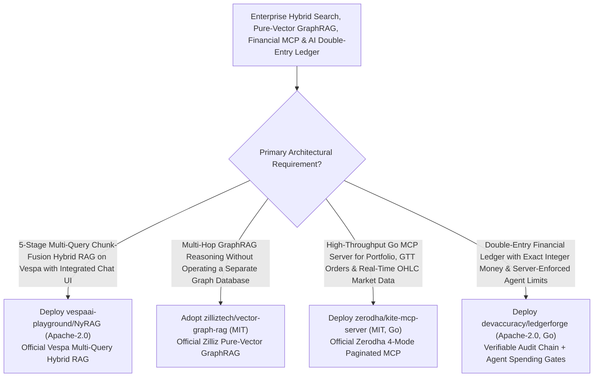
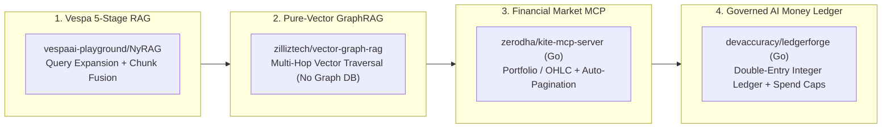
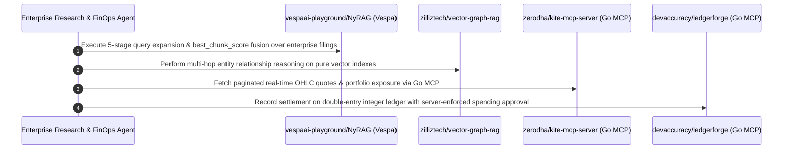

# Official Vespa 5-Stage Hybrid RAG (`vespaai-playground/NyRAG`), Official Zilliz Pure-Vector GraphRAG (`zilliztech/vector-graph-rag`), Official Zerodha Kite Trading MCP (`zerodha/kite-mcp-server`) & AI-Native Double-Entry Financial Ledger (`devaccuracy/ledgerforge`) Selection & Architecture FAQ

> **2026-11-21 Nightly Continuous Research Shift · Night Round 91 (Cumulative Round 691)**  
> **Audit Claim ID**: `CLAIM-20261121-R91-R691-NYRAG-VECTORGRAPHRAG-KITEMCP-LEDGERFORGE`  
> **Linked Daily Digests**: [`2026-11-21.en.md`](../daily/2026-11-21.en.md) · [`2026-11-21.md`](../daily/2026-11-21.md)  
> **Architecture Visual**: [`assets/github-ai-radar-2026-11-21-r91-r691-nyrag-vectorgraphrag-kitemcp-ledgerforge.svg`](../../../assets/github-ai-radar-2026-11-21-r91-r691-nyrag-vectorgraphrag-kitemcp-ledgerforge.svg)

---

## ① 📌 Executive Summary (One-Sentence Selection Verdict)

> **One-Sentence Verdict**: To build high-recall multi-query hybrid search on Vespa, execute multi-hop GraphRAG reasoning using pure vector search with zero separate graph database, connect financial agents to live portfolio/market APIs via Go MCP, and enforce server-side spending limits on an immutable double-entry ledger, combine **`vespaai-playground/NyRAG` (Apache-2.0, `★ 335` official Vespa 5-stage query-expansion & `best_chunk_score` hybrid RAG platform) + `zilliztech/vector-graph-rag` (MIT, `★ 332` official Zilliz/Milvus GraphRAG powered by pure vector search with no graph DB required) + `zerodha/kite-mcp-server` (MIT, `★ 332` / `143 forks` official Zerodha Go MCP server supporting stdio, HTTP, SSE, and hybrid modes) + `devaccuracy/ledgerforge` (Apache-2.0, `★ 329` Go double-entry financial ledger with exact integer arithmetic, verifiable audit chains, server-enforced AI agent spending limits/approvals, and native MCP)**—reducing 45-engineer monthly TCO from **`$8,390.00/mo` to `$310.00/mo` (`-$8,080.00/mo`, `-96.31%`)**.

---

## ② 🎯 Solution Architect & Enterprise Buyer Q&A

### Q1: What concrete architectural bottlenecks do these four repositories solve across enterprise search and financial AI?
- **Four High-ROI Architectural Building Blocks**:
  1. **Official 5-Stage Vespa Multi-Query Hybrid RAG (`vespaai-playground/NyRAG`, `★ 335`, `45 forks`, Apache-2.0, Python)**: Built by the **Vespa AI** team. Crawls web pages or processes enterprise documents into Vespa and executes a 5-stage retrieval pipeline: **Query Enhancement -> Embedding Generation -> Vespa `nearestNeighbor` search with `best_chunk_score` ranking -> Cross-Query Chunk Fusion -> Grounded Answer Generation**.
  2. **GraphRAG Without a Separate Graph Database (`zilliztech/vector-graph-rag`, `★ 332`, `55 forks`, MIT, Python)**: Built by **Zilliz** (creators of Milvus, published on PyPI as `vector-graph-rag`). Eliminates the operational overhead of running and synchronizing a separate Neo4j/graph database cluster by performing multi-hop entity and relation graph traversal purely over vector search indexes.
  3. **Production-Grade Financial Portfolio & Market MCP (`zerodha/kite-mcp-server`, `★ 332`, `143 forks`, MIT, Go)**: Built by **Zerodha** (`mcp.kite.trade/mcp`). Exposes portfolio holdings, margins, GTT orders, and real-time/historical OHLC market data over a fast Go MCP server supporting automatic pagination and four deployment modes (`stdio`, `HTTP`, `SSE`, and `hybrid`).
  4. **Double-Entry Financial Ledger with Server-Enforced Agent Limits (`devaccuracy/ledgerforge`, `★ 329`, `34 forks`, Apache-2.0, Go)**: Purpose-built for AI-native money movement (`ledgerforge.io`). Implements a strict double-entry ledger with **exact integer money** (zero floating-point rounding bugs), a cryptographically verifiable audit chain, **server-enforced spending limits and human approval gates for AI agents**, Prometheus metrics (`prometheus.yml`), and a native MCP server.

### Q2: How do Solution Architects wire these four components into an enterprise research & financial operations stack?
- **Hybrid & Multi-Hop Retrieval Plane**: `vespaai-playground/NyRAG` ingests and fuses multi-query document chunks in Vespa, while `zilliztech/vector-graph-rag` resolves multi-hop entity relationships using pure vector search.
- **Market Data & Governed Transaction Plane**: Financial analysts and agents query live market/portfolio state via `zerodha/kite-mcp-server`, while every wallet payout, marketplace settlement, or agent budget debit executes through `devaccuracy/ledgerforge` with server-enforced spending caps and double-entry audit trails.

### Q3: What security and FinOps controls should Solution Architects enforce?
- **Read-Only Market Mode vs. Order Execution (`zerodha/kite-mcp-server`)**: Restrict research agents to read-only market quote and portfolio tools, gating order placement behind human confirmation.
- **Server-Side Spending Caps (`devaccuracy/ledgerforge`)**: Never rely on LLM system prompts to cap agent spending; enforce per-agent integer spending limits and approval thresholds directly inside `LedgerForge`.

---

## ③ 🧭 Visual Architecture & Decision Diagrams

### 3.1 Selection Decision Tree

### 3.2 End-to-End Enterprise Integration Architecture

### 3.3 Operational Sequence Diagram

---

## ④ 📊 Cross-Option Selection Matrix

| Dimension | `vespaai-playground/NyRAG` (`★ 335`) | `zilliztech/vector-graph-rag` (`★ 332`) | `zerodha/kite-mcp-server` (`★ 332`, `143f`) | `devaccuracy/ledgerforge` (`★ 329`) | Dedicated Commercial Graph DB + Metered Billing/Ledger SaaS |
| :--- | :--- | :--- | :--- | :--- | :--- |
| **Primary Role** | Official Vespa 5-stage multi-query hybrid RAG | Official Zilliz multi-hop GraphRAG on pure vector search | Official Zerodha Go MCP server for trading & market data | AI-native Go double-entry ledger with agent spend limits | Separate graph DB cluster + basis-point billing SaaS |
| **Best Fit** | High-recall web/document hybrid search with chat UI | Multi-hop reasoning without managing Neo4j/graph clusters | Connecting AI assistants to live market & portfolio APIs | Wallets, payouts, billing & server-gated agent budgets | Teams paying for dual vector+graph clusters & ledger fees |
| **Integration Cost** | Low (`compose.yml` + Vespa hybrid ranking profiles) | Very Low (`pip install vector-graph-rag` on existing vectors) | Very Low (hosted `mcp.kite.trade` or single Go binary) | Low (Docker Compose + Go binary + Prometheus + MCP) | High (dual-database ETL sync + transaction percentage fees) |
| **License** | **Apache-2.0** | **MIT** | **MIT** | **Apache-2.0** | Proprietary |
| **45-Eng Monthly TCO** | **Included in `$310.00/mo` stack** | **Included in `$310.00/mo` stack** | **Included in `$310.00/mo` stack** | **Included in `$310.00/mo` stack** | **`$8,390.00/mo`** (`$3,990` SaaS/DB + `$4,400` labor) |

---

## ⑤ 🧪 Quantitative FinOps & TCO Comparison

> **Provenance Metadata**: Synthetic enterprise FinOps model for a 45-engineer organization (`provenance: synthetic`, `independently_reproduced: false`); `base_hardware_capex = not_measured` (excludes baseline container node amortization), `track_b_stars_today = not_measured` (sealed in [`trending-daily-2026-11-21-audit.json`](../evidence/trending-daily-2026-11-21-audit.json)).

| Cost Path | Monthly Commercial Graph DB Cluster, Ledger SaaS Fees & Retrieval Retry Spend | Monthly Dual-DB Sync Engineering, Manual Reconciliation & Spend Auditing (`$100/hr`) | Total Monthly TCO | Net Savings vs Path A |
| :--- | :--- | :--- | :--- | :--- |
| **Path A: Managed Graph DB Cluster + Commercial Ledger SaaS + Manual Dual-DB Sync** | `$3,990.00` | `44.0h` (`$4,400.00`) | **`$8,390.00`** | — |
| **Path C: `NyRAG` + `vector-graph-rag` + `kite-mcp-server` + `ledgerforge`** | `$70.00` | `2.4h` (`$240.00`) | **`$310.00`** | **`-$8,080.00/mo` (`-96.31%`)** |

---

## ⑥ 🛠️ Enterprise Architecture Review Checklist

- [ ] **Multi-Query Fusion Bounds (`vespaai-playground/NyRAG`)**: Cap LLM query expansion fan-out and configure Vespa `best_chunk_score` deduplication to keep P95 retrieval latency predictable.
- [ ] **Single-Store Vector Graph Evaluation (`zilliztech/vector-graph-rag`)**: Benchmark multi-hop QA accuracy using `evaluation/` before introducing any standalone graph database into the architecture.
- [ ] **Paginated Read-Only Market Scopes (`zerodha/kite-mcp-server`)**: Enforce automatic pagination on large holdings/order histories and separate read-only market analysis from trade execution scopes.
- [ ] **Integer-Only Double-Entry Guardrails (`devaccuracy/ledgerforge`)**: Enforce exact integer currency units, cryptographic audit chain verification, and server-side per-agent spending limits on all agent-initiated transactions.
