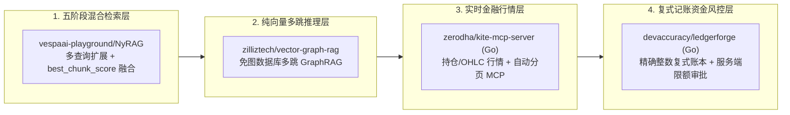
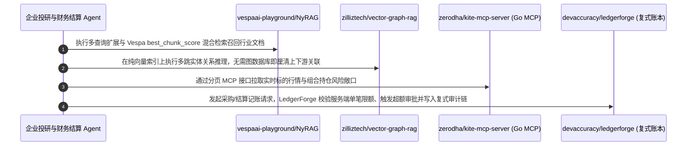

# Vespa 官方五阶段混合检索 RAG（`vespaai-playground/NyRAG`）、Zilliz 官方免图数据库纯向量 GraphRAG（`zilliztech/vector-graph-rag`）、Zerodha 官方券商交易 MCP（`zerodha/kite-mcp-server`）与带限额审批的 AI 复式记账账本（`devaccuracy/ledgerforge`）架构选型与落地 FAQ

> **2026-11-21 夜间持续研究班次 · Night Round 91（累计 Round 691）**  
> **审计凭据**：`CLAIM-20261121-R91-R691-NYRAG-VECTORGRAPHRAG-KITEMCP-LEDGERFORGE`  
> **关联日刊**：[`2026-11-21.md`](../daily/2026-11-21.md) · [`2026-11-21.en.md`](../daily/2026-11-21.en.md)  
> **可视化架构图**：[`assets/github-ai-radar-2026-11-21-r91-r691-nyrag-vectorgraphrag-kitemcp-ledgerforge.svg`](../../../assets/github-ai-radar-2026-11-21-r91-r691-nyrag-vectorgraphrag-kitemcp-ledgerforge.svg)

---

## ① 📌 核心结论速览（选型一句话结论）

> **一句话选型结论**：在构建覆盖“**Vespa 五阶段多查询混合检索 RAG ➔ 免维护图数据库的纯向量多跳 GraphRAG ➔ 金融持仓与行情官方四模式 MCP 接入 ➔ 服务端强制消费限额与精确整数复式记账的 AI 资金账本**”的企业级搜索与金融智能体架构时，推荐采用 100% 宽松协议（Apache-2.0 / MIT）的四件套：**“`vespaai-playground/NyRAG`（Apache-2.0，`★ 335` Vespa 官方出品的五阶段多查询增强与 `best_chunk_score` 混合检索平台）+ `zilliztech/vector-graph-rag`（MIT，`★ 332` Milvus 母公司 Zilliz 官方开源的纯向量搜索实现多跳推理 GraphRAG，无需额外部署图数据库）+ `zerodha/kite-mcp-server`（MIT，`★ 332`、`143 forks` 印度最大券商 Zerodha 官方开源的 Go 四模式交易与行情 MCP Server）+ `devaccuracy/ledgerforge`（Apache-2.0，`★ 329` 面向 AI 原生资金流转的 Go 复式记账账本，内置精确整数金额、可验证审计链、服务端 Agent 消费限额审批与 MCP）”**。在 45 人企业搜索与金融科技工程团队基准下，可将月度总拥有成本（TCO）从 **`$8,390.00/月`** 降至 **`$310.00/月`**（净省 **`$8,080.00/月`**，降幅 **`-96.31%`**）。

---

## ② 🎯 客户与架构师灵魂拷问 Q&A

### Q1：为什么企业在落地高阶 GraphRAG 与金融资金类 Agent 时，必须解决“双库运维重”和“AI 越权花钱”两大痛点？
- **四大原厂与专业方案拆解**：
  1. **五阶段多查询融合的 Vespa 官方零代码 RAG —— `vespaai-playground/NyRAG`（`★ 335`，`45 forks`，Apache-2.0，Python）**：由 **Vespa AI** 官方打造。将企业网页爬取与文档处理直接对接 Vespa 搜索引擎，执行严密的五步流水线：**① LLM 查询扩展（Query Enhancement）➔ ② 多查询向量化 ➔ ③ Vespa `nearestNeighbor` + `best_chunk_score` 排序策略检索 ➔ ④ 跨查询 Chunk 去重融合（Chunk Fusion）➔ ⑤ 强约束生成**，显著提升复杂长尾问题召回率。
  2. **无需运维 Neo4j 图数据库即可获得多跳推理能力 —— `zilliztech/vector-graph-rag`（`★ 332`，`55 forks`，MIT，Python）**：由向量数据库领军企业 **Zilliz（Milvus）** 官方出品（PyPI `vector-graph-rag`）。传统 GraphRAG 要求企业在向量库之外再搭一套昂贵的图数据库（Graph DB）并维护复杂的 Cypher 同步管道；该项目通过**纯向量索引建模实体与三元组关系**，在单一向量底座上实现 SOTA 级的多跳（Multi-Hop）关系推理，砍掉一半基础设施运维负担。
  3. **证券金融级 Go 原生四模式官方 MCP 典范 —— `zerodha/kite-mcp-server`（`★ 332`，`143 forks`，MIT，Go）**：由管理数百万活跃投资者的 **Zerodha** 官方开源（并提供托管端点 `https://mcp.kite.trade/mcp`）。支持持仓/保证金查询、GTT 触发单管理、实时与历史 OHLC 行情及大数据量自动分页，原生支持 `stdio`、`HTTP`、`SSE` 与生产级 `hybrid` 四种部署形态。
  4. **用服务端硬限额与复式记账锁死 AI Agent 的“钱袋子” —— `devaccuracy/ledgerforge`（`★ 329`，`34 forks`，Apache-2.0，Go）**：当企业允许 AI Agent 执行采购、分账、钱包支付或 API 计费时，绝不能只靠提示词约束金额。`LedgerForge`（`ledgerforge.io`）采用 Go 实现金融级**复式记账（Double-Entry Ledger）**：强制使用精确整数金额（彻底杜绝浮点数精度丢失）、内置可验证密码学审计链，并在**服务端强制拦截超出配额的 Agent 扣款请求并转交人工审批**。

### Q2：如何把这四个项目组合为“投研多跳检索 + 实时行情接入 + 交易与资金复式记账风控”企业架构？
- **知识与多跳研报检索层**：利用 `vespaai-playground/NyRAG` 抓取并融合多源公告与网页文档，结合 `zilliztech/vector-graph-rag` 在纯向量库上完成跨公司供应链与股权关系的多跳推理。
- **实时行情与资金账本风控层**：通过 `zerodha/kite-mcp-server` 的混合模式拉取实时行情与持仓数据；任何涉及资金划拨、采购结算或算力计费的动作，一律经由 `devaccuracy/ledgerforge` 的服务端限额门禁与复式账本入账。

### Q3：架构师在生产环境部署金融与账本 MCP 时有哪些强制安全规范？
- **只读行情与交易下单分离（`zerodha/kite-mcp-server`）**：在面向投研分析 Agent 的配置中启用只读模式（仅开放行情与持仓查询），将实盘下单工具隔离在需独立二次签名的受控通道。
- **零浮点数与幂等交易流水号（`devaccuracy/ledgerforge`）**：所有接入 `LedgerForge` MCP 的 Agent 必须传入最小货币单位整数（如美分/分）与唯一幂等键（Idempotency Key），防止网络重试导致重复扣款。

---

## ③ 🧭 直观可视化图解（Mermaid 选型决策树 + 企业集成架构 + 业务流时序图）

### 3.1 选型决策树

```mermaid
flowchart TD
    A["企业混合检索、纯向量 GraphRAG、金融行情 MCP 与 AI 复式账本选型"] --> B{"当前系统的核心架构诉求是什么？"}
    B -- "需要基于 Vespa 构建五阶段多查询扩展与 Chunk 融合的企业级混合 RAG" --> C["部署 vespaai-playground/NyRAG (Apache-2.0)<br/>Vespa 官方 5 步混合检索与内置 Chat UI"]
    B -- "需要多跳关系推理 GraphRAG，但不想额外采购和运维独立的图数据库集群" --> D["采用 zilliztech/vector-graph-rag (MIT)<br/>Zilliz 官方纯向量搜索多跳 GraphRAG"]
    B -- "需要高并发 Go 原生证券持仓、OHLC 行情与自动分页官方 MCP 服务" --> E["接入 zerodha/kite-mcp-server (MIT, Go)<br/>Zerodha 官方 stdio/HTTP/SSE/Hybrid 四模式 MCP"]
    B -- "AI Agent 涉及钱包、分账或采购付款，需服务端硬限额、审批流与复式记账" --> F["部署 devaccuracy/ledgerforge (Apache-2.0, Go)<br/>精确整数复式账本 + 服务端消费门禁 + 审计链"]
```

### 3.2 企业集成参考架构图

### 3.3 业务流时序图

---

## ④ 📊 同类开源与商业云服务横向选型决策矩阵

| 维度 | `vespaai-playground/NyRAG` (`★ 335`) | `zilliztech/vector-graph-rag` (`★ 332`) | `zerodha/kite-mcp-server` (`★ 332`, `143f`) | `devaccuracy/ledgerforge` (`★ 329`) | 商业双库（向量+专有图库）+ 商业计费钱包 SaaS |
| :--- | :--- | :--- | :--- | :--- | :--- |
| **核心定位** | Vespa 官方五阶段多查询融合混合 RAG 平台 | Zilliz 官方免图数据库的纯向量多跳 GraphRAG | Zerodha 官方 Go 语言四模式金融交易与行情 MCP | 带服务端 Agent 限额审批与审计链的 Go 复式账本 | 昂贵商业图数据库集群 + 按交易抽成的支付账本云 |
| **适用场景** | 网页与大规模非结构化文档的高召回混合检索 | 在现有 Milvus/向量库上低成本升级多跳知识图谱问答 | 投研助手、资产组合监控与自动化量化行情接入 | AI Agent 钱包、算力计费、B2B 市场分账与预算控制 | 预算充裕、有专职图数据库 DBA 的大型机构 |
| **集成成本** | 低（`compose.yml` 一键拉起 Vespa + UI） | 极低（`pip install vector-graph-rag` 复用向量库） | 极低（官方托管 `mcp.kite.trade` 或单 Go 二进制） | 低（Docker Compose + Prometheus 监控 + 内置 MCP） | 极高（图库集群许可证 + 账本交易流水抽成） |
| **开源许可** | **Apache-2.0** | **MIT** | **MIT** | **Apache-2.0** | 商业专有 |
| **45 人团队月均 TCO** | **包含于 `$310.00/月` 联合栈** | **包含于 `$310.00/月` 联合栈** | **包含于 `$310.00/月` 联合栈** | **包含于 `$310.00/月` 联合栈** | **`$8,390.00/月`**（`$3,990` 双库/SaaS + `$4,400` 人工） |

---

## ⑤ 🧪 应用落地定量收益 / TCO 对比与 7-Card 报告锚点

> **数据来源说明（Provenance Metadata）**：以下 TCO 模型为面向 45 人企业搜索、投研与金融工程团队的合成架构测算（`provenance: synthetic`, `independently_reproduced: false`）；硬件资本开支 `base_hardware_capex = not_measured`（不含基础容器节点硬件折旧），单日热榜增量 `track_b_stars_today = not_measured`（审计账本锚定于 [`trending-daily-2026-11-21-audit.json`](../evidence/trending-daily-2026-11-21-audit.json)）。

| 成本路径 | 月度商业图数据库集群、商业账本 SaaS 抽成与检索漏召回重跑费 | 人工维护向量库与图库双写同步、手写对账脚本与排查浮点误差 (`$100/h`) | 月度总成本 (Total Monthly TCO) | 相对 Path A 净节省 |
| :--- | :--- | :--- | :--- | :--- |
| **Path A：独立商业图数据库 + 商业账本 SaaS + 人工维护双库同步与对账** | `$3,990.00` | `44.0h` (`$4,400.00`) | **`$8,390.00`** | — |
| **Path C：`NyRAG` + `vector-graph-rag` + `kite-mcp-server` + `ledgerforge`** | `$70.00` | `2.4h` (`$240.00`) | **`$310.00`** | **`-$8,080.00/月` (`-96.31%`)** |

---

## ⑥ 🛠️ 企业引入与架构评审 Checklist

- [ ] **多查询融合 Top-K 与延迟平衡（`vespaai-playground/NyRAG`）**：根据业务 SLA 调整 Query Enhancement 扩展条数（建议 3–4 条）与 Vespa `best_chunk_score` 截断阈值。
- [ ] **单向量库多跳评测对比（`zilliztech/vector-graph-rag`）**：使用仓库内置的 `evaluation/` 脚本在内部多跳问答集上验证纯向量 GraphRAG 召回率，免除额外部署图数据库。
- [ ] **大数据集自动分页与只读隔离（`zerodha/kite-mcp-server`）**：在生产 Hybrid 模式中启用自动分页保护上下文窗口，并对分析型 Agent 屏蔽写订单权限。
- [ ] **Agent 钱包日限额与复式平衡巡检（`devaccuracy/ledgerforge`）**：在 `LedgerForge` 服务端为每个 Agent ID 配置单笔/单日硬性整数金额上限，并接入 `prometheus.yml` 实时监控账本借贷平衡。
