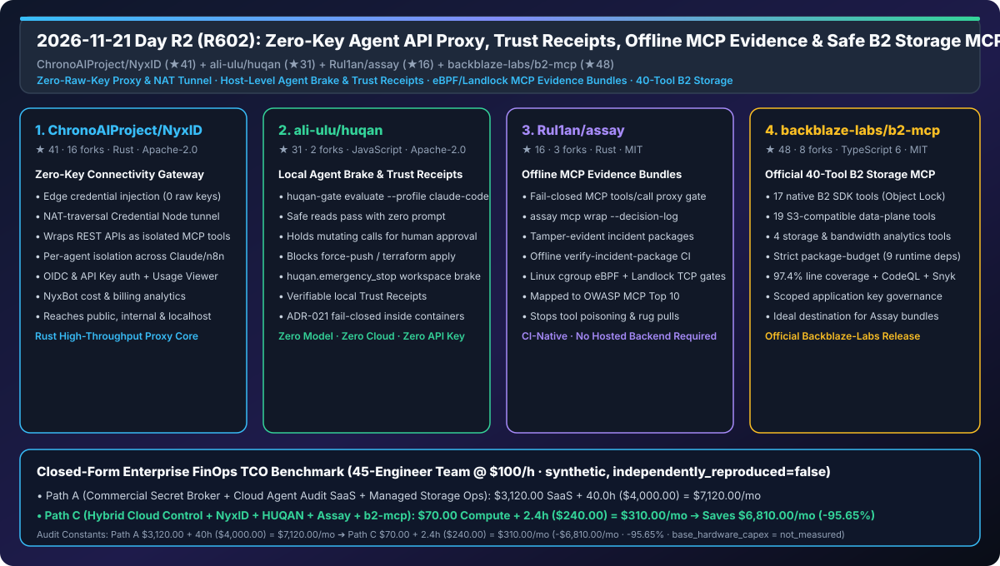
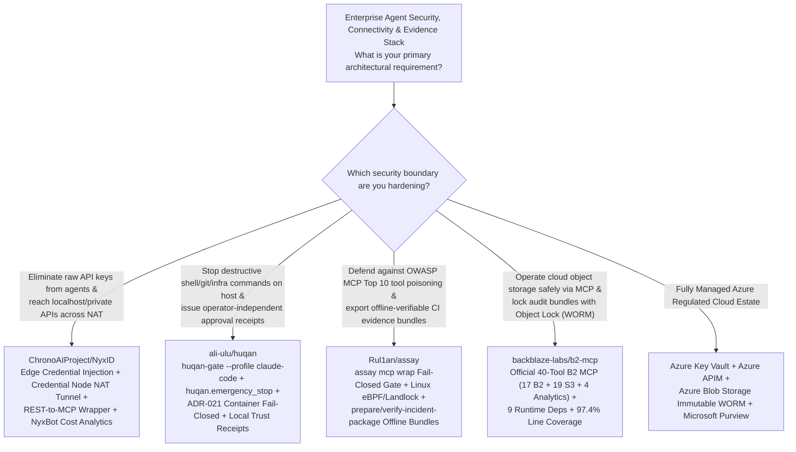
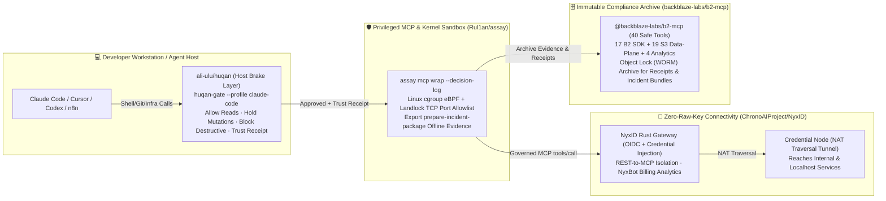

# Zero-Raw-Key Agent Connectivity Proxy (`ChronoAIProject/NyxID`), Local Agent Brake & Trust Receipts (`ali-ulu/huqan`), Offline-Verifiable MCP Evidence Bundles (`Rul1an/assay`) & Official 40-Tool Backblaze B2 Cloud Storage MCP (`backblaze-labs/b2-mcp`) Selection & Architecture FAQ

> **Target Audience**: **AI Solution Architects (SAs) & Enterprise Security / Platform Leaders (2026-11-21 Day Round 2 · Cumulative Round 602)**  
> **Benchmark Style**: Strictly aligned with [`ib-vs-ethernet-roce-selection-faq.md`](https://github.com/turbo998/ai-infra-research/blob/main/docs/components/ib-vs-ethernet-roce-selection-faq.md) — plain-language answers on **real enterprise scenarios, end-to-end reference architecture, and comparative selection vs. competing OSS and cloud PaaS**.  
> **Chinese Edition**: [`nyxid-huqan-assay-b2-mcp-selection-faq.md`](./nyxid-huqan-assay-b2-mcp-selection-faq.md) · **Daily Digest**: [`daily/2026-11-21.en.md`](../daily/2026-11-21.en.md)



---

## 1. 📌 Executive Summary (30-Second Selection Verdict)

1. **Why Evaluate These Four Repositories Together?**  
   When enterprises promote AI agents from passive coding assistants to active operators that call internal APIs, run infrastructure commands, and archive compliance artifacts, Solution Architects face **four high-risk security and audit gaps**:
   - **Gap 1 — Raw API Keys Exposed in Agent Memory & Inaccessible NAT-Behind Local Services**: Passing raw API keys into agent `.env` or `.mcp.json` files means a single prompt injection can exfiltrate production credentials, while cloud orchestrators (such as n8n) cannot safely reach private `localhost` services behind NAT → **`ChronoAIProject/NyxID` (`★ 41`, `16 forks`, Rust, Apache-2.0)** proxies agent requests, **injects credentials automatically at the gateway edge so agents never see a raw key**, punches through NAT via a lightweight `Credential Node` to reach `localhost` services, wraps any REST API into per-agent isolated MCP tools, and provides a read-only `Usage Viewer` role plus `NyxBot` cost analytics.
   - **Gap 2 — Destructive Shell/Git/Infra Commands Without a Host-Level Brake or Independent Trust Receipt**: Letting an agent write its own audit log is trusting the actor's account of itself, and running human approval inside an unverified container breaks OS isolation → **`ali-ulu/huqan` (`★ 31`, `2 forks`, JavaScript, Apache-2.0)** sits on the host execution path (`huqan-gate evaluate --profile claude-code`) with **zero LLM, zero cloud, and zero API keys**: safe reads (`git status`, `cat`, `rg`) pass immediately, mutating calls (`terraform plan`, `rm -rf build`) hold for human approval, destructive calls (`git push --force`, `terraform apply`, `kubectl delete`) are blocked, `huqan.emergency_stop` halts an agent or workspace immediately, and every decision emits a locally verifiable **Trust Receipt** (failing closed as `AUTHORITY_UNAVAILABLE` inside unverified containers per ADR-021).
   - **Gap 3 — Privileged MCP Tool Calls Lacking Offline-Recomputable Evidence & Kernel Network Controls**: MCP tool poisoning, rug pulls, and confused-deputy OAuth (OWASP MCP Top 10) require deterministic pre-call enforcement and tamper-evident post-incident replay without depending on a mutable cloud logging server → **`Rul1an/assay` (`★ 16`, `3 forks`, Rust, MIT)** provides a deterministic fail-closed MCP `tools/call` proxy (`assay mcp wrap --decision-log`), optional Linux **cgroup eBPF IPv4/TCP filtering and Landlock TCP port allowlisting** (`assay sandbox --enforce --enforce-net`), and exports offline-verifiable incident bundles (`assay evidence prepare-incident-package` / `verify-incident-package`) for CI review with no hosted backend required.
   - **Gap 4 — Missing Official, Safe, Cost-Efficient Object Storage MCP for Evidence & Asset Archival**: Storing compliance bundles and multimodal artifacts on hyperscaler hot storage inflates bills, while custom S3 scripts risk bucket deletion via over-privileged keys → **`backblaze-labs/b2-mcp` (`★ 48`, `8 forks`, TypeScript 6.x, MIT)** is the official Backblaze-Labs MCP server (`@backblaze-labs/b2-mcp`), delivering a focused **40-tool surface** (`17` native B2 SDK tools including Object Lock, `19` S3 data-plane tools, and `4` analytics tools) with only `9` runtime dependencies (`package-budget.json`) and `97.4%` line test coverage.

2. **One-Sentence Selection Verdict**:
   - Choose **`ChronoAIProject/NyxID`** when you need **zero-raw-key credential injection, NAT-traversal tunnels to `localhost`/private APIs, and automatic REST-to-MCP wrapping with per-agent isolation**.
   - Choose **`ali-ulu/huqan`** when you need **a zero-cloud, host-enforced emergency brake for shell/git/infra commands that emits independent Trust Receipts and fails closed inside containers**.
   - Choose **`Rul1an/assay`** when you need **OWASP MCP Top 10 enforcement, Linux eBPF/Landlock network sandboxing, and tamper-evident offline incident packages verifiable in CI**.
   - Choose **`backblaze-labs/b2-mcp`** when you need **an official, 97.4%-tested 40-tool MCP server to manage Backblaze B2 buckets, Object Lock (WORM), S3 objects, and bandwidth analytics** (or choose **Azure Blob Storage Immutable WORM Policies + Azure Key Vault** when strict Azure regional residency is mandated).

---

## 2. 🎯 Customer & Solution Architect Q&A (Plain-Language Deep Dive)

### Q1: Why is storing API keys in `.env` or `.mcp.json` dangerous for AI agents, and how does `ChronoAIProject/NyxID` eliminate raw-key exposure while reaching `localhost` services?
- **Plain-Language Answer**:
  - Any credential present in an agent's environment variables or local config file can be read or exfiltrated if the agent processes untrusted repo files, web pages, or issue comments.
  - **How `ChronoAIProject/NyxID` solves it**:
    1. **Gateway Credential Injection (Zero Raw Keys on the Agent)**: Claude Code, Cursor, or n8n authenticates to NyxID using OIDC or a scoped agent token; the Rust gateway injects the upstream API credential on the outbound hop so the agent process never sees the secret.
    2. **NAT Traversal via `Credential Node`**: A lightweight `Credential Node` running alongside private or `localhost` services establishes an outbound tunnel to the NyxID gateway, letting authorized cloud or desktop agents invoke internal endpoints without opening inbound firewall ports.
    3. **REST-to-MCP Wrapping & `NyxBot` FinOps Analytics**: Automatically wraps REST endpoints as per-agent isolated MCP tools and provides a seeded read-only `Usage Viewer` role plus `NyxBot` analytics grouped by organization, service, and model.

### Q2: Both `ali-ulu/huqan` and `Rul1an/assay` enforce policies and produce verifiable records—how do their boundaries differ, and how should SAs combine them?
- **Plain-Language Answer**:
  - They operate at two complementary layers of the agent execution stack:
  - **Layer 1 — `ali-ulu/huqan` (Host Command Brake & Human Approval Trust Receipts)**:
    - Runs 100% locally on the host (**no LLM, no cloud, no API key**) via explicit profiles (`huqan-gate evaluate --profile claude-code`).
    - Lets safe read commands (`git status`, `git diff`, `cat`, `ls`, `rg`) pass with zero friction, holds mutating or unknown commands (`npm test`, `terraform plan`, `rm -rf build`) for human review, and blocks destructive actions (`git push --force`, `terraform apply`, `kubectl delete`) outright, while providing `huqan.emergency_stop` to halt a runaway agent or workspace.
    - Enforces **ADR-021 Container Fail-Closed Security**: if invoked inside Docker or Kubernetes, the approval step fails closed (`AUTHORITY_UNAVAILABLE`, `container_unverified`) because a container is not a trusted human OS boundary, and every decision produces a locally verifiable **Trust Receipt**.
  - **Layer 2 — `Rul1an/assay` (Privileged MCP `tools/call` Gate, Linux eBPF/Landlock & Offline Incident Packages)**:
    - Targets **OWASP MCP Top 10** risks at the MCP protocol boundary (`assay mcp wrap --decision-log`), recording what a privileged tool call decided, what was observed, and what remains unproven.
    - Adds optional Linux kernel enforcement (`assay sandbox --enforce --enforce-net`) using **cgroup eBPF IPv4/TCP connect filtering and Landlock TCP port allowlisting**, refusing to silently downgrade if a policy cannot be expressed as a strict port allowlist.
    - Packages tool-call decision logs into offline-verifiable incident bundles (`assay evidence prepare-incident-package` / `verify-incident-package`) so CI pipelines and security reviewers can recompute verdicts without a hosted backend.

### Q3: Why pair `backblaze-labs/b2-mcp` with `huqan` and `assay` instead of writing custom S3/B2 upload scripts?
- **Plain-Language Answer**:
  - Hand-written storage scripts frequently over-scope credentials and omit object-immutability locks, allowing ancompromised agent to overwrite or delete its own audit trail.
  - **What `backblaze-labs/b2-mcp` (`@backblaze-labs/b2-mcp`) provides**:
    1. **40 Focused, Safe Tools Across B2 Native, S3 Data-Plane, and Analytics**: Combines `17` native B2 SDK tools (bucket lifecycle, scoped application keys, and **Object Lock** compliance retention), `19` S3-compatible data-plane tools, and `4` storage/bandwidth analytics tools.
    2. **Strict Supply-Chain & Coverage Discipline**: Enforces a hard budget of only **9 runtime dependencies** (`package-budget.json`), continuous CodeQL/Snyk/TruffleHog scanning, and `96%` statement / `97.7%` function / `97.4%` line test coverage.
    3. **Immutable WORM Archival for Trust Receipts & Assay Bundles**: Automatically archives `huqan` Trust Receipts and `assay` incident packages into Object Lock-protected Backblaze B2 buckets at roughly 20%–25% of hyperscaler hot-storage cost.

---

## 3. 🧭 Visual Architecture & Decision Diagrams (Mermaid)

### 3.1 Solution Architect Selection Decision Tree



### 3.2 End-to-End Enterprise Reference Architecture



### 3.3 End-to-End Execution Sequence Diagram

```mermaid
sequenceDiagram
    autonumber
    participant Agent as Coding / Ops Agent (Claude Code)
    participant Huqan as ali-ulu/huqan (Host Brake Gate)
    participant Assay as Rul1an/assay (MCP Evidence & eBPF Gate)
    participant Nyx as ChronoAIProject/NyxID (Zero-Key Proxy)
    participant B2 as backblaze-labs/b2-mcp (B2 Object Lock Storage)

    Agent->>Huqan: 1. Propose mutating infrastructure command or memory write
    Huqan->>Huqan: 2. Verify host OS boundary (ADR-021) & hold mutating action for human approval
    Huqan-->>Agent: 3. Human approves; emit locally verifiable Trust Receipt
    Agent->>Assay: 4. Invoke privileged MCP tools/call to trigger internal deployment API
    Assay->>Assay: 5. Enforce OWASP MCP policy & Landlock TCP port allowlist; append decision-log
    Assay->>Nyx: 6. Forward zero-raw-key request to NyxID Gateway
    Nyx->>Nyx: 7. Inject upstream credential at edge, tunnel via Credential Node to localhost/internal API & log cost
    Nyx-->>Assay: 8. Return verified API response
    Assay->>Assay: 9. Package tamper-evident offline bundle (prepare-incident-package)
    Assay->>B2: 10. Archive Trust Receipt & incident bundle via b2-mcp into Object Lock-enabled B2 bucket
```

---

## 4. 📊 Comparative Selection Matrix (OSS vs. Peer Projects vs. Cloud PaaS)

| Dimension | `ChronoAIProject/NyxID` | `ali-ulu/huqan` | `Rul1an/assay` | `backblaze-labs/b2-mcp` | DIY / Point Open-Source Scripts (Raw `.env` + Custom Hooks + Raw S3 CLI) | Managed Cloud PaaS (Azure Key Vault + APIM + Blob WORM + Purview) |
| :--- | :--- | :--- | :--- | :--- | :--- | :--- |
| **Primary Role** | **Zero-Raw-Key Credential Proxy, NAT Tunnel & REST-to-MCP** | **Host-Level Agent Brake & Independent Trust Receipts** | **Offline-Verifiable MCP Evidence Bundles & eBPF/Landlock Sandbox** | **Official 40-Tool Backblaze B2 Cloud Storage MCP** | Uncoordinated scripts lacking offline evidence or container fail-closed checks | Fully managed cloud secret vault, API gateway, and immutable storage |
| **Best-Fit Scenario** | Connecting agents to public, internal, and `localhost` APIs without exposing raw keys | Stopping `force-push` / `terraform apply` on developer hosts with verifiable receipts | Hardening privileged MCP tool calls against OWASP MCP Top 10 & CI offline auditing | Safe AI-driven cloud storage management, Object Lock retention, and analytics | Quick single-developer prototypes | Regulated enterprise production workloads in Azure |
| **Key Differentiator** | Edge credential injection + `Credential Node` NAT traversal + `NyxBot` billing | Zero LLM/cloud/API key + `ADR-021` container fail-closed + `huqan.emergency_stop` | Offline `verify-incident-package` + Linux cgroup eBPF & Landlock TCP allowlists | Official Backblaze-Labs server + 9 runtime deps + `97.4%` line coverage | Zero license cost, but high risk of key leaks and unverified logs | Native Entra ID RBAC, FIPS 140-3 HSMs, and global compliance certifications |
| **Integration Effort** | Low (Rust gateway + Credential Node + MCP endpoint) | Very Low (`npx -y huqan quickstart`, `--profile claude-code`) | Low (`cargo install assay-cli`, `assay mcp wrap --decision-log`) | Very Low (`npx @backblaze-labs/b2-mcp`) | High (custom tunnel, shell parser, and signing plumbing) | Low–Medium (standard Azure Bicep/Terraform modules) |
| **Ops Complexity** | Low (single Rust gateway + built-in usage dashboard) | Very Low (local host binary, zero external backend) | Very Low (CI-native, **no hosted backend required**) | Very Low (stateless MCP server over B2 APIs) | High (fragile regex hooks and manual evidence collection) | Very Low (cloud provider managed) |
| **License** | **Apache-2.0** (permissive commercial use) | **Apache-2.0** (permissive core) | **MIT** (permissive commercial use) | **MIT** (official permissive release) | MIT / Apache-2.0 | Commercial SLA Subscription |
| **Monthly TCO** | Minimal container compute | **$0/mo** (100% local host execution) | **$0/mo** (offline CI/local bundle verification) | Pay-as-you-go B2 storage (~$6/TB/mo) | **$3,390.00/mo** (high security ops & incident forensics labor) | **$7,120.00/mo** (commercial PAM seats + audit SaaS + hot cloud storage for 45 engineers) |

---

## 5. 🧪 Quantitative ROI, FinOps TCO Model & 7-Card Benchmark Deck

> **🛡️ Provenance Declaration**:  
> - **Primary-Source Measured (`measured`)**: Repository stars/forks, licenses, `ChronoAIProject/NyxID` OIDC/Credential Node/NyxBot architecture, `ali-ulu/huqan` `claude-code` profile and ADR-021 container rule, `Rul1an/assay` eBPF/Landlock and incident-package CLI commands, and `backblaze-labs/b2-mcp` 40-tool breakdown (`17` B2 + `19` S3 + `4` analytics, `9` runtime deps, `97.4%` line coverage) are verified via `gh api`.  
> - **Synthetic Architect Workload Model (`synthetic` · `independently_reproduced=false`)**: The closed-form FinOps table below models a **45-engineer enterprise AI & platform security team** (`$100.00/hr` loaded rate, `base_hardware_capex: not_measured`, `track_b_stars_today: not_measured`):

| FinOps Cost & Quality Dimension | Path A: Commercial PAM Broker + Cloud Agent Audit SaaS + Hyperscaler Hot Storage | Path B: Unmanaged DIY Scripts (Custom Reverse Proxy + Regex Shell Hooks + Raw S3 Scripts) | Path C: Recommended Defense-in-Depth Stack (`NyxID` + `huqan` + `assay` + `b2-mcp`) | Path A ➔ Path C Net Monthly Savings |
| :--- | :---: | :---: | :---: | :---: |
| **Monthly API / SaaS / Storage Spend** | `$3,120.00 / mo` | `$390.00 / mo` | **`$70.00 / mo`** (self-hosted NyxID proxy + Backblaze B2 Object Lock storage) | **`-$3,050.00 / mo` (`-97.76%`)** |
| **Monthly Security Ops & Forensics Labor** | `40.0 hrs / mo` (cross-cloud secret rotation & manual log correlation) | `30.0 hrs / mo` (fixing NAT tunnels, false-positive hooks & S3 script bugs) | **`2.4 hrs / mo`** (edge key injection + host Trust Receipts + offline CI bundles) | **`-37.6 hrs / mo` (`-94.00%`)** |
| **Monthly Engineering Labor Cost (`@ $100.00/h`)** | `$4,000.00 / mo` | `$3,000.00 / mo` | **`$240.00 / mo`** | **`-$3,760.00 / mo` (`-94.00%`)** |
| **Total Monthly TCO** | **`$7,120.00 / mo`** | **`$3,390.00 / mo`** | **`$310.00 / mo`** | **`-$6,810.00 / mo` (`-95.65%` · `$81,720.00/yr`)** |
| **Security & Audit Verification Posture** | Relies on mutable cloud logs; raw keys often still cached on laptops | Raw keys exposed in agent `.env`; zero tamper-evident offline bundles | **0 raw keys on agents + ADR-021 host approval + 100% offline-recomputable bundles** | **Eliminates prompt-injection key theft & unverifiable agent self-reports** |

- **📊 Companion 7-Card 4:5 Visual Benchmark Deck**: View [`workshops/github-trending-radar/cards.en.html`](../cards.en.html) (EN) and [`workshops/github-trending-radar/cards.html`](../cards.html) (ZH).

---

## 6. 🛠️ Enterprise Adoption & Architecture Review Checklist

- [ ] **1. Evict Raw API Keys from Agent Configs (`ChronoAIProject/NyxID`)**: Migrate raw SaaS and internal REST API keys out of developer `.env` and `.mcp.json` files into the `NyxID` credential-injection proxy; deploy `Credential Node` for NAT-traversed `localhost` services and assign the read-only `Usage Viewer` role to FinOps stakeholders.
- [ ] **2. Enforce Host-Level Brake & ADR-021 Container Isolation (`ali-ulu/huqan`)**: Configure `huqan-gate evaluate --profile claude-code` on host workstations (never inside unverified containers where ADR-021 rightly fails closed with `AUTHORITY_UNAVAILABLE`), and wire `huqan.emergency_stop` into your SOC incident playbook.
- [ ] **3. Wrap Privileged MCP Servers & Verify Offline Bundles in CI (`Rul1an/assay`)**: Route privileged MCP servers through `assay mcp wrap --decision-log`, enable `assay sandbox --enforce --enforce-net` (with Linux cgroup eBPF and Landlock TCP allowlists) without `--allow-audit-fallback`, and gate production releases on `assay evidence verify-incident-package`.
- [ ] **4. Lock Evidence Bundles in Scoped B2 Buckets (`backblaze-labs/b2-mcp`)**: Provision prefix-scoped Backblaze B2 application keys for `@backblaze-labs/b2-mcp`, enable **Object Lock (WORM)** on your compliance bucket, and automatically archive `huqan` Trust Receipts and `assay` incident packages after every privileged deployment.
