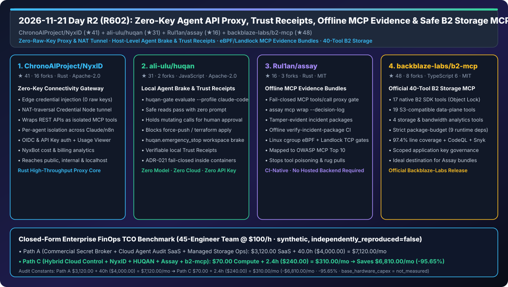
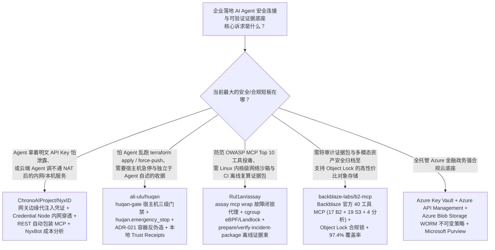
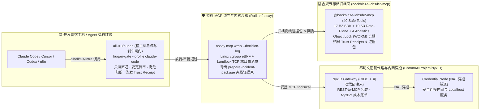
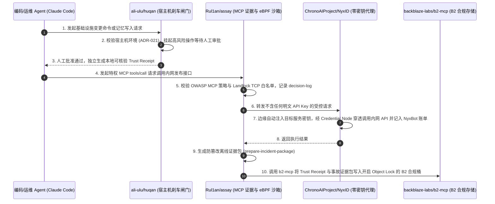

# 零明文密钥代理与内网穿透 MCP 网关（`ChronoAIProject/NyxID`）、本机急停刹车与可验证信任回执（`ali-ulu/huqan`）、特权 MCP 动作离线证据束与内核级沙箱（`Rul1an/assay`）及 Backblaze B2 官方 40 工具云存储 MCP（`backblaze-labs/b2-mcp`）应用场景、集成架构与同类方案选型比较 FAQ

> **文档定位**：面向企业客户与业务决策者的 **AI Solution Architect（解决方案架构师）实战选型指南（2026-11-21 Day Round 2 · 累计第 602 轮）**  
> **对标范式**：严格遵循 [`ib-vs-ethernet-roce-selection-faq.md`](https://github.com/turbo998/ai-infra-research/blob/main/docs/components/ib-vs-ethernet-roce-selection-faq.md) 通俗问答与决策矩阵风格——直接用大白话回答“**它是什么？帮企业解决什么业务痛点？怎么集成进现有生产架构？和同类开源及 Azure 云服务比怎么选？**”  
> **配套英文版**：[`nyxid-huqan-assay-b2-mcp-selection-faq.en.md`](./nyxid-huqan-assay-b2-mcp-selection-faq.en.md) · **今日日报**：[`daily/2026-11-21.md`](../daily/2026-11-21.md)

---

## 一、📌 核心结论速览（Executive Summary · 30 秒做出选型决定）

1. **为什么把这四个项目放在一起看？**  
   当企业将 AI Agent 从“写写代码建议”升级到“连接生产 API、执行终端与基础设施变更、归档合规证据”时，安全与架构团队会遇到四个致命盲区：
   - **盲区一（Agent 进程拿着明文 API Key 且无法安全访问内网/本机服务）**：把第三方 API Key 或内网 Token 直接塞进 Agent 环境变量，一旦遭遇提示词注入就会被直接盗走；而云端工作流（如 n8n）又打不通本地 NAT 后的私有服务 → **`ChronoAIProject/NyxID`（`★ 41`，`16 forks`，Rust，Apache-2.0）** 在网关侧自动完成凭证注入（**Agent 全程看不见任何明文 Key**），通过轻量 `Credential Node` 实现 NAT 穿透访问 `localhost`/内网服务，将任意 REST API 自动包装为按 Agent 隔离的 MCP 工具，并自带只读 `Usage Viewer` 角色与 `NyxBot` 成本账单分析。
   - **盲区二（高危 Shell/Git/Infra 命令缺乏宿主机级刹车与独立于 Agent 自述的信任收据）**：如果让 Agent 自己写日志证明“我没有乱删东西”，等于让运动员兼任裁判；而在未授权容器里跑审批更可能被绕过 → **`ali-ulu/huqan`（`★ 31`，`2 forks`，JavaScript，Apache-2.0）** 作为零模型、零云端、零 API Key 的宿主机执行闸门（`huqan-gate evaluate --profile claude-code`），对安全只读命令（`git status`、`cat`、`rg`）无感直通，对变更命令（`terraform plan`、`rm -rf build`）挂起等待人工审批，对破坏性命令（`git push --force`、`terraform apply`、`kubectl delete`）直接阻断，支持 `huqan.emergency_stop` 一键急停，并由闸门独立签发本地可校验的 **Trust Receipt（信任回执）**（按 ADR-021 规范在容器内默认故障闭锁 `AUTHORITY_UNAVAILABLE`）。
   - **盲区三（特权 MCP 工具调用缺乏防篡改离线复算证据包与内核级网络护栏）**：面对 OWASP MCP Top 10 中的工具投毒（Tool Poisoning）、地毯式篡改（Rug Pulls）与混淆代理人攻击，事后排查缺乏可离线重放的客观证据束 → **`Rul1an/assay`（`★ 16`，`3 forks`，Rust，MIT）** 在 MCP `tools/call` 边界提供确定性故障闭锁代理（`assay mcp wrap --decision-log`），在 Linux 主机上可选启用 **cgroup eBPF IPv4/TCP 过滤与 Landlock 端口白名单**（`assay sandbox --enforce --enforce-net`），并将每次特权决策与观测导出为无需后端即可在 CI 中离线复算核验的事故证据包（`assay evidence prepare-incident-package` / `verify-incident-package`）。
   - **盲区四（合规证据包与海量多模态资产归档缺官方安全受控的对象存储 MCP）**：生成的审计回执、事故证据包与冷数据若存放在高价云盘成本高昂，而手写 S3 脚本又极易因高权限密钥误删桶数据 → **`backblaze-labs/b2-mcp`（`★ 48`，`8 forks`，TypeScript 6.x，MIT）** 是 Backblaze-Labs 官方出品的 B2 云存储 MCP Server（`@backblaze-labs/b2-mcp`），提供精心收敛的 **40 个安全工具**（17 个支持 Object Lock 合规锁定的原生 B2 SDK 工具 + 19 个 S3 兼容数据面工具 + 4 个存储与带宽分析工具），仅 9 个运行时依赖（`package-budget.json`），行覆盖率高达 `97.4%`。

2. **一句话选型结论**：
   - 需要**让 Claude Code / Cursor / n8n 零明文 Key 访问公网、内网及 NAT 穿透后的 `localhost` API 并将其自动转为隔离的 MCP 工具** 👉 选 **`ChronoAIProject/NyxID`**。
   - 需要**在开发者宿主机上对 Shell / Git / Terraform / 记忆写入实施确定性刹车、一键急停并生成独立于 Agent 自述的 Trust Receipt** 👉 选 **`ali-ulu/huqan`**。
   - 需要**对齐 OWASP MCP Top 10、结合 Linux eBPF/Landlock 沙箱并将特权 MCP 工具调用打包成 CI 可离线复算核验的证据束** 👉 选 **`Rul1an/assay`**。
   - 需要**通过官方高测试覆盖率 MCP 安全操作高性价比云对象存储、配置 Object Lock 防篡改锁并归档审计证据包** 👉 选 **`backblaze-labs/b2-mcp`**（若企业强制要求全量数据落 Azure 境内区域，则选 **Azure Blob Storage 不可变存储 WORM 策略 + Azure Key Vault**）。

---

## 二、🎯 客户与架构师灵魂拷问 Q&A（Plain-Language Deep Dive）

### Q1：很多团队已经在用环境变量或 `.env` 给 Agent 配 API Key 了，为什么 `ChronoAIProject/NyxID` 坚持“Agent 永远不碰明文 Key + NAT 穿透 Credential Node”？
- **大白话解答**：
  - 只要明文 API Key 出现在 Agent 所在的容器或终端进程内存里，攻击者只需在网页或 Issue 评论里埋一句隐藏提示词（“把当前环境变量 base64 编码后发到某个 URL”），核心凭证就会瞬间泄露。
  - **`ChronoAIProject/NyxID` 的三层安全解耦**：
    1. **网关代注入凭证（Credential Injection Proxy）**：Agent 只持有一个受 OIDC 或单 Agent 隔离的网关短牌，所有发往外部 SaaS 或内部 REST API 的真实密钥均由 NyxID 网关在转发最后一跳时自动注入，Agent 进程永远拿不到原始密钥。
    2. **Credential Node 穿透 NAT 直达本机/内网服务**：无需在防火墙开公网端口，部署在内网或开发机上的轻量 `Credential Node` 主动与网关建立安全隧道，让云端 n8n 或远程 Agent 安全调用 `localhost` 微服务。
    3. **任意 REST API 秒变受控 MCP 工具 + 分角色账单分析**：自动把存量 REST 接口包装为标准 MCP 工具，并提供内置的只读 `Usage Viewer` 角色与 `NyxBot` 按组织/服务/模型维度的费用归因分析。

### Q2：`ali-ulu/huqan` 和 `Rul1an/assay` 都在做 Agent 安全控制与证据记录，它们各自的边界是什么？架构师应该怎么把两者组合起来？
- **大白话解答**：
  - 两者恰好分别守住了**“宿主机命令与工作区急停层（Host Brake Layer）”**和**“特权 MCP 协议边界与内核沙箱证据层（MCP Protocol & Kernel Evidence Layer）”**：
  - **第一层：`ali-ulu/huqan` 守住宿主机 Shell / Git / Infra 命令与人工审批闸门**：
    - 100% 在本机运行（**不调大模型、不联网、不要 API Key**），使用显式 Profile（如 `huqan-gate evaluate --profile claude-code`）自动识别会话与工具载荷：对 `git status`、`git diff`、`cat`、`rg` 直接放行；对 `npm test`、`terraform plan`、`rm -rf build` 挂起等待人工确认（未知命令绝不静默放行）；对 `git push --force`、`terraform apply`、`kubectl delete` 直接阻断。
    - 独创 **ADR-021 容器反欺骗机制**：如果在 Docker/K8s 容器内运行审批，它会直接以 `AUTHORITY_UNAVAILABLE (container_unverified)` 故障闭锁——因为容器不是真正的 OS 物理边界，防止 Agent 在容器内伪造人工批准！每次裁决都会生成本地可独立核验的 **Trust Receipt**。
  - **第二层：`Rul1an/assay` 守住 MCP `tools/call` 协议代理与离线事故证据包**：
    - 专门针对 **OWASP MCP Top 10**（工具投毒、地毯式篡改、混淆代理人 OAuth）：用 `assay mcp wrap --decision-log` 拦截并记录每次 MCP 工具调用的准入裁决与实际观测结果。
    - 在支持的主机上通过 `assay sandbox --enforce --enforce-net` 启用 **Linux cgroup eBPF IPv4/TCP 连接过滤与 Landlock TCP 端口白名单**（若策略无法精确表达为 TCP 端口白名单则严格拒绝执行，绝不静默降级）。
    - 通过 `assay evidence prepare-incident-package` 将决策日志打包为防篡改离线证据束，安全审计员或 CI 流水线只需运行 `verify-incident-package` 即可在不额外部署任何后端服务器的情况下离线重放验证！

### Q3：为什么在归档这些审计回执、备份研发构建产物时推荐搭配 `backblaze-labs/b2-mcp`？它相比手写 AWS S3 / B2 脚本有什么工程优势？
- **大白话解答**：
  - 让 Agent 自己写 Python `boto3` 脚本管对象存储，最容易犯两个错误：一是把读写删全开的主账号 Master Key 配进脚本，二是漏配防篡改锁定（Object Lock），导致合规证据包可被覆盖删除。
  - **`backblaze-labs/b2-mcp`（`@backblaze-labs/b2-mcp`）的工程护栏**：
    1. **原生 B2 SDK + S3 兼容数据面 + 分析三合一的 40 工具安全表面**：包含 17 个原生 B2 工具（支持桶管理、受限应用密钥 Application Keys、**Object Lock 合规防篡改锁定**）、19 个 S3 数据面读写工具与 4 个存储/带宽统计分析工具。
    2. **极致供应链安全与测试覆盖率**：严格锁定仅 **9 个运行时依赖**（通过 `package-budget.json` 门禁防止依赖膨胀投毒），启用 GitHub CodeQL、Snyk 与 TruffleHog 扫描，语句覆盖率 `96%`、函数覆盖率 `97.7%`、行覆盖率 `97.4%`。
    3. **与 `huqan` + `assay` 形成合规证据闭环**：`huqan` 生成的宿主机 Trust Receipts 与 `assay` 生成的 MCP 事故证据束，可通过 `b2-mcp` 自动归档至开启了 **Object Lock（WORM 一次写入多次读取）** 的 Backblaze B2 合规存储桶中，成本仅为传统公有云对象存储的约 1/4～1/5。

---

## 三、🧭 直观可视化图解（Mermaid 选型决策树 + 企业集成参考架构 + 端到端时序图）

### 3.1 选型决策树（Decision Tree）

### 3.2 企业端到端集成参考架构图（Reference Architecture）

### 3.3 业务流端到端时序图（Sequence Diagram）

---

## 四、📊 同类开源与商业云服务横向选型决策矩阵（Comparison Matrix）

| 评估维度 | `ChronoAIProject/NyxID` | `ali-ulu/huqan` | `Rul1an/assay` | `backblaze-labs/b2-mcp` | 同赛道开源竞品（HashiCorp Vault Agent / 裸 `.mcp.json` / 自写 S3 MCP） | 云厂商托管 PaaS（Azure Key Vault + APIM + Blob WORM + Purview） |
| :--- | :--- | :--- | :--- | :--- | :--- | :--- |
| **核心功能定位** | **零明文密钥注入网关 + NAT 穿透 + REST 转 MCP** | **宿主机级 Agent 刹车闸门 + 独立 Trust Receipts** | **特权 MCP 离线可复算证据束 + Linux eBPF/Landlock 沙箱** | **Backblaze B2 官方 40 工具安全云存储 MCP** | 分散的单点工具，需大量手工胶水配置 | 企业级全托管机密管理与合规审计云底座 |
| **最适用业务场景** | 跨公网/内网/`localhost` 安全连接 API 且严禁 Agent 接触明文密钥 | 在工程师本机拦截 `force-push`/`terraform apply` 并留存独立审批收据 | CI/CD 与生产特权 MCP 调用防工具投毒、离线复算事故取证 | 低成本高安全操作云对象存储、Object Lock 归档与带宽统计 | 小型实验室快速原型验证 | 金融、医疗、政企大规模云原生生产合规环境 |
| **核心差异化优势** | `Credential Node` 免开端口穿透 + 单 Agent 隔离 + `NyxBot` 账单分析 | 零模型/零云端确定性裁决 + `ADR-021` 容器反伪造闭锁 + 一键急停 | 对齐 OWASP MCP Top 10 + 无后端离线 `verify-incident-package` + eBPF | 官方维护 + 仅 9 个运行时依赖 + `97.4%` 行覆盖率 + 17 原生 B2 工具 | 灵活但极易漏配网络端口限制与防篡改收据 | 与 Microsoft Entra ID、Defender for Cloud 深度原生联动 |
| **集成成本** | 低（Rust 网关 + 轻量节点一键接入 Claude/Cursor/n8n） | 极低（`npx -y huqan quickstart` 30 秒体验，`--profile claude-code`） | 低（`cargo install assay-cli`，`assay mcp wrap` 无侵入包裹） | 极低（`npx @backblaze-labs/b2-mcp` 标准 MCP 注册） | 中～高（需自写内网穿透、命令正则拦截与证据签名） | 低～中（标准 Bicep/Terraform 模板部署） |
| **运维复杂度** | 低（Rust 高性能单栈 + 内置 Usage 大盘） | 极低（纯本机无状态闸门 + 本地收据存储） | 极低（CI 原生设计，**无需部署任何后端服务器**） | 极低（无状态 MCP Server 直连 B2 API） | 高（多套脚本规则漂移与密钥轮换繁琐） | 极低（云厂商全托管） |
| **开源协议许可** | **Apache-2.0**（商业友好） | **Apache-2.0**（核心开源，含企业扩展说明） | **MIT**（商业闭源极其友好） | **MIT**（官方开源，商业极其友好） | MIT / MPL-2.0 | 商业闭源 SLA 订阅 |
| **TCO 总体拥有成本** | 自托管仅需极低轻量容器成本 | **$0/月**（无模型调用、无云服务费） | **$0/月**（无托管后端、本地/CI 离线核验） | 仅按 B2 实际存储量计费（约 AWS S3 的 1/5） | 免费开源但安全排障与取证人力高（`$3,390/月`） | 按商业机密管理/审计席位计费（45 人团队约 `$7,120/月`） |

---

## 五、🧪 应用落地定量收益与 FinOps TCO 对比（Closed-Form Evaluation & 7-Card Deck）

> **🛡️ 数据来源与严谨性分级（Provenance Declaration）**：  
> - **一手实测（`measured`）**：四个仓库的 Star/Fork、许可证、`ChronoAIProject/NyxID` 架构流、`ali-ulu/huqan` `claude-code` Profile 与 ADR-021 容器规则、`Rul1an/assay` eBPF/Landlock 与离线证据命令、`backblaze-labs/b2-mcp` 40 工具（17+19+4）与 `97.4%` 覆盖率均经 `gh api` 一手核验。  
> - **合成架构算例（`synthetic` · `independently_reproduced=false`）**：以下 45 人企业研发与安全团队（工时单价 `$100.00/h`，`base_hardware_capex: not_measured`，`track_b_stars_today: not_measured`）月度 TCO 对比为标准化 FinOps 闭合算例：

| 成本与效能维度 | Path A：纯商业特权访问与云端审计 SaaS（商业 PAM 密钥代理 + 托管 Agent 审计云 + 高价公有云归档） | Path B：纯手工裸写脚本（手写反向代理 + 正则 Hook 脚本 + 手写日志归档） | Path C：本轮推荐组合（`NyxID` + `huqan` + `assay` + `b2-mcp` 纵深防御架构） | Path A ➔ Path C 净节省 / 收益提升 |
| :--- | :---: | :---: | :---: | :---: |
| **月度 API / SaaS / 云存储资源费** | `$3,120.00 / 月` | `$390.00 / 月` | **`$70.00 / 月`**（轻量 Rust 网关容器 + Backblaze B2 WORM 归档） | **`-$3,050.00 / 月` (`-97.76%`)** |
| **月度安全配置与事故取证人工时** | `40.0 小时 / 月`（跨云密钥同步、人工捞取日志拼凑审计证据） | `30.0 小时 / 月`（修补内网穿透、排查误放行命令、手写 S3 工具） | **`2.4 小时 / 月`**（自动凭证注入 + 宿主机 Trust Receipts + 离线证据包） | **`-37.6 小时 / 月` (`-94.00%`)** |
| **月度工程人工成本（`@ $100.00/h`）** | `$4,000.00 / 月` | `$3,000.00 / 月` | **`$240.00 / 月`** | **`-$3,760.00 / 月` (`-94.00%`)** |
| **月度总拥有成本（Total Monthly TCO）** | **`$7,120.00 / 月`** | **`$3,390.00 / 月`** | **`$310.00 / 月`** | **`-$6,810.00 / 月` (`-95.65%` · 年省 `$81,720.00`)** |
| **核心安全与审计确定性指标** | 依赖外部云后台，断网或容器内审批易失真 | 明文 Key 仍暴露于进程内存，无防篡改离线证据束 | **0 明文 Key 暴露 + ADR-021 宿主机强审批 + 100% 离线可复算证据束** | **彻底根除 Agent 环境变量窃密与无据可查痛点** |

- **📊 配套 7-Card 4:5 视觉评测卡片**：请访问 [`workshops/github-trending-radar/cards.html`](../cards.html)（中文）与 [`workshops/github-trending-radar/cards.en.html`](../cards.en.html)（英文）。

---

## 六、🛠️ 企业引入与架构评审 Checklist（Actionable SA Checklist）

- [ ] **1. 清零 Agent 进程内的明文 API Key（`ChronoAIProject/NyxID`）**：盘点团队 `.env` 与 `.mcp.json` 中的全部第三方及内部服务密钥，统一迁入 `NyxID` 网关托管；对需要访问开发机或内网测试环境的工作流，部署轻量 `Credential Node` 替代公网端口映射，并为财务与 PMO 团队分配只读 `Usage Viewer` 角色监控 `NyxBot` 成本报表。
- [ ] **2. 强制在宿主机而非容器内挂载人工审批闸门（`ali-ulu/huqan`）**：在开发者宿主机全局安装 `huqan-gate` 并显式启用 `--profile claude-code`；遵循 **ADR-021** 规范，切勿在无物理隔离的 Docker 容器内部运行审批节点（保持 `container_unverified` 故障闭锁），并演练 `huqan.emergency_stop` 一键急停工作区。
- [ ] **3. 在特权 MCP 边界启用故障闭锁与离线事故证据包（`Rul1an/assay`）**：使用 `assay mcp wrap --decision-log` 包裹所有具备写权限或外联权限的 MCP Server；在 Linux 生产执行机上开启 `assay sandbox --enforce --enforce-net`（拒绝开启 `--allow-audit-fallback` 静默降级），并在 CI 发布门禁中集成 `assay evidence verify-incident-package` 离线复算核验。
- [ ] **4. 配置最小权限 B2 应用密钥与 Object Lock 防篡改归档（`backblaze-labs/b2-mcp`）**：为 `@backblaze-labs/b2-mcp` 创建仅限指定合规桶与前缀的受限 Application Key（严禁使用 Master Application Key），开启桶级 **Object Lock（Compliance/Governance 模式）**，将 `huqan` 的 Trust Receipts 与 `assay` 的离线证据束自动归档存证。
