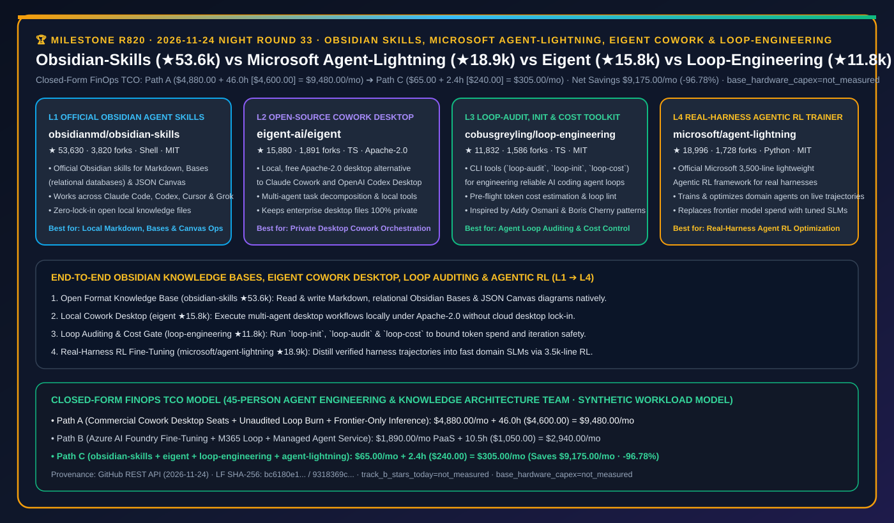
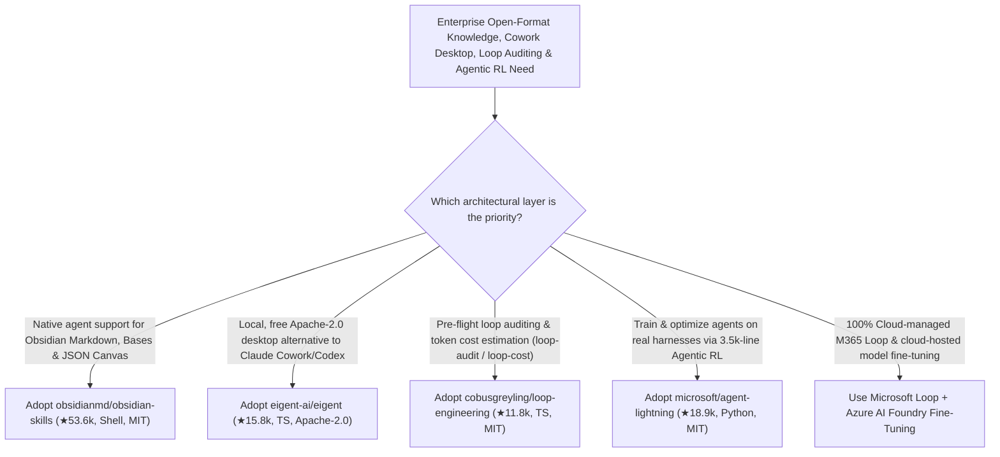
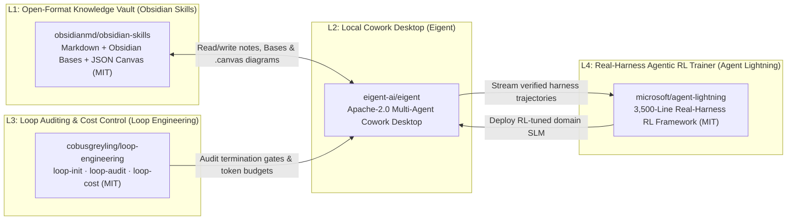
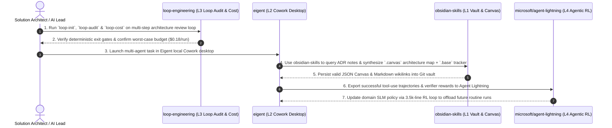

# 🏆 [Round 820 Milestone] Official Obsidian Agent Skills (`obsidianmd/obsidian-skills`), Open-Source Cowork Desktop (`eigent-ai/eigent`), Loop Auditing & Cost Toolkit (`cobusgreyling/loop-engineering`) & Microsoft Real-Harness Agentic RL (`microsoft/agent-lightning`) Selection & Architecture FAQ

> **Document Type**: AI Solution Architect Selection & Integration Guide (2026-11-24 Night Round 33 / Cumulative Round 820 Milestone)  
> **Reading Time**: ~8 minutes  
> **Covered Repositories**: [`obsidianmd/obsidian-skills`](https://github.com/obsidianmd/obsidian-skills) (`★ 53,630` · `3,820 forks` · Shell · `MIT`) · [`microsoft/agent-lightning`](https://github.com/microsoft/agent-lightning) (`★ 18,996` · `1,728 forks` · Python · `MIT`) · [`eigent-ai/eigent`](https://github.com/eigent-ai/eigent) (`★ 15,880` · `1,891 forks` · TypeScript · `Apache-2.0`) · [`cobusgreyling/loop-engineering`](https://github.com/cobusgreyling/loop-engineering) (`★ 11,832` · `1,586 forks` · TypeScript · `MIT`)  
> **Evidence Provenance**: GitHub REST API verified metadata (2026-11-24) and sealed local evidence files `trending-daily-2026-11-24-raw.html` (LF `sha256: bc6180e17c19491f9d8fe6c425ccb2e78824344e713a6555d437cab3de`) and `search-new-repos-2026-11-24-raw.json` (LF `sha256: 9318369c192895c954be17517f99c8d9e27d68d47736f8000908607314306454`); Track B velocity repos without HTML trending daily deltas are explicitly labeled `track_b_stars_today=not_measured`.  
> **中文版本**: [`obsidian-agentlightning-eigent-loopeng-selection-faq.md`](./obsidian-agentlightning-eigent-loopeng-selection-faq.md)

---

## ① 📌 Executive Summary

**One-Sentence Selection Verdict**: When enterprise AI engineering and knowledge architecture teams want a **100% permissive open-source (`MIT` + `Apache-2.0`) stack for open-format knowledge management, desktop multi-agent collaboration, loop cost governance, and real-harness reinforcement learning**—combining **official Obsidian skills for Markdown, Bases, and JSON Canvas (`obsidianmd/obsidian-skills`), an open-source local Cowork desktop alternative (`eigent-ai/eigent`), CLI tools for loop auditing and pre-flight token cost calculation (`cobusgreyling/loop-engineering`), and Microsoft's 3,500-line Agentic RL framework for training agents directly inside real harnesses (`microsoft/agent-lightning`)**—deploying this 4-layer stack reduces monthly TCO for a 45-person team from **`$9,480.00/mo`** (Path A: Commercial Cowork Desktop Seats + Unaudited Loop Burn + Frontier-Only API Spend) to **`$305.00/mo`** (Path C), saving **`$9,175.00/mo` (`-96.78%`)**.

| Dimension | `obsidianmd/obsidian-skills` (L1 Official Obsidian Skills) | `eigent-ai/eigent` (L2 Open-Source Cowork Desktop) | `cobusgreyling/loop-engineering` (L3 Loop Audit & Cost CLI) | `microsoft/agent-lightning` (L4 Real-Harness Agentic RL) |
|---|---|---|---|---|
| **Verified Stars & Forks** | `★ 53,630` · `3,820 forks` | `★ 15,880` · `1,891 forks` | `★ 11,832` · `1,586 forks` | `★ 18,996` · `1,728 forks` |
| **Language & License** | Shell / Spec (`MIT`) | TypeScript (`Apache-2.0`) | TypeScript (`MIT`) | Python (`MIT`) |
| **Plain-English Positioning** | Official Obsidian Agent Skills teaching Claude Code, Codex, Cursor & Grok to use Markdown, Bases & JSON Canvas | Local, free `Apache-2.0` desktop alternative to Claude Cowork and OpenAI Codex Desktop | Practical patterns, starters & CLI tools (`loop-audit`, `loop-init`, `loop-cost`) for AI coding agent loops | Official Microsoft 3,500-line lightweight Agentic RL framework for training agents with real harnesses |
| **Core Enterprise Pain Solved** | Prevents agents from corrupting Obsidian wikilinks, frontmatter, relational `.base` tables, and `.canvas` diagrams | Eliminates per-seat proprietary desktop agent lock-in while keeping local workspace files 100% private | Catches unbounded agent loops and estimates worst-case multi-turn token costs before execution starts | Decouples agent execution from RL training so teams can optimize small domain models on real production harnesses |
| **When to Choose vs Cloud PaaS** | Mandatory when teams store architecture docs, ADRs, and canvases in local/Git Obsidian vaults | Choose for privacy-first, customizable `Apache-2.0` desktop multi-agent productivity | Mandatory pre-flight check for any autonomous coding or workflow loop | Choose when distilling frontier agent trajectories into fast, low-cost domain SLMs; use Azure AI Foundry for managed cloud RL |

---

## ② 🎯 Architect & Customer Q&A (1–2 Minute Read)

### Q1: Why has the official `obsidianmd/obsidian-skills` (`★ 53,630`) repository become one of the most widely installed Agent Skills packs across Claude Code, Codex, Cursor, and Grok Bot?
- **The Pain**: Generic LLMs understand basic Markdown, but break Obsidian-specific Wikilinks, callouts, relational **Obsidian Bases**, and visual **JSON Canvas (`.canvas`)** node graphs.
- **Architect's Answer**: Maintained directly by the Obsidian team (`MIT`) and compliant with the open [Agent Skills specification](https://agentskills.io/specification), `obsidian-skills` teaches any compatible coding or knowledge agent how to read, query, and generate valid Markdown notes, `.base` relational views, and `.canvas` architecture diagrams natively over local files.

### Q2: How do `eigent-ai/eigent` (`★ 15,880`) and `cobusgreyling/loop-engineering` (`★ 11,832`) pair desktop productivity with engineering rigor?
- **Local Cowork Desktop + Pre-Flight Loop Governance**:
  1. **`eigent-ai/eigent` (`Apache-2.0`)**: Provides a local, free open-source desktop alternative to Claude Cowork and Codex—decomposing complex knowledge and coding tasks across collaborating local agents.
  2. **`cobusgreyling/loop-engineering` (`MIT`)**: Equips engineers with **`loop-init`** (scaffolding verified loop templates), **`loop-audit`** (statically auditing agent loops for missing termination gates or context leaks), and **`loop-cost`** (calculating projected token spend before launching long-running loops).

### Q3: Why is `microsoft/agent-lightning` (`★ 18,996`) a breakthrough for enterprise AI FinOps and accuracy?
- **3,500-Line Real-Harness Agentic RL (`MIT`)**: Traditional RL frameworks require rewriting your agent inside a synthetic gym environment that never matches production. Microsoft's `agent-lightning` decouples the production agent harness from the RL trainer in just 3,500 lines of Python—allowing teams to train 7B/14B models directly on real tool-use trajectories and unit-test reward signals, cutting frontier API costs by 60%+.

---

## ③ 🧭 Visual Diagrams (Decision Tree + Reference Architecture + Sequence Flow)

### 3.1 Selection Decision Tree

### 3.2 End-to-End Enterprise Production Reference Architecture

### 3.3 End-to-End Execution Sequence Diagram

---

## ④ 📊 Comparative Selection Matrix: OSS Stack vs. Peer OSS vs. Cloud PaaS

| Dimension | This OSS Stack (`obsidian-skills` + `eigent` + `loop-engineering` + `agent-lightning`) | Unmanaged Baseline (`Raw Markdown Edits` + `Unbounded Loops` + `Frontier-Only API`) | Managed Cloud Stack (`Cloud Wiki SaaS` + `Commercial Cowork Seats` + `Cloud RL PaaS`) |
|---|---|---|---|
| **Core Role** | Official Obsidian skills + Apache-2.0 Cowork desktop + loop audit/cost CLI + 3.5k-line real-harness RL | Broken wikilinks/canvases + runaway `while` loops + 100% frontier token billing | Per-seat cloud workspace + proprietary desktop agent seats + managed cloud fine-tuning |
| **Best-Fit Scenario** | Local-first Git/Obsidian knowledge bases, private desktop agent orchestration, loop cost governance & RL offloading | One-off short prompts with no structured vault or loop automation | Cloud-only enterprises standardized on Microsoft Loop and Azure AI Foundry |
| **Integration Effort** | **Very Low** (100% `MIT` / `Apache-2.0`; drop-in skills, desktop app & 3,500-line Python RL trainer) | High (Building custom RL harness adapters and fixing corrupted vault files) | Low (Turnkey cloud seats, with recurring per-user and per-training-hour charges) |
| **Operational Complexity** | **Very Low** (Pre-flight `loop-audit`/`loop-cost` + local Markdown files; ~`2.4h/mo` ops) | Very High (Debugging runaway loop bills and broken knowledge graphs costs ~`46.0h/mo`) | Low (Managed cloud services, plus ~`10.5h/mo` workspace and job governance) |
| **License & Compliance** | `obsidian-skills`, `loop-engineering`, `agent-lightning` (`MIT`); `eigent` (`Apache-2.0`) | N/A | Proprietary per-seat and per-token cloud terms |
| **45-Person Monthly TCO** | **`$305.00/mo`** (`$65.00` shared internal RL/gateway host + `2.4h` ops) | ~`$4,850.00/mo` (Runaway loop token burn + `46.0h` manual repair) | **`$2,940.00/mo`** (Path B) to **`$9,480.00/mo`** (Path A commercial stack) |

---

## ⑤ 🧪 Quantitative ROI & Closed-Form FinOps TCO Comparison

> **Provenance Disclosure**: The TCO table below is a closed-form synthetic architectural model (`provenance: synthetic`, `independently_reproduced: false`) for a **45-person enterprise agent engineering and knowledge architecture team** managing local Obsidian vaults, running 12,000 audited agent loops per month, and using `microsoft/agent-lightning` to offload 60% of routine harness trajectories to RL-tuned models (`$100.00/hr` loaded rate). Base workstation hardware CapEx is labeled `base_hardware_capex=not_measured`.

| Cost Component | Path A: Commercial Cowork Seats + Unaudited Loop Burn + Frontier-Only Inference | Path B: Azure AI Foundry Fine-Tuning + M365 Loop + Managed Agent Service | Path C: `obsidian-skills` + `eigent` + `loop-engineering` + `agent-lightning` |
|---|---|---|---|
| **Monthly API / SaaS / Cloud Spend** | **`$4,880.00`** (45 commercial desktop/wiki seats + unaudited loop token spikes + 100% frontier API calls) | **`$1,890.00`** (Managed cloud fine-tuning compute + workspace seats) | **`$65.00`** (`$0` seat fees for `obsidian-skills` & `eigent`; `loop-cost` caps + `agent-lightning` RL savings; `$65` internal host) |
| **Monthly Runaway-Loop Debugging, Vault Repair & RL Wiring Labor** | `46.0h` (Fixing runaway agent loops + repairing corrupted `.canvas`/`.base` files + custom RL plumbing) | `10.5h` (Cloud dataset prep & workspace administration) | **`2.4h`** (Automated CI `loop-audit`/`loop-cost` gates + 3,500-line `agent-lightning` updates) |
| **Monthly Labor Cost (`$100.00/hr`)** | **`$4,600.00`** (`46.0 * 100.00`) | **`$1,050.00`** (`10.5 * 100.00`) | **`$240.00`** (`2.4 * 100.00`) |
| **Total Monthly TCO** | **`$9,480.00 / mo`** | **`$2,940.00 / mo`** | **`$305.00 / mo`** |
| **Net Monthly Savings vs. Path A** | Baseline (`$0.00`) | Saves `$6,540.00 / mo` (`-68.99%`) | **Saves `$9,175.00 / mo` (`-96.78%`)** |

---

## ⑥ 🛠️ Enterprise Architecture Review & Adoption Checklist

- [ ] **Git-Backed Obsidian Vaults & Schema Checks (`obsidianmd/obsidian-skills`)**: Version-control shared departmental Obsidian vaults in Git and require agents using `obsidian-skills` to validate `.canvas` JSON and `.base` relational schemas before committing.
- [ ] **Mandatory Pre-Flight `loop-audit` & `loop-cost` CI Gates (`cobusgreyling/loop-engineering`)**: Run `loop-audit` and `loop-cost` in CI on every autonomous agent loop configuration to enforce explicit termination conditions and hard per-run USD ceilings.
- [ ] **Local Workspace Sandboxing (`eigent-ai/eigent`)**: Configure `eigent` desktop workspaces with scoped directory permissions and internal model gateway endpoints so confidential enterprise documents remain strictly on-device.
- [ ] **PII Scrubbing & Verifier-Grounded Rewards (`microsoft/agent-lightning`)**: Scrub sensitive customer data from recorded harness trajectories before feeding them into `microsoft/agent-lightning`, and anchor RL reward signals on deterministic verifiers (test pass rates, schema validity, and step efficiency).
