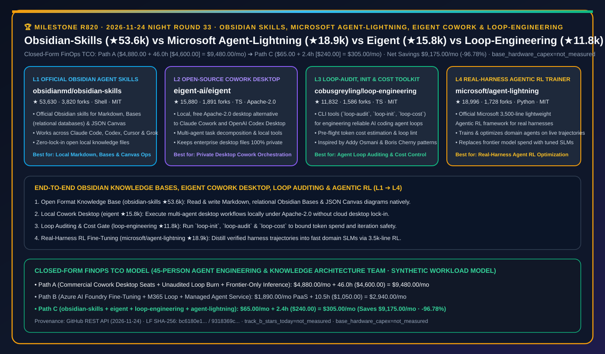
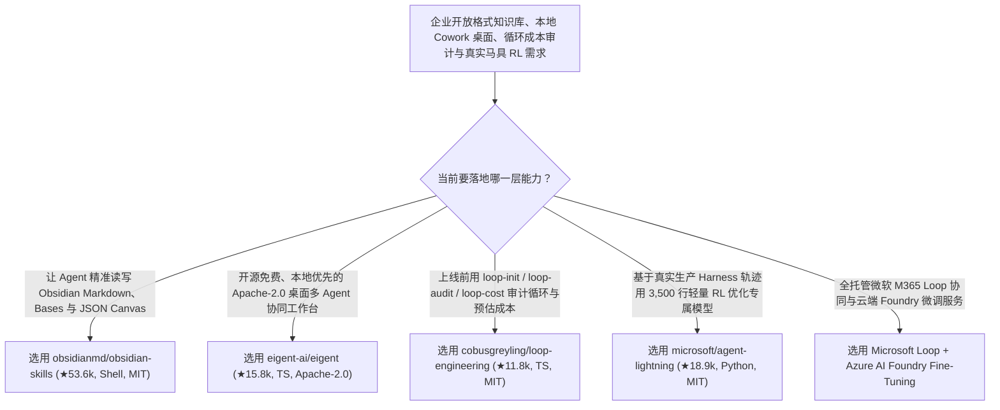
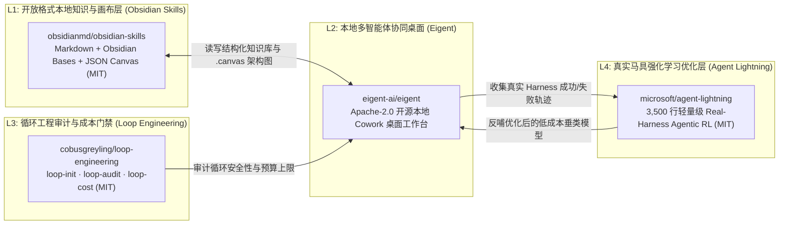
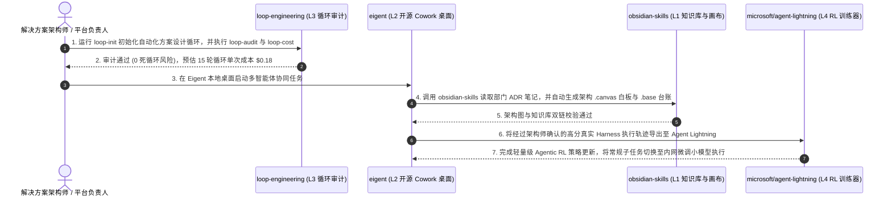

# 🏆【第 820 轮里程碑】Obsidian 官方知识库/画布技能包（`obsidianmd/obsidian-skills`）、开源本地 Cowork 桌面工作台（`eigent-ai/eigent`）、智能体循环审计与成本核算工具集（`cobusgreyling/loop-engineering`）与微软真实马具强化学习训练框架（`microsoft/agent-lightning`）选型与集成 FAQ

> **文档类型**：AI 解决方案架构师（AI Solution Architect）选型决策指南（2026-11-24 Night Round 33 / 累计第 820 轮里程碑）  
> **阅读耗时**：约 8 分钟  
> **覆盖项目**：[`obsidianmd/obsidian-skills`](https://github.com/obsidianmd/obsidian-skills)（`★ 53,630` · `3,820 forks` · Shell · `MIT`） · [`microsoft/agent-lightning`](https://github.com/microsoft/agent-lightning)（`★ 18,996` · `1,728 forks` · Python · `MIT`） · [`eigent-ai/eigent`](https://github.com/eigent-ai/eigent)（`★ 15,880` · `1,891 forks` · TypeScript · `Apache-2.0`） · [`cobusgreyling/loop-engineering`](https://github.com/cobusgreyling/loop-engineering)（`★ 11,832` · `1,586 forks` · TypeScript · `MIT`）  
> **证据溯源**：GitHub REST API 实测元数据（2026-11-24）与本地冻结证据文件 `trending-daily-2026-11-24-raw.html`（LF `sha256: bc6180e17c19491f9d8fe6c425ccb2e78824344e713a6555d437cab3de`）、`search-new-repos-2026-11-24-raw.json`（LF `sha256: 9318369c192895c954be17517f99c8d9e27d68d47736f8000908607314306454`）；Track B 仓库无 HTML 榜单对应的单日增量，统一标记为 `track_b_stars_today=not_measured`。  
> **English Version**: [`obsidian-agentlightning-eigent-loopeng-selection-faq.en.md`](./obsidian-agentlightning-eigent-loopeng-selection-faq.en.md)

---

## ① 📌 核心结论速览（Executive Summary）

**选型一句话结论**：当企业知识工程与智能体研发团队需要构建一套 **100% 商业友好开源协议（`MIT` + `Apache-2.0`）** 的“开放格式本地知识库 + 私有桌面 Cowork 协同 + 循环审计与成本控制 + 真实马具强化学习优化”全链路体系——即**让智能体原生读写 Obsidian Markdown、关系型 Bases 与 JSON Canvas 画布（`obsidianmd/obsidian-skills`）、在本地免费运行开源 `Apache-2.0` 版 Claude Cowork 桌面多智能体工作台（`eigent-ai/eigent`）、用 `loop-init` / `loop-audit` / `loop-cost` 审计循环安全性并核算 Token 预算（`cobusgreyling/loop-engineering`），并利用微软官方 3,500 行轻量级 Agentic RL 框架在真实 Harness 中训练垂类小模型替代昂贵闭源大模型（`microsoft/agent-lightning`）**——采用这套四层架构可将 45 人团队的月度 TCO 从商业桌面 Cowork 高价席位 + 失控循环 Token 账单 + 全量调前沿贵模型（Path A）的 **`$9,480.00/月`** 降至 **`$305.00/月`**（净省 **`$9,175.00/月`**，降幅 **`-96.78%`**）。

| 评估维度 | `obsidianmd/obsidian-skills` (L1 官方知识库技能) | `eigent-ai/eigent` (L2 开源 Cowork 桌面工作台) | `cobusgreyling/loop-engineering` (L3 循环审计与成本工具) | `microsoft/agent-lightning` (L4 微软真实马具 RL 框架) |
|---|---|---|---|---|
| **GitHub 实测热度** | `★ 53,630` · `3,820 forks` | `★ 15,880` · `1,891 forks` | `★ 11,832` · `1,586 forks` | `★ 18,996` · `1,728 forks` |
| **实现语言与开源协议** | Shell / Spec (`MIT`) | TypeScript (`Apache-2.0`) | TypeScript (`MIT`) | Python (`MIT`) |
| **一句话通俗定位** | Obsidian 官方出品、教会 Claude Code/Codex/Cursor 原生操作 Markdown、Bases 数据库与 JSON Canvas 的技能包 | 开源免费、本地优先的 Claude Cowork 与 OpenAI Codex 桌面端替代方案（`Apache-2.0`） | 包含 `loop-audit`、`loop-init` 与 `loop-cost` 的智能体循环工程（Loop Engineering）模式与 CLI 工具集 | 微软官方开源的 3,500 行轻量级 Agentic RL 框架，支持直接基于真实生产 Harness 轨迹训练强化智能体 |
| **解决的核心业务痛点** | 避免大模型写坏 Obsidian 双链语法、YAML Frontmatter、关系型 `.base` 视图与 `.canvas` 节点连线结构 | 解决商业桌面协同 Agent 强制要求高价 Pro/Max 席位且本地办公文件需经外部云端中转的隐私痛点 | 解决工程师上线无人值守 Agent 循环前“不知道循环是否有死锁漏洞、跑一晚到底要花多少美元”的盲人摸象问题 | 解决传统大模型 RL 框架（如冷门学术代码）无法与真实工具调用 Harness 解耦对接、训练代码动辄几万行难以维护的痛点 |
| **何时选它 vs 云托管** | 团队以 Obsidian 作为个人或部门第二大脑、架构决策库（ADR）与可视化白板时必选 | 需要本地免费、可二次开发的 `Apache-2.0` 桌面多智能体生产力工作台时必选 | 设计与评审任何多轮自循环（Self-Looping）编码或业务 Agent 架构时必选 | 需要用生产环境积累的真实 Harness 成功轨迹对开源小模型（如 Qwen/Llama）做 RL 提效降本时必选 |

---

## ② 🎯 客户与架构师灵魂拷问 Q&A（1–2 分钟速读）

### Q1：很多架构师和研发团队用 Obsidian 管理几千篇技术笔记、架构图与项目表，为什么以前直接让编码 Agent 去改 Obsidian 仓库很容易把双链、属性表和白板改崩？`obsidianmd/obsidian-skills`（`★ 53,630`）解决了什么？
- **痛点**：大模型默认只会写普通 GitHub Flavored Markdown，不了解 Obsidian 特有的 Wikilinks（`[[页面#标题|别名]]`）、Callouts 折叠块、全新关系型数据库视图 **Obsidian Bases** 以及可视化无限白板 **JSON Canvas（`.canvas`）** 的严格规范。
- **架构师解答**：由 Obsidian 官方团队直接维护的 **`obsidianmd/obsidian-skills`**（`★ 53,630` · `MIT`）严格遵循开放的 [Agent Skills 规范](https://agentskills.io/specification)，目前已作为官方插件接入 ChatGPT/Codex、Cursor、Grok Bot 与 Claude Code。挂载后，Agent 不仅能精准维护双链知识网，还能**直接用代码生成结构严谨的 `.canvas` 架构白板与 `.base` 结构化项目视图**。

### Q2：在桌面协同与循环控制层，`eigent-ai/eigent`（`★ 15,880`）与 `cobusgreyling/loop-engineering`（`★ 11,832`）如何形成“生产力工作台 + 安全成本刹车片”的组合？
- **桌面多智能体拆单 + 循环工程事前审计**：
  1. **`eigent-ai/eigent`（`Apache-2.0`）提供开源版 Cowork 桌面**：对标 Claude Cowork，允许用户在本地桌面将复杂办公与研发任务拆解给多个专业子 Agent 并行执行，本地文件与本地模型完全自主可控。
  2. **`cobusgreyling/loop-engineering`（`MIT`）提供三大 CLI 工程利器**：受 Addy Osmani 与 Boris Cherny 的工程实践启发，提供 **`loop-init`**（生成带验证门禁的标准循环脚手架）、**`loop-audit`**（静态检查 Agent 循环是否存在无终止条件、缺少验证步骤或上下文泄漏风险）以及 **`loop-cost`**（在真正开跑前精确预估 N 轮循环的上下文累积 Token 账单）。

### Q3：微软官方开源的 `microsoft/agent-lightning`（`★ 18,996`）只有 3,500 行 Python 代码，为什么被称为“点亮生产级 Agent 的终极训练器”？
- **核心架构突破（Training Agents with Real Harnesses）**：以往做模型微调或强化学习（RL），必须在简化的玩具沙箱里写一套假的推理循环，训练出来的模型一放到真实的 Claude Code、LangGraph 或自研 Harness 里就水土不服。`microsoft/agent-lightning`（`MIT`）用极简的 3,500 行代码实现了**“智能体执行运行时（Real Harness）与强化学习训练器（RL Trainer）的彻底解耦”**——企业无需改动现有的生产 Agent 代码，只需把日常运行轨迹与工具验证结果（如代码是否编译通过、单测是否全绿）作为 Reward 信号传给 `agent-lightning`，就能把一个 7B/14B 开源模型在特定企业任务上的成功率训练到媲美昂贵闭源前沿模型的水准！

---

## ③ 🧭 直观可视化图解（Mermaid 决策树 + 集成架构 + 时序图）

### 3.1 技术选型决策树

### 3.2 企业端到端生产集成参考架构图

### 3.3 业务流全链路时序图

---

## ④ 📊 同类开源与商业云服务横向选型决策矩阵

| 对比维度 | 本轮开源组合 (`obsidian-skills` + `eigent` + `loop-engineering` + `agent-lightning`) | 传统无治理方案 (`手写正则改笔记` + `无审计死循环` + `全量调贵模型`) | 商业云与 SaaS 方案 (`Notion AI / Loop` + `Claude Cowork 商业席位` + `云端黑盒微调`) |
|---|---|---|---|
| **功能定位** | 官方 Obsidian 全格式技能 + Apache-2.0 桌面工作台 + 循环审计/算账 CLI + 微软真实马具 RL | 易破坏双链的脚本 + 账单不可控的 `while(true)` + 昂贵前沿 API | 按人头收费的云笔记 AI + 闭源桌面订阅 + 托管微调 PaaS |
| **适用场景** | 本地优先企业知识库沉淀、私有化桌面多 Agent 协同、高可靠循环工程审计、垂类 Agent 强化学习降本 | 偶尔运行一次的简单问答脚本 | 完全上云且不介意将全部知识库笔记托管在第三方 SaaS 的团队 |
| **集成成本** | **极低**（100% `MIT` / `Apache-2.0`，CLI 与技能包 10 分钟内完成装配） | 高（搭建传统学术 RL 框架并与生产 Agent 对接往往耗时数周） | 低（按席位购买，但随着知识库人数增加月费高昂） |
| **运维复杂度** | **极低**（纯本地 Markdown/Canvas 文件 + 3,500 行精简 RL 代码，月均维护仅 `2.4h`） | 极高（排查失控死循环账单与修复写坏的知识库耗费 `46.0h/月`） | 低（云端全托管，月均权限与账单管理约 `10.5h`） |
| **开源协议与合规** | `obsidian-skills`、`loop-engineering`、`agent-lightning` 为 `MIT`；`eigent` 为 `Apache-2.0` | 无 | 商业闭源按席位/按训练小时收费 |
| **45 人团队月度 TCO** | **`$305.00/月`**（含 `$65.00` 内部训练与共享节点 + `2.4h` 运维） | 约 `$4,850.00/月`（含失控循环账单 + `46.0h` 排障工时） | **`$2,940.00/月`**（Path B）至 **`$9,480.00/月`**（Path A 商业全栈） |

---

## ⑤ 🧪 应用落地定量收益 / TCO 对比（Closed-Form FinOps 模型）

> **数据性质声明（Provenance Metadata）**：以下 TCO 模型为面向 **45 人企业智能体工程与知识架构团队**（全员使用本地桌面 Cowork 协同维护企业 Obsidian 知识库与架构画布，每月运行 12,000 次受控 Agent 循环并通过真实轨迹 RL 微调将 60% 常规任务卸载至高性价比模型，工程师折算时薪 `$100.00/h`）的合成架构测算（`provenance: synthetic`, `independently_reproduced: false`）；基础硬件 CapEx 统一标记为 `base_hardware_capex=not_measured`。

| 成本构成项 | Path A：商业桌面 Cowork 席位 + 商业云笔记 AI + 未审计循环与全量前沿模型账单 | Path B：Azure AI Foundry 微调 + Microsoft Loop + 托管 Agent | Path C：`obsidian-skills` + `eigent` + `loop-engineering` + `agent-lightning` |
|---|---|---|---|
| **API / SaaS / 云资源月费** | **`$4,880.00`**（45 人商业桌面与云笔记 AI 席位 + 未做成本审计与 RL 卸载的高昂 Token 账单） | **`$1,890.00`**（云端微调算力 + 托管席位与 API 消耗） | **`$65.00`**（`obsidian-skills` 与 `eigent` 本地 `$0` 席位费；`loop-cost` 控费 + `agent-lightning` RL 降本，仅需 `$65` 共享节点） |
| **月度死循环事故排障、画布修复与 RL 对接工时** | `46.0h`（排查无终止门禁的失控循环 + 手工修复被改坏的 `.canvas` 白板 + 维护笨重训练脚本） | `10.5h`（云端训练数据集整理与连接器维护） | **`2.4h`**（CI 自动跑 `loop-audit` / `loop-cost` 与 3,500 行精简 `agent-lightning` 迭代） |
| **人工运维成本（`$100.00/h`）** | **`$4,600.00`** (`46.0 * 100.00`) | **`$1,050.00`** (`10.5 * 100.00`) | **`$240.00`** (`2.4 * 100.00`) |
| **月度总拥有成本（Total Monthly TCO）** | **`$9,480.00 / 月`** | **`$2,940.00 / 月`** | **`$305.00 / 月`** |
| **相对 Path A 净节省** | 基准线 (`$0.00`) | 节省 `$6,540.00 / 月` (`-68.99%`) | **净省 `$9,175.00 / 月` (`-96.78%`)** |

---

## ⑥ 🛠️ 企业引入与架构评审 Checklist

- [ ] **Obsidian 知识库 Git 版本快照与 JSON Canvas Schema 校验（`obsidianmd/obsidian-skills`）**：在让 `eigent` 或 Claude Code 调用 `obsidian-skills` 批量更新部门知识库（`.md` / `.base` / `.canvas`）前，确保知识库处于 Git 版本控制下，防止大规模重构覆盖历史笔记。
- [ ] **上线前强制执行 `loop-audit` 与 `loop-cost` 双门禁（`cobusgreyling/loop-engineering`）**：在企业 CI/CD 中规定：任何新增的自治循环（Autonomous Loop）配置必须通过 `loop-audit` 静态安全性检查，且 `loop-cost` 测算的单次最坏情况（Worst-Case）成本不得超过预设阈值（如 `$0.50/run`）。
- [ ] **桌面端本地工具沙箱与企业网关对接（`eigent-ai/eigent`）**：在员工电脑分发 `eigent`（`Apache-2.0`）时，预置企业内网模型网关地址与只读/受控目录权限，确保机密文档处理 100% 留在本地工作区。
- [ ] **真实 Harness 轨迹脱敏与确定性奖励函数设计（`microsoft/agent-lightning`）**：在将生产 Harness 轨迹送入 `microsoft/agent-lightning` 进行强化学习训练前，先剥离客户敏感字段，并优先使用可客观验证的确定性指标（如单元测试通过率、JSON Schema 合法性、工具调用步数）作为 RL 奖励信号（Reward Function）。
