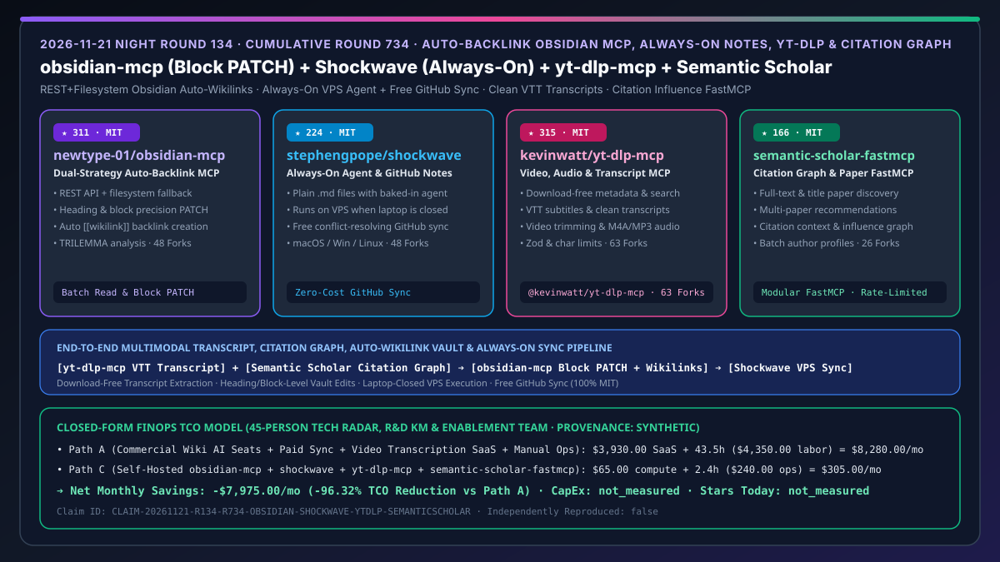
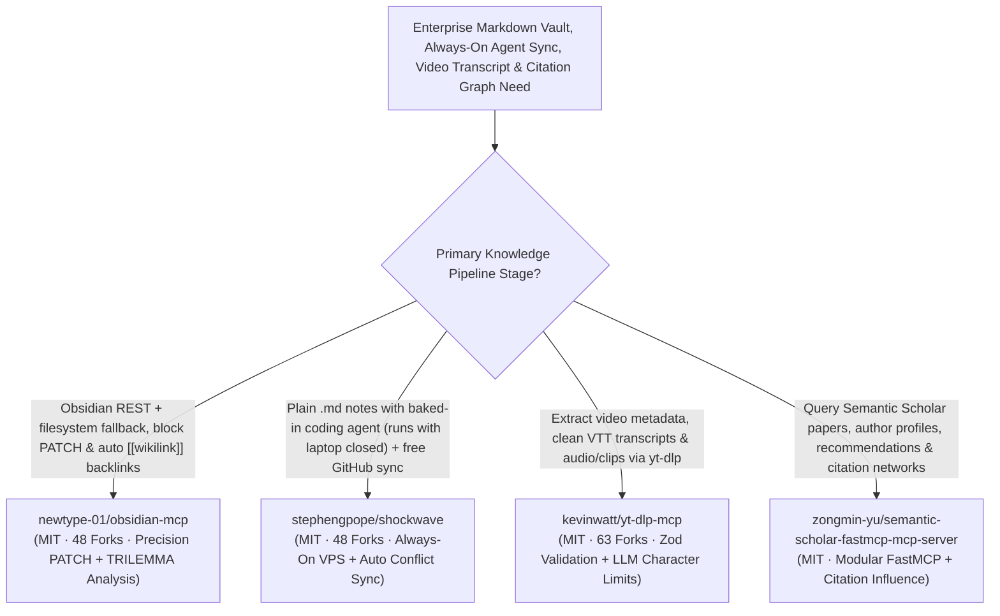
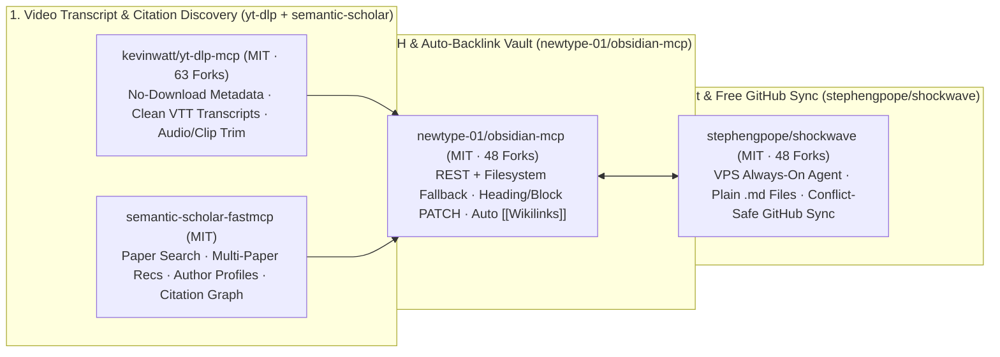
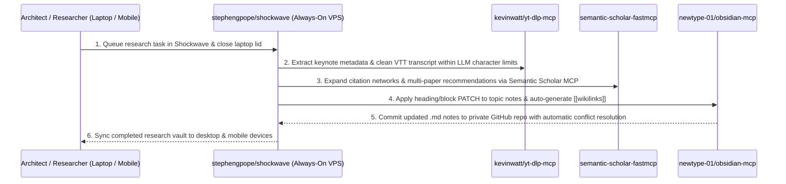

# Dual-Strategy Auto-Backlink Obsidian MCP (`newtype-01/obsidian-mcp`), Always-On GitHub-Synced Agent Notes (`stephengpope/shockwave`), Video/Transcript Bridge (`kevinwatt/yt-dlp-mcp`) & Semantic Scholar Citation FastMCP (`zongmin-yu/semantic-scholar-fastmcp-mcp-server`) Selection & Architecture FAQ

> **Document Type**: Enterprise AI Solution Architect Selection & Integration Guide (GitHub Trending AI Radar — 2026-11-21 Night Round 134 / Cumulative Round 734)
> **Covered Repositories**: [`newtype-01/obsidian-mcp`](https://github.com/newtype-01/obsidian-mcp) (`★ 311`, `48 forks`, `MIT` — Obsidian MCP server with REST API + filesystem fallback, heading/block-level precision PATCH, automatic `[[wikilink]]` backlink generation & `TRILEMMA-PRINCIPLES` analysis) · [`stephengpope/shockwave`](https://github.com/stephengpope/shockwave) (`★ 224`, `48 forks`, `MIT` — plain-`.md` notes app with a baked-in coding agent, always-on self-hosted VPS execution when your laptop is closed & free conflict-resolving GitHub sync) · [`kevinwatt/yt-dlp-mcp`](https://github.com/kevinwatt/yt-dlp-mcp) (`★ 315`, `63 forks`, `MIT` — `yt-dlp` MCP server for download-free video metadata, VTT/clean-text transcript extraction with LLM character limits, video trimming & audio extraction) · [`zongmin-yu/semantic-scholar-fastmcp-mcp-server`](https://github.com/zongmin-yu/semantic-scholar-fastmcp-mcp-server) (`★ 166`, `26 forks`, `MIT` — modular FastMCP server for Semantic Scholar paper search, multi-paper recommendations, author profiles & citation influence networks)
> **Core Scenario**: How enterprise tech-radar, R&D knowledge management, and enablement teams build an **Always-On Multimodal Knowledge Ingestion & Wikilink Vault** pipeline: **extracting clean transcripts and metadata from technical talks without downloading heavy video files (`yt-dlp-mcp`)**, **tracing citation networks and multi-paper recommendations (`semantic-scholar-fastmcp-mcp-server`)**, **patching structured insights into Obsidian vaults with heading/block precision and automatic `[[wikilinks]]` (`obsidian-mcp`)**, and **keeping background agent research running when laptops close with free conflict-resolving GitHub sync (`shockwave`)**.

---

## 1. 📌 Executive Summary (One-Line Selection Verdict)

1. **Need an Obsidian MCP server (`48 forks`) that combines an Obsidian REST API + local filesystem fallback with heading/block-level precision PATCH updates, automatic `[[wikilink]]` backlink generation, batch note reads, and `TRILEMMA-PRINCIPLES` strategic analysis** ➔ Choose **[`newtype-01/obsidian-mcp`](https://github.com/newtype-01/obsidian-mcp) (`★ 311`, `48 forks`, `MIT`)**.
   - **Plain-English Mechanism**: Uses a **Dual API Strategy** (connecting to the Obsidian REST API when the desktop app is open and falling back to the filesystem automatically), executes targeted heading/block PATCHes via `update_note` instead of overwriting whole files, and automatically converts note title mentions into `[[wikilinks]]`.
2. **Need a plain-`.md` notes workspace (`macOS`, `Windows`, `Linux`) with a baked-in coding agent that keeps working on a lightweight self-hosted VPS when you close your laptop and syncs across devices for free via your own GitHub repository** ➔ Choose **[`stephengpope/shockwave`](https://github.com/stephengpope/shockwave) (`★ 224`, `48 forks`, `MIT`)**.
   - **Plain-English Mechanism**: Built by Stephen G. Pope, `shockwave` pairs a native desktop app with a one-line self-hosted VPS daemon (`api/install.sh`) and free GitHub-backed versioned file sync (with automatic conflict resolution), ensuring long-running agent tasks finish even while your laptop is shut.
3. **Need a battle-tested (`63 forks`) MCP server (`npx -y @kevinwatt/yt-dlp-mcp@latest`) to search video platforms, extract metadata and clean multi-language VTT transcripts without downloading video bytes, or trim clips and extract M4A/MP3 audio** ➔ Choose **[`kevinwatt/yt-dlp-mcp`](https://github.com/kevinwatt/yt-dlp-mcp) (`★ 315`, `63 forks`, `MIT`)**.
   - **Plain-English Mechanism**: Wraps `yt-dlp` in a TypeScript + Zod-validated MCP server with built-in character limits to protect LLM context windows during transcript and metadata extraction.
4. **Need a modular FastMCP server (`papers.py`, `authors.py`, `recommendations.py`) for the Semantic Scholar API to run multi-paper recommendations, batch paper/author lookups, and citation influence analysis** ➔ Choose **[`zongmin-yu/semantic-scholar-fastmcp-mcp-server`](https://github.com/zongmin-yu/semantic-scholar-fastmcp-mcp-server) (`★ 166`, `26 forks`, `MIT`)**.
   - **Plain-English Mechanism**: Centralizes a rate-limited FastMCP client over Semantic Scholar's academic graph and pairs seamlessly with `semantic-scholar-skills` (`/expand-references`, `/trace-citations`, `/paper-triage`).

---

## 2. 🎯 Architect & Customer Deep-Dive Q&A

### Q1: Why do enterprise knowledge vaults suffer from unlinked note graveyards, overwritten markdown files, and interrupted agent runs—and how does this four-project stack solve them?

- **Four Knowledge Engineering Breakthroughs**:
  1. **Download-Free Video Transcript & Metadata Extraction (`kevinwatt/yt-dlp-mcp`)**: Pulls clean text transcripts and channel metadata from technical keynotes in seconds with Zod validation and LLM character caps.
  2. **Automated Citation Graph & Multi-Paper Discovery (`semantic-scholar-fastmcp-mcp-server`)**: Expands references and traces citation influence across academic papers mentioned in talks or RFCs.
  3. **Precision Block PATCH & Auto-Wikilinks (`newtype-01/obsidian-mcp`)**: Prevents destructive full-file overwrites via heading/block-level PATCH operations, automatically links related concepts into `[[wikilinks]]`, and works even when the Obsidian GUI is closed via filesystem fallback.
  4. **Always-On VPS Execution + Free GitHub Sync (`stephengpope/shockwave`)**: Keeps plain `.md` files under your ownership, continues agent work on your VPS after laptop lid closure, and resolves multi-device sync conflicts through GitHub at zero monthly subscription cost.
- **When to Choose Managed Cloud Services (Path B)**:
  - Organizations standardized on proprietary cloud wikis without local `.md` ownership requirements can use **Notion AI** or **Atlassian Rovo**.

### Q2: How do we wire an end-to-end Multimodal Tech-Radar & Always-On Markdown Knowledge Vault architecture?

1. **Video & Academic Graph Ingestion Layer (`yt-dlp-mcp` + `semantic-scholar-fastmcp`)**:
   - Extract clean transcripts from conference videos via `@kevinwatt/yt-dlp-mcp` and enrich referenced papers/authors via `semantic-scholar-fastmcp-mcp-server`.
2. **Dual-Strategy Vault & Auto-Backlink Layer (`newtype-01/obsidian-mcp`)**:
   - Use `update_note` (heading/block PATCH), `read_multiple_notes`, and automatic `[[wikilink]]` conversion to weave findings into the team's Obsidian vault.
3. **Always-On Agent & GitHub Sync Layer (`stephengpope/shockwave`)**:
   - Run the `shockwave` daemon on an internal/VPS node so queued research tasks complete 24/7 and sync cleanly across desktops and mobile via a private GitHub repo.

### Q3: What are the governance and usage boundaries of this stack?

- **Key Strengths**:
  - **100% `MIT` Open Source** with zero proprietary database lock-in (100% plain `.md` files).
- **Compliance Guardrails**:
  - Use `kevinwatt/yt-dlp-mcp` primarily for metadata and transcript extraction on authorized or publicly licensed technical/educational content in accordance with platform terms.

---

## 3. 🧭 Visual Architecture & Decision Diagrams

### 3.1 Solution Architect Selection Decision Tree

### 3.2 End-to-End Enterprise Reference Architecture

### 3.3 Video Transcript Extraction, Citation Network Expansion, Obsidian Block PATCH & Shockwave GitHub Sync Sequence

---

## 4. 📊 Peer Open-Source vs Commercial Cloud Selection Matrix

| Dimension | `newtype-01/obsidian-mcp` (`★ 311`) | `stephengpope/shockwave` (`★ 224`) | `kevinwatt/yt-dlp-mcp` (`★ 315`) | `semantic-scholar-fastmcp` (`★ 166`) | Commercial Cloud Wiki AI + Paid Sync & Transcription SaaS (Path A) | Basic File MCP + Manual Video/Paper Note-Taking (Path B) |
| :--- | :--- | :--- | :--- | :--- | :--- | :--- |
| **Core Role** | Dual-strategy auto-backlink Obsidian MCP | Always-on VPS agent & GitHub-synced `.md` app | Video metadata, clean transcript & clip MCP | Modular Semantic Scholar paper & citation MCP | Notion AI + paid note sync + per-minute transcription SaaS | Manual note-taking + naive whole-file overwrites |
| **Architectural Edge** | **REST + filesystem fallback + block PATCH + auto `[[wikilinks]]`** | **Keeps working when laptop closes + free GitHub sync (`48 forks`)** | **Transcript extraction without video download (`63 forks`)** | **Multi-paper recommendations + citation influence tracking** | Proprietary cloud lock-in; stacked per-seat & per-minute SaaS fees | Whole-file overwrites corrupt notes; stops when laptop sleeps |
| **License** | `MIT` | `MIT` | `MIT` | `MIT` | Proprietary SaaS | Custom Scripts |
| **Monthly TCO (45-Eng Team)** | **`$305.00/mo` combined** (`$65.00` shared VPS + `2.4h` ops) | Included in `$305.00/mo` stack | Included in `$305.00/mo` stack | Included in `$305.00/mo` stack | **`$8,280.00/mo`** (`$3,930.00` SaaS + `43.5h` manual note curation) | `~$2,800.00/mo` (manual transcription & backlink curation toil) |

---

## 5. 🧪 Quantitative ROI / FinOps TCO Model & 7-Card Report

> **📊 Provenance & Closed-Form Audit Declaration**:
> - **Provenance**: `synthetic` (45-person enterprise tech-radar, R&D knowledge management & enablement workload model; `independently_reproduced = false`; `base_hardware_capex = not_measured`; `track_b_stars_today = not_measured`).
> - **Closed-Form Equations**:
>   - **Path A (Commercial Cloud Wiki AI Seats + Paid Multi-Device Note Sync + Metered Video Transcription SaaS + Manual Backlink & Citation Graph Curation Labor)**: Monthly SaaS subscriptions **`$3,930.00`** + manual video/paper synthesis & vault curation labor **`43.5h × $100.00/h = $4,350.00`** = **`$8,280.00/mo`**.
>   - **Path C (Self-Hosted `newtype-01/obsidian-mcp` + `stephengpope/shockwave` + `kevinwatt/yt-dlp-mcp` + `zongmin-yu/semantic-scholar-fastmcp-mcp-server`)**: Shared lightweight VPS compute **`$65.00`** + vault schema & sync maintenance **`2.4h × $100.00/h = $240.00`** = **`$305.00/mo`**.
>   - **Net Savings vs Path A**: **`-$7,975.00/mo`** (**`96.32%`** cost reduction).

| Architecture Option | API / SaaS / Compute | Knowledge & Media Curation Labor (`$100/h`) | Total Monthly TCO | Net Savings vs Path A | Key Architectural Outcome |
| :--- | :---: | :---: | :---: | :---: | :--- |
| **Path A: Commercial Cloud Wiki AI + Paid Sync + Transcription** | `$3,930.00` | `43.5h` (`$4,350.00`) | **`$8,280.00`** | Baseline | Proprietary cloud lock-in; per-seat sync & per-minute media bills |
| **Path B: Basic File MCP + Manual Video/Citation Note-Taking** | `$1,300.00` | `15.0h` (`$1,500.00`) | **`$2,800.00`** | `-$5,480.00` (`-66.18%`) | Lacks block PATCH, auto-backlinks, always-on VPS & VTT extraction |
| **Path C: `obsidian` + `shockwave` + `yt-dlp` + `scholar`** | **`$65.00`** | **`2.4h` (`$240.00`)** | **`$305.00`** | **`-$7,975.00` (`-96.32%`)** | **Block PATCH/auto-backlinks + always-on GitHub sync + media/citation MCP** |

- 🔗 **7-Card 4:5 Visual Report**: [`workshops/github-trending-radar/cards.en.html`](../cards.en.html) · [`cards.html`](../cards.html)

---

## 6. 🛠️ Enterprise Adoption & Architecture Review Checklist

- [ ] **1. Standardize Non-Destructive Vault Edits on `newtype-01/obsidian-mcp`**: Use heading/block-level PATCH (`update_note`), automatic `[[wikilink]]` backlink generation, and REST + filesystem fallback.
- [ ] **2. Enable Always-On Execution & Free GitHub Sync with `stephengpope/shockwave`**: Pair desktop clients with an internal/VPS `shockwave` server backed by a private GitHub repository for conflict-resolved `.md` sync.
- [ ] **3. Ingest Technical Talks via `kevinwatt/yt-dlp-mcp`**: Extract metadata and clean VTT transcripts without downloading full video streams, enforcing character limits for LLM context safety.
- [ ] **4. Trace Citation Networks with `zongmin-yu/semantic-scholar-fastmcp-mcp-server`**: Connect the modular FastMCP server (and companion `/expand-references` / `/trace-citations` skills) to map academic lineage.
