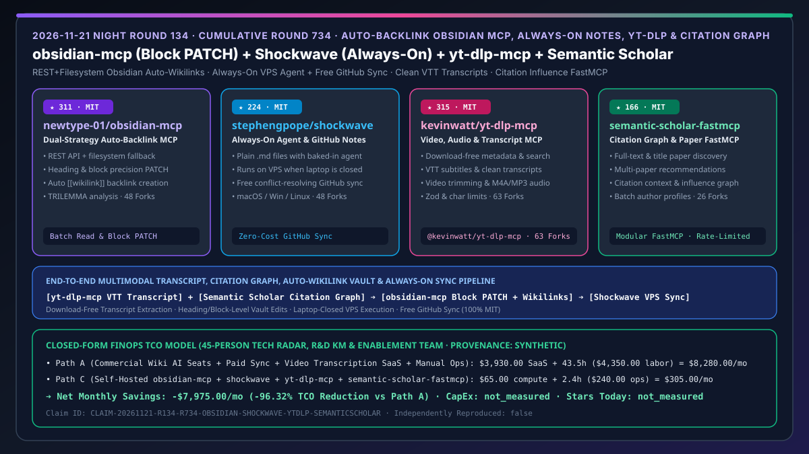
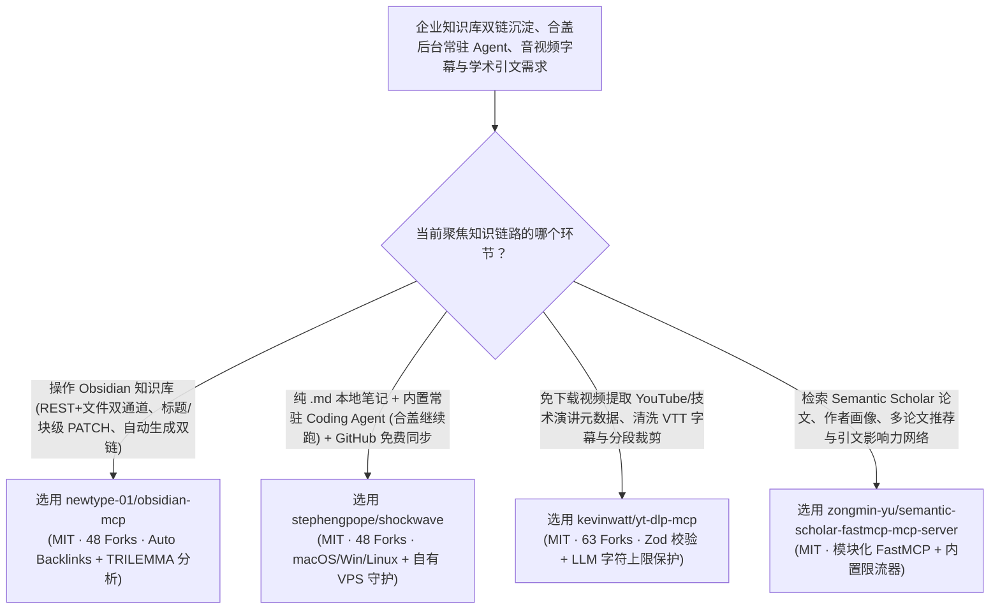
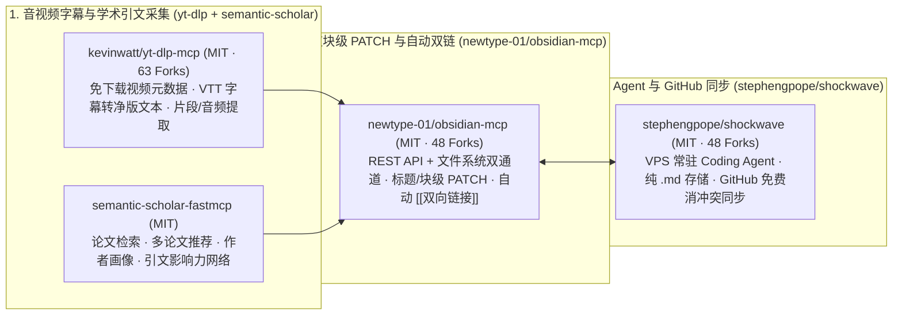
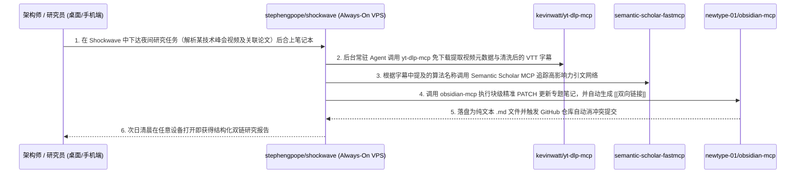

# 双通道自动双向链接 Obsidian MCP（`newtype-01/obsidian-mcp`）、自带合盖后台运行 Agent 与 GitHub 免费同步的笔记工作台（`stephengpope/shockwave`）、音视频字幕/元数据提取 MCP（`kevinwatt/yt-dlp-mcp`）与 Semantic Scholar 引文网络 FastMCP（`zongmin-yu/semantic-scholar-fastmcp-mcp-server`）选型与集成架构 FAQ

> **文档类型**：企业 AI 解决方案架构师（AI Solution Architect）选型决策指南（GitHub Trending AI 雷达 2026-11-21 Night Round 134 / 累计第 734 轮）
> **覆盖项目**：[`newtype-01/obsidian-mcp`](https://github.com/newtype-01/obsidian-mcp)（`★ 311`、`48 forks`、`MIT`，采用 Obsidian REST API + 本地文件系统双通道兜底、支持标题/块级精准 PATCH、自动生成 `[[双向链接]]` 与 `TRILEMMA-PRINCIPLES` 战略分析的 Obsidian 知识库 MCP）· [`stephengpope/shockwave`](https://github.com/stephengpope/shockwave)（`★ 224`、`48 forks`、`MIT`，纯本地 `.md` 存储、内置后台常驻编码/整理 Agent 且通过用户自有 GitHub 仓库实现免费跨端自动消冲突同步的知识工作台）· [`kevinwatt/yt-dlp-mcp`](https://github.com/kevinwatt/yt-dlp-mcp)（`★ 315`、`63 forks`、`MIT`，基于 `yt-dlp` 提供免下载元数据提取、多语种 VTT 字幕清洗、片段裁剪与音频提取并带字符安全上限的音视频 MCP）· [`zongmin-yu/semantic-scholar-fastmcp-mcp-server`](https://github.com/zongmin-yu/semantic-scholar-fastmcp-mcp-server)（`★ 166`、`26 forks`、`MIT`，模块化封装论文检索、多论文联合推荐、作者画像与引文影响力网络的 Semantic Scholar FastMCP）
> **核心场景**：当企业技术情报（Tech Radar）、研发知识库（PKM/Team Vault）与培训内容运营团队建设**“全媒体输入 ➔ 结构化双链沉淀 ➔ 24 小时后台自治整理”**流水线时，如何打通**“技术演讲音视频免下载提取干净字幕（`yt-dlp-mcp`）+ 学术论文引文网络溯源（`semantic-scholar-fastmcp`）”➔“自动转化为带 `[[双向链接]]` 与块级 PATCH 的 Obsidian 笔记（`obsidian-mcp`）”➔“合上笔记本电脑仍由 VPS 常驻 Agent 继续执行后台研究并通过 GitHub 免费跨端同步（`shockwave`）”**？

---

## 一、📌 核心结论速览（选型一句话结论）

1. **想让 AI 助手直接读写团队的 Obsidian 知识库（Vault），且同时具备“Obsidian REST API + 本地文件系统降级”双保险、标题/块级精准 PATCH 修改与自动识别笔记名生成 `[[双向链接]]`（Auto Backlink Generation）** ➔ 选 **[`newtype-01/obsidian-mcp`](https://github.com/newtype-01/obsidian-mcp)（`★ 311`，`48 forks`，`MIT`）**。
   - **通俗原理**：市面上多数 Obsidian MCP 要么强依赖开启 Obsidian 客户端插件，要么只能整篇覆盖文件。`newtype-01/obsidian-mcp` 采用 **Dual API Strategy（优先调 REST API，未开客户端时自动回退到本地文件系统）**，支持批量读取（`read_multiple_notes`）、按标题/段落块精准局部更新（`update_note` PATCH）、自动把正文中出现的笔记标题转为 `[[wikilinks]]`，并内置 `TRILEMMA-PRINCIPLES` 战略分析框架。
2. **想要一款纯本地 `.md` 文件归属自己、无需单独配 Claude Code 就内置了带记忆与自进化的真实 Coding Agent，且“合上笔记本电脑任务仍在自有轻量 VPS 上继续跑、通过自有 GitHub 仓库免费跨端自动解冲突同步”的笔记应用** ➔ 选 **[`stephengpope/shockwave`](https://github.com/stephengpope/shockwave)（`★ 224`，`48 forks`，`MIT`）**。
   - **通俗原理**：由 AI 自动化专家 Stephen G. Pope 打造（提供 macOS / Windows / Linux 客户端 + 一键 VPS 服务端脚本 `api/install.sh`）。它解决了传统本地笔记的两大痛点：① **Always On（合盖不断连）**——把长耗时研究任务派给 Agent 后合上电脑，VPS 端继续执行；② **零月租 GitHub 同步**——利用你自己的 GitHub 私有库实现跨设备（含手机端）历史版本同步与自动冲突消解。
3. **想让大模型直接检索 YouTube 或技术峰会视频、在不下载几百 MB 视频文件的前提下秒级提取元数据与多语言 VTT 干净纯文本字幕（或按需裁剪视频片段/提取 MP3 播客音频）** ➔ 选 **[`kevinwatt/yt-dlp-mcp`](https://github.com/kevinwatt/yt-dlp-mcp)（`★ 315`，`63 forks`，`MIT`）**。
   - **通俗原理**：高达 `63 forks` 的音视频桥接标杆（`npx -y @kevinwatt/yt-dlp-mcp@latest`）。它用 TypeScript + Zod 严格校验参数，并设置了保护大模型上下文的字符数上限（Character Limits for LLM Safety），支持分页视频搜索、免下载提取频道/标签元数据、多语种字幕转纯文本以及 480p–1080p 分段裁剪下载。
4. **想让研发 Agent 通过 FastMCP 深度调用 Semantic Scholar API，执行多论文联合推荐、批量获取论文与作者学术画像，并追踪引文上下文与学术影响力网络（Citation Influence）** ➔ 选 **[`zongmin-yu/semantic-scholar-fastmcp-mcp-server`](https://github.com/zongmin-yu/semantic-scholar-fastmcp-mcp-server)（`★ 166`，`26 forks`，`MIT`）**。
   - **通俗原理**：采用高内聚模块化设计（`papers.py`、`authors.py`、`recommendations.py` 与内置限流器 `http.py`），还可无缝搭配作者同源的 `semantic-scholar-skills`（提供 `/expand-references`、`/trace-citations`、`/paper-triage` 斜杠工作流）。

---

## 二、🎯 客户与架构师灵魂拷问 Q&A（深度架构拆解）

### Q1：为什么企业的“技术情报与知识沉淀（PKM/Team KM）”往往变成只进不出的收藏夹吃灰？这四个项目如何实现从“音视频/论文采集”到“双链图谱沉淀与后台自治执行”的闭环？

- **四大知识工程痛点与解方**：
  1. **长达 2 小时的技术演讲视频人工看太慢 ➔ `kevinwatt/yt-dlp-mcp`**：免下载视频流，直接用 `yt-dlp-mcp` 拉取 VTT 字幕并清洗为受字符上限保护的精炼文本。
  2. **演讲里提到的前沿论文缺乏上下游引文脉络 ➔ `semantic-scholar-fastmcp-mcp-server`**：自动检索对应论文的引文网络（Citation Network）、共同被引用关系与高影响力后续研究。
  3. **AI 写入的笔记全是孤岛、甚至整篇覆盖弄丢手写批注 ➔ `newtype-01/obsidian-mcp`**：通过标题/块级 PATCH 将摘要精准插入既有笔记指定章节，并触发 **Auto Backlink Generation** 自动织入现有 Obsidian 双链知识图谱。
  4. **笔记本电脑休眠导致夜间知识整理中断、官方云同步按月收费 ➔ `stephengpope/shockwave`**：由自有 VPS 上的常驻 Agent 24 小时持续整理 `.md` 知识库，并通过 GitHub 私有仓库免费同步到所有终端。
- **何时直接用云厂商托管方案（Path B）？**
  - 若企业全员强制使用 Notion 企业版或 Confluence Cloud，直接开启 **Notion AI / Atlassian Rovo** 即可。

### Q2：典型企业级“全媒体情报采集 (`yt-dlp` + `semantic-scholar`) + 双链精准沉淀 (`obsidian-mcp`) + 24h 常驻同步工作台 (`shockwave`)”架构怎么搭？

1. **多模态音视频与学术引文采集层（`yt-dlp-mcp` + `semantic-scholar-fastmcp`）**：
   - 并行拉取技术大会视频字幕/元数据与 Semantic Scholar 关联论文引文图谱。
2. **Obsidian 双通道精准编排与双链生成层（`newtype-01/obsidian-mcp`）**：
   - 使用 REST API + 文件系统双通道策略，调用 `update_note`（块级 PATCH）与自动双向链接生成，将结构化洞察写入本地 `.md` 知识库。
3. **常驻后台 Agent 与 GitHub 免费跨端同步层（`stephengpope/shockwave`）**：
   - 通过 `shockwave` 服务端守护进程在夜间持续执行知识归档与待办任务，并经由企业私有 GitHub 仓库自动消冲突同步至桌面与移动设备。

### Q3：这套架构的部署与合规边界是什么？

- **核心优势**：
  - **100% `MIT` 宽松开源协议**，所有笔记均为纯文本 `.md`（零厂商锁定），且通过自有 GitHub 仓库实现零月租版本控制同步。
- **合规注意事项**：
  - 使用 `kevinwatt/yt-dlp-mcp` 抓取外部音视频内容时，建议仅调用其元数据与字幕提取工具用于内部学习研究，遵守目标平台服务条款与著作权规范。

---

## 三、🧭 直观可视化图解（Mermaid 决策树 + 集成架构 + 时序图）

### 3.1 架构师选型决策树

### 3.2 企业端到端生产集成参考架构图

### 3.3 视频字幕提取、Semantic Scholar 引文追踪、Obsidian 自动双链 PATCH 与 Shockwave 后台同步时序图

---

## 四、📊 同类开源与商业云服务横向选型决策矩阵

| 对比维度 | `newtype-01/obsidian-mcp` (`★ 311`) | `stephengpope/shockwave` (`★ 224`) | `kevinwatt/yt-dlp-mcp` (`★ 315`) | `semantic-scholar-fastmcp` (`★ 166`) | 商业云笔记 AI 席位 + 商业音视频转写 SaaS (Path A) | 手工看视频记笔记 + 基础文件读写 MCP (Path B) |
| :--- | :--- | :--- | :--- | :--- | :--- | :--- |
| **核心能力定位** | 双通道自动双链与块级 PATCH Obsidian MCP | 自带常驻 Agent 与 GitHub 免费同步的 `.md` 笔记 | 免下载视频字幕、元数据与裁剪 MCP | 模块化 Semantic Scholar 论文与引文网络 MCP | Notion AI + Obsidian Sync + 商业播客/视频转写云 | 人工倍速听视频、手动查 Google Scholar 贴笔记 |
| **核心技术突破** | **REST+文件系统双兜底 + 块级 PATCH + 自动生成 `[[wikilinks]]`** | **合上电脑 VPS 继续干活 + GitHub 免费自动消冲突同步** | **免下载视频流直接抽字幕 + LLM 安全字符截断保护** | **多论文联合推荐 + 引文上下文与影响力追踪** | 笔记锁死在专有云数据库；按人头与按转写分钟双重收费 | 基础文件 MCP 会整篇覆盖写坏格式，且电脑合盖即断连 |
| **开源协议** | `MIT` | `MIT` | `MIT` | `MIT` | 闭源商业 SaaS | 内部零散脚本 |
| **月度 TCO（45 人团队）** | **组合仅 `$305.00/月`**（`$65.00` 共享轻量 VPS + `2.4h` 运维） | 同左（GitHub 同步完全免费） | 同左（本地/容器按需提取） | 同左（官方公开学术 API） | **`$8,280.00/月`**（`$3,930.00` 云笔记/转写订阅 + `43.5h` 人工整理） | 约 `$2,800.00/月`（大量人工听写与整理双链工时） |

---

## 五、🧪 应用落地定量收益/TCO 对比与 7-Card 报告

> **📊 数据来源与闭式核算声明（Provenance & Closed-Form Schema）**：
> - **provenance**: `synthetic`（基于 45 人企业技术雷达、研发知识库与多媒体培训内容团队工作负载模型：`independently_reproduced = false`；硬件采购基线 `base_hardware_capex = not_measured`；Track B 单日增量 `track_b_stars_today = not_measured`）。
> - **核算公式**：
>   - **Path A（商业企业级云笔记与 AI 插件按席位订阅 + 商业多设备同步月费 + 商业音视频转写 SaaS + 研究员手工看视频整理论文引文与维护双向链接）**：月度商业 SaaS 订阅 **`$3,930.00`** + 手工音视频整理与双链维护人工 **`43.5h × $100.00/h = $4,350.00`** = **`$8,280.00/月`**。
>   - **Path C（自建 `newtype-01/obsidian-mcp` + `stephengpope/shockwave` + `kevinwatt/yt-dlp-mcp` + `zongmin-yu/semantic-scholar-fastmcp-mcp-server` 开源知识工程栈）**：轻量常驻 VPS 容器算力 **`$65.00`** + 知识库目录与同步密钥维护 **`2.4h × $100.00/h = $240.00`** = **`$305.00/月`**。
>   - **净节省（Net Savings vs Path A）**：**`-$7,975.00/月`**（成本降低 **`96.32%`**）。

| 评估方案 | API / SaaS / 算力成本 | 知识整理与多媒体归档人工（`$100/h`） | 月度总 TCO | 相对 Path A 净节省 | 关键架构交付指标 |
| :--- | :---: | :---: | :---: | :---: | :--- |
| **Path A：商业云笔记 AI 席位 + 付费同步 + 商业视频转写** | `$3,930.00` | `43.5h` (`$4,350.00`) | **`$8,280.00`** | Baseline | 专有格式锁定；按分钟转写与按人头同步费用高昂 |
| **Path B：基础文件系统 MCP + 人工手写双链与查论文** | `$1,300.00` | `15.0h` (`$1,500.00`) | **`$2,800.00`** | `-$5,480.00` (`-66.18%`) | 缺少块级精准 PATCH、自动双链、合盖后台常驻与字幕清洗 |
| **Path C：`obsidian` + `shockwave` + `yt-dlp` + `scholar`** | **`$65.00`** | **`2.4h` (`$240.00`)** | **`$305.00`** | **`-$7,975.00` (`-96.32%`)** | **双通道块级 PATCH/自动双链 + 合盖常驻 GitHub 同步 + 字幕/引文直连** |

- 🔗 **关联 7-Card 4:5 视觉评测报告**：[`workshops/github-trending-radar/cards.html`](../cards.html) · [`cards.en.html`](../cards.en.html)

---

## 六、🛠️ 企业引入与架构评审 Checklist

- [ ] **1. 部署 `newtype-01/obsidian-mcp` 实现非破坏性双链沉淀**：启用 REST API + 文件系统双通道兜底，强制 Agent 使用标题/块级 PATCH（`update_note`）与自动双向链接生成，禁止整篇粗暴覆盖。
- [ ] **2. 使用 `stephengpope/shockwave` 建立合盖常驻与免费 GitHub 同步机制**：在内网或自有轻量 VPS 运行 `api/install.sh`，通过企业私有 GitHub 仓库实现纯 `.md` 笔记的免费多端自动消冲突同步。
- [ ] **3. 接入 `kevinwatt/yt-dlp-mcp` 高效消费技术视频情报**：优先调用免下载元数据与 VTT 字幕清洗工具，利用内置字符上限保护主模型上下文。
- [ ] **4. 挂载 `zongmin-yu/semantic-scholar-fastmcp-mcp-server` 补全引文图谱**：结合 `/expand-references` 与 `/trace-citations` 追踪核心论文的上下游学术演进。
