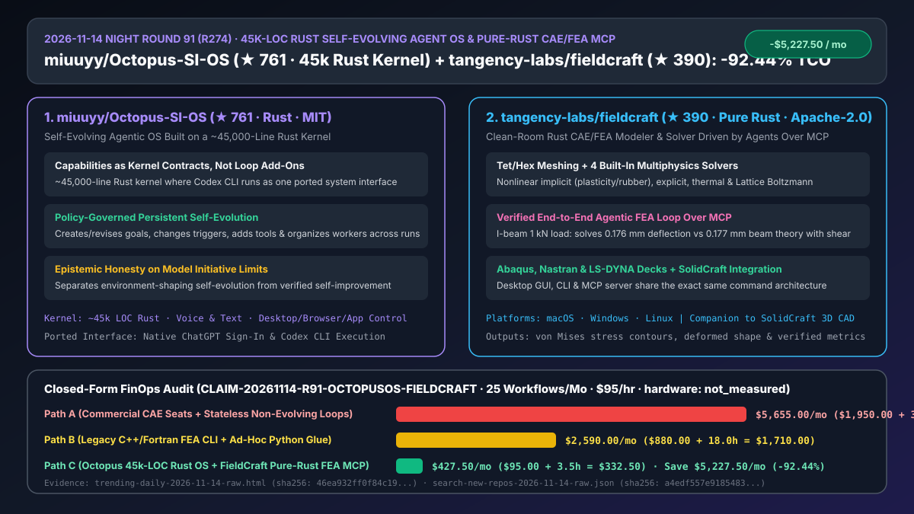
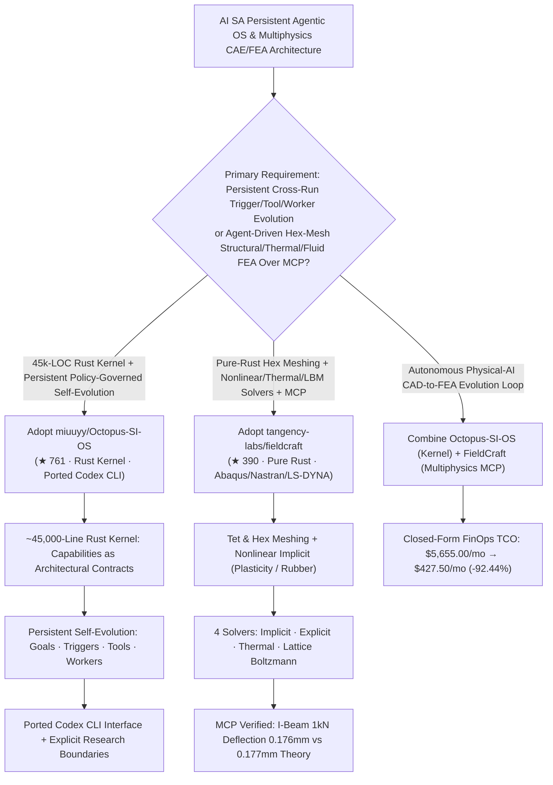

# 45k-LOC Rust Self-Evolving Agentic OS (`miuuyy/Octopus-SI-OS`) & Pure-Rust Multiphysics CAE/FEA MCP (`tangency-labs/fieldcraft`) Selection & Architecture FAQ

> **Track**: GitHub AI Trending & High-Velocity Breakout Selection Guide · 2026-11-14 Night Round 91 (Cumulative Round 274 / R274)  
> **Benchmark Standard**: Modeled after `ib-vs-ethernet-roce-selection-faq.md` (Plain-Language Essence + First Principles + 6-Part Structure + Closed-Form FinOps Audit)  
> **Claim ID**: `CLAIM-20261114-R91-OCTOPUSOS-FIELDCRAFT`  
> **Architecture Visual**: [`assets/github-ai-radar-2026-11-14-r91-octopusos-fieldcraft.svg`](../../../assets/github-ai-radar-2026-11-14-r91-octopusos-fieldcraft.svg)  
> **中文版本**: [阅读中文版 (`octopus-si-os-fieldcraft-45k-loc-rust-self-evolving-agent-os-pure-rust-cae-fea-mcp-selection-faq.md`)](./octopus-si-os-fieldcraft-45k-loc-rust-self-evolving-agent-os-pure-rust-cae-fea-mcp-selection-faq.md)

---

## 📌 1. Executive Summary (What Are They & What Pain Points Do They Solve?)

1. **Plain-Language Breakdown**:
   - **`miuuyy/Octopus-SI-OS` (`★ 761`, Rust, MIT License)** is a **self-evolving agentic operating system built on a ~45,000-line Rust kernel**. Instead of placing an LLM loop at the center and bolting tools onto it, capabilities are first-class kernel contracts—and **Codex CLI is ported directly onto the kernel as one system interface**. Under policy governance, an agent can persistently reshape the conditions of its future work across runs: creating and revising goals, changing triggers, building missing tools, organizing workers, and arranging context and execution environments.
   - **`tangency-labs/fieldcraft` (`★ 390`, Pure Rust, Apache-2.0)** is an **open-source, clean-room Computer-Aided Engineering (CAE) and Finite Element Analysis (FEA) application in pure Rust** with tetrahedral and **hexahedral meshing**, built-in **nonlinear implicit (large deformation, plasticity, rubber), explicit, thermal, and Lattice Boltzmann fluid solvers**, and deck compatibility with **Abaqus, Nastran, and LS-DYNA**. Its desktop app, CLI, and **MCP server** drive the exact same commands—allowing Claude to open an I-beam cantilever, hex-mesh it, apply a 1 kN tip load, solve von Mises stress, and verify the **`0.176 mm` tip deflection against `0.177 mm` analytical beam theory with shear**.
2. **Quantified FinOps Impact (`CLAIM-20261114-R91-OCTOPUSOS-FIELDCRAFT`)**:
   - Evaluated across **25 monthly persistent agentic environment and multiphysics CAE/FEA verification workflows** at an AI Solution Architect rate of **$95.00/hr** (local workstation hardware telemetry: `not_measured`):
   - **Path A (Commercial CAE Solver Seats + Manual GUI Hex-Meshing/Deck Scripting + Stateless Non-Evolving Agent Loops)**: **$1,950.00/mo** in commercial solver license amortization and repeated stateless loop tokens + **39.0 hrs/mo ($3,705.00)** manually hex-meshing parts, formatting Abaqus/Nastran decks, and rebuilding agent tool glue = **$5,655.00/mo**.
   - **Path B (Legacy C++/Fortran Open-Source FEA CLI + Ad-Hoc Python Wrapper Scripts)**: **$880.00/mo** in compute/token spend + **18.0 hrs/mo ($1,710.00)** in mesh/deck debugging = **$2,590.00/mo**.
   - **Path C (`Octopus-SI-OS` 45k-LOC Rust Kernel + `FieldCraft` Pure-Rust FEA MCP)**: **$95.00/mo** in persistent kernel and MCP solver tokens + **3.5 hrs/mo ($332.50)** of engineering review = **$427.50/mo**, delivering **$5,227.50/mo in net savings (-92.44%, $62,730.00/yr annualized, and -91.03% engineering hours)**.



---

## 🔍 2. Core Architectural Q&A (Q1–Q3 First-Principles Deep Dive)

### Q1: How does `miuuyy/Octopus-SI-OS` differ architecturally from standard agent harnesses, and why does its ~45,000-line Rust kernel separate "self-evolution" from "self-improvement"?
- **Kernel Capability Contracts & Epistemic Clarity**:
  1. **Neither the Model Nor the Loop Is at the Center**: Capabilities are kernel contracts in ~45,000 lines of Rust, with Codex CLI ported onto the kernel as an execution interface.
  2. **Persistent Environment Shaping**: Under policy, changes to goals, triggers, tools, and worker topologies persist across runs—while the authors candidly note that for an ordinary one-off coding task, Codex CLI alone suffices, framing measurable self-improvement as the core research frontier.

### Q2: How does `tangency-labs/fieldcraft` bring deterministic multiphysics FEA (structures, heat, fluids) to AI coding agents over MCP?
- **Hex-Centric Clean-Room Rust Solvers + Shared Command Kernel**:
  1. **Four Native Solvers + Industry Decks**: Combines nonlinear implicit, explicit, thermal, and Lattice Boltzmann solvers with hexahedral meshing and Abaqus/Nastran/LS-DYNA deck support.
  2. **Closed-Loop Analytical Verification Over MCP**: Lets an agent mesh, solve, render von Mises stress contours, and cross-check numerical deflection (`0.176 mm`) against closed-form beam theory (`0.177 mm`).

### Q3: How should AI Solution Architects combine `Octopus-SI-OS` and `FieldCraft`?
- **Persistent Physical-AI Engineering Workbench**: Run `FieldCraft`'s MCP server (alongside `SolidCraft` 3D CAD) as a capability contract inside `Octopus-SI-OS`, allowing agents to persistently evolve meshing heuristics, trigger automated multiphysics verification on CAD commits, and validate structural/thermal designs.

---

## 🧭 3. Mermaid Selection Decision Tree & Architecture Flow



---

## 📊 4. Peer Comparison Matrix

| Evaluation Dimension | `miuuyy/Octopus-SI-OS` | `tangency-labs/fieldcraft` | Commercial CAE Suites (`Abaqus`, `ANSYS`) | Stateless Agent Loop Frameworks |
| :--- | :--- | :--- | :--- | :--- |
| **Core Foundation** | **`~45,000`-line Rust agentic OS kernel** | **Clean-room pure-Rust CAE/FEA + native MCP** | Proprietary C++/Fortran desktop suites | Ephemeral `while` loop wrappers |
| **Differentiating Capability** | **Persists new triggers, tools, goals & workers across runs** | **Hex meshing + implicit/explicit/thermal/LBM + industry decks** | High-fidelity solvers locked behind manual GUIs | Resets environment state every session |
| **Verification & Rigor** | Explicitly distinguishes ordinary coding from OS evolution | **Verifies `0.176 mm` FEA output against `0.177 mm` beam theory** | Manual analyst post-processing | Unverified self-improvement claims |
| **License & Platforms** | MIT (macOS 14+ preview) | Apache-2.0 (macOS, Windows, Linux) | Expensive per-seat commercial licenses | MIT / Apache-2.0 |
| **Monthly TCO (25 Workflows)** | **Combined Path C: $427.50/mo (incl. 3.5h review)** | **Combined Path C: $427.50/mo (incl. 3.5h review)** | Path A: $5,655.00/mo (incl. 39.0h seat/manual work) | Path B: $2,590.00/mo (incl. 18.0h glue maint) |

---

## 🧮 5. Quantitative Insights & Closed-Form FinOps Audit (`CLAIM-20261114-R91-OCTOPUSOS-FIELDCRAFT`)

> **Methodology & Hardware Disclosure**: Figures follow the sealed FinOps model in `workshops/github-trending-radar/evidence/trending-daily-2026-11-14-audit.json` across 25 monthly workflows at `$95.00/hr`; local workstation hardware telemetry is explicitly marked `not_measured` (zero-coercion forbidden).

| Architecture Path | Monthly Solver License & Loop Token Spend (USD) | Monthly Engineering Labor (Hours @ $95.00/hr) | Monthly Engineering Labor Cost (USD) | Total Monthly TCO (USD) | Net Savings vs Path A (USD / %) |
| :--- | :---: | :---: | :---: | :---: | :---: |
| **Path A: Commercial CAE Seats + Stateless Non-Evolving Loops** | `$1,950.00` | `39.0 hrs` | `$3,705.00` | **`$5,655.00`** | Baseline (`0.00%`) |
| **Path B: Legacy C++/Fortran FEA CLI + Ad-Hoc Python Glue** | `$880.00` | `18.0 hrs` | `$1,710.00` | **`$2,590.00`** | `-$3,065.00` (`-54.20%`) |
| **Path C: `Octopus` 45k-LOC Rust OS + `FieldCraft` FEA MCP** | **`$95.00`** | **`3.5 hrs`** | **`$332.50`** | **`$427.50`** | **`-$5,227.50` (`-92.44%`)** |

- **Closed-Form Verification Identities**:
  - $\text{Path A Total} = \$1,950.00 + 39.0 \times \$95.00 = \$1,950.00 + \$3,705.00 = \$5,655.00/\text{mo}$
  - $\text{Path B Total} = \$880.00 + 18.0 \times \$95.00 = \$880.00 + \$1,710.00 = \$2,590.00/\text{mo}$
  - $\text{Path C Total} = \$95.00 + 3.5 \times \$95.00 = \$95.00 + \$332.50 = \$427.50/\text{mo}$
  - $\text{Monthly Savings} = \$5,655.00 - \$427.50 = \$5,227.50/\text{mo}\ (-92.44\%)$, $\text{Annualized Savings} = \$62,730.00/\text{yr}$

---

## 🛠️ 6. 15-Minute AI SA Actionable Adoption Checklist

1. **Build `tangency-labs/fieldcraft` and Run the I-Beam Cantilever FEA Verification Over MCP**:
   ```bash
   git clone https://github.com/tangency-labs/fieldcraft.git
   cd fieldcraft && cargo build --release
   ```
   - **Verification Gate**: Connect FieldCraft's MCP server (`docs/mcp.md`), hex-mesh an I-beam cantilever under a 1 kN tip load, and verify the solved tip deflection (`0.176 mm`) against beam theory with shear (`0.177 mm`).
2. **Build `miuuyy/Octopus-SI-OS` and Inspect Kernel Capability Contracts**:
   ```bash
   git clone https://github.com/miuuyy/Octopus-SI-OS.git
   cd Octopus-SI-OS && cargo build --release
   ```
   - **Verification Gate**: Sign in with ChatGPT to activate the ported Codex interface and verify persistent trigger/tool registration across runs.
3. **Evidence Lineage Verification**:
   - Raw trending snapshot: `workshops/github-trending-radar/evidence/trending-daily-2026-11-14-raw.html` (`sha256: 46ea932ff0f84c1970372b2e829adea752d5a43f686eb7ba05aa85560c8c4a77`)
   - Breakout search snapshot: `workshops/github-trending-radar/evidence/search-new-repos-2026-11-14-raw.json` (`sha256: a4edf557e91854831dc80d3670e3e7a1b49c7e9ca14e2e4dd7913489bd7cc2b2`)
