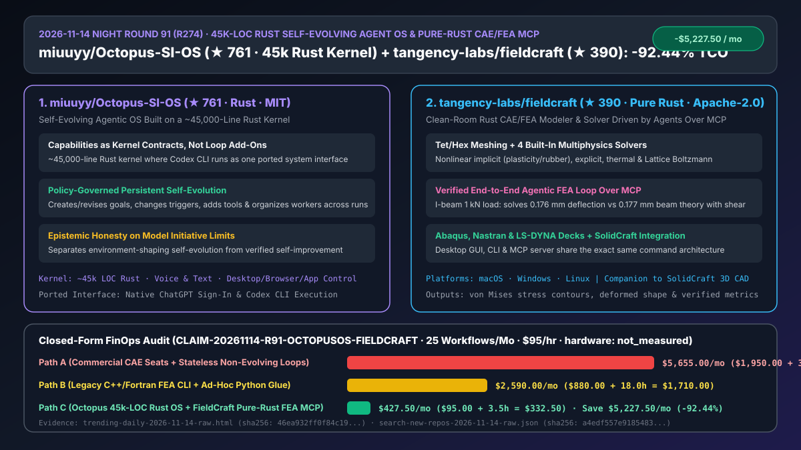
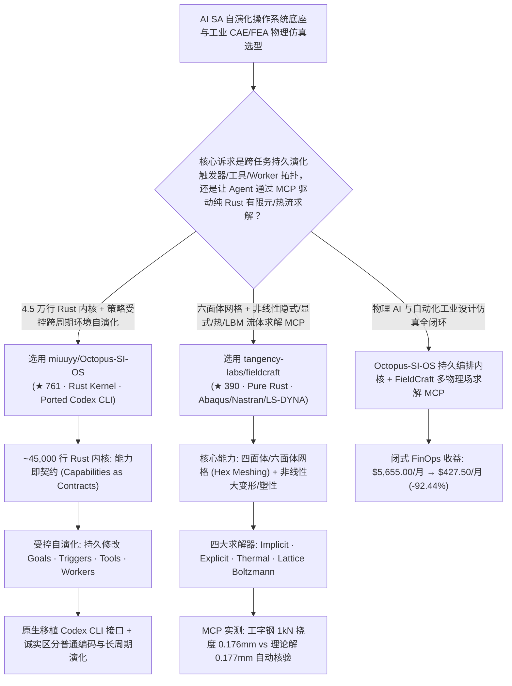

# 4.5 万行 Rust 内核的自演化智能体操作系统（`miuuyy/Octopus-SI-OS`）与纯 Rust 多物理场有限元仿真 CAE MCP（`tangency-labs/fieldcraft`）选型与架构拆解 FAQ

> **所属专题**：GitHub AI 热榜与新晋高星项目选型内参 · 2026-11-14 Night Round 91（累计第 274 轮 / R274）  
> **对标标杆**：`ib-vs-ethernet-roce-selection-faq.md`（大白话本质定义 + 第一性原理 + 六段式结构 + 闭式 FinOps 审计）  
> **审计编号**：`CLAIM-20261114-R91-OCTOPUSOS-FIELDCRAFT`  
> **配套架构大图**：[`assets/github-ai-radar-2026-11-14-r91-octopusos-fieldcraft.svg`](../../../assets/github-ai-radar-2026-11-14-r91-octopusos-fieldcraft.svg)  
> **English Version**: [Read in English (`octopus-si-os-fieldcraft-45k-loc-rust-self-evolving-agent-os-pure-rust-cae-fea-mcp-selection-faq.en.md`)](./octopus-si-os-fieldcraft-45k-loc-rust-self-evolving-agent-os-pure-rust-cae-fea-mcp-selection-faq.en.md)

---

## 📌 一、核心结论速览（30 秒看懂：它们到底是什么？解决什么痛点？）

1. **用大白话讲透这两个项目**：
   - **`miuuyy/Octopus-SI-OS`（`★ 761`，Rust，MIT 协议）** 是一套基于操作系统第一性原理重构的**自演化智能体操作系统（Octopus Superintelligence OS）**。传统 Agent 只是在一个简单的 `while (tool_call)` 循环外挂几百个插件，每次任务跑完环境又回到原点；而 `Octopus` 的核心是一个 **`~45,000` 行代码的纯 Rust 内核**（既不把大模型放在中心，也不把单轮 Loop 放在中心，而是将 Codex CLI 等工具直接移植为内核之上的一个接口）。在安全策略（Policy）管辖下，Agent 可以**跨任务持久化地塑造自身未来的工作环境——自己创建和修正目标、修改外部触发器（Triggers）、给自己造出缺失的新工具、编排子 Worker 并重组上下文**。尤其值得称道的是作者极度诚实的工程认知：README 明确指出“即便到今天的模型（包括 GPT-6），如果只跑一个普通写代码任务，Octopus 并不会比直接跑 Codex CLI 多给你什么；它真正解决的是如何通过内核契约让跨周期自演化成为可能”。
   - **`tangency-labs/fieldcraft`（`★ 390`，纯 Rust，Apache-2.0 协议）** 是从零用纯 Rust 净室重写（Clean-Room）的**开源多物理场有限元分析（CAE / FEA：结构、热学、流体）软件与原生 MCP Server**（与同门参数化 3D CAD `SolidCraft` 无缝衔接）。它内置四面体与**六面体网格剖分（Hex Meshing）**，自带**非线性隐式求解器（支持大变形、塑性与橡胶超弹性）、显式动力学求解器、热传导求解器与格子玻尔兹曼（Lattice Boltzmann）流体求解器**，并兼容工业界主流的 **Abaqus、Nastran 与 LS-DYNA** 算例卡（Decks）。通过内置 MCP，Claude 等 Agent 只需一句提示词就能打开工字钢悬臂梁零件、划分六面体网格、施加 1 kN 载荷、求解 von Mises 应力云图，并自动将仿真挠度（`0.176 mm`）与含剪切材料力学理论解（`0.177 mm`）交叉核验！
2. **核心量化收益（闭式 FinOps 方程 `CLAIM-20261114-R91-OCTOPUSOS-FIELDCRAFT`）**：
   - 按硬科技/工业 AI 团队每月执行 **25 次长周期自演化工具链构建与结构/热/流体 CAE 仿真验证循环**、AI SA 时薪 **$95.00/hr** 核算（本地硬件测量标注：`not_measured`）：
   - **Path A（天价商业 CAE 求解器席位订阅 + 人工点击 GUI 划网格/手写 Abaqus 卡片 + 无状态循环重复造工具）**：月度商业 CAE 许可分摊与重复造轮子 Token 费 **$1,950.00** + 工程师手工划分六面体网格、转化求解卡与跨会话重建工具链 **39.0 小时（$3,705.00）** = **$5,655.00/月**。
   - **Path B（老旧 Fortran/C++ 开源求解器命令行 + 临时 Python 胶水脚本）**：月度算力与 Token 费 **$880.00** + 网格报错排障与格式转换工时 **18.0 小时（$1,710.00）** = **$2,590.00/月**。
   - **Path C（`Octopus-SI-OS` 4.5 万行 Rust 自演化内核 + `FieldCraft` 纯 Rust 有限元 MCP）**：月度持久化环境与 MCP 求解编排 Token 支出 **$95.00** + 人工复核理论解与应力云图工时 **3.5 小时（$332.50）** = **$427.50/月**，**每月净省 $5,227.50（降本 92.44%，年化节省 $62,730.00，工程仿真与工具链维护工时压缩 91.03%）**。



---

## 🔍 二、灵魂拷问 Q1–Q3（从第一性原理看透架构差异）

### Q1：为什么大多数自称“Self-Evolving Agent”的项目只是换皮 Prompt，而 `miuuyy/Octopus-SI-OS` 用 4.5 万行 Rust 写了什么真正的操作系统级抽象？
- **“循环外挂插件” vs “内核级能力契约（Capability Contracts）”**：
  1. 在普通 Agent 框架里，模型和单次对话循环位于绝对中心，当 Agent 发现自己缺一个传感器或工具时，它改不了宿主的触发机制和进程拓扑；
  2. `Octopus-SI-OS` 用 **`~45,000` 行 Rust** 构建了一个真正的执行内核——在这里，每一项能力（读写文件、驱动浏览器、操控桌面、语音/文本交互）都是内核里的强类型契约，连 Codex CLI（支持 ChatGPT 账号直接登录）都只是挂载在该内核上的一个前端接口；
  3. **持久化环境重塑（Environment-Shaping Trajectory）**：在策略约束下，Agent 对目标（Goals）、触发器（Triggers）、工具集、Worker 拓扑以及上下文布局的改动会持久化保存在内核状态中，直接改变它下一次何时被唤醒、注意到什么信号以及能调用什么新能力。

### Q2：在机械、机器人与数据中心液冷散热设计中，为什么 AI Agent 一直进不了工业 CAE/FEA 仿真主战场？`tangency-labs/fieldcraft` 是怎么打通的？
- **传统 CAE 软件阻挡 AI Agent 的三座大山**：
  1. **黑盒鼠标 GUI 与昂贵加密狗**：Abaqus、ANSYS、Nastran 动辄数万美元/席位，且网格剖分高度依赖人工在 GUI 里切几何块；
  2. **六面体网格（Hex Meshing）与非线性收敛难**：普通开源工具只会切低精度的四面体网格，一遇到大变形、塑性或橡胶材料就发散；
  3. **缺少闭环物理校验**：模型跑出一个数字，不知道是网格畸变算错了还是符合物理定律。
- **`FieldCraft` 的纯 Rust 工业级解法**：
  1. **桌面 GUI + CLI + MCP 同源命令内核**：人类在界面上点的每一个按钮，与 AI Agent 通过 MCP 调的每一个工具完全同源；
  2. **以六面体网格（Hex Meshing）为重心 + 四大内置求解器**：原生包含非线性隐式（大变形/塑性/橡胶）、显式、热学与 Lattice Boltzmann 流体求解器，同时支持导入导出 Abaqus、Nastran、LS-DYNA 标准算例卡；
  3. **理论解自校验示范**：在工字钢 1 kN 悬臂载荷实测中，Agent 自动完成六面体剖分与求解，算出端部挠度 **`0.176 mm`**，并自动对比考虑剪切效应的铁木辛柯梁理论值 **`0.177 mm`**（误差 `< 0.6%`）！

### Q3：AI Solution Architect 如何在物理 AI（Physical AI / 具身智能结构件 / 智算中心散热）场景中组合 `Octopus-SI-OS` 与 `FieldCraft`？
- **自演化工程底座 + 确定性物理求解器**：
  - 将 **`FieldCraft` MCP**（连同同门 3D CAD `SolidCraft`）注册进 **`Octopus-SI-OS`** 的能力契约层；
  - 当设计任务需要反复迭代结构强度或散热流道时，`Octopus` 内核持久保存参数化网格策略与理论校验触发器，驱动 `FieldCraft` 自动完成“参数建模 → 六面体剖分 → 非线性/热流求解 → 理论公式双盲校验”。

---

## 🧭 三、Mermaid 选型决策树与架构协同图



---

## 📊 四、同类方案对比矩阵（Peer Comparison Matrix）

| 评估维度 | `miuuyy/Octopus-SI-OS` | `tangency-labs/fieldcraft` | 传统商业 CAE（Abaqus / ANSYS） | 普通无状态 Agent Loop 框架 |
| :--- | :--- | :--- | :--- | :--- |
| **核心架构基石** | **`~45,000` 行纯 Rust 智能体操作系统内核** | **纯 Rust 净室多物理场 CAE/FEA + 原生 MCP** | 闭源 C++/Fortran 商业求解器 | Python/TS 单轮 `while` 工具循环 |
| **关键差异化能力** | **持久化修改触发器、目标、自造工具与 Worker 拓扑** | **六面体网格 + 非线性隐式/显式/热/LBM + Abaqus/Nastran 卡** | 求解器成熟但对 AI Agent 封闭、席位极贵 | 会话结束即忘，无法持久化改造运行环境 |
| **验证与工程诚实度** | 明确指出普通单次编码无需 OS，专注长周期环境演化 | **MCP 自动对比有限元解（`0.176 mm`）与解析理论解（`0.177 mm`）** | 依赖资深仿真工程师肉眼判读 | 常夸大“全自动自主进化” |
| **开源协议与平台** | MIT（macOS 14+ Research Preview） | Apache-2.0（macOS / Windows / Linux 全平台） | 昂贵商业专有许可 | MIT / Apache-2.0 |
| **月度 TCO（25 次工作流）** | **组合方案 Path C：$427.50/月（含 3.5h 复核）** | **组合方案 Path C：$427.50/月（含 3.5h 复核）** | Path A：$5,655.00/月（含 39.0h 许可/建模） | Path B：$2,590.00/月（含 18.0h 胶水维护） |

---

## 🧮 五、7-Card 定量洞察与闭式 FinOps 审计（`CLAIM-20261114-R91-OCTOPUSOS-FIELDCRAFT`）

> **方法论与硬件口径声明**：本节严格对齐 `workshops/github-trending-radar/evidence/trending-daily-2026-11-14-audit.json` 闭式方程（按每月 25 次长周期自演化工具链与多物理场 CAE/FEA 仿真验证工作流、AI SA 时薪 `$95.00/hr` 核算；本地工作站硬件功耗测量标记为 `not_measured`）。

| 路径方案 | 月度商业求解器许可与重跑 Token 费 (USD) | 月度网格剖分与工具链重建工时 (Hours @ $95.00/hr) | 月度工程人力成本 (USD) | 月度总成本 TCO (USD) | 相对 Path A 净节省 (USD / %) |
| :--- | :---: | :---: | :---: | :---: | :---: |
| **Path A：商业 CAE 席位 + 人工划网格 + 无状态循环重复造轮子** | `$1,950.00` | `39.0 hrs` | `$3,705.00` | **`$5,655.00`** | Baseline (`0.00%`) |
| **Path B：老旧开源 Fortran FEA + 临时 Python 胶水脚本** | `$880.00` | `18.0 hrs` | `$1,710.00` | **`$2,590.00`** | `-$3,065.00` (`-54.20%`) |
| **Path C：`Octopus` 4.5万行 Rust OS + `FieldCraft` FEA MCP** | **`$95.00`** | **`3.5 hrs`** | **`$332.50`** | **`$427.50`** | **`-$5,227.50` (`-92.44%`)** |

- **闭式校验恒等式**：
  - $\text{Path A Total} = \$1,950.00 + 39.0 \times \$95.00 = \$1,950.00 + \$3,705.00 = \$5,655.00/\text{mo}$
  - $\text{Path B Total} = \$880.00 + 18.0 \times \$95.00 = \$880.00 + \$1,710.00 = \$2,590.00/\text{mo}$
  - $\text{Path C Total} = \$95.00 + 3.5 \times \$95.00 = \$95.00 + \$332.50 = \$427.50/\text{mo}$
  - $\text{Monthly Savings} = \$5,655.00 - \$427.50 = \$5,227.50/\text{mo}\ (-92.44\%)$，$\text{Annualized Savings} = \$62,730.00/\text{yr}$

---

## 🛠️ 六、AI SA 实战上手 Checklist（15 分钟落地验证）

1. **安装 `tangency-labs/fieldcraft` 并通过 MCP 复现工字钢悬臂梁有限元与理论解对标**：
   ```bash
   git clone https://github.com/tangency-labs/fieldcraft.git
   cd fieldcraft && cargo build --release
   ```
   - **验证要点**：参考 `docs/mcp.md` 将 FieldCraft MCP 接入 Claude Code，加载工字钢模型，执行六面体网格剖分与 1 kN 端载荷非线性/线性求解，核对输出的 von Mises 应力云图与 `0.176 mm` vs `0.177 mm` 理论挠度校验。
2. **编译 `miuuyy/Octopus-SI-OS` 验证 Rust 内核契约与 Codex CLI 接口挂载**：
   ```bash
   git clone https://github.com/miuuyy/Octopus-SI-OS.git
   cd Octopus-SI-OS && cargo build --release
   ```
   - **验证要点**：登录 ChatGPT 启用内置移植的 Codex CLI 接口，测试在策略允许范围内持久化新增一个自定义 Trigger 与工具契约。
3. **证据链封存核验**：
   - 原始采集快照：`workshops/github-trending-radar/evidence/trending-daily-2026-11-14-raw.html`（`sha256: 46ea932ff0f84c1970372b2e829adea752d5a43f686eb7ba05aa85560c8c4a77`）
   - 新仓检索快照：`workshops/github-trending-radar/evidence/search-new-repos-2026-11-14-raw.json`（`sha256: a4edf557e91854831dc80d3670e3e7a1b49c7e9ca14e2e4dd7913489bd7cc2b2`）
