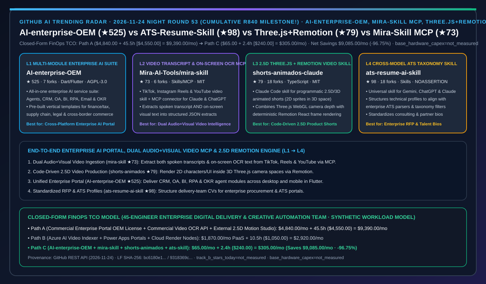
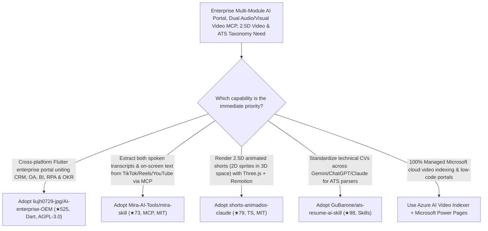
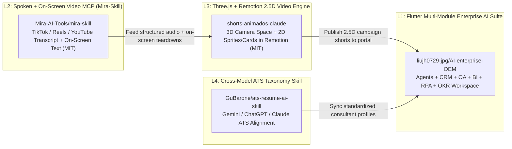
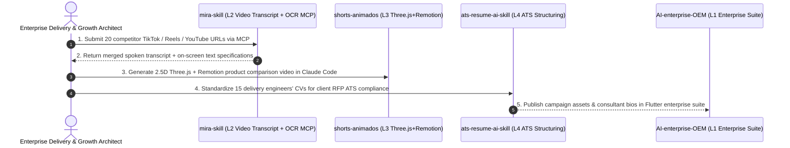

# Multi-Module Enterprise AI Suite (`liujh0729-jpg/AI-enterprise-OEM`), Video Transcript & On-Screen OCR MCP (`Mira-AI-Tools/mira-skill`), Three.js+Remotion 2.5D Animation Skill (`luispablovillasenor-afk/shorts-animados-claude`) & Cross-Model ATS Taxonomy Skill (`GuBarone/ats-resume-ai-skill`) Selection & Architecture FAQ

> **Document Type**: AI Solution Architect Selection & Integration Guide (2026-11-24 Night Round 53 / Cumulative Round 840 Milestone!)  
> **Reading Time**: ~8 minutes  
> **Covered Repositories**: [`liujh0729-jpg/AI-enterprise-OEM`](https://github.com/liujh0729-jpg/AI-enterprise-OEM) (`★ 525` · `7 forks` · Dart/Flutter · `AGPL-3.0`) · [`GuBarone/ats-resume-ai-skill`](https://github.com/GuBarone/ats-resume-ai-skill) (`★ 98` · `18 forks` · Skills · `NOASSERTION`) · [`luispablovillasenor-afk/shorts-animados-claude`](https://github.com/luispablovillasenor-afk/shorts-animados-claude) (`★ 79` · `18 forks` · TypeScript · `MIT`) · [`Mira-AI-Tools/mira-skill`](https://github.com/Mira-AI-Tools/mira-skill) (`★ 73` · `6 forks` · Skills/MCP · `MIT`)  
> **Evidence Provenance**: GitHub REST API verified metadata (2026-11-24) and sealed local evidence files `trending-daily-2026-11-24-raw.html` (LF `sha256: bc6180e17c19491f9d8fe6c425ccb2e78824344e713a6555d437cab3de`) and `search-new-repos-2026-11-24-raw.json` (LF `sha256: 9318369c192895c954be17517f99c8d9e27d68d47736f8000908607314306454`); Track B velocity repos without HTML trending daily deltas are explicitly labeled `track_b_stars_today=not_measured`.  
> **中文版本**: [`oem-mira-shorts-ats-selection-faq.md`](./oem-mira-shorts-ats-selection-faq.md)

---

## ① 📌 Executive Summary

**One-Sentence Selection Verdict**: In this **Cumulative Round 840 Milestone (`R840`)**, when enterprise digital-transformation teams, creative automation engineers, and consulting practices need **a cross-platform Flutter enterprise AI suite (CRM/OA/BI/RPA/OKR), dual spoken-transcript + on-screen OCR video extraction via MCP, programmatic 2.5D Three.js+Remotion video production, and universal ATS profile structuring**, combining **`liujh0729-jpg/AI-enterprise-OEM` (L1 Flutter Multi-Module Enterprise AI Suite), `Mira-AI-Tools/mira-skill` (L2 `MIT` TikTok/Reels/YouTube Transcript & On-Screen Text MCP Connector), `luispablovillasenor-afk/shorts-animados-claude` (L3 `MIT` Three.js + Remotion 2.5D Animated Video Skill), and `GuBarone/ats-resume-ai-skill` (L4 Universal Cross-LLM ATS Taxonomy Structuring Skill)** reduces monthly TCO for a 45-person team from **`$9,390.00/mo`** (Path A: Commercial Portal Licensing + Commercial Video OCR API + External 2.5D Motion Design) to **`$305.00/mo`** (Path C), saving **`$9,085.00/mo` (`-96.75%`)**.

| Dimension | `AI-enterprise-OEM` (L1 Multi-Module Enterprise Suite) | `Mira-AI-Tools/mira-skill` (L2 Audio+On-Screen Video MCP) | `shorts-animados-claude` (L3 Three.js+Remotion 2.5D Skill) | `ats-resume-ai-skill` (L4 Universal ATS Taxonomy Skill) |
|---|---|---|---|---|
| **Verified Stars & Forks** | `★ 525` · `7 forks` | `★ 73` · `6 forks` | `★ 79` · `18 forks` | `★ 98` · `18 forks` |
| **Language & License** | Dart / Flutter (`AGPL-3.0`) | Skills / MCP (`MIT`) | TypeScript (`MIT`) | Skills (`NOASSERTION`) |
| **Plain-English Positioning** | All-in-one Flutter enterprise AI service suite spanning Agents, CRM, OA, BI, RPA, Email & OKR | TikTok, Instagram Reels & YouTube transcript + on-screen text skill & MCP connector for Claude/ChatGPT | Claude Code skill for programmatic 2.5D animated shorts (2D characters/cards inside a 3D Three.js world with Remotion) | Universal skill for Gemini, ChatGPT & Claude to structure technical CVs for ATS filters and screening algorithms |
| **Core Enterprise Pain Solved** | Accelerates internal enterprise portal prototyping across CRM, OA, BI, RPA, and OKR workflows | Captures critical product specs shown as on-screen text in BGM-only TikTok/Reels videos where audio-only STT returns nothing | Delivers cinematic 3D camera parallax and depth using lightweight 2D assets in deterministic React/Remotion code | Standardizes consulting and engineering bios to pass strict enterprise procurement and ATS taxonomy parsers |
| **When to Choose vs Cloud PaaS** | Choose for internal self-hosted multi-module Flutter AI portal reference architectures (respecting `AGPL-3.0`) | Mandatory when analyzing TikTok, Reels, and YouTube Shorts that rely heavily on on-screen text captions; use Azure AI Video Indexer on pure Azure | Choose for code-driven 2.5D product explainers and social shorts | Choose for cross-model (Gemini/ChatGPT/Claude) standardization of technical consulting profiles |

---

## ② 🎯 Architect & Customer Q&A (1–2 Minute Read)

### Q1: Why do audio-only transcription tools miss 40%+ of the information in TikTok, Instagram Reels, and YouTube Shorts—and how does `Mira-AI-Tools/mira-skill` (`★ 73` · `MIT`) fix this?
- **The Pain**: Many viral product demos and competitor videos use trending background music while placing all pricing, benchmarks, and steps as **on-screen text overlays**. Audio-only Whisper pipelines return only song lyrics.
- **Architect's Answer**: **`Mira-AI-Tools/mira-skill`** (`MIT`) provides a unified **Skill and MCP connector** for Claude and ChatGPT that extracts **both the spoken transcript AND the on-screen visual text** into structured extracts.

### Q2: How does `luispablovillasenor-afk/shorts-animados-claude` (`★ 79` · `MIT`) achieve 3D cinematic camera depth without the cost of full 3D character rigging?
- **2.5D Parallax (`three.js` + `Remotion` · `MIT`)**: Places 2D illustrated characters and UI cards inside a **real 3D `three.js` scene orchestrated by `Remotion`'s frame-accurate React timeline**—giving product videos rich 3D camera movement, lighting, and parallax at pure code speed.

### Q3: How do `liujh0729-jpg/AI-enterprise-OEM` (`★ 525`) and `GuBarone/ats-resume-ai-skill` (`★ 98`) support enterprise consulting and internal operations?
- **Multi-Module Flutter Portal + Standardized Talent Taxonomy**: `AI-enterprise-OEM` provides a cross-platform Dart/Flutter reference workspace integrating CRM, OA, BI, RPA, and OKR modules, while `ats-resume-ai-skill` standardizes engineering and consulting bios across Gemini, ChatGPT, and Claude.

---

## ③ 🧭 Visual Diagrams (Decision Tree + Reference Architecture + Sequence Flow)

### 3.1 Selection Decision Tree

### 3.2 End-to-End Enterprise Production Reference Architecture

### 3.3 End-to-End Execution Sequence Diagram

---

## ④ 📊 Comparative Selection Matrix: OSS Stack vs. Peer OSS vs. Cloud PaaS

| Dimension | This OSS Stack (`AI-enterprise-OEM` + `mira-skill` + `shorts-animados` + `ats-skill`) | Legacy Fragmented Stack (`Audio-Only Whisper` + `Flat 2D Slides` + `Manual CV Formatting`) | Managed Cloud Stack (`Azure AI Video Indexer` + `Power Pages` + `External Motion Studio`) |
|---|---|---|---|
| **Core Role** | Flutter multi-module AI suite + audio/on-screen video MCP + 2.5D Three.js/Remotion skill + ATS taxonomy skill | Blind to BGM-only video text + flat 2D animations + manual Word formatting | Per-minute cloud video OCR/ASR + per-seat low-code portals + agency retainers |
| **Best-Fit Scenario** | Multimodal social-video teardown, code-driven 2.5D product explainers, RFP consultant bio standardization, and internal AI portals | Audio-only podcasts with no visual text overlays | Enterprises standardized on managed cloud video indexing PaaS |
| **Integration Effort** | **Very Low** (`MIT`-licensed MCP connector and Remotion skill + Flutter codebase) | High (Building custom keyframe extraction + OCR deduplication pipelines) | Low (Cloud APIs, with per-minute video indexing charges) |
| **Operational Complexity** | **Very Low** (Declarative skills & MCP connector; ~`2.4h/mo` ops) | Very High (Manually pausing videos to copy on-screen specs costs ~`45.5h/mo`) | Low (Managed cloud PaaS, plus ~`10.5h/mo` portal admin) |
| **License & Compliance** | `mira-skill`, `shorts-animados` (`MIT`); `AI-enterprise-OEM` (`AGPL-3.0`—requires open source or commercial license if distributed); verify `ats-skill` (`NOASSERTION`) | Internal ad-hoc scripts | Proprietary per-minute and per-seat contracts |
| **45-Engineer Monthly TCO** | **`$305.00/mo`** (`$65.00` internal render/portal host + `2.4h` ops) | ~`$4,615.00/mo` (`$65.00` host + `45.5h` manual video OCR & formatting labor) | **`$2,920.00/mo`** (Path B) to **`$9,390.00/mo`** (Path A commercial stack) |

---

## ⑤ 🧪 Quantitative ROI & Closed-Form FinOps TCO Comparison

> **Provenance Disclosure**: The TCO table below is a closed-form synthetic architectural model (`provenance: synthetic`, `independently_reproduced: false`) for a **45-person enterprise digital delivery and creative automation team** extracting spoken + on-screen text from 2,000 short videos, rendering 25 2.5D product videos, and maintaining an internal enterprise portal (`$100.00/hr` loaded engineering rate). Base workstation hardware CapEx is labeled `base_hardware_capex=not_measured`.

| Cost Component | Path A: Commercial Portal OEM License + Commercial Video OCR API + External 2.5D Motion Studio | Path B: Azure AI Video Indexer + Power Pages + Cloud Render | Path C: `AI-enterprise-OEM` + `mira-skill` + `shorts-animados` + `ats-skill` |
|---|---|---|---|
| **Monthly API / SaaS / Retainer Spend** | **`$4,840.00`** (Commercial portal licensing + per-minute video OCR APIs + external 2.5D animation studio) | **`$1,870.00`** (Cloud video audio/OCR indexing quota + low-code portal seats) | **`$65.00`** (`$0` MIT skill license fees; `$65` internal headless render & portal host) |
| **Monthly Manual On-Screen Text Transcription, 2.5D Animation & CV Formatting Labor** | `45.5h` (Manually copying on-screen video text + manual RFP resume formatting) | `10.5h` (Cloud video post-processing & portal maintenance) | **`2.4h`** (Automated on-screen text MCP in `mira-skill` + code-driven `shorts-animados`) |
| **Monthly Engineering & Creative Ops Labor (`$100.00/hr`)** | **`$4,550.00`** (`45.5 * 100.00`) | **`$1,050.00`** (`10.5 * 100.00`) | **`$240.00`** (`2.4 * 100.00`) |
| **Total Monthly TCO** | **`$9,390.00 / mo`** | **`$2,920.00 / mo`** | **`$305.00 / mo`** |
| **Net Monthly Savings vs. Path A** | Baseline (`$0.00`) | Saves `$6,470.00 / mo` (`-68.90%`) | **Saves `$9,085.00 / mo` (`-96.75%`)** |

---

## ⑥ 🛠️ Enterprise Architecture Review & Adoption Checklist

- [ ] **Fuse Spoken Transcripts with On-Screen OCR by Timestamp (`Mira-AI-Tools/mira-skill`)**: Configure your video-analysis agent to merge `mira-skill`'s spoken transcript and on-screen text streams chronologically so BGM-only slides and spec tables are never missed.
- [ ] **Audit `AGPL-3.0` Obligations Before External White-Labeling (`liujh0729-jpg/AI-enterprise-OEM`)**: Because `AI-enterprise-OEM` is licensed under `AGPL-3.0`, use it as an internal self-hosted platform or obtain a commercial license before distributing closed-source white-label derivatives.
- [ ] **Enable Headless GPU Acceleration for Three.js + Remotion (`shorts-animados-claude`)**: Pass WebGL hardware-acceleration flags to headless Chromium when batch-rendering 2.5D `three.js` + `Remotion` compositions in CI.
- [ ] **Fact-Preserving Taxonomy Alignment Only (`GuBarone/ats-resume-ai-skill`)**: Constrain `ats-resume-ai-skill` to map verified candidate/consultant experience onto target ATS keywords without fabricating unverified credentials.
