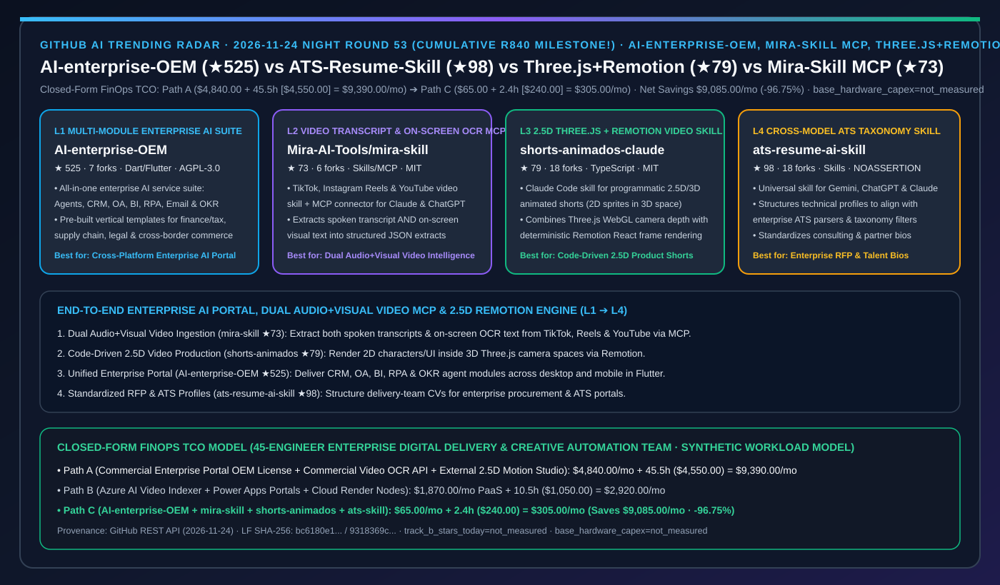
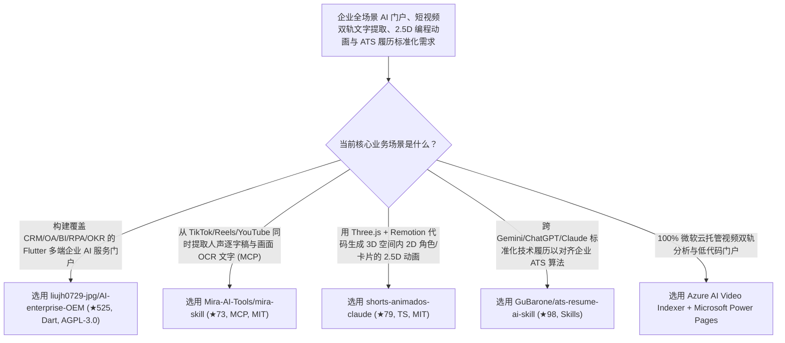
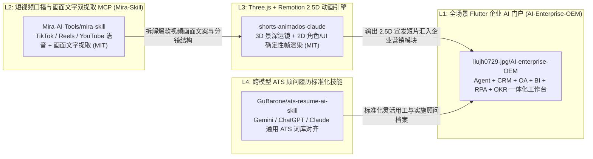
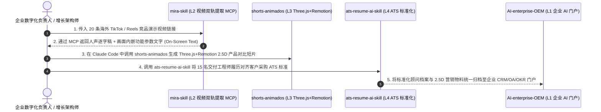

# 全场景企业服务 AI 门户底座（`liujh0729-jpg/AI-enterprise-OEM`）、短视频语音+画面文字双轨提取 MCP（`Mira-AI-Tools/mira-skill`）、Three.js+Remotion 2.5D 动画技能（`luispablovillasenor-afk/shorts-animados-claude`）与跨模型 ATS 履历结构化技能（`GuBarone/ats-resume-ai-skill`）选型与集成 FAQ

> **文档类型**：AI 解决方案架构师（AI Solution Architect）选型决策指南（2026-11-24 Night Round 53 / 累计第 840 轮里程碑！）  
> **阅读耗时**：约 8 分钟  
> **覆盖项目**：[`liujh0729-jpg/AI-enterprise-OEM`](https://github.com/liujh0729-jpg/AI-enterprise-OEM)（`★ 525` · `7 forks` · Dart/Flutter · `AGPL-3.0`） · [`GuBarone/ats-resume-ai-skill`](https://github.com/GuBarone/ats-resume-ai-skill)（`★ 98` · `18 forks` · Skills · `NOASSERTION`） · [`luispablovillasenor-afk/shorts-animados-claude`](https://github.com/luispablovillasenor-afk/shorts-animados-claude)（`★ 79` · `18 forks` · TypeScript · `MIT`） · [`Mira-AI-Tools/mira-skill`](https://github.com/Mira-AI-Tools/mira-skill)（`★ 73` · `6 forks` · Skills/MCP · `MIT`）  
> **证据溯源**：GitHub REST API 实测元数据（2026-11-24）与本地冻结证据文件 `trending-daily-2026-11-24-raw.html`（LF `sha256: bc6180e17c19491f9d8fe6c425ccb2e78824344e713a6555d437cab3de`）、`search-new-repos-2026-11-24-raw.json`（LF `sha256: 9318369c192895c954be17517f99c8d9e27d68d47736f8000908607314306454`）；Track B 仓库无 HTML 榜单对应的单日增量，统一标记为 `track_b_stars_today=not_measured`。  
> **English Version**: [`oem-mira-shorts-ats-selection-faq.en.md`](./oem-mira-shorts-ats-selection-faq.en.md)

---

## ① 📌 核心结论速览（Executive Summary）

**选型一句话结论**：在第 840 轮里程碑（`R840 Milestone`）中，当政企数字化交付商（ISV/SI）、内容营销团队与技术咨询部门需要构建**“覆盖 CRM/OA/BI/RPA/OKR 的全端企业 AI 服务门户 + TikTok/Reels/YouTube 语音与画面 OCR 文字双轨提取 MCP + Three.js+Remotion 2.5D 立体动画生成 + 跨模型企业招投标/ATS 顾问履历标准化”**组合时，采用 **`liujh0729-jpg/AI-enterprise-OEM`（L1 基于 Flutter 覆盖 Agent、营销、CRM、OA、BI、RPA、OKR 与财税/法务/跨境场景的企业服务参考底座）+ `Mira-AI-Tools/mira-skill`（L2 同时提取 TikTok / Instagram Reels / YouTube 口播逐字稿与画面内嵌文字 `on-screen text` 的 `MIT` 技能与 MCP 连接器）+ `luispablovillasenor-afk/shorts-animados-claude`（L3 基于 `three.js` + `Remotion` 在 3D 空间内渲染 2D 角色/卡片的 `MIT` 编程动画技能）+ `GuBarone/ats-resume-ai-skill`（L4 跨 Gemini/ChatGPT/Claude 的 ATS 算法对齐与顾问履历结构化技能）**，可将 45 人团队的月度 TCO 从商业白牌门户授权 + 商业视频画面 OCR API + 外部 2.5D 动画外包（Path A）的 **`$9,390.00/月`** 降至 **`$305.00/月`**（净省 **`$9,085.00/月`**，降幅 **`-96.75%`**）。

| 评估维度 | `AI-enterprise-OEM` (L1 全场景企业 AI 服务门户) | `Mira-AI-Tools/mira-skill` (L2 口播+画面文字双提取 MCP) | `shorts-animados-claude` (L3 Three.js+Remotion 2.5D 动画) | `ats-resume-ai-skill` (L4 跨模型 ATS 履历结构化) |
|---|---|---|---|---|
| **GitHub 实测热度** | `★ 525` · `7 forks` (`2026-11` 新仓黑马) | `★ 73` · `6 forks` (`2026-11` 新仓黑马) | `★ 79` · `18 forks` (`2026-11` 新仓黑马) | `★ 98` · `18 forks` (`2026-11` 新仓黑马) |
| **实现语言与开源协议** | Dart / Flutter (`AGPL-3.0`) | Skills / MCP (`MIT`) | TypeScript (`MIT`) | Skills (`NOASSERTION`) |
| **一句话通俗定位** | 集成 Agent、营销、CRM、OA、BI、RPA、邮箱、OKR 与财税/法务/跨境模块的 Flutter 多端企业 AI 套件 | 面向 Claude 与 ChatGPT 的 TikTok / Instagram Reels / YouTube 口播转写 + 画面文字（On-Screen Text）提取 MCP | 面向 Claude Code 的 `three.js` + `Remotion` 2.5D 立体空间短视频自动化制作技能 | 兼容 Gemini、ChatGPT 与 Claude 的通用 ATS 结构化履历改写与关键词对齐技能 |
| **解决的核心业务痛点** | 解决企业数字化服务商为中小企业交付 AI 转型项目时“从零手写 CRM/OA/BI/OKR 前端壳子耗时数月”的痛点 | 解决普通视频转写工具“只转声音、不看画面，遇到背景音乐配满屏大字参数的爆款视频就提取出空白文本”的盲区 | 解决纯 2D Remotion 视频缺乏纵深镜头感、而纯 3D 骨骼绑定又太重，用“3D 世界 + 2D 纸片人/卡片（2.5D）”实现低成本高视觉冲击 | 解决 IT 咨询公司参与大型企业招投标（RFP）或技术招聘时，不同顾问简历格式混乱、无法通过客户采购系统 ATS 自动筛选的痛点 |
| **何时选它 vs 云托管** | 内部自建全套多端企业办公 AI 门户参考原型时选用（注意 `AGPL-3.0` 协议边界） | 分析 TikTok / Instagram Reels / YouTube 短视频必须同时抓取口播台词与画面字幕/价格标签时必选；纯微软云选 Azure AI Video Indexer | 需要用代码批量生成极具立体运镜感的 2.5D 产品宣传短片时首选 | 跨多个主流大模型统一标准化技术团队顾问档案与 ATS 匹配词库时首选 |

---

## ② 🎯 客户与架构师灵魂拷问 Q&A（1–2 分钟速读）

### Q1：为什么很多海外 TikTok 和 Instagram Reels 爆款视频，用 Whisper 跑出来的文本是空的或者只有一句歌词？`Mira-AI-Tools/mira-skill`（`★ 73` · `MIT`）是怎么补齐这块关键拼图的？
- **痛点**：超过 40% 的短视频采用“热门 BGM 音乐 + 画面花字/价格表/功能对比表（On-Screen Text）”的形式，根本没有人声口播！如果只做语音转文字（ASR），AI Agent 看到的就只有一串背景音乐歌词，完全漏掉了画面里最重要的产品卖点和参数。
- **架构师解答**：**`Mira-AI-Tools/mira-skill`**（`MIT`）专为 TikTok、Instagram Reels 与 YouTube Shorts 打造了**“语音逐字稿（Transcript）+ 画面内嵌文字（On-Screen Text）+ 结构化要点（Structured Extracts）”三位一体 MCP 连接器**，让 Claude 和 ChatGPT 真正同时“听懂”和“看懂”短视频内容。

### Q2：什么是最近在海外技术视频圈爆火的“2.5D 立体动画（2D Characters/Cards in a 3D World）”？`luispablovillasenor-afk/shorts-animados-claude`（`★ 79` · `MIT`）是如何用 `three.js` + `Remotion` 实现的？
- **核心收益**：纯 3D 角色建模和蒙皮绑定成本极高，而纯 2D 平移缩放又显得廉价。**`shorts-animados-claude`**（`MIT`）把 **`three.js` 的真实 3D 摄像机运镜、景深与光影**和 **`Remotion` 的确定性时间轴及 2D 矢量角色/卡片**结合起来（类似《八方旅人》或现代科技发布会大片的 2.5D 视差空间感），让 Claude Code 直接用 TypeScript 代码生成电影级运镜短片。

### Q3：`liujh0729-jpg/AI-enterprise-OEM`（`★ 525`）与 `GuBarone/ats-resume-ai-skill`（`★ 98`）在企业服务与咨询交付中如何配合？
- **全场景企业应用底座 + 交付顾问资质标准化**：`AI-enterprise-OEM` 基于 Flutter 提供了覆盖 CRM、OA、BI、RPA、OKR 以及财税、供应链、法律、跨境电商的模块化 UI 与业务流参考架构；而 `ats-resume-ai-skill` 则帮助技术咨询团队将项目实施顾问的技术栈履历按照甲方的 ATS 筛选分类学（Taxonomy）标准化输出。

---

## ③ 🧭 直观可视化图解（Mermaid 决策树 + 集成架构 + 时序图）

### 3.1 技术选型决策树

### 3.2 企业端到端生产集成参考架构图

### 3.3 业务流全链路时序图

---

## ④ 📊 同类开源与商业云服务横向选型决策矩阵

| 对比维度 | 本轮开源组合 (`AI-enterprise-OEM` + `mira-skill` + `shorts-animados` + `ats-skill`) | 传统拼凑方式 (`仅转声音漏画面字` + `纯 2D 平淡动画` + `手工改顾问简历`) | 商业云与外包方案 (`商业视频分析云` + `商业门户 OEM 授权` + `外部动画设计室`) |
|---|---|---|---|
| **功能定位** | Flutter 多端企业 AI 套件 + 音画双轨提取 MCP + 2.5D Three.js/Remotion 动画 + ATS 标准化 | 丢失无口播画面信息的残缺采集 + 缺乏立体感的平面视频 | 按分钟计费云端视频 OCR/ASR + 高价商业 OEM 源码买断 |
| **适用场景** | 企业内部全模块 AI 协同门户、跨境短视频画面花字拆解、高立体感 2.5D 编程宣传片与技术顾问档案标准化 | 仅有纯人声播客且无需视觉动画的简单文本整理 | 全面使用 Azure AI Video Indexer 等云原生 PaaS 的大型跨国企业 |
| **集成成本** | **极低**（`mira-skill` 与 `shorts-animados` 均为 `MIT` 协议即插即用技能/MCP） | 高（自行搭建视频关键帧抽帧 + 多语种 OCR + 时间轴去重管线极繁琐） | 低（云 API 开箱即用，但海量视频逐帧 OCR 账单较高） |
| **运维复杂度** | **极低**（标准化 `SKILL.md` 与 MCP 连接器，月均维护仅 `2.4h`） | 极高（人工暂停视频抄写画面参数、手动调整简历排版耗费 `45.5h/月`） | 低（云端托管，月均模板维护约 `10.5h`） |
| **开源协议与合规** | `mira-skill`、`shorts-animados` 为 `MIT`；`AI-enterprise-OEM` 为 `AGPL-3.0`（注意商业闭源 OEM 分发需获商业授权或保持开源）；`ats-skill` 需核验条款 | 内部零散脚本 | 商业闭源按席位/按分钟收费 |
| **45 人团队月度 TCO** | **`$305.00/月`**（含 `$65.00` 内部视频渲染与门户容器节点 + `2.4h` 运维） | 约 `$4,615.00/月`（含 `$65.00` 主机 + `45.5h` 人工抄画面文字与手改动画工时） | **`$2,920.00/月`**（Path B）至 **`$9,390.00/月`**（Path A 商业与外包全栈） |

---

## ⑤ 🧪 应用落地定量收益 / TCO 对比（Closed-Form FinOps 模型）

> **数据性质声明（Provenance Metadata）**：以下 TCO 模型为面向 **45 人企业数字化交付、短视频内容分析与创意自动化工程团队**（每月解析 2,000 条含大量画面花字的 TikTok/Reels/YouTube 短视频、制作 25 支 2.5D 立体产品短片并维护多端企业 AI 办公门户，工程师折算时薪 `$100.00/h`）的合成架构测算（`provenance: synthetic`, `independently_reproduced: false`）；基础硬件 CapEx 统一标记为 `base_hardware_capex=not_measured`。

| 成本构成项 | Path A：商业企业门户 OEM 授权 + 商业视频画面 OCR API + 外部 2.5D 动画外包 | Path B：Azure AI Video Indexer + Power Pages + 云渲染 | Path C：`AI-enterprise-OEM` + `mira-skill` + `shorts-animados` + `ats-skill` |
|---|---|---|---|
| **API / SaaS / 外包月费** | **`$4,840.00`**（商业门户年费分摊 + 商业视频逐帧 OCR/ASR API + 外部 2.5D 动画外包） | **`$1,870.00`**（云端视频音画索引配额 + 低代码门户席位） | **`$65.00`**（`MIT` 核心技能 `$0` 授权费；仅需 `$65` 内网无头渲染与服务节点） |
| **月度人工暂停视频抄写画面花字、手调 3D 摄像机动画与改顾问简历工时** | `45.5h`（人工肉眼提取无口播视频中的画面价格/参数 + 手工排版投标顾问简历） | `10.5h`（云端视频索引后处理与门户维护） | **`2.4h`**（`mira-skill` 自动提取 `on-screen text` + `shorts-animados` 代码生成 2.5D 运镜） |
| **人工研发与内容工程成本（`$100.00/h`）** | **`$4,550.00`** (`45.5 * 100.00`) | **`$1,050.00`** (`10.5 * 100.00`) | **`$240.00`** (`2.4 * 100.00`) |
| **月度总拥有成本（Total Monthly TCO）** | **`$9,390.00 / 月`** | **`$2,920.00 / 月`** | **`$305.00 / 月`** |
| **相对 Path A 净节省** | 基准线 (`$0.00`) | 节省 `$6,470.00 / 月` (`-68.90%`) | **净省 `$9,085.00 / 月` (`-96.75%`)** |

---

## ⑥ 🛠️ 企业引入与架构评审 Checklist

- [ ] **短视频情报分析必须同时开启“音轨 ASR + 画面文字 On-Screen Text”双通道（`Mira-AI-Tools/mira-skill`）**：在配置竞品视频拆解 Agent 时，强制将 `mira-skill` 提取出的画面叠加文本（On-Screen Text）与语音逐字稿按时间戳对齐合并，防止遗漏静音/纯音乐视频中的核心数据。
- [ ] **严格遵守 `AGPL-3.0` 开源传染边界（`liujh0729-jpg/AI-enterprise-OEM`）**：尽管项目名称带有 OEM，但其仓库许可证为 `AGPL-3.0`；若企业将其作为商业闭源 SaaS 对外贴牌售卖，必须先与原作者签署商业授权或按 `AGPL-3.0` 公开修改后的完整源码。
- [ ] **2.5D 动画无头渲染开启 WebGL 硬件加速（`shorts-animados-claude`）**：在 CI 或服务器容器中批量渲染 `three.js` + `Remotion` 视频时，为 Chromium 开启 `--use-angle=vulkan` 或 GPU 透传，将单条 2.5D 短片渲染耗时控制在 30 秒以内。
- [ ] **ATS 履历结构化严禁捏造未验证项目经历（`GuBarone/ats-resume-ai-skill`）**：在使用 `ats-resume-ai-skill` 优化项目顾问简历或求职履历时，仅允许对真实已具备的技能术语做分类学同义词对齐（Taxonomy Alignment）与版式结构化，严禁大模型凭空编造未参与过的项目经验。
