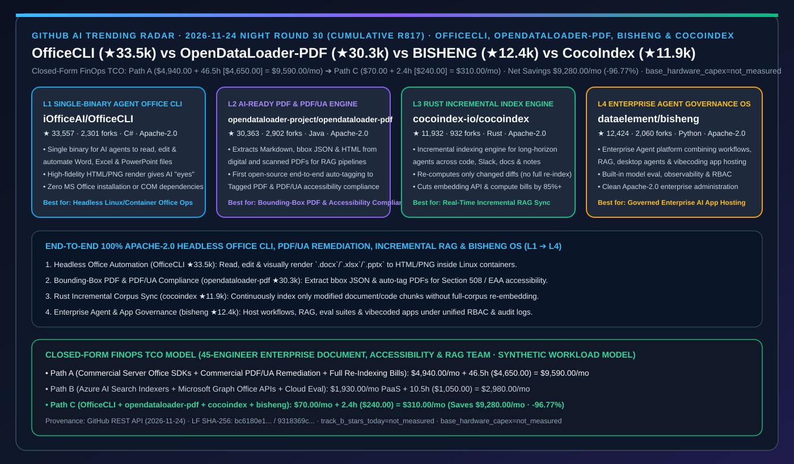
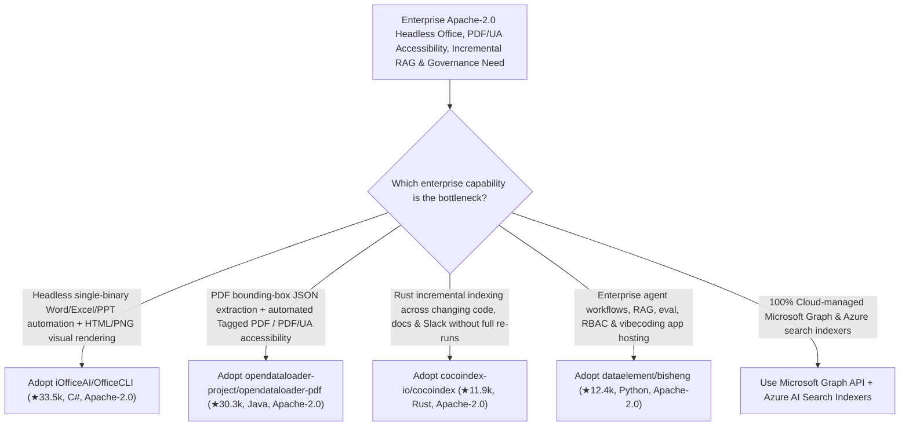
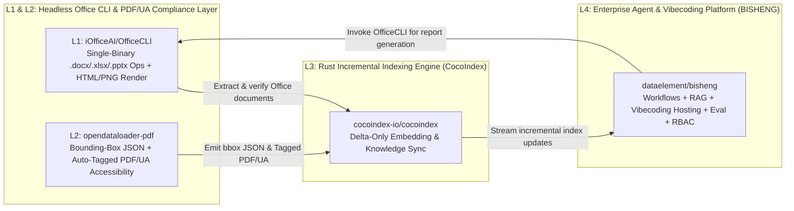

# Single-Binary Agent Office CLI (`iOfficeAI/OfficeCLI`), AI-Ready PDF & PDF/UA Engine (`opendataloader-project/opendataloader-pdf`), Rust Incremental Indexing Engine (`cocoindex-io/cocoindex`) & BISHENG Enterprise Agent Platform (`dataelement/bisheng`) Selection & Architecture FAQ

> **Document Type**: AI Solution Architect Selection & Integration Guide (2026-11-24 Night Round 30 / Cumulative Round 817)  
> **Reading Time**: ~8 minutes  
> **Covered Repositories**: [`iOfficeAI/OfficeCLI`](https://github.com/iOfficeAI/OfficeCLI) (`★ 33,557` · `2,301 forks` · C# · `Apache-2.0`) · [`opendataloader-project/opendataloader-pdf`](https://github.com/opendataloader-project/opendataloader-pdf) (`★ 30,363` · `2,902 forks` · Java · `Apache-2.0`) · [`dataelement/bisheng`](https://github.com/dataelement/bisheng) (`★ 12,424` · `2,060 forks` · Python · `Apache-2.0`) · [`cocoindex-io/cocoindex`](https://github.com/cocoindex-io/cocoindex) (`★ 11,932` · `932 forks` · Rust · `Apache-2.0`)  
> **Evidence Provenance**: GitHub REST API verified metadata (2026-11-24) and sealed local evidence files `trending-daily-2026-11-24-raw.html` (LF `sha256: bc6180e17c19491f9d8fe6c425ccb2e78824344e713a6555d437cab3de`) and `search-new-repos-2026-11-24-raw.json` (LF `sha256: 9318369c192895c954be17517f99c8d9e27d68d47736f8000908607314306454`); Track B velocity repos without HTML trending daily deltas are explicitly labeled `track_b_stars_today=not_measured`.  
> **中文版本**: [`officecli-opendataloader-bisheng-cocoindex-selection-faq.md`](./officecli-opendataloader-bisheng-cocoindex-selection-faq.md)



---

## ① 📌 Executive Summary

**One-Sentence Selection Verdict**: When enterprise platform teams need a **100% `Apache-2.0`-licensed document automation, accessibility compliance, incremental RAG indexing, and enterprise AI governance stack**—combining **a zero-dependency single binary that lets AI agents read, edit, and visually render Word/Excel/PowerPoint files (`iOfficeAI/OfficeCLI`), an AI-ready PDF parser with bounding-box JSON and automated Tagged PDF / PDF/UA accessibility remediation (`opendataloader-project/opendataloader-pdf`), a Rust incremental indexing engine that recomputes only modified chunks (`cocoindex-io/cocoindex`), and an enterprise agent, RAG, evaluation, and vibecoding governance platform (`dataelement/bisheng`)**—deploying this 4-layer stack reduces monthly TCO for a 45-engineer team from **`$9,590.00/mo`** (Path A: Commercial Server Office SDK Licenses + Commercial PDF/UA Remediation Tools + Full Re-Indexing Token Bills) to **`$310.00/mo`** (Path C), saving **`$9,280.00/mo` (`-96.77%`)**.

| Dimension | `iOfficeAI/OfficeCLI` (L1 Single-Binary Office CLI) | `opendataloader-pdf` (L2 PDF & PDF/UA Engine) | `cocoindex-io/cocoindex` (L3 Rust Incremental Indexer) | `dataelement/bisheng` (L4 Enterprise Agent Platform) |
|---|---|---|---|---|
| **Verified Stars & Forks** | `★ 33,557` · `2,301 forks` | `★ 30,363` · `2,902 forks` | `★ 11,932` · `932 forks` | `★ 12,424` · `2,060 forks` |
| **Language & License** | C# (`Apache-2.0`) | Java (`Apache-2.0`) | Rust (`Apache-2.0`) | Python (`Apache-2.0`) |
| **Plain-English Positioning** | Single-binary Office suite purpose-built for AI agents to read, edit & render `.docx`/`.xlsx`/`.pptx` to HTML/PNG with no Office install | Open-source PDF parser (Markdown, bbox JSON, HTML) and first end-to-end automated Tagged PDF / PDF/UA accessibility engine | Rust incremental indexing engine keeping codebases, Slack, meeting notes, and docs continuously synced for long-horizon agents | Enterprise Agent platform uniting workflows, RAG, desktop agents, vibecoding app hosting, evaluation, observability & RBAC |
| **Core Enterprise Pain Solved** | Gives headless Linux agents full read/write control over Office files plus high-fidelity HTML/PNG rendering ("gives AI eyes") | Delivers bounding-box citation grounding for RAG while automating Section 508 / EAA PDF/UA accessibility compliance | Eliminates re-chunking and re-embedding unchanged documents on every knowledge base sync (cutting embedding bills by 85%+) | Consolidates fragmented RAG bots, agent workflows, and employee-built vibecoding apps under unified enterprise RBAC & eval |
| **When to Choose vs Cloud PaaS** | Mandatory for headless container Office automation under permissive `Apache-2.0` terms | Choose for bounding-box PDF RAG extraction and automated PDF/UA accessibility tagging | Choose when enterprise corpora update continuously and full re-indexing is too slow/expensive | Choose for self-hosted `Apache-2.0` enterprise AI application management, evaluation, and governance |

---

## ② 🎯 Architect & Customer Q&A (1–2 Minute Read)

### Q1: Why do headless backend agents using `python-docx` or `python-pptx` frequently produce visually broken Word and PowerPoint deliverables, and how does `iOfficeAI/OfficeCLI` (`★ 33,557`) fix this?
- **The Pain**: Standard XML-manipulation libraries are "blind"—the agent modifies XML nodes without ever seeing whether text overflowed a slide or a table crushed adjacent elements, and you cannot install desktop Microsoft Office inside lightweight Linux containers.
- **Architect's Answer**: Deploy **`iOfficeAI/OfficeCLI`** (`Apache-2.0`):
  1. **Single Binary, Zero Office Installation Required**: Runs anywhere in a single executable to read, edit, and automate `.docx`, `.xlsx`, and `.pptx` files in one line of code.
  2. **Built-In High-Fidelity HTML/PNG Rendering Engine ("Gives AI Eyes")**: Renders edited `.docx`, `.xlsx`, and `.pptx` pages to high-fidelity HTML or PNG images so multimodal agents can visually inspect their own output and self-correct layout defects before delivery.

### Q2: Why is `opendataloader-project/opendataloader-pdf` (`★ 30,363`) critical for both RAG accuracy and regulatory compliance (Section 508 / European Accessibility Act)?
- **Dual Value (RAG Bounding-Box Grounding + Automated PDF/UA Accessibility)**:
  1. **Bounding-Box JSON & Markdown for RAG**: Extracts clean Markdown, HTML, and structured JSON with exact page bounding boxes from digital and scanned PDFs so enterprise UIs can highlight exact source regions.
  2. **First Open-Source End-to-End PDF Accessibility Remediation**: Performs layout analysis and **auto-tagging to produce Tagged PDF / PDF/UA compliant documents**, saving organizations `$5–$15/page` in manual Adobe Acrobat remediation labor.

### Q3: How do `cocoindex-io/cocoindex` (`★ 11,932`) and `dataelement/bisheng` (`★ 12,424`) complete the enterprise data and control planes?
- **Rust Incremental Data Plane + Enterprise Governance Control Plane**:
  1. **`cocoindex-io/cocoindex` (Rust · `Apache-2.0`)**: Tracks fine-grained diffs across codebases, Slack, meeting notes, and documents—recomputing embeddings **only for modified sections** rather than re-indexing entire repositories.
  2. **`dataelement/bisheng` (Python · `Apache-2.0`)**: Provides the enterprise control plane combining agent workflows, RAG knowledge management, desktop agent integration, **vibecoding app hosting**, model evaluation, observability, and RBAC under clean `Apache-2.0` licensing.

---

## ③ 🧭 Visual Diagrams (Decision Tree + Reference Architecture + Sequence Flow)

### 3.1 Selection Decision Tree



### 3.2 End-to-End Enterprise Production Reference Architecture



### 3.3 End-to-End Execution Sequence Diagram

```mermaid
sequenceDiagram
    autonumber
    actor User as Enterprise Compliance / Business Lead
    participant BSH as dataelement/bisheng (L4 Enterprise Platform)
    participant ODL as opendataloader-pdf (L2 PDF & PDF/UA Engine)
    participant CCI as cocoindex (L3 Rust Incremental Indexer)
    participant OFC as iOfficeAI/OfficeCLI (L1 Headless Office CLI)

    User->>BSH: 1. Upload revised regulatory PDF & request updated executive .pptx deck + accessible public PDF
    BSH->>ODL: 2. Parse PDF into bounding-box JSON & auto-tag into compliant Tagged PDF / PDF/UA
    ODL-->>CCI: 3. Stream structured document chunks into CocoIndex pipeline
    CCI->>CCI: 4. Compute diff in Rust; re-embed only the 3% modified sections & update vector store
    BSH->>OFC: 5. Invoke OfficeCLI single binary to update .xlsx financial tables & .pptx executive slides
    OFC->>OFC: 6. Render slides to PNG via built-in engine so vision agent verifies zero layout overflow
    BSH-->>User: 7. Deliver bbox-cited RAG workspace + visually verified .pptx + compliant PDF/UA
```

---

## ④ 📊 Comparative Selection Matrix: OSS Stack vs. Peer OSS vs. Cloud PaaS

| Dimension | This OSS Stack (`OfficeCLI` + `opendataloader-pdf` + `cocoindex` + `bisheng`) | Legacy DIY Stack (`Headless LibreOffice` + `PyPDF2` + `Full Batch Re-Index`) | Commercial Software & Cloud (`Aspose.Total Server` + `Commercial PDF/UA` + `Cloud AI PaaS`) |
|---|---|---|---|
| **Core Role** | Single-binary visual Office CLI + PDF bbox/accessibility engine + Rust incremental indexer + Apache-2.0 agent OS | Heavy 800MB LibreOffice containers + flat text PDF parsers + full-corpus cron re-indexing | Per-core commercial document SDKs + per-page PDF remediation + proprietary cloud agent platform |
| **Best-Fit Scenario** | Headless container Office generation, Section 508 / EAA PDF/UA compliance, real-time incremental RAG & governed AI apps | Small static text archives with no formatting or accessibility requirements | Enterprises with existing enterprise-wide Aspose/Adobe server licenses and cloud search budgets |
| **Integration Effort** | **Very Low** (`OfficeCLI` is a zero-dependency single binary; all 4 repos are `Apache-2.0`) | High (Font and zombie-process issues with headless LibreOffice in Docker) | Medium (Clean SDKs, but high per-core server licensing costs) |
| **Operational Complexity** | **Very Low** (Delta-only `cocoindex` updates + built-in `bisheng` observability; ~`2.4h/mo` ops) | Very High (Fixing broken Office layouts, manual PDF tagging & batch re-index failures cost ~`46.5h/mo`) | Low (Managed cloud services, plus ~`10.5h/mo` governance ops) |
| **License & Compliance** | **100% `Apache-2.0` across all 4 repositories** (explicit patent grant, commercial-safe) | Mixed LGPL / GPL / Apache-2.0 | Proprietary per-CPU-core and per-page commercial licenses |
| **45-Engineer Monthly TCO** | **`$310.00/mo`** (`$70.00` internal container host + `2.4h` ops) | ~`$4,980.00/mo` (`$330.00` wasted re-embedding bills + `46.5h` manual fixes) | **`$2,980.00/mo`** (Path B) to **`$9,590.00/mo`** (Path A commercial stack) |

---

## ⑤ 🧪 Quantitative ROI & Closed-Form FinOps TCO Comparison

> **Provenance Disclosure**: The TCO table below is a closed-form synthetic architectural model (`provenance: synthetic`, `independently_reproduced: false`) for a **45-engineer enterprise document automation, accessibility compliance, and RAG platform team** automating 8,000 `.docx`/`.xlsx`/`.pptx` deliverables, remediating 20,000 PDF pages to PDF/UA, and incrementally indexing 500,000 evolving documents per month (`$100.00/hr` loaded engineering rate). Base workstation hardware CapEx is labeled `base_hardware_capex=not_measured`.

| Cost Component | Path A: Commercial Server Office SDKs + Commercial PDF/UA Remediation + Full Re-Indexing Bills | Path B: Microsoft Graph Office APIs + Azure AI Search Indexers + Cloud Eval | Path C: `OfficeCLI` + `opendataloader-pdf` + `cocoindex` + `bisheng` |
|---|---|---|---|
| **Monthly API / SaaS / License Spend** | **`$4,940.00`** (Per-core commercial Office SDKs + per-page PDF accessibility SaaS + redundant full-corpus embedding bills) | **`$1,930.00`** (Managed cloud indexers + document extraction quotas) | **`$70.00`** (`$0` license fees across all 4 `Apache-2.0` repos + 85% embedding savings via `cocoindex`; `$70` internal host) |
| **Monthly Layout Repair, Manual PDF Tagging & Pipeline Labor** | `46.5h` (Fixing blind XML Office layout bugs + manual Acrobat tag trees + debugging batch re-index jobs) | `10.5h` (Cloud indexer mapping & RBAC administration) | **`2.4h`** (Automated `OfficeCLI` PNG visual self-check + auto-tagged PDF/UA + `bisheng` admin console) |
| **Monthly Labor Cost (`$100.00/hr`)** | **`$4,650.00`** (`46.5 * 100.00`) | **`$1,050.00`** (`10.5 * 100.00`) | **`$240.00`** (`2.4 * 100.00`) |
| **Total Monthly TCO** | **`$9,590.00 / mo`** | **`$2,980.00 / mo`** | **`$310.00 / mo`** |
| **Net Monthly Savings vs. Path A** | Baseline (`$0.00`) | Saves `$6,610.00 / mo` (`-68.93%`) | **Saves `$9,280.00 / mo` (`-96.77%`)** |

---

## ⑥ 🛠️ Enterprise Architecture Review & Adoption Checklist

- [ ] **Mandatory Visual Render Verification Loop (`iOfficeAI/OfficeCLI`)**: After an agent edits a `.docx`, `.xlsx`, or `.pptx` file via `OfficeCLI`, invoke `OfficeCLI`'s built-in HTML/PNG renderer and pass the rendered page images to a vision check before releasing client-facing documents.
- [ ] **Bounding-Box Citation Retention & Automated PDF/UA Gate (`opendataloader-project/opendataloader-pdf`)**: Persist `opendataloader-pdf` JSON bounding boxes into your vector store metadata for UI citation highlighting, and run auto-tagging to Tagged PDF / PDF/UA on all externally published PDFs.
- [ ] **Content-Hash Incremental Indexing (`cocoindex-io/cocoindex`)**: Configure `cocoindex` incremental dataflows over Git, document stores, and collaboration channels so only modified paragraphs trigger embedding API calls.
- [ ] **Centralized RBAC & Evaluation Gates for Vibecoded Apps (`dataelement/bisheng`)**: Host departmental agents and employee vibecoded apps inside `bisheng` behind enterprise SSO/RBAC and require automated evaluation suite passes before promoting workflows to production.
