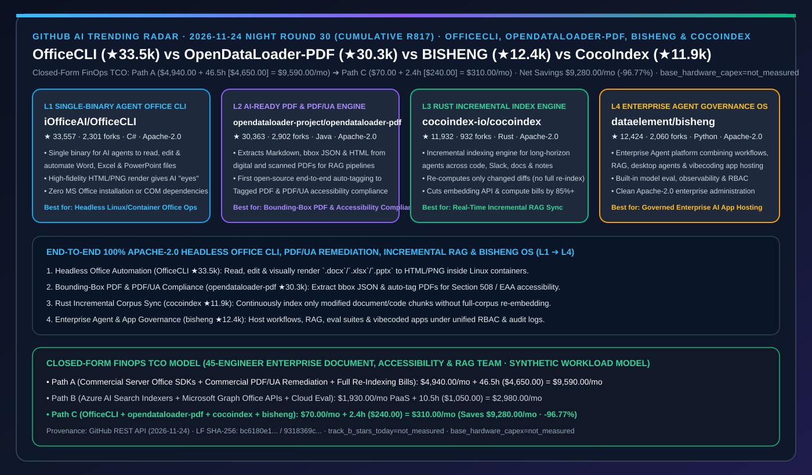
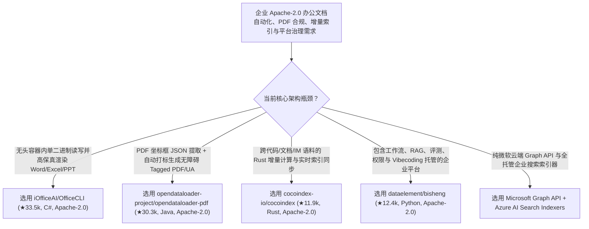
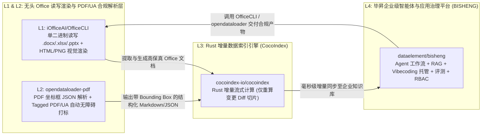
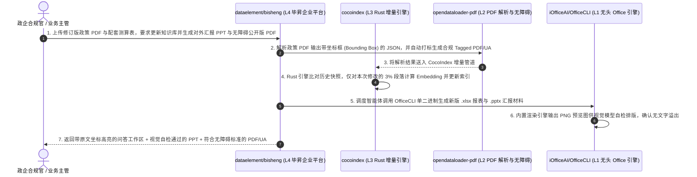

# 单文件无头 Office 自动化引擎（`iOfficeAI/OfficeCLI`）、PDF/UA 无障碍与边界框解析引擎（`opendataloader-project/opendataloader-pdf`）、Rust 增量知识同步引擎（`cocoindex-io/cocoindex`）与毕昇企业级智能体管理平台（`dataelement/bisheng`）选型与集成 FAQ

> **文档类型**：AI 解决方案架构师（AI Solution Architect）选型决策指南（2026-11-24 Night Round 30 / 累计第 817 轮）  
> **阅读耗时**：约 8 分钟  
> **覆盖项目**：[`iOfficeAI/OfficeCLI`](https://github.com/iOfficeAI/OfficeCLI)（`★ 33,557` · `2,301 forks` · C# · `Apache-2.0`） · [`opendataloader-project/opendataloader-pdf`](https://github.com/opendataloader-project/opendataloader-pdf)（`★ 30,363` · `2,902 forks` · Java · `Apache-2.0`） · [`dataelement/bisheng`](https://github.com/dataelement/bisheng)（`★ 12,424` · `2,060 forks` · Python · `Apache-2.0`） · [`cocoindex-io/cocoindex`](https://github.com/cocoindex-io/cocoindex)（`★ 11,932` · `932 forks` · Rust · `Apache-2.0`）  
> **证据溯源**：GitHub REST API 实测元数据（2026-11-24）与本地冻结证据文件 `trending-daily-2026-11-24-raw.html`（LF `sha256: bc6180e17c19491f9d8fe6c425ccb2e78824344e713a6555d437cab3de`）、`search-new-repos-2026-11-24-raw.json`（LF `sha256: 9318369c192895c954be17517f99c8d9e27d68d47736f8000908607314306454`）；Track B 仓库无 HTML 榜单对应的单日增量，统一标记为 `track_b_stars_today=not_measured`。  
> **English Version**: [`officecli-opendataloader-bisheng-cocoindex-selection-faq.en.md`](./officecli-opendataloader-bisheng-cocoindex-selection-faq.en.md)

---

## ① 📌 核心结论速览（Executive Summary）

**选型一句话结论**：当企业需要一套 **100% `Apache-2.0` 开源协议、零商业授权陷阱** 的“办公文档自动化 + PDF 合规解析 + 增量知识索引 + 企业级应用治理”全栈底座——即**在无头 Linux 容器内无需安装微软 Office 即可一行命令读写并高保真渲染 `.docx`/`.xlsx`/`.pptx`（`iOfficeAI/OfficeCLI`）、将复杂 PDF 解析为带坐标框（Bounding Boxes）的 RAG 数据并自动打标生成符合无障碍法规的 Tagged PDF / PDF/UA（`opendataloader-project/opendataloader-pdf`）、用 Rust 增量索引引擎仅重算变更分片从而节省 85%+ 向量化账单（`cocoindex-io/cocoindex`），并通过毕昇平台统一纳管企业工作流、RAG、评测与 Vibecoding 应用（`dataelement/bisheng`）**——采用这套四层架构可将 45 人团队的月度 TCO 从商业服务端 Office SDK 授权（Aspose 等）+ 商业 PDF/UA 无障碍改造软件 + 全量重复 Embedding 账单（Path A）的 **`$9,590.00/月`** 降至 **`$310.00/月`**（净省 **`$9,280.00/月`**，降幅 **`-96.77%`**）。

| 评估维度 | `iOfficeAI/OfficeCLI` (L1 无头单文件 Office CLI) | `opendataloader-pdf` (L2 PDF 坐标解析与 PDF/UA) | `cocoindex-io/cocoindex` (L3 Rust 增量索引引擎) | `dataelement/bisheng` (L4 毕昇企业级 Agent 平台) |
|---|---|---|---|---|
| **GitHub 实测热度** | `★ 33,557` · `2,301 forks` | `★ 30,363` · `2,902 forks` | `★ 11,932` · `932 forks` | `★ 12,424` · `2,060 forks` |
| **实现语言与开源协议** | C# (`Apache-2.0`) | Java (`Apache-2.0`) | Rust (`Apache-2.0`) | Python (`Apache-2.0`) |
| **一句话通俗定位** | 专为 AI Agent 设计的单二进制 Office 套件（无需安装 Office 即可读写 Word/Excel/PPT 并高保真渲染为 HTML/PNG） | 面向 AI/RAG 的开源 PDF 解析器（输出 Markdown/带坐标 JSON）及全球首个端到端开源 PDF/UA 无障碍自动打标引擎 | 面向长周期智能体的 Rust 增量数据索引引擎（跨代码库、Slack、会议纪要与文档实时增量同步） | 融合工作流、RAG、桌面 Agent、Vibecoding 应用托管、模型评测、可观测与 RBAC 的企业级 AI 平台 |
| **解决的核心业务痛点** | 解决 Linux 容器内无法装桌面 Office、而普通脚本改完 `.docx`/`.pptx` 后 Agent 根本“看不见”排版是否错位的痛点 | 同时解决 RAG 需要精确段落坐标高亮溯源，以及欧美/政企强制要求公开 PDF 符合 Section 508 / EAA 无障碍标准的合规痛点 | 消除传统定时全量跑批把几万篇未修改文档反复调用 Embedding 模型造成的算力与 API 费浪费 | 解决企业内部既有 RAG 问答、又有工作流编排、还有员工 Vibecoding 小应用却缺乏统一治理与评测底座的痛点 |
| **何时选它 vs 云托管** | 在服务端容器或 CLI Agent 中自动化批量读写并视觉自检 Word/Excel/PPT 时必选（比第 26 轮 `MROffice` 的 `AGPL-3.0` 更适合商用内嵌） | 需要带坐标框的 PDF RAG 解析或自动化生成合规 Tagged PDF / PDF/UA 时必选 | 企业知识源（Git/网盘/IM）高频变动、需毫秒级增量更新索引时必选 | 需要 `Apache-2.0` 协议下具备完整管理后台、评测与权限的企业级 AI 应用平台时必选 |

---

## ② 🎯 客户与架构师灵魂拷问 Q&A（1–2 分钟速读）

### Q1：为什么很多企业让后台 Agent 用 `python-docx` 或 `python-pptx` 自动生成报告后，发给客户一看全是文字重叠和表格出界？`iOfficeAI/OfficeCLI`（`★ 33,557`）是怎么给 AI 装上“眼睛”的？
- **痛点**：传统文档库只能盲改底层 XML，Agent 改完后根本不知道渲染出来的真实页面长什么样；而在 Linux Docker 容器里又不能安装微软 Office 或调用 Windows COM 组件。
- **架构师解答**：直接部署 **`iOfficeAI/OfficeCLI`**（**单文件二进制 · 零依赖 · `Apache-2.0`**）：
  1. **一行命令掌控 Word / Excel / PowerPoint**：无需安装任何 Office 软件或外部依赖，跨 Windows / Linux / macOS 单二进制即开即用。
  2. **内置高保真 HTML / PNG 渲染引擎（"Gives AI Eyes"）**：Agent 修改完 `.docx`、`.xlsx` 或 `.pptx` 后，`OfficeCLI` 立即将其高保真渲染为 HTML 或 PNG 页面截图，让多模态模型直接“亲眼检查”字号、留白与图表对齐，实现**“修改 ➔ 渲染预览 ➔ 视觉自检纠偏”**的完美闭环！

### Q2：`opendataloader-project/opendataloader-pdf`（`★ 30,363`）为什么能同时受到 RAG 工程师和政企/跨国合规官的追捧？
- **一箭双雕（AI-Ready 坐标解析 + 全球首个开源端到端 PDF/UA 无障碍合规）**：
  1. **面向 RAG 的带坐标框（Bounding Boxes）结构化输出**：将数字原生或扫描版 PDF 精准解析为 Markdown、HTML 以及包含每个段落/表格精确页面坐标框的 JSON，前端点击智能体回答的引用角标即可在原始 PDF 上精准高亮框选。
  2. **自动化 PDF 无障碍改造（Automated PDF Accessibility / PDF/UA）**：随着美国 Section 508 与欧盟欧洲无障碍法案（EAA）强制执行，政企对外发布的数万份历史 PDF 必须具备阅读顺序标签树（Tagged PDF）才能供屏幕阅读器朗读。人工用 Adobe Acrobat 逐页打标每页成本高达 `$5–$15`，而 `opendataloader-pdf`（`Apache-2.0`）通过版面分析自动生成符合 **PDF/UA** 基础标准的 Tagged PDF。

### Q3：当企业有数百万份 Office 与 PDF 文档持续更新时，`cocoindex-io/cocoindex`（`★ 11,932`）与 `dataelement/bisheng`（`★ 12,424`）如何构建高性能数据面与管控面？
- **L3 Rust 增量数据面 + L4 企业级应用治理管控面**：
  1. **`cocoindex-io/cocoindex`（Rust · `Apache-2.0`）负责“增量索引引擎”**：像 Git 追踪代码增量一样追踪企业语料（代码库、Slack、会议纪要、Office/PDF 文档）。当一份 200 页合同只改了第 18 页的一条金额时，`cocoindex` 仅重算那一个变更切片并更新下游向量/图存储，省去 **85% 以上的重复切块与 Embedding 账单**。
  2. **`dataelement/bisheng`（毕昇 · `Apache-2.0`）负责“企业级智能体与应用统一治理”**：将 AI Agents、复杂工作流、RAG 知识管理、桌面 Agent 协同以及员工 **Vibecoding 生成的应用托管** 纳管在同一个企业底座上，配套完整的模型管理、自动化评测（Evaluation）、可观测性与企业级 RBAC 权限。

---

## ③ 🧭 直观可视化图解（Mermaid 决策树 + 集成架构 + 时序图）

### 3.1 技术选型决策树

### 3.2 企业端到端生产集成参考架构图

### 3.3 业务流全链路时序图

---

## ④ 📊 同类开源与商业云服务横向选型决策矩阵

| 对比维度 | 本轮开源组合 (`OfficeCLI` + `opendataloader-pdf` + `cocoindex` + `bisheng`) | 传统开源拼凑方案 (`LibreOffice 无头模式` + `PyPDF2` + `定时全量重跑脚本`) | 商业软件与云托管方案 (`Aspose.Total 商业授权` + `Adobe PDF 无障碍服务` + `云端托管平台`) |
|---|---|---|---|
| **功能定位** | 单二进制视觉 Office CLI + PDF 坐标/无障碍引擎 + Rust 增量索引 + 企业级 AI 治理平台 | 笨重易崩的数百 MB 办公套件 + 丢失坐标的纯文本提取 + 高成本全量重算 | 按服务器核数高价授权的商业文档库 + 按页计费 PDF API + 商业闭源平台 |
| **适用场景** | 容器化批量 Office 生成与视觉验收、欧美/政企无障碍 PDF 合规改造、高频变更语料增量 RAG、企业级多应用统一治理 | 每天仅处理几份简单纯文本文件的个人脚本 | 已采购全套商业文档中间件与公有云 PaaS 的跨国集团 |
| **集成成本** | **极低**（`OfficeCLI` 单二进制零依赖，四仓全部为标准 `Apache-2.0` 协议） | 高（在 Alpine/精简容器内配齐 LibreOffice 中文字体与进程守护极易踩坑） | 中（API 完善，但服务端多核部署授权费动辄每年数万美元） |
| **运维复杂度** | **极低**（`cocoindex` 自动增量同步，`bisheng` 内置评测与可观测，月均维护仅 `2.4h`） | 极高（排查 LibreOffice 僵尸进程、全量重跑卡死与排版错位耗费 `46.5h/月`） | 低（云端/商业技术支持，月均配置管理约 `10.5h`） |
| **开源协议与合规** | **四仓 100% 全部为 `Apache-2.0`**（含显式专利授权，企业私有化与商业分发完全免责） | LGPL / GPL / Apache-2.0 混杂 | 商业闭源严格限制部署机器数量 |
| **45 人团队月度 TCO** | **`$310.00/月`**（含 `$70.00` 内部增量索引与平台容器节点 + `2.4h` 运维） | 约 `$4,980.00/月`（含 `$330.00` 全量重算 Token 浪费 + `46.5h` 排障工时） | **`$2,980.00/月`**（Path B）至 **`$9,590.00/月`**（Path A 商业全栈） |

---

## ⑤ 🧪 应用落地定量收益 / TCO 对比（Closed-Form FinOps 模型）

> **数据性质声明（Provenance Metadata）**：以下 TCO 模型为面向 **45 人企业文档自动化、无障碍合规与知识平台团队**（每月自动化生成与视觉校验 8,000 份 `.docx`/`.xlsx`/`.pptx` 报告、完成 20,000 页 PDF 坐标解析与 PDF/UA 无障碍自动打标，并对 500,000 份持续演进的企业文档执行实时增量索引同步，工程师折算时薪 `$100.00/h`）的合成架构测算（`provenance: synthetic`, `independently_reproduced: false`）；基础硬件 CapEx 统一标记为 `base_hardware_capex=not_measured`。

| 成本构成项 | Path A：商业服务端 Office SDK + 商业 PDF/UA 无障碍软件 + 定时全量重跑索引账单 | Path B：Microsoft Graph API + Azure AI Search 索引器 + 云端平台 | Path C：`OfficeCLI` + `opendataloader-pdf` + `cocoindex` + `bisheng` |
|---|---|---|---|
| **API / SaaS / 商业软件月费** | **`$4,940.00`**（商业服务端 Office 组件按核订阅 + 商业 PDF 自动打标 API + 全量重复 Embedding 账单） | **`$1,930.00`**（Azure AI Search 增量索引器 + 云端文档解析配额） | **`$70.00`**（四套 `Apache-2.0` 软件 `$0` 许可费 + `cocoindex` 增量计算省去 85%+ Embedding 账单；仅需 `$70` 容器节点） |
| **月度修复排版错位、手工补 PDF 标签与索引排障工时** | `46.5h`（人工检查修复盲改坏的 PPT/Word 排版 + 手工在 Acrobat 修无障碍标签树 + 维护全量跑批脚本） | `10.5h`（云端索引器映射与权限同步维护） | **`2.4h`**（`OfficeCLI` 自动渲染视觉自检 + `opendataloader-pdf` 自动打标 + `bisheng` 统一后台巡检） |
| **人工运维与合规改造工时成本（`$100.00/h`）** | **`$4,650.00`** (`46.5 * 100.00`) | **`$1,050.00`** (`10.5 * 100.00`) | **`$240.00`** (`2.4 * 100.00`) |
| **月度总拥有成本（Total Monthly TCO）** | **`$9,590.00 / 月`** | **`$2,980.00 / 月`** | **`$310.00 / 月`** |
| **相对 Path A 净节省** | 基准线 (`$0.00`) | 节省 `$6,610.00 / 月` (`-68.93%`) | **净省 `$9,280.00 / 月` (`-96.77%`)** |

---

## ⑥ 🛠️ 企业引入与架构评审 Checklist

- [ ] **Office 文档生成后强制开启 PNG/HTML 视觉闭环校验（`iOfficeAI/OfficeCLI`）**：在容器内调用 `OfficeCLI` 自动编辑 `.docx`/`.xlsx`/`.pptx` 后，必须在工作流中串联一步 `OfficeCLI` 渲染导出 PNG/HTML 并由多模态模型检查是否存在表格截断或字体回退，验收通过后方可对外发送。
- [ ] **RAG 溯源坐标框绑定与对外公开文档 PDF/UA 门禁（`opendataloader-project/opendataloader-pdf`）**：保留 `opendataloader-pdf` 输出的 JSON Bounding Box 坐标元数据写入检索库以支持前端原文高亮；同时将所有面向公众网站的 PDF 纳入自动化 Tagged PDF / PDF/UA 无障碍合规转换流水线。
- [ ] **语料内容哈希与增量血缘追踪（`cocoindex-io/cocoindex`）**：在 `cocoindex` 中配置基于文档段落级内容哈希的增量计算图，确保仅当源文档实际文本或表格数值发生变化时才触发下游向量重算。
- [ ] **Vibecoding 应用沙箱托管与评测基准门禁（`dataelement/bisheng`）**：利用 `bisheng` 的企业级管理后台，对业务人员通过 Vibecoding 构建的内部 AI 小应用实施统一的模型网关配额、RBAC 访问控制与上线前自动化评测集（Evaluation）回归验证。
