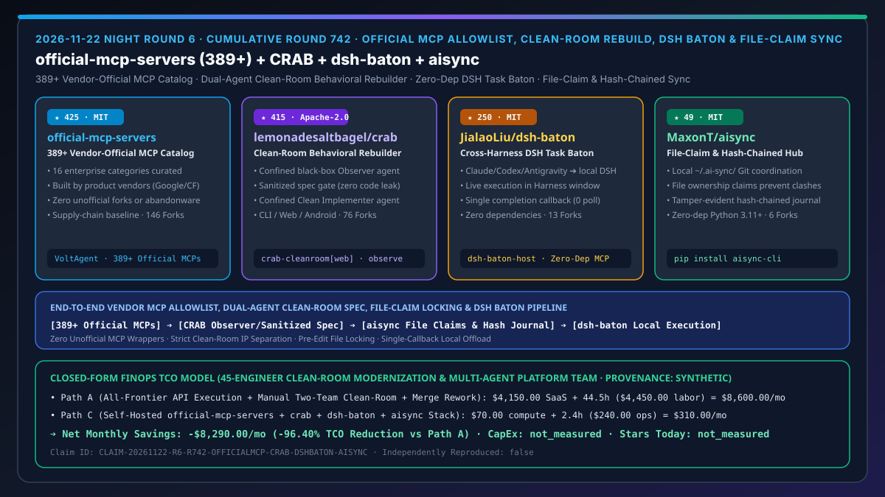
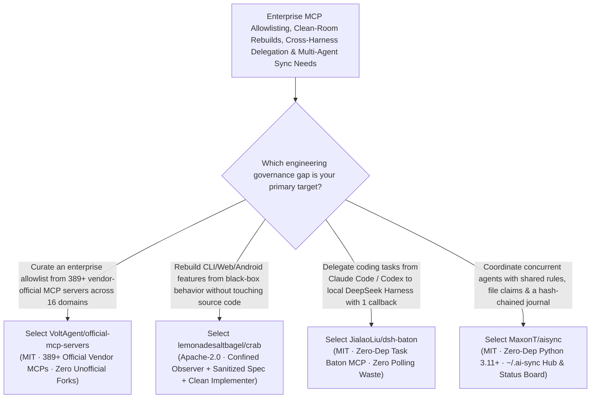
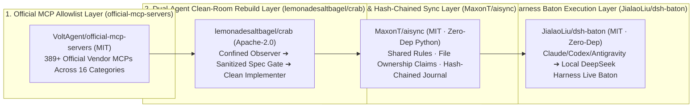
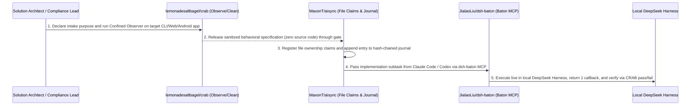

# 389+ Official Vendor MCP Directory (`VoltAgent/official-mcp-servers`), Dual-Agent Clean-Room Behavioral Rebuilder (`lemonadesaltbagel/crab`), Zero-Dep Cross-Harness Task Baton (`JialaoLiu/dsh-baton`) & File-Claim Multi-Agent Sync Hub (`MaxonT/aisync`) Selection & Architecture FAQ

> **Document Type**: Enterprise AI Solution Architect Selection & Integration Guide (GitHub Trending AI Radar — 2026-11-22 Night Round 6 / Cumulative Round 742)
> **Covered Repositories**: [`VoltAgent/official-mcp-servers`](https://github.com/VoltAgent/official-mcp-servers) (`★ 425`, `146 forks`, `MIT`: curated directory of 389+ official vendor-built MCP servers across 16 enterprise categories, strictly excluding unofficial forks and abandoned wrappers) · [`lemonadesaltbagel/crab`](https://github.com/lemonadesaltbagel/crab) (`★ 415`, `76 forks`, `Apache-2.0`, `crab-cleanroom`: Clean Rebuild of Anything's Behavior across CLI, Web, and Android targets using a confined black-box Observer agent, a sanitization gate, and a confined Clean Implementer agent that receives only abstract pass/fail verdicts) · [`JialaoLiu/dsh-baton`](https://github.com/JialaoLiu/dsh-baton) (`★ 250`, `13 forks`, `MIT`: zero-dependency MCP server that passes coding tasks from Claude Code, Codex, or Antigravity to a local DeepSeek Harness window with live progress and a single completion callback) · [`MaxonT/aisync`](https://github.com/MaxonT/aisync) (`★ 49`, `6 forks`, `MIT`: zero-dependency Python 3.11+ multi-agent coordination hub at `~/.ai-sync/` with shared rules, file ownership claims, and a hash-chained journal across Claude Code, Codex, Cursor, and MCP clients)
> **Core Scenario**: When enterprise engineering and platform teams need to **prevent supply-chain poisoning from unverified third-party MCP wrappers, reimplement legacy or reference CLI/Web/Android features with strict clean-room IP separation, offload heavy implementation tasks from expensive frontier CLIs to local DeepSeek Harness sessions without polling overhead, and prevent concurrent coding agents from overwriting the same files**, how do you combine **`VoltAgent/official-mcp-servers` + `lemonadesaltbagel/crab` + `JialaoLiu/dsh-baton` + `MaxonT/aisync`** into a governed multi-agent engineering stack?

---

## 1. 📌 Executive Summary (One-Line Selection Verdict)

1. **Need a trusted baseline to populate your internal enterprise MCP allowlist without risking supply-chain attacks from unofficial community forks or abandoned wrappers?** ➔ Choose **[`VoltAgent/official-mcp-servers`](https://github.com/VoltAgent/official-mcp-servers) (`★ 425`, `146 forks`, `MIT`)**.
   - **Plain-English Mechanism**: Catalogs **389+ official MCP servers** built and maintained directly by the companies behind the products (Google, Cloudflare, AWS, Stripe, Datadog, etc.) across 16 enterprise categories (Cloud/DevOps, Databases, Observability, Browser/Web, Search, Developer Tools, Security, Productivity, Finance, Messaging, AI/Media, Design, Travel, Marketing, HR, Emerging).
2. **Need to rebuild a feature from a CLI, Web, or Android application by observing how it behaves as a black box—while guaranteeing that the implementing agent never sees a single line of the target's source code?** ➔ Choose **[`lemonadesaltbagel/crab`](https://github.com/lemonadesaltbagel/crab) (`★ 415`, `76 forks`, `Apache-2.0`)**.
   - **Plain-English Mechanism**: Automates two-team clean-room engineering via dual isolated MCP servers (`observe` and `clean`): a confined **Observer Agent** probes the target's inputs, refusals, defaults, edge cases, and screen sequences to produce falsifiable rules; a sanitization gate releases only a clean behavioral spec; a confined **Clean Implementer Agent** builds from that spec and receives only abstract `pass/fail` verification verdicts.
3. **Need Claude Code, Codex, or Antigravity to act as the lead architect while handing off heavy coding tasks to a local DeepSeek Harness window—returning the result in one callback with zero polling token waste?** ➔ Choose **[`JialaoLiu/dsh-baton`](https://github.com/JialaoLiu/dsh-baton) (`★ 250`, `13 forks`, `MIT`)**.
   - **Plain-English Mechanism**: Zero-dependency MCP bridge (`dsh-baton-host`) that routes subtasks into your local DeepSeek Harness window (clearly tagged `Sent by Claude`, `Sent by ChatGPT`, or `Sent by Antigravity`), executes them live, and wakes the calling agent once upon completion.
4. **Running Claude Code, Codex, and Cursor concurrently on the same repository and need shared rules, file-ownership claims to prevent merge collisions, and a tamper-evident hash-chained journal?** ➔ Choose **[`MaxonT/aisync`](https://github.com/MaxonT/aisync) (`★ 49`, `6 forks`, `MIT`)**.
   - **Plain-English Mechanism**: Zero-dependency Python 3.11+ hub (`~/.ai-sync/` Git repo + native hooks + MCP server `io.github.MaxonT/aisync`) that synchronizes instructions, enforces explicit file claims before edits, and logs every multi-agent action into a verifiable hash-chained journal.

---

## 2. 🎯 Architect & Customer Deep-Dive Q&A

### Q1: How do these four tools address the four biggest governance and FinOps risks in multi-agent software engineering?

- **Four Enterprise Risks Mitigated**:
  1. **Unverified MCP supply-chain exposure ➔ `VoltAgent/official-mcp-servers`**: Restricts tool onboarding to 389+ vendor-official MCP servers.
  2. **Source-code contamination during feature reimplementation ➔ `lemonadesaltbagel/crab`**: Enforces architectural separation between the black-box `observer` and the `clean` implementer, passing only sanitized behavioral specs and abstract pass/fail verdicts.
  3. **Frontier token burn on routine implementation loops ➔ `JialaoLiu/dsh-baton`**: Delegates execution from Claude Code / Codex to local DeepSeek Harness with a single completion callback.
  4. **Concurrent multi-agent file overwrite collisions ➔ `MaxonT/aisync`**: Coordinates file ownership claims and writes a hash-chained audit journal across CLIs.
- **When to Choose Managed Cloud PaaS (Path B)?**
  - If your organization standardizes exclusively on cloud-hosted GitHub Copilot Coding Agent and Azure API Center, use native cloud controls; for local multi-CLI orchestration (`Claude Code` + `Codex` + `Cursor` + `DeepSeek Harness`) and clean-room behavioral rebuilding, deploy this 4-repo open-source stack (Path C).

### Q2: How do we wire `official-mcp-servers`, `crab`, `aisync`, and `dsh-baton` into an end-to-end enterprise workflow?

1. **Vendor-Verified MCP Governance Layer (`VoltAgent/official-mcp-servers`)**:
   - Seed your internal MCP registry exclusively from the 389+ official vendor catalog.
2. **Dual-Agent Clean-Room Behavioral Spec Layer (`lemonadesaltbagel/crab`)**:
   - Run the confined `observer` against target CLI/Web/Android workflows and release a sanitized behavioral specification through the gate.
3. **File-Claim & Hash-Chained Coordination Layer (`MaxonT/aisync`)**:
   - Distribute the sanitized spec and shared rules via `~/.ai-sync/`, locking file ownership claims per agent before edits begin.
4. **Cross-Harness Baton Execution Layer (`JialaoLiu/dsh-baton`)**:
   - Pass implementation subtasks from Claude Code / Codex to local DeepSeek Harness via `dsh-baton` and verify against `crab` abstract pass/fail checks.

### Q3: What are the legal and operational guardrails for production deployment?

- **Clean-Room Intake & Provenance**:
  - Always record the legal purpose declaration at `crab` intake and archive the sanitized specification alongside `aisync`'s hash-chained journal to prove zero source-code access during clean-room audits.

---

## 3. 🧭 Visual Architecture & Workflow Diagrams (Mermaid)

### 3.1 Solution Architect Selection Decision Tree

### 3.2 End-to-End Enterprise Reference Architecture

### 3.3 End-to-End Clean-Room Observation, File-Claim Locking & Cross-Harness Baton Sequence Diagram

---

## 4. 📊 Peer Open-Source vs. Commercial Cloud Selection Matrix

| Dimension | `VoltAgent/official-mcp-servers` (`★ 425`) | `lemonadesaltbagel/crab` (`★ 415`) | `JialaoLiu/dsh-baton` (`★ 250`) | `MaxonT/aisync` (`★ 49`) | Commercial Clean-Room Consulting + All-Frontier Execution + Commercial Governance Suites (Path A) | Unvetted Community MCPs + Raw Decompiler Dumps + Unlocked Concurrent Edits (Path B) |
| :--- | :--- | :--- | :--- | :--- | :--- | :--- |
| **Primary Role** | 389+ official vendor MCP allowlist catalog | Dual-agent clean-room behavioral rebuilder | Zero-dep Claude/Codex-to-DSH task baton MCP | Zero-dep multi-agent file-claim & hash-chained hub | Two-team external consulting clean-room + all-frontier API execution | Random third-party MCP forks, raw decompiled source prompts, unlocked edits |
| **Key Differentiator** | **389+ vendor-official servers across 16 categories** | **Observer/Clean isolation + abstract `pass/fail` verdicts** | **Zero-dep live handoff to local DSH + single callback** | **Pre-edit file ownership claims + hash-chained journal** | High consulting & frontier token costs | Supply-chain poisoning risk, copyright contamination & frequent merge overwrites |
| **License** | `MIT` | `Apache-2.0` | `MIT` | `MIT` | Proprietary Services / SaaS | Ad-hoc high-risk workflow |
| **Monthly TCO (45-Eng Team)** | **`$310.00/mo` combined** (`$70.00` sandbox runner + `2.4h` ops) | Included (`Apache-2.0` local execution) | Included (offloads bulk coding to local DSH) | Included (zero-dep local `~/.ai-sync` repo) | **`$8,600.00/mo`** (`$4,150.00` frontier API/SaaS + `44.5h` clean-room & merge rework) | ~`$3,050.00/mo` (merge conflict rework & unvetted plugin troubleshooting) |

---

## 5. 🧪 Quantitative Enterprise ROI / FinOps TCO Model & 7-Card Report

> **📊 Provenance & Closed-Form Declaration**:
> - **provenance**: `synthetic` (45-engineer enterprise application modernization, clean-room reimplementation, and multi-agent platform team workload model: `independently_reproduced = false`; `base_hardware_capex = not_measured`; `track_b_stars_today = not_measured`).
> - **Closed-Form Equations**:
>   - **Path A (All-Frontier Model Execution & Polling + Commercial Governance Subscriptions + Manual Two-Team Clean-Room Spec Authoring & Multi-Agent Merge Conflict Resolution)**: Monthly frontier API & governance subscriptions **`$4,150.00`** + manual clean-room spec drafting, concurrent file-overwrite recovery, and MCP vetting labor **`44.5h × $100.00/h = $4,450.00`** = **`$8,600.00/mo`**.
>   - **Path C (Self-Hosted `VoltAgent/official-mcp-servers` + `lemonadesaltbagel/crab` + `JialaoLiu/dsh-baton` + `MaxonT/aisync` Stack)**: Shared clean-room test sandbox compute **`$70.00`** + official MCP catalog sync & `aisync` policy maintenance labor **`2.4h × $100.00/h = $240.00`** = **`$310.00/mo`**.
>   - **Net Monthly Savings vs. Path A**: **`-$8,290.00/mo`** (**`96.40%`** TCO reduction).

| Evaluation Path | API / SaaS / Compute Cost | Clean-Room & Sync Ops Labor (`$100/h`) | Total Monthly TCO | Net Savings vs. Path A | Architectural Delivery Impact |
| :--- | :---: | :---: | :---: | :---: | :--- |
| **Path A: All-Frontier Execution + Manual Clean-Room + Manual Merges** | `$4,150.00` | `44.5h` (`$4,450.00`) | **`$8,600.00`** | Baseline | High frontier token burn on routine code; slow manual clean-room documentation |
| **Path B: Unvetted MCPs + Decompiler Dumps + Unlocked Concurrent CLIs** | `$1,450.00` | `16.0h` (`$1,600.00`) | **`$3,050.00`** | `-$5,550.00` (`-64.53%`) | High IP contamination & supply-chain risk; frequent multi-agent file overwrites |
| **Path C: `official-mcp` + `crab` + `dsh-baton` + `aisync`** | **`$70.00`** | **`2.4h` (`$240.00`)** | **`$310.00`** | **`-$8,290.00` (`-96.40%`)** | **389+ official MCPs + dual-agent clean-room + DSH baton + file claims** |

- 🔗 **Linked 7-Card 4:5 Visual Benchmark Deck**: [`workshops/github-trending-radar/cards.en.html`](../cards.en.html) · [`cards.html`](../cards.html)

---

## 6. 🛠️ Enterprise Adoption & Architecture Review Checklist

- [ ] **1. Baseline Enterprise MCP Onboarding on `VoltAgent/official-mcp-servers`**: Restrict developer MCP installations to the 389+ vendor-official catalog across 16 enterprise categories.
- [ ] **2. Enforce Dual-Agent Clean-Room Isolation with `lemonadesaltbagel/crab`**: Run confined `observe` and `clean` agents separated by the sanitization gate so implementers never access target source code.
- [ ] **3. Offload Routine Coding Loops via `JialaoLiu/dsh-baton`**: Hand subtasks from Claude Code or Codex to local DeepSeek Harness sessions with single-callback completion.
- [ ] **4. Coordinate Concurrent Multi-Agent Workspaces with `MaxonT/aisync`**: Enable file ownership claims and hash-chained journaling in `~/.ai-sync/` across Claude Code, Codex, and Cursor.
