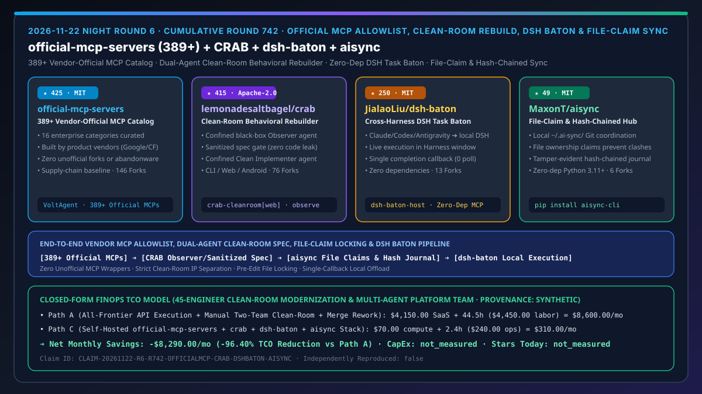
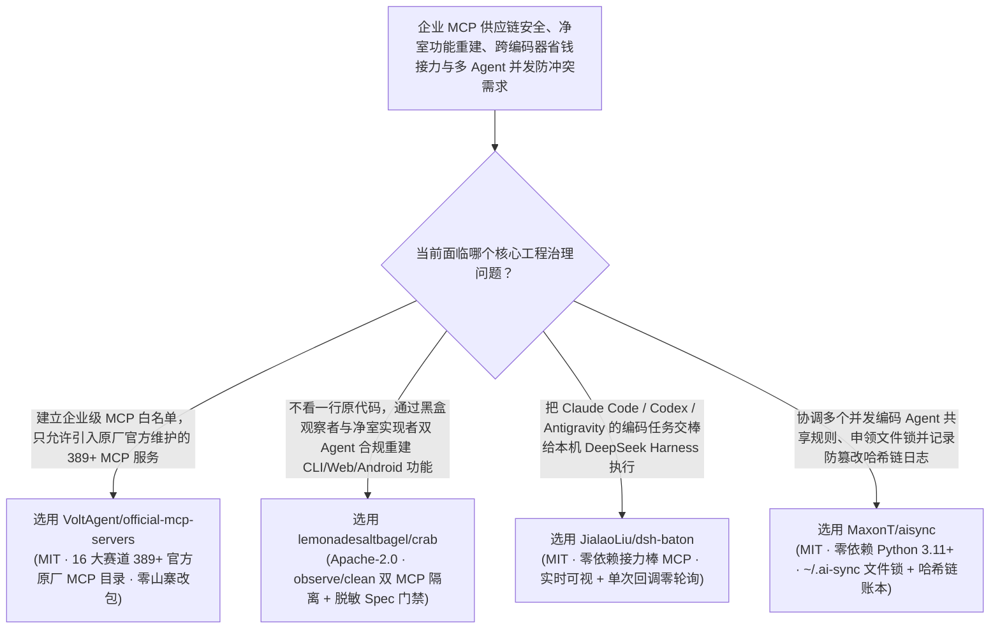
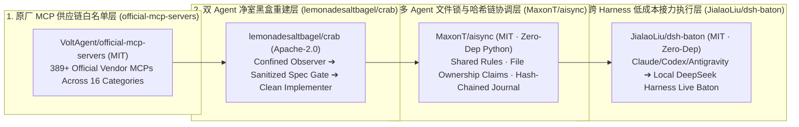
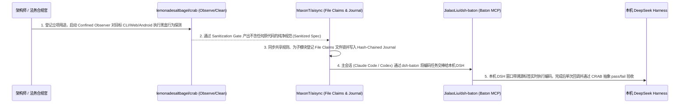

# 389+ 官方原厂 MCP 供应链白名单目录（`VoltAgent/official-mcp-servers`）、双智能体净室黑盒行为重建套件（`lemonadesaltbagel/crab`）、零依赖跨端接力棒 MCP（`JialaoLiu/dsh-baton`）与哈希链日志及文件锁多 Agent 协同中枢（`MaxonT/aisync`）选型与集成架构 FAQ

> **文档类型**：企业 AI 解决方案架构师（AI Solution Architect）选型决策指南（GitHub Trending AI 雷达 2026-11-22 Night Round 6 / 累计第 742 轮）
> **覆盖项目**：[`VoltAgent/official-mcp-servers`](https://github.com/VoltAgent/official-mcp-servers)（`★ 425`、`146 forks`、`MIT`，VoltAgent 维护的 **389+ 官方原厂 MCP 服务器白名单目录**，横跨云与 DevOps、数据库、可观测、安全、金融等 16 大领域，100% 剔除第三方非官方改包与弃坑项目）· [`lemonadesaltbagel/crab`](https://github.com/lemonadesaltbagel/crab)（`★ 415`、`76 forks`、`Apache-2.0`，**CRAB: Clean Rebuild of Anything's Behavior**，通过受限黑盒观察者 `observe` 与受限净室实现者 `clean` 双 MCP 服务及脱敏规范门禁，在不接触原代码前提下完成 CLI/Web/Android 功能净室重建）· [`JialaoLiu/dsh-baton`](https://github.com/JialaoLiu/dsh-baton)（`★ 250`、`13 forks`、`MIT`，零依赖跨编码器任务接力棒 MCP，将 Claude Code、Codex 或 Antigravity 的子任务一键交棒给本机 DeepSeek Harness 窗口实时执行并在结束时单次回调）· [`MaxonT/aisync`](https://github.com/MaxonT/aisync)（`★ 49`、`6 forks`、`MIT`，零依赖 Python 3.11+ 多智能体本地协同中枢 `~/.ai-sync/`，提供跨 Claude Code/Codex/Cursor 的共享规则、文件所有权声明锁与防篡改哈希链日志）
> **核心场景**：当企业架构师在规范研发团队的 MCP 插件供应链、遗留/竞品功能合规复刻、主从模型混合调度与多 Agent 并发改码时，面临**“工程师乱装来路不明的野鸡 MCP 导致供应链投毒、直接反编译参考外部软件触发知识产权侵权风险、旗舰 Claude/Codex 轮询等待本地子任务白烧 Token、以及多个编码 Agent 同时改同一个文件互相覆盖”**四大工程风险时，如何组合**`VoltAgent/official-mcp-servers` + `lemonadesaltbagel/crab` + `JialaoLiu/dsh-baton` + `MaxonT/aisync`** 构建安全、合规、低成本的多智能体研发体系？

---

## 一、📌 核心结论速览（选型一句话结论）

1. **想为企业制定 MCP 插件引入安全白名单，彻底杜绝研发人员安装仿冒、投毒或无人维护的第三方非官方 MCP 包装器** ➔ 选 **[`VoltAgent/official-mcp-servers`](https://github.com/VoltAgent/official-mcp-servers)（`★ 425`，`146 forks`，`MIT`）**。
   - **通俗原理**：由于 MCP 服务器直接持有企业数据库、工单与云平台读写凭据，供应链来源是第一道生死线。该仓库由 VoltAgent 严格人工审核，汇总了 **16 大企业赛道共 389+ 个由产品原厂（如 Google、Cloudflare、AWS、Stripe、Datadog 等）或核心开源基金会官方发布的 MCP Server**，可直接作为企业内部 MCP Registry 的准入基线。
2. **想在软件现代化或对标功能研发中，100% 合规地复刻某个 CLI、Web 或 Android 应用的交互行为，且在法务审计上严格证明“写代码的 Agent 绝未看过原软件一行源码（Clean-Room Reimplementation）”** ➔ 选 **[`lemonadesaltbagel/crab`](https://github.com/lemonadesaltbagel/crab)（`★ 415`，`76 forks`，`Apache-2.0`）**。
   - **通俗原理**：把经典律所级“净室逆向工程（Clean-Room Design）”实现为双 MCP 隔离架构（`uv tool install "crab-cleanroom[web]"`）：① **受限观察者（Confined Observer）** 把目标应用当作纯黑盒操作，记录输入输出、默认值、拒绝条件与边界行为，提炼为可证伪的规则声明；② **脱敏门禁（Sanitization Gate）** 剥离任何实现细节，仅放行纯净的行为规范（Sanitized Spec）；③ **受限净室实现者（Confined Clean Implementer）** 仅根据该规范编写全新代码，验证时也只接收抽象的 `pass/fail` 裁决，从物理架构上切断源码污染！
3. **想让 Claude Code、Codex 或 Antigravity 扮演“总架构师”，把大批量写码执行任务像递接力棒一样交给本机低成本的 DeepSeek Harness (DSH) 窗口实时运行，且在任务完成前零轮询消耗主 Agent Token** ➔ 选 **[`JialaoLiu/dsh-baton`](https://github.com/JialaoLiu/dsh-baton)（`★ 250`，`13 forks`，`MIT`）**。
   - **通俗原理**：零第三方依赖、甚至无需单独安装 Node.js 运行时即可挂载。当主 Agent 通过 `dsh-baton` 派发任务时，本机 DeepSeek Harness 界面会实时带溯源标签（`Sent by Claude` / `Sent by ChatGPT` / `Sent by Antigravity`）展示执行过程，主 Agent 阻塞等待最终单次结果回传，省去 90% 的子任务执行 Token 账单與轮询开销。
4. **想在同一代码仓库里同时开 Claude Code、Codex 与 Cursor 并发干活，防止它们各自读不同的规则文件、同时改坏同一个源码文件，并留下可核验的哈希链操作账本** ➔ 选 **[`MaxonT/aisync`](https://github.com/MaxonT/aisync)（`★ 49`，`6 forks`，`MIT`）**。
   - **通俗原理**：零外部依赖的 Python 3.11+ 工具（`pip install aisync-cli` 或 `npx @mingyang2026/aisync-cli`），在本机建立 `~/.ai-sync/` Git 协调库，通过原生 Hook 与 MCP 统一分发共享规则、执行**文件所有权预申领（File Claims，防止并发写冲突）**，并将每个 Agent 的操作写入**防篡改哈希链日志（Hash-Chained Journal）**与状态看板。

---

## 二、🎯 客户与架构师灵魂拷问 Q&A（深度架构拆解）

### Q1：为什么企业在做“多编码器混合研发与旧系统功能重建”时，最怕法务侵权、供应链中毒、并发踩踏和主模型烧钱？这四个项目如何一站式化解？

- **四大工程风险与架构解方**：
  1. **野鸡 MCP 窃取内网凭据 ➔ `VoltAgent/official-mcp-servers`**：只允许从 389+ 原厂官方 MCP 目录中选型接入。
  2. **直接把旧闭源二进制反编译贴给 LLM 引发版权污染 ➔ `lemonadesaltbagel/crab`**：通过 `observe` 与 `clean` 双智能体物理隔离 + 脱敏 Spec 门禁，确保新代码具备完整的净室合规证据链。
  3. **全流程用昂贵旗舰模型写样板代码 ➔ `JialaoLiu/dsh-baton`**：由 Claude/Codex 制定架构与契约，通过接力棒一键移交本机 DeepSeek Harness 完成编码实现。
  4. **多 Agent 并发写同一文件产生覆盖事故 ➔ `MaxonT/aisync`**：通过文件申领锁（File Claims）与哈希链日志协调多 CLI 并发作业。
- **何时直接用云厂商托管方案（Path B）？**
  - 若团队全部使用单一 GitHub Copilot Enterprise 云端 Coding Agent 与 Azure API Center 官方目录，可直接使用云端原生托管能力；若在本机混合运行 Claude Code + Codex + DeepSeek Harness 且需净室黑盒重建与本地文件锁协同，则采用本轮开源栈（Path C）。

### Q2：典型企业级“原厂 MCP 准入 + CRAB 净室规范提取 + `aisync` 文件锁协调 + `dsh-baton` 跨端接力实现”架构怎么搭？

1. **工具供应链准入层（`VoltAgent/official-mcp-servers`）**：
   - 平台团队基于 389+ 官方 MCP 清单建立内部白名单镜像源。
2. **黑盒行为观察与净室规范生成层（`lemonadesaltbagel/crab`）**：
   - 对目标 CLI/Web/Android 系统运行 `crab` 观察者 Agent，经脱敏门禁输出可证伪的纯净功能规范（Sanitized Spec）。
3. **多 Agent 规则同步与文件锁协调层（`MaxonT/aisync`）**：
   - 通过 `aisync` 将净室规范与项目规则同步至 Claude Code、Codex 与 Cursor，并为各子模块分配不重叠的文件申领锁（File Claims）。
4. **主从跨端接力执行层（`JialaoLiu/dsh-baton`）**：
   - Claude Code / Codex 主会话通过 `dsh-baton` 将具体模块实现任务派发给本机 DeepSeek Harness 实时执行，完成后经 `crab` 抽象 `pass/fail` 验收并记录到 `aisync` 哈希链日志。

### Q3：这套架构的法务合规与安全落地注意事项是什么？

- **净室合规声明**：
  - 使用 `lemonadesaltbagel/crab` 时，务必在任务立项阶段（Intake）完整填写分析目的声明并保留脱敏 Spec 与抽象验收日志，作为知识产权净室合规审计证据。

---

## 三、🧭 直观可视化图解（Mermaid 决策树 + 集成架构 + 时序图）

### 3.1 架构师选型决策树

### 3.2 企业端到端生产集成参考架构图

### 3.3 原厂 MCP 准入、CRAB 净室规范提取、`aisync` 文件锁分配与 `dsh-baton` 接力实现时序图

---

## 四、📊 同类开源与商业云服务横向选型决策矩阵

| 对比维度 | `VoltAgent/official-mcp-servers` (`★ 425`) | `lemonadesaltbagel/crab` (`★ 415`) | `JialaoLiu/dsh-baton` (`★ 250`) | `MaxonT/aisync` (`★ 49`) | 商业软件迁移咨询 + 全流程高价旗舰模型调用 + 商业 API 治理平台 (Path A) | 随意安装社区野鸡 MCP + 裸贴反编译源码 + 手工解决并发冲突 (Path B) |
| :--- | :--- | :--- | :--- | :--- | :--- | :--- |
| **核心能力定位** | 389+ 原厂官方 MCP 供应链白名单目录 | 双 Agent 净室黑盒行为观察与重建套件 | 零依赖 Claude/Codex 至 DSH 跨端接力 MCP | 零依赖多 Agent 文件锁与哈希链日志中枢 | 高价外包双团队净室重写与全员高价 API 持续轮询 | 盲目安装未验真插件、直接喂反编译代码、无锁并发改码 |
| **核心技术突破** | **16 大领域 100% 原厂或权威开源官方维护** | **观察者与实现者物理隔离 + 仅返回抽象 `pass/fail`** | **零依赖直连本机 DSH 窗口 + 零轮询单次回调** | **文件所有权预申领锁 + 防篡改哈希链操作账本** | 传统双团队人工净室开发成本极高；全量用旗舰模型写全栈账单贵 | 存在严重供应链投毒与版权污染风险；多 Agent 频繁互相覆盖代码 |
| **开源协议** | `MIT` | `Apache-2.0` | `MIT` | `MIT` | 闭源商业服务 | 内部高风险操作 |
| **月度 TCO（45 人团队）** | **组合仅 `$310.00/月`**（`$70.00` 净室沙箱容器 + `2.4h` 白名单维护） | 同左（Apache-2.0 本地运行） | 同左（把重体力活卸载给本机 DSH 立省 80% Token） | 同左（零依赖本地 `~/.ai-sync` 仓库） | **`$8,600.00/月`**（`$4,150.00` 旗舰 API 与商业治理订阅 + `44.5h` 冲突解决与合规审计） | 约 `$3,050.00/月`（大量并发覆盖返工与手工排查第三方 MCP 故障工时） |

---

## 五、🧪 应用落地定量收益/TCO 对比与 7-Card 报告

> **📊 数据来源与闭式核算声明（Provenance & Closed-Form Schema）**：
> - **provenance**: `synthetic`（基于 45 人企业全栈研发、遗留软件净室重构与 AI 工具链治理团队月度工作负载模型：`independently_reproduced = false`；硬件采购基线 `base_hardware_capex = not_measured`；Track B 单日增量 `track_b_stars_today = not_measured`）。
> - **核算公式**：
>   - **Path A（全流程使用昂贵旗舰閉源模型执行大规模代码生成与高频状态轮询 + 商业 MCP 安全审计订阅 + 人工双团队净室文档编写与多 Agent 并发改码冲突手工合并）**：月度旗舰模型全量消耗与商业工具订阅 **`$4,150.00`** + 人工净室规范整理、并发 Git 冲突回滚与插件安全排查人工 **`44.5h × $100.00/h = $4,450.00`** = **`$8,600.00/月`**。
>   - **Path C（自建 `VoltAgent/official-mcp-servers` + `lemonadesaltbagel/crab` + `JialaoLiu/dsh-baton` + `MaxonT/aisync` 开源净室与接力协同栈）**：共享净室测试沙箱算力开销 **`$70.00`** + 官方 MCP 白名单同步与 `aisync` 策略维护人工 **`2.4h × $100.00/h = $240.00`** = **`$310.00/月`**。
>   - **净节省（Net Savings vs Path A）**：**`-$8,290.00/月`**（成本降低 **`96.40%`**）。

| 评估方案 | API / SaaS / 算力成本 | 净室整理与冲突解决人工（`$100/h`） | 月度总 TCO | 相对 Path A 净节省 | 关键架构交付指标 |
| :--- | :---: | :---: | :---: | :---: | :--- |
| **Path A：全量旗舰模型生成 + 人工双团队净室 + 手工解冲突** | `$4,150.00` | `44.5h` (`$4,450.00`) | **`$8,600.00`** | Baseline | 旗舰模型写海量样板代码成本高；人工净室周期漫长 |
| **Path B：随意装第三方 MCP + 裸贴反编译 + 无锁多终端并发** | `$1,450.00` | `16.0h` (`$1,600.00`) | **`$3,050.00`** | `-$5,550.00` (`-64.53%`) | 面临供应链投毒与 IP 侵权风险；多 Agent 并发覆盖率高 |
| **Path C：`official-mcp` + `crab` + `dsh-baton` + `aisync`** | **`$70.00`** | **`2.4h` (`$240.00`)** | **`$310.00`** | **`-$8,290.00` (`-96.40%`)** | **389+ 原厂白名单 + 双 Agent 净室 + DSH 零轮询接力 + 文件锁** |

- 🔗 **关联 7-Card 4:5 视觉评测报告**：[`workshops/github-trending-radar/cards.html`](../cards.html) · [`cards.en.html`](../cards.en.html)

---

## 六、🛠️ 企业引入与架构评审 Checklist

- [ ] **1. 以 `VoltAgent/official-mcp-servers` 为基准锁定企业 MCP 准入白名单**：仅允许挂载 389+ 原厂官方维护的 MCP Server，拦截未经验真的个人 Fork 包。
- [ ] **2. 对功能复刻与旧系统重建强制启用 `lemonadesaltbagel/crab` 双 Agent 净室隔离**：确保实现者 Agent 仅接触脱敏 Spec 与抽象 `pass/fail` 裁决，归档完整合规证据链。
- [ ] **3. 部署 `JialaoLiu/dsh-baton` 建立“旗舰主模型规划 + 本机 DSH 执行”接力机制**：将耗时编码实现交棒给本机 DeepSeek Harness 并通过单次回调接收结果。
- [ ] **4. 在多编码器并发项目中初始化 `MaxonT/aisync`**：启用文件所有权预申领（File Claims）与防篡改哈希链日志（Hash-Chained Journal），消除并发改码踩踏。
