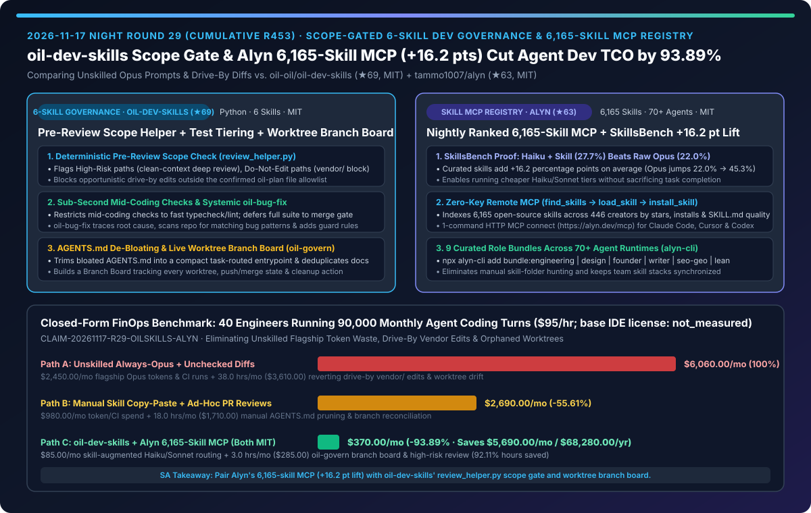
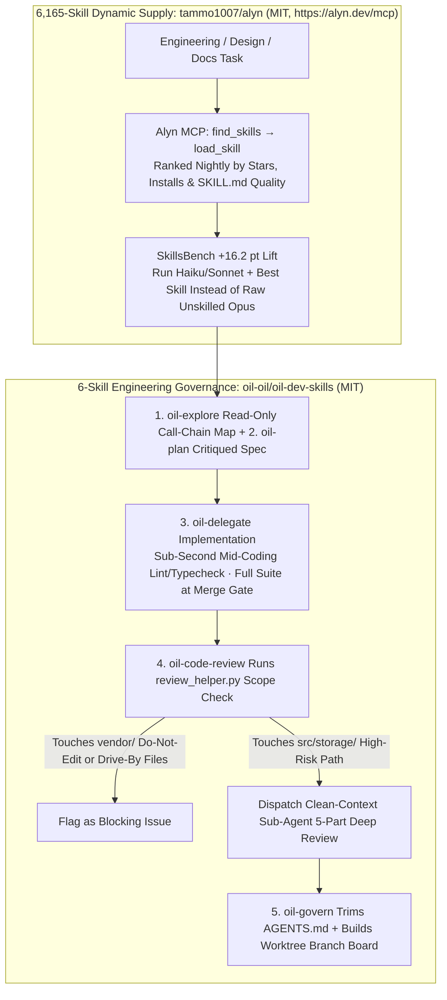

# Scope-Gated 6-Skill Dev Governance (`oil-oil/oil-dev-skills`) & 6,165-Skill Dynamic MCP Registry (`tammo1007/alyn`) Selection FAQ

> **Document Type**: Enterprise AI Solution Architect Practical Selection Guide (Standard 6-Section FAQ)  
> **Shift & Round**: 2026-11-17 Night Round 29 (Cumulative Round 453)  
> **Tracked Repositories**:
> - **`oil-oil/oil-dev-skills`** (`★ 69`, Python / 6 Agent Skills: `oil-explore`, `oil-plan`, `oil-delegate`, `oil-code-review`, `oil-govern`, `oil-bug-fix`, `MIT`): Structured AI coding governance suite featuring a deterministic pre-review scope helper (`review_helper.py` flagging high-risk paths, blocking `do-not-edit` paths, and rejecting out-of-scope drive-by edits), sub-second mid-coding test tiering, root-cause systemic bug fixing, and `oil-govern` (`AGENTS.md` de-bloating + live worktree **Branch Board**)
> - **`tammo1007/alyn`** (`★ 63`, JavaScript / `alyn-cli` + `https://alyn.dev/mcp` Zero-Key Remote HTTP MCP, `MIT`): Nightly ranked discovery registry of **6,165 open-source skills across 446 creators** for 70+ coding agents—grounded in SkillsBench (`arXiv:2602.12670`) showing **Claude Haiku 4.5 with skills (`27.7%`) beats Claude Opus 4.5 without skills (`22.0%`), with curated skills adding `+16.2` percentage points on average**  
> **Audit Claim ID**: `CLAIM-20261117-R29-OILSKILLS-ALYN` (base developer IDE seat subscriptions marked `not_measured`)

---

## 📌 1. Executive Summary

1. **Why Enterprise Engineering Teams Scaling Coding Agents Hit Two Operational Bottlenecks: Unskilled Flagship Token Waste and Unchecked Scope/Worktree Drift**:
   - **Bottleneck 1 — Burning Flagship Opus Tokens Without Task-Specific Skills**: On SkillsBench (`arXiv:2602.12670`), Claude Opus 4.5 *without* skills solved only **`22.0%`** of tasks, whereas lightweight Claude Haiku 4.5 *with* curated skills solved **`27.7%`** (and Opus *with* skills jumped to **`45.3%`**, an average **`+16.2` percentage point lift**). Yet developers rarely load the right skill because hunting through thousands of GitHub repositories by hand is impractical.
   - **Bottleneck 2 — Scope Drift, Mid-Coding CI Thrashing & Bloated `AGENTS.md` / Orphaned Worktrees**: Without workflow guardrails, coding agents run slow full-repository test suites after every two-line edit, sneak opportunistic drive-by edits into restricted `vendor/` or storage directories, bloat `AGENTS.md` with duplicated instructions, and leave dozens of unmerged worktree branches scattered across machines.
   - **The Solution Architect Stack (`oil-dev-skills` + `alyn`, Both `MIT`)**: Connect **`tammo1007/alyn`** (`https://alyn.dev/mcp` and `alyn-cli`) so agents dynamically query and load the top-ranked skill out of **6,165 open-source skills** (`find_skills → load_skill`) and install curated role bundles (`bundle:engineering`, `bundle:lean`); pair it with **`oil-oil/oil-dev-skills`** (`MIT`) to enforce read-only call-chain mapping (`oil-explore`), sub-second mid-coding checks (`oil-delegate`), deterministic pre-review scope checking (`review_helper.py` in `oil-code-review`), and milestone `AGENTS.md` pruning plus worktree **Branch Boards** (`oil-govern`).
2. **Closed-Form FinOps Impact (40 Software Engineers Running 90,000 Monthly Coding Agent Turns Across Multi-Worktree Repos at `$95.00/hr`)**:
   - Migrating from **Path A (Always-Opus Unskilled Prompts + Unchecked Drive-By Diffs & Full-Suite Test Thrashing at `$6,060.00/mo`)** to **Path C (`oil-dev-skills` + `alyn` 6,165-Skill MCP Stack at `$370.00/mo`)** saves **`$5,690.00/mo` (`-93.89%`, or `$68,280.00/yr`)** while cutting scope-drift reverts, `AGENTS.md` cleanup, and branch reconciliation from `38.0 hrs/mo` to `3.0 hrs/mo` (**`92.11%` reduction**).

---

## 💬 2. Core Architectural Q&A (Q1–Q3)

### Q1: How does `oil-oil/oil-dev-skills` stop scope drift with `review_helper.py` and keep `AGENTS.md` and Git worktrees clean with `oil-govern`?
- **Plain-Language Definition**: `oil-dev-skills` (`MIT`) is a **6-skill software engineering governance pipeline** (`oil-explore`, `oil-plan`, `oil-delegate`, `oil-code-review`, `oil-govern`, `oil-bug-fix`) for Claude Code, Codex, and Antigravity.
- **Four Production Engineering Controls**:
  1. **Deterministic Pre-Review Scope Gate (`review_helper.py`)**: Before `oil-code-review` inspects a diff, `review_helper.py` compares changed files against the repository's `AGENTS.md` dev profile and the confirmed `oil-plan` allowlist:
     - **High-risk paths** (e.g., `src/storage/`) are dispatched to an independent sub-agent with a **clean context** for a 5-part deep review;
     - **Do-not-edit paths** (e.g., `vendor/`) are immediately flagged as **blocking issues**;
     - **Files outside the plan scope** are audited individually, blocking opportunistic drive-by edits.
  2. **Test-Tiering Dispatch Contract**: Restricts mid-coding checks to sub-second compile, typecheck, and lint runs (plus targeted quick tests once coding finishes), holding full test suites and builds until the merge gate.
  3. **Systemic Root-Cause Bug Fixing (`oil-bug-fix`)**: Reproduces failures, traces where bad data originates, scans the entire repository for matching bug patterns to fix them together, and proposes a deterministic check so the bug class cannot return.
  4. **`AGENTS.md` De-Bloating & Live Worktree Branch Board (`oil-govern`)**: Trims `AGENTS.md` into a compact task-routed entrypoint, deduplicates rules across topic docs, and builds a **Branch Board** showing where every worktree/branch lives, its push/merge status, and recommended cleanup actions.

### Q2: How does `tammo1007/alyn` leverage 6,165 ranked skills to let smaller, faster models outperform raw flagship models?
- **Empirical Foundation (SkillsBench `arXiv:2602.12670`)**:
  - **Claude Haiku 4.5 *with* skills (`27.7%`) beat Claude Opus 4.5 *without* skills (`22.0%`)**, while giving skills to Opus boosted its score to **`45.3%`** (`+16.2` percentage points average improvement).
- **Three Core Capabilities of `Alyn` (`MIT`)**:
  1. **Zero-Key Remote HTTP MCP (`https://alyn.dev/mcp`)**: Connects in one line (`claude mcp add --transport http alyn-mcp https://alyn.dev/mcp`) across Claude Code, Cursor, Codex, and 70+ MCP clients, indexing **6,165 open-source skills from 446 creators** refreshed nightly by stars, real installs, and `SKILL.md` quality;
  2. **Just-in-Time Skill Loading (`find_skills → load_skill → install_skill`)**: Before improvising on a task, the agent queries `find_skills`, loads the highest-ranked skill into the current session, and optionally persists it with `install_skill`;
  3. **9 Curated Role Bundles (`alyn-cli`)**: One-command installation (`npx alyn-cli add bundle:engineering`, `bundle:design`, `bundle:founder`, `bundle:writer`, `bundle:seo-geo`, `bundle:marketing`, `bundle:documents`, `bundle:video`, and **`bundle:lean`** for shorter, token-thrifty responses).

### Q3: How should an AI Solution Architect combine `oil-dev-skills` and `alyn` across an enterprise engineering org?
- **Dynamic Skill Supply & Token Optimization (`alyn` MCP + `bundle:lean`)**: Connect `https://alyn.dev/mcp` across all developer workstations so routine tasks run on Haiku/Sonnet augmented by the top-ranked domain skill (`+16.2 pts` lift) and `bundle:lean` token discipline.
- **Execution & Merge Governance (`oil-dev-skills`)**: Gate feature and bug-fix execution through `oil-explore → oil-plan → oil-delegate → oil-code-review (review_helper.py) → oil-govern`.

---

## 🧭 3. End-to-End Reference Architecture & Decision Tree (Mermaid)

---

## 📊 4. Peer Solution Comparison Matrix (Decision Matrix)

| Evaluation Dimension | Option A: Unskilled Always-Opus Prompts + Unchecked Diffs | Option B: Manual `.claude/skills` Copy-Paste + Ad-Hoc PR Reviews | **Option C (Recommended): `oil-dev-skills` + `alyn` 6,165-Skill MCP (Both MIT)** |
| :--- | :--- | :--- | :--- |
| **Skill Coverage & Model Cost-Efficiency** | ❌ Raw Opus without skills scores `22.0%` at maximum token cost | ⚠️ Static local skill folders quickly fall behind best practices | ✅ **Dynamic access to 6,165 ranked skills (`+16.2 pt` lift); Haiku + skill (`27.7%`) beats raw Opus** |
| **Pre-Review Scope Drift & Protected-Path Gate** | ❌ Agents modify `vendor/` or reformat unrelated files unannounced | ⚠️ Reviewers manually hunt through large diffs for scope creep | ✅ **`review_helper.py` blocks `do-not-edit` paths & routes `high-risk` paths to clean-context review** |
| **Mid-Coding Test Latency & CI Efficiency** | ❌ Runs full test suite after every tiny edit, stalling local/CI loops | ⚠️ Verbal prompt reminders are frequently ignored by agents | ✅ **Dispatch contract enforces sub-second typecheck/lint mid-coding; full suite at merge gate** |
| **`AGENTS.md` Bloat & Multi-Worktree Hygiene** | ❌ Bloated `AGENTS.md` wastes context; orphaned worktrees pile up | ❌ Manual `git worktree list` and branch archeology | ✅ **`oil-govern` compacts `AGENTS.md` into a router and builds a live Worktree Branch Board** |
| **Monthly TCO (40 Engineers / 90k Agent Turns)** | **`$6,060.00 / mo`** (`$2,450` Opus/CI spend + `38.0 hrs` drift reverts) | **`$2,690.00 / mo`** (`$980` tokens + `18.0 hrs` manual branch/doc cleanup) | **`$370.00 / mo`** (**`-93.89%` savings**; `$85` skill-routed tokens + `3.0 hrs` board review) |

---

## 🧮 5. 7-Card Quantitative Insights & Closed-Form FinOps (`CLAIM-20261117-R29-OILSKILLS-ALYN`)

> **Scope & Boundary Declaration**: Evaluated for a 40-engineer software development organization executing **90,000 monthly coding agent turns across multi-worktree repositories** at a blended engineering rate of `$95.00/hr` (base developer IDE seat licenses marked `not_measured`):

$$\text{Total Monthly TCO} = \text{Agent Token \& Test Runner Spend} + (\text{Scope-Drift Revert \& Worktree Hygiene Hours} \times \$95.00)$$

| Cost Component | Path A: Unskilled Always-Opus + Unchecked Diffs | Path B: Manual Skill Copy-Paste + Ad-Hoc Reviews | **Path C: `oil-dev-skills` + `alyn` MCP Stack (MIT)** |
| :--- | :---: | :---: | :---: |
| **Monthly Agent Token & Mid-Coding CI Runner Spend** | `$2,450.00` | `$980.00` | **`$85.00`** (Haiku/Sonnet + Alyn skills & `bundle:lean`) |
| **Monthly Scope-Drift Revert & Worktree Hygiene Hours** | `38.0 hrs` | `18.0 hrs` | **`3.0 hrs`** (**`92.11%` reduction**) |
| **Monthly Software Engineering Labor (`@ $95.00/hr`)** | `$3,610.00` | `$1,710.00` | **`$285.00`** |
| **Total Monthly TCO** | **`$6,060.00`** | **`$2,690.00`** (`-55.61%`) | **`$370.00`** (**`-93.89%`**) |
| **Net Savings vs. Path A (Monthly / Annual)** | Baseline (`$0.00`) | `$3,370.00 / mo` (`$40,440/yr`) | **`$5,690.00 / mo` (`$68,280.00 / yr`)** |

---

## ✅ 6. Solution Architect Action Checklist

- [ ] **Step 1 — Connect `Alyn` Remote HTTP MCP & Install Core Bundles**: Run `claude mcp add --transport http alyn-mcp https://alyn.dev/mcp` and `npx alyn-cli add bundle:engineering && npx alyn-cli add bundle:lean` so agents automatically query `find_skills` before improvising.
- [ ] **Step 2 — Install `oil-dev-skills` & Declare `high-risk` / `do-not-edit` Paths in `AGENTS.md`**: Add `oil-oil/oil-dev-skills` to your agent skill directory and mark critical modules (`high-risk`) and vendor/locked paths (`do-not-edit`) in `AGENTS.md`.
- [ ] **Step 3 — Gate All Code Reviews on `review_helper.py` & Sub-Second Mid-Coding Checks**: Enforce `oil-delegate`'s fast typecheck/lint contract during coding and run `oil-code-review`'s `review_helper.py` to block out-of-scope edits before review.
- [ ] **Step 4 — Run `oil-govern` at Every Milestone to Prune `AGENTS.md` & Reconcile Worktrees**: Execute `oil-govern` to deduplicate `AGENTS.md` rules and clean up stale worktrees using its generated Branch Board.
