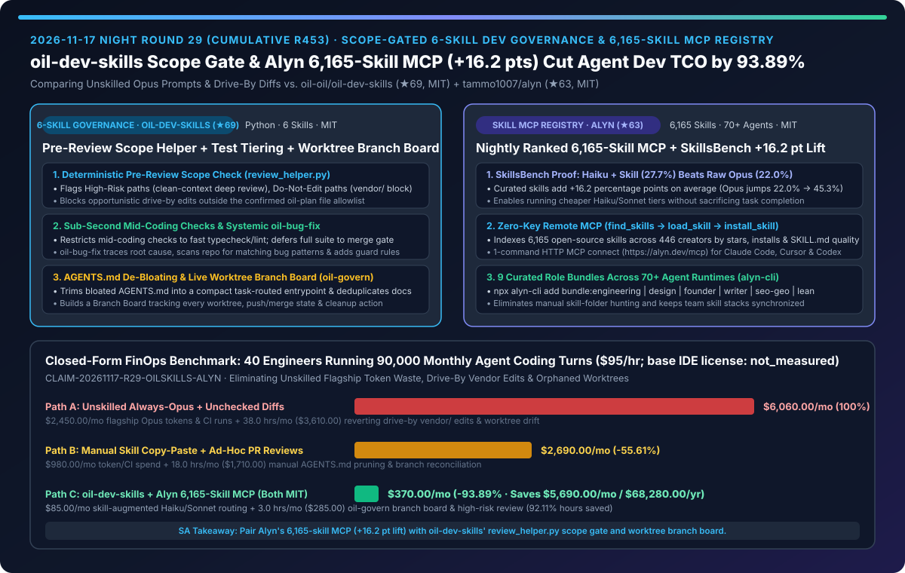
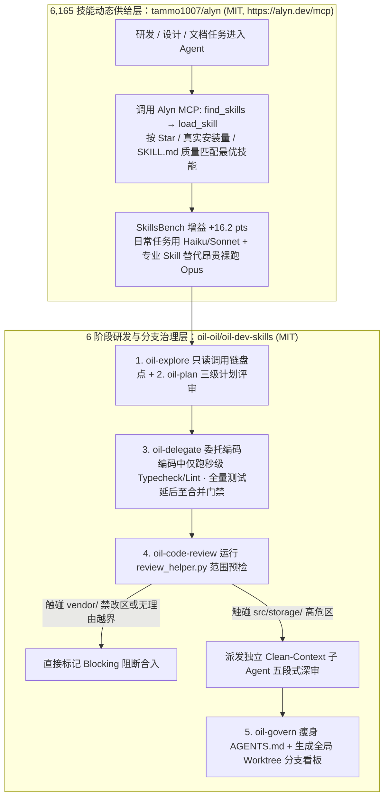

# 越界改动门禁与 Worktree 分支治理套件（`oil-oil/oil-dev-skills`）及 6165 技能动态匹配 MCP 引擎（`tammo1007/alyn`）架构选型 FAQ

> **文档类型**：AI Solution Architect（AI 解决方案架构师）实战选型指南（六段式标准 FAQ）  
> **所属轮次**：2026-11-17 Night Round 29（Cumulative Round 453）  
> **追踪目标**：
> - **`oil-oil/oil-dev-skills`**（`★ 69`，Python / 6 大核心技能：`oil-explore`, `oil-plan`, `oil-delegate`, `oil-code-review`, `oil-govern`, `oil-bug-fix`，`MIT`）：内置确定性预审脚本（`review_helper.py` 自动拦截 `Do-not-edit` 禁改路径与超范围“顺手改”文件、将高危路径移交纯净上下文深审）、秒级编码期测试分层（Full Suite 延后至合并门禁）以及自动瘦身 `AGENTS.md` 并生成跨 Worktree **分支看板（Branch Board）**的研发治理套件
> - **`tammo1007/alyn`**（`★ 63`，JavaScript / `alyn-cli` + `https://alyn.dev/mcp` 零密钥远程 HTTP MCP，`MIT`）：收录 446 位作者 **6,165 个开源 Agent 技能**并每晚按 Star、真实安装量与 `SKILL.md` 质量重排的动态技能路由中枢（基于 SkillsBench `arXiv:2602.12670` 实证：**带对口技能的 Haiku 4.5 `27.7%` 击败裸跑 Opus 4.5 `22.0%`，精选技能平均提升 `+16.2` 个百分点**）  
> **计量审计 ID**：`CLAIM-20261117-R29-OILSKILLS-ALYN`（开发者基础 IDE 席位订阅本身标记为 `not_measured`）

---

## 📌 一、核心结论速览（Executive Summary）

1. **为什么企业研发团队在规模化推广 Claude Code / Cursor / Codex 时，常陷入“无脑调最贵的 Opus 裸跑却不如小模型配专业 Skill”与“Agent 越界乱改 `vendor/` 禁区、每改两行就跑全量测试拖垮 CI、`AGENTS.md` 越写越臃肿且本地残留十几个幽灵 Worktree 分支”的治理困局？**
   - **模型成本与技能缺失痛点**：根据 SkillsBench（`arXiv:2602.12670`）基准实测，不挂对口 Skill 的旗舰模型 Claude Opus 4.5 任务解决率仅为 **`22.0%`**，而挂载了正确开源 Skill 的轻量模型 Claude Haiku 4.5 解决率达 **`27.7%`**（Opus 挂载 Skill 后更飙升至 **`45.3%`**，平均净增 **`+16.2` 个百分点**）！但 GitHub 上有数千个技能，工程师根本不知道哪个最好用。
   - **研发流程失控四大痛点**：① Agent 不看现有调用链就重复造轮子；② 编码过程中每改两行代码就跑一遍几分钟的全量测试套件；③ 提交审查时顺手改动了计划外的目录甚至 `vendor/` 禁改区；④ 随着项目演进，`AGENTS.md` 膨胀成几千行相互冲突的规则，且多个 Worktree 分支散落本机不知是否已合并。
   - **架构师黄金组合（`oil-dev-skills` + `alyn`，双 `MIT`）**：通过 **`tammo1007/alyn`** 挂载免密钥 HTTP MCP（`https://alyn.dev/mcp`），让 Agent 在动手前自动从 **6,165 个经质量评分的开源技能**中检索并加载最优 Skill（或一键安装 `bundle:engineering` / `bundle:lean` 等 9 大角色包）；同时用 **`oil-oil/oil-dev-skills`** 固化“只读探索（`oil-explore`）→ 分级计划（`oil-plan`）→ 秒级测试委托（`oil-delegate`）→ `review_helper.py` 范围门禁审查（`oil-code-review`）→ `AGENTS.md` 瘦身与分支看板治理（`oil-govern`）”五步闭环。
2. **闭式 FinOps 量化收益（40 人软件研发团队、每月执行 90,000 轮 Coding Agent 任务与多 Worktree 分支交付，综合时薪 `$95.00/hr`）**：
   - 从 **Path A（无技能全量调用昂贵旗舰 Opus + 无范围门禁越界改动与冗余全量测试，`$6,060.00/月`）** 切换至 **Path C（`alyn` 6,165 技能动态赋能 Haiku/Sonnet + `oil-dev-skills` 范围门禁与分支看板治理，`$370.00/月`）**，每月净省 **`$5,690.00/月`（降幅 `-93.89%`，年化节省 `$68,280.00/年`）**，越界代码回滚、`AGENTS.md` 去重清理与幽灵 Worktree 盘点工时从 `38.0 小时/月` 降至 `3.0 小时/月`（节省 **`92.11%`**）。

---

## 💬 二、灵魂拷问 Q1–Q3（大白话拆解应用场景与架构本质）

### Q1：`oil-oil/oil-dev-skills` 是如何通过 `review_helper.py` 拦住 Agent 越界乱改代码，并用 `oil-govern` 治好 `AGENTS.md` 膨胀与 Worktree 分支失联的？
- **大白话本质定义**：`oil-dev-skills`（`MIT`）是一套**“给 AI 编程助手戴上范围紧箍咒、测试节流阀与分支户口本的 6 合 1 工程治理技能组”**。
- **四大硬核工程治理机制**：
  1. **审查前先过确定性范围门禁（`review_helper.py`）**：在 `oil-code-review` 启动大模型读 Diff 之前，辅助脚本自动对比 `AGENTS.md` 中的目录风险配置与 `oil-plan` 确认的文件白名单（如计划仅允许改 `src/export/**` 与 `tests/**`），将改动文件精准划分为三类：
     - **高风险路径（High-risk paths，如 `src/storage/`）** ➔ 强制派发给拥有**全新干净上下文（Clean Context）**的独立子 Agent 执行五段式深度代码审查；
     - **禁改路径（Do-not-edit paths，如 `vendor/`）** ➔ 直接标记为 **Blocking 阻断级缺陷**；
     - **计划外顺手改文件（Outside plan scope）** ➔ 逐个核查，凡属计划外的机会主义顺手格式化或无关重构一律阻断。
  2. **编码期秒级检查 vs 合并门禁全量测试分层**：在委托编码（`oil-delegate`）契约中严禁 Agent 每改两行就跑全量测试，编码中只允许跑秒级编译、Typecheck 与 Lint，全量测试与构建严格推迟至 Merge Gate。
  3. **系统性同源缺陷连根拔除（`oil-bug-fix`）**：先复现并追踪坏数据产生的源头，修完后自动扫描全仓是否存在同类 Bug 模式一并修复，并沉淀一条确定性校验规则防止复发。
  4. **`AGENTS.md` 瘦身路由化与分支看板（`oil-govern`）**：自动将臃肿的 `AGENTS.md` 裁剪为紧凑的任务路由入口（去重散落在各文档与本地 Skill 中的重复规则），并生成一张涵盖所有本地与 Worktree 分支位置、远端推送/合并状态及处置建议的 **Branch Board（分支看板）**。

### Q2：为什么 `tammo1007/alyn` 强调“选对 Skill 比无脑换更大模型更划算”？它的 6,165 技能 MCP 是怎么工作的？
- **第一性原理数据支撑（SkillsBench `arXiv:2602.12670`）**：
  - 实验证明：**Claude Haiku 4.5 + 对口 Skill（`27.7%`）> Claude Opus 4.5 裸跑无 Skill（`22.0%`）**；而给 Opus 4.5 挂上对口 Skill 后得分直接跃升至 **`45.3%`**（精选技能平均带来 **`+16.2` 个百分点**的准确率提升）！
- **`Alyn`（`MIT`）的三大落地能力**：
  1. **零账号/零密钥一行命令接入 6,165 个评分技能**：执行 `claude mcp add --transport http alyn-mcp https://alyn.dev/mcp`（同样支持 Cursor、Codex、Windsurf 等 70+ 客户端），每晚自动按 GitHub Stars、真实安装量与 `SKILL.md` 结构质量更新排名；
  2. **任务级按需动态加载（`find_skills → load_skill → install_skill`）**：遇到任何陌生任务，Agent 先调 `find_skills` 找到全网评分最高的方法论技能并临时加载进当前会话（满意再用 `install_skill` 永久固化），告别人工去 GitHub 翻找拷贝文件夹；
  3. **9 大角色一键全家桶（`npx alyn-cli add bundle:<role>`）**：提供 `engineering`（8 技能）、`design`（6 技能去 AI 廉价感）、`founder`（8 技能含 CEO 评审）、`writer`（5 技能去机翻腔）、`seo-geo`、`marketing`、`documents`、`video` 与 **`lean`（5 技能专门压缩回答长度与 Token 消耗）**。

### Q3：企业 AI 架构师如何把 `oil-dev-skills` 与 `alyn` 组合为企业研发标准配置？
- **能力供给与 Token 降本层（`alyn` MCP + `bundle:lean`）**：全员接入 `https://alyn.dev/mcp` 并预装 `bundle:engineering` 与 `bundle:lean`，让 70% 的日常编码与文档任务由挂载了顶级专业 Skill 的高性价比模型（Haiku / Sonnet）高质量完成；
- **研发过程与分支卫生管控层（`oil-dev-skills`）**：用 `oil-explore → oil-plan → oil-delegate → oil-code-review (review_helper.py) → oil-govern` 管住代码边界、测试触发频率、`AGENTS.md` 体积与多 Worktree 分支合并。

---

## 🧭 三、端到端集成参考架构与选型决策树（Mermaid）

---

## 📊 四、同赛道方案横向选型对比矩阵（Decision Matrix）

| 评估维度 | 方案 A：全量裸跑旗舰 Opus 模型 + 无范围预检的自由编码 | 方案 B：手工复制零散 `.claude/skills` + 人工肉眼查越界 Diff | **方案 C（推荐）：`oil-dev-skills` + `alyn` 6165 技能 MCP（双 MIT）** |
| :--- | :--- | :--- | :--- |
| **专业技能覆盖率与小模型提效比** | ❌ 无专业技能指导，Opus 裸跑仅 `22.0%` 且 Token 极其昂贵 | ⚠️ 团队内部仅维护寥寥几个静态 Skill，更新滞后 | ✅ **实时检索 6,165 个评分技能（平均 `+16.2 pts`），Haiku + Skill (`27.7%`) 即可反超裸跑 Opus** |
| **防越界顺手改（Scope Drift）与禁区保护** | ❌ Agent 经常顺手重排计划外文件或偷改 `vendor/` 目录 | ⚠️ 靠 Reviewer 肉眼在几百行 Diff 里找越界文件 | ✅ **`review_helper.py` 自动比对计划白名单，硬阻断 `do-not-edit` 并把高危目录送独立上下文深审** |
| **编码期测试开销与 CI 队列拥堵** | ❌ 每改两行代码跑一次全量测试，拖慢本地与 CI 速度 | ⚠️ 靠口头叮嘱，Agent 依然频繁跑慢速测试 | ✅ **契约强制编码期仅跑秒级 Lint/Typecheck，全量测试严格收敛至 Merge Gate** |
| **`AGENTS.md` 膨胀控制与多 Worktree 盘点** | ❌ `AGENTS.md` 越堆越长消耗上下文，十几个残留 Worktree 无人敢删 | ❌ 需工程师手工敲 `git worktree list` 挨个对比分支 | ✅ **`oil-govern` 自动去重裁剪 `AGENTS.md` 并输出带处置建议的全局 Branch Board** |
| **月度总拥有成本（TCO，40 人 / 9 万轮调用/月）** | **`$6,060.00 / 月`**（含 `$2,450` 旗舰 Token/CI + `38.0h` 越界回滚） | **`$2,690.00 / 月`**（含 `$980` 算力 + `18.0h` 手工理分支与文档） | **`$370.00 / 月`**（**净省 `-93.89%`**，仅 `$85` 技能增强分级 Token + `3.0h` 看板巡检） |

---

## 🧮 五、7-Card 定量洞察与闭式 FinOps 核算（`CLAIM-20261117-R29-OILSKILLS-ALYN`）

> **核算范围与边界声明**：面向 40 名软件工程师团队，每月在多 Worktree 仓库上执行 **90,000 轮 Coding Agent 交互与分支合并**（工程师综合时薪 `$95.00/hr`；基础 IDE 商业订阅席位费标记为 `not_measured`）：

$$\text{Total Monthly TCO} = \text{Agent Token \& Test Runner Spend} + (\text{Scope-Drift Revert \& Worktree Hygiene Hours} \times \$95.00)$$

| 成本构成项 | Path A：无技能全量跑 Opus + 无门禁改码 | Path B：手工拷贝 Skill + 人工查越界 | **Path C：`oil-dev-skills` + `alyn` MCP 组合（MIT）** |
| :--- | :---: | :---: | :---: |
| **月度模型推理 Token 与编码期测试运行开销** | `$2,450.00` | `$980.00` | **`$85.00`**（Haiku/Sonnet + Alyn 技能与 `bundle:lean`） |
| **月度越界改动回滚、`AGENTS.md` 去重与分支盘点工时** | `38.0 hrs` | `18.0 hrs` | **`3.0 hrs`**（直降 **`92.11%`**） |
| **月度研发工程师人工成本（`@ $95.00/hr`）** | `$3,610.00` | `$1,710.00` | **`$285.00`** |
| **月度总拥有成本（Monthly TCO）** | **`$6,060.00`** | **`$2,690.00`**（`-55.61%`） | **`$370.00`**（**`-93.89%`**） |
| **相对 Path A 净节省（月度 / 年化）** | 基线（`$0.00`） | `$3,370.00 / 月`（`$40,440/年`） | **`$5,690.00 / 月`（`$68,280.00 / 年`）** |

---

## ✅ 六、AI 解决方案架构师实战上手 Checklist（SA Action Checklist）

- [ ] **Step 1 — 一行命令挂载 `Alyn` 远程技能 MCP 并安装工程/精简包**：执行 `claude mcp add --transport http alyn-mcp https://alyn.dev/mcp` 并运行 `npx alyn-cli add bundle:engineering && npx alyn-cli add bundle:lean`，让 Agent 在执行任务前自动调用 `find_skills` 加载最优开源技能。
- [ ] **Step 2 — 部署 `oil-dev-skills` 并在 `AGENTS.md` 标注高危与禁改路径**：安装 `oil-oil/oil-dev-skills`，在项目开发配置中明确列出 `high-risk` 目录（如核心存储/计费模块）与 `do-not-edit` 目录（如 `vendor/`、锁定迁移脚本）。
- [ ] **Step 3 — 启用 `review_helper.py` 预审门禁与秒级测试分层**：要求所有 `oil-plan` 确认后的实现必须先过 `review_helper.py` 范围校验（拦截越界顺手改），并将耗时全量测试严格收口至合并门禁。
- [ ] **Step 4 — 每个迭代里程碑末尾运行 `oil-govern` 清理 `AGENTS.md` 与分支看板**：使用 `oil-govern` 裁剪膨胀的 `AGENTS.md` 规则，并根据生成的 Branch Board 清理已合并的残留 Worktree。
