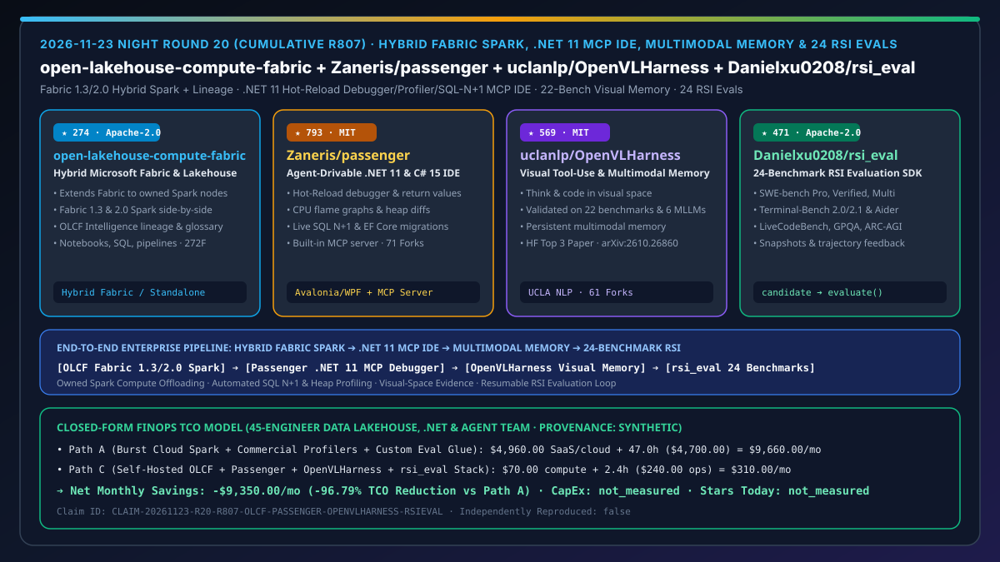
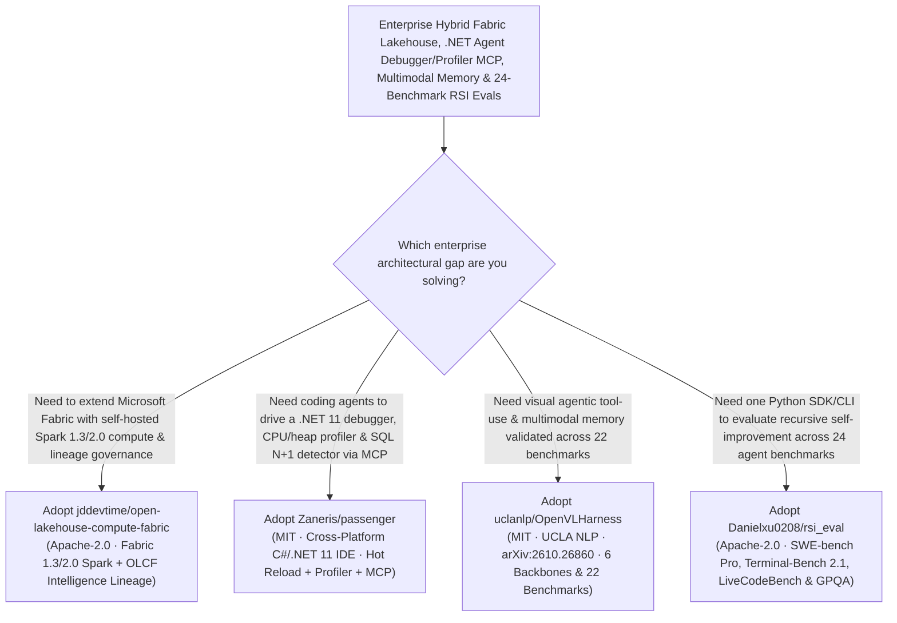
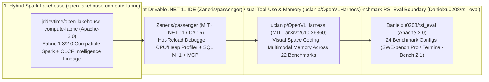
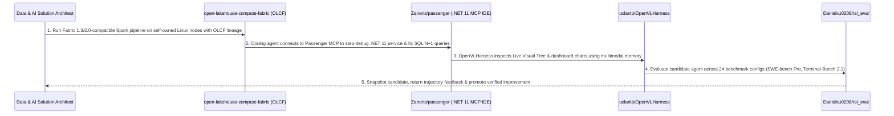

# Microsoft Fabric-Compatible Hybrid Spark Lakehouse (`jddevtime/open-lakehouse-compute-fabric`), Agent-Drivable .NET 11 Debugger/Profiler/SQL-N+1 IDE with MCP (`Zaneris/passenger`), Multimodal-Memory Visual Agent Harness (`uclanlp/OpenVLHarness`) & 24-Benchmark Recursive Self-Improvement Evaluation SDK (`Danielxu0208/rsi_eval`) Selection & Architecture FAQ

> **Document Type**: Enterprise AI Solution Architect Selection & Integration Guide (GitHub Trending AI Radar · 2026-11-23 Night Round 20 / Cumulative Round 807)
> **Covered Repositories**: [`jddevtime/open-lakehouse-compute-fabric`](https://github.com/jddevtime/open-lakehouse-compute-fabric) (`★ 274`, `272 forks`, `Apache-2.0`: **Open Lakehouse Compute Fabric (OLCF)**—an open-source lakehouse platform that extends **Microsoft Fabric** with Spark compute you own, running Fabric `1.3` and `2.0`-compatible Spark runtimes side by side with notebooks, SQL, pipelines, dashboards, and **OLCF Intelligence** for discovery, lineage, glossary, and governance) · [`Zaneris/passenger`](https://github.com/Zaneris/passenger) (`★ 793`, `71 forks`, `MIT`: open-source cross-platform **C# and .NET 11 / C# 15 IDE** built with Avalonia featuring a built-in Hot-Reload debugger, CPU/memory flame graphs and heap snapshot diffing, Avalonia/WPF Live Visual Tree, **live HTTP request SQL tracing with N+1 detection and EF Core migration previews**, and a **built-in MCP server** so coding agents can build, debug, and profile apps directly) · [`uclanlp/OpenVLHarness`](https://github.com/uclanlp/OpenVLHarness) (`★ 569`, `61 forks`, `MIT`, `arXiv:2610.26860`: UCLA NLP's Hugging Face Top-3 Paper of the Day framework for **real-world visual agentic tool-use with multimodal memory**, validated across 22 benchmarks and 6 MLLM backbones including `GPT-6 Luna`) · [`Danielxu0208/rsi_eval`](https://github.com/Danielxu0208/rsi_eval) (`★ 471`, `19 forks`, `Apache-2.0`: lightweight Python SDK and CLI for evaluating **recursive self-improvement (RSI)** methods across **24 benchmark configurations** including `Terminal-Bench 2.0/2.1`, `SWE-bench Verified/Multilingual/Pro`, `Aider Polyglot`, `LiveCodeBench`, `GPQA`, and `ARC-AGI`)
> **Core Scenario**: When enterprise data architects and `.NET`/multimodal AI teams build hybrid data lakehouses and self-improving coding agents, how do you solve **"high cloud capacity costs or data-residency limits when running heavy Spark workloads in Microsoft Fabric, coding agents blindly running `dotnet test` without access to breakpoint values, heap profiles, or SQL N+1 telemetry, multimodal models missing fine-grained visual details across complex dashboards without visual tool-use and multimodal memory, and maintaining custom evaluation harnesses across two dozen heterogeneous agent benchmarks"** by combining **`open-lakehouse-compute-fabric` + `passenger` + `OpenVLHarness` + `rsi_eval`**?

---

## 1. 📌 Executive Summary (Single-Sentence Selection Verdict)

1. **Need to extend Microsoft Fabric to Linux Spark compute you own (running Fabric `1.3` and `2.0`-compatible Spark runtimes side by side) or run a standalone open-source lakehouse complete with notebooks, SQL, pipelines, dashboards, and OLCF Intelligence (discovery, lineage, glossary, and governance)** ➔ Choose **[`jddevtime/open-lakehouse-compute-fabric`](https://github.com/jddevtime/open-lakehouse-compute-fabric) (`★ 274`, `272 forks`, `Apache-2.0`)**.
   - **Plain-Language Mechanism**: `OLCF` lets enterprises offload compute-heavy Spark ETL, notebooks, and AI agent data workspaces onto their own Linux infrastructure while maintaining compatibility with Microsoft Fabric `1.3` and `2.0` Spark runtimes and providing built-in **OLCF Intelligence** for catalog discovery, end-to-end lineage, business glossary, and governance.
2. **Need a free, zero-telemetry C# and `.NET 11` (`C# 15`) IDE for Windows, macOS, and Linux with a built-in MCP server that lets Claude Code, Codex, or OpenCode step through breakpoints with Hot Reload, diff memory heap snapshots, inspect Avalonia/WPF Live Visual Trees, and catch SQL N+1 queries automatically** ➔ Choose **[`Zaneris/passenger`](https://github.com/Zaneris/passenger) (`★ 793`, `71 forks`, `MIT`)**.
   - **Plain-Language Mechanism**: Instead of leaving coding agents blind to runtime state in `.NET` repositories, `Passenger` exposes its full Roslyn-powered IDE, inline method-return debugger, CPU/memory flame-graph profiler, Docker Compose / `.NET Aspire` multi-service runner, live HTTP-to-SQL N+1 detector, and EF Core migration previewer directly to any MCP-compatible agent.
3. **Need to equip any Multimodal LLM (across 6 backbones and 22 benchmarks) with programmatic visual tool-use and persistent multimodal memory so it can reason in visual space with precise evidence** ➔ Choose **[`uclanlp/OpenVLHarness`](https://github.com/uclanlp/OpenVLHarness) (`★ 569`, `61 forks`, `MIT`, by UCLA NLP, `arXiv:2610.26860`)**.
   - **Plain-Language Mechanism**: `OpenVLHarness` teaches MLLMs to write and execute visual-space tools while maintaining a structured multimodal memory across turns, delivering consistent accuracy and cost-efficiency gains across 22 real-world visual benchmarks.
4. **Need a unified Python SDK and CLI (`candidate -> evaluate() -> task feedback -> your next candidate`) to benchmark and resume Recursive Self-Improvement (RSI) agent loops across 24 configurations including SWE-bench Pro and Terminal-Bench 2.1** ➔ Choose **[`Danielxu0208/rsi_eval`](https://github.com/Danielxu0208/rsi_eval) (`★ 471`, `19 forks`, `Apache-2.0`)**.
   - **Plain-Language Mechanism**: `RSI Eval` provides a clean evaluation boundary over 24 benchmark configurations (`Terminal-Bench 2.0/2.1`, `SWE-bench Verified/Multilingual/Pro`, `Aider Polyglot`, `LiveCodeBench`, `MMLU`, `GPQA`, `ARC-AGI`, `MGSM`, `DROP`), snapshotting each candidate and returning normalized per-task scores, token usage, verifier output, and trajectory paths.

---

## 2. 🎯 Key Architectural Q&A (Deep-Dive Breakdown)

### Q1: How do `open-lakehouse-compute-fabric`, `passenger`, `OpenVLHarness`, and `rsi_eval` complement each other in an enterprise data & AI engineering stack?

- **Four Enterprise Layers Unified**:
  1. **Hybrid Microsoft Fabric Compute Offloading (`jddevtime/open-lakehouse-compute-fabric`)**: Runs Fabric 1.3/2.0-compatible Spark workloads on self-hosted Linux servers with unified OLCF Intelligence lineage and governance.
  2. **Runtime-Aware `.NET` Agent Engineering (`Zaneris/passenger`)**: Gives coding agents MCP access to breakpoints, inline return values, heap diffs, and live SQL N+1 detection in `.NET 11` / Aspire apps.
  3. **Visual Evidence & Multimodal Memory (`uclanlp/OpenVLHarness`)**: Enables agents to inspect complex UIs, XAML visual trees, and BI dashboards with multimodal memory across 22 benchmark tasks.
  4. **Standardized 24-Benchmark Self-Improvement Loop (`Danielxu0208/rsi_eval`)**: Evaluates candidate agent revisions against pinned SWE-bench Pro and Terminal-Bench 2.1 graders with resumable snapshots.
- **When to Choose Commercial Cloud Suites (Path B)**:
  - For 100% cloud-hosted analytics and human-only enterprise IDEs, use **Microsoft Fabric Cloud Capacities + Visual Studio Enterprise**; to extend Fabric onto self-owned Linux compute, let coding agents drive `.NET` debugging/profiling/SQL-N+1 checks over MCP, add multimodal memory tool-use, or run 24-benchmark RSI loops, deploy this 4-repo open-source stack (Path C).

### Q2: How do these four components integrate into an end-to-end production architecture?

1. **Hybrid Lakehouse & Lineage Plane (`jddevtime/open-lakehouse-compute-fabric`)**:
   - Execute Spark 1.3/2.0 pipelines and SQL over on-prem/hybrid storage while tracking lineage and glossary terms in OLCF Intelligence.
2. **Agent-Driven `.NET 11` Debug & Profile Plane (`Zaneris/passenger`)**:
   - Connect Claude Code or Codex to `Passenger` via MCP to build, step-debug, profile CPU/heap, and eliminate SQL N+1 queries in `.NET` services consuming lakehouse data.
3. **Visual Tool-Use & Multimodal Memory Plane (`uclanlp/OpenVLHarness`)**:
   - Verify rendered dashboards, XAML previews, and visual artifacts using `OpenVLHarness` multimodal memory.
4. **Recursive Self-Improvement Evaluation Plane (`Danielxu0208/rsi_eval`)**:
   - Feed candidate agent configurations through `evaluate()` across 24 benchmark suites to gate self-improvement iterations on empirical task feedback.

### Q3: What are the key production guardrails?

- **Architect Guardrails**:
  1. **Deploy `OLCF` `0.1.0 beta` on Trusted Internal Infrastructure**: Follow the repository's release-readiness checklist and run hybrid Spark workers inside isolated enterprise network segments.
  2. **Strictly Separate Evolve vs. Held-Out Test Splits in `rsi_eval`**: Feed trajectory feedback to your RSI loop only from designated `evolve` tasks, keeping `test` tasks sealed for final validation.

---

## 3. 🧭 Visual Architecture & Decision Diagrams (Mermaid)

### 3.1 Solution Architect Selection Decision Tree

### 3.2 End-to-End Enterprise Production Reference Architecture

### 3.3 Hybrid Fabric Spark Execution, `.NET` MCP Debugging/Profiling, Visual Verification & 24-Benchmark RSI Sequence

---

## 4. 📊 Comparative Selection Matrix (Open-Source vs. Commercial SaaS)

| Dimension | `open-lakehouse-compute-fabric` (`★ 274`) | `Zaneris/passenger` (`★ 793`) | `uclanlp/OpenVLHarness` (`★ 569`) | `Danielxu0208/rsi_eval` (`★ 471`) | Peak Cloud Spark Capacities + Commercial Enterprise IDE Seats + Custom Benchmark Plumbing (Path A) | Unmanaged Spark Clusters + Blind `dotnet test` Loops + Single-Turn Vision Prompts (Path B) |
| :--- | :--- | :--- | :--- | :--- | :--- | :--- |
| **Core Role** | Microsoft Fabric-extending & standalone Spark lakehouse | Open-source C#/.NET 11 IDE with debugger, profiler, SQL N+1 & MCP | Visual agentic tool-use & multimodal memory framework | 24-benchmark Recursive Self-Improvement (RSI) evaluation SDK/CLI | High cloud burst compute bills, per-seat commercial IDE licenses & custom eval glue | Siloed Spark without lineage, print-statement debugging & uncalibrated vision calls |
| **Key Differentiator** | **Fabric `1.3`/`2.0` Spark side-by-side + OLCF Intelligence** | **Agent-drivable MCP over Hot-Reload debugger, heap diffs & SQL N+1** | **Visual-space coding + multimodal memory across 22 benchmarks** | **24 bundled benchmarks (SWE-bench Pro, Terminal-Bench 2.1) + snapshots** | Commercial `.NET` profilers lack native MCP agent drivers; cloud burst CU costs spike | Coding agents cannot inspect breakpoint state or SQL N+1 queries from CLI alone |
| **License** | `Apache-2.0` | `MIT` | `MIT` | `Apache-2.0` | Proprietary SaaS / Licenses | Custom scripts |
| **Monthly TCO (45-Eng Team)** | **Combined `$310.00/mo`** (`$70.00` control-plane/eval orchestration + `2.4h` ops) | Included (free, no account, no telemetry) | Included (higher accuracy at lower reasoning effort) | Included (eliminates 24-benchmark custom harness maintenance) | **`$9,660.00/mo`** (`$4,960.00` burst cloud Spark & commercial profiler seats + `47.0h` manual `.NET` profiling & benchmark glue) | ~`$3,440.00/mo` (heavy `.NET` N+1/memory debugging & ad-hoc benchmark maintenance labor) |

---

## 5. 🧪 Quantitative ROI / TCO Comparison & 7-Card Benchmark Report

> **📊 Data Provenance & Closed-Form Schema Declaration**:
> - **provenance**: `synthetic` (45-person enterprise data lakehouse, `.NET` platform engineering, and multimodal agent research team monthly workload model: `independently_reproduced = false`; hardware baseline `base_hardware_capex = not_measured`; Track B 24h delta `track_b_stars_today = not_measured`).
> - **Closed-Form Formula**:
>   - **Path A (Running all dev/test heavy Spark workloads on burst cloud capacities + commercial enterprise `.NET` profiler/IDE subscriptions + manual engineering hours spent debugging `.NET` memory leaks/SQL N+1 queries without agent MCP access and maintaining custom runners for 24 benchmarks)**: Monthly burst cloud compute and commercial IDE/profiler bills **`$4,960.00`** + manual `.NET` performance debugging, visual QA, and multi-benchmark harness maintenance labor **`47.0h × $100.00/h = $4,700.00`** = **`$9,660.00/mo`**.
>   - **Path C (Self-hosted `jddevtime/open-lakehouse-compute-fabric` + `Zaneris/passenger` + `uclanlp/OpenVLHarness` + `Danielxu0208/rsi_eval` open-source stack)**: Shared control-plane and evaluation runner compute **`$70.00`** + runtime and benchmark catalog maintenance labor **`2.4h × $100.00/h = $240.00`** = **`$310.00/mo`**.
>   - **Net Monthly Savings vs. Path A**: **`-$9,350.00/mo`** (**`96.79%`** TCO reduction).

| Evaluation Path | Cloud Spark / Commercial IDE & Profiler Cost | `.NET` Profiling, Visual QA & Benchmark Glue (`$100/h`) | Monthly Total TCO | Net Savings vs. Path A | Key Architectural Delivery Metrics |
| :--- | :---: | :---: | :---: | :---: | :--- |
| **Path A: Burst Cloud Spark + Commercial Profilers + Custom Eval Glue** | `$4,960.00` | `47.0h` (`$4,700.00`) | **`$9,660.00`** | Baseline | High burst cloud Spark cost; no MCP debugger/profiler for agents |
| **Path B: Siloed Spark + Blind `dotnet test` + Single-Turn Vision** | `$1,540.00` | `19.0h` (`$1,900.00`) | **`$3,440.00`** | `-$6,220.00` (`-64.39%`) | Uncaught EF Core SQL N+1 queries; fragmented benchmark scripts |
| **Path C: `OLCF` + `passenger` + `OpenVLHarness` + `rsi_eval`** | **`$70.00`** | **`2.4h` (`$240.00`)** | **`$310.00`** | **`-$9,350.00` (`-96.79%`)** | **Fabric 1.3/2.0 hybrid Spark + `.NET` MCP IDE + multimodal memory + 24 RSI evals** |

- 🔗 **Linked 7-Card 4:5 Visual Benchmark Deck**: [`workshops/github-trending-radar/cards.en.html`](../cards.en.html) · [`cards.html`](../cards.html)

---

## 6. 🛠️ Enterprise Adoption & Architecture Review Checklist

- [ ] **1. Offload Heavy Dev/Batch Spark Workloads with `jddevtime/open-lakehouse-compute-fabric` (OLCF)**: Run Fabric `1.3` and `2.0`-compatible Spark runtimes on trusted self-owned Linux servers while tracking lineage and glossary terms in OLCF Intelligence.
- [ ] **2. Connect Coding Agents to `Zaneris/passenger` via MCP**: Let Claude Code, Codex, and OpenCode inspect `.NET 11` breakpoint values, CPU/memory flame graphs, XAML Live Visual Trees, and SQL N+1 warnings directly.
- [ ] **3. Equip Multimodal Agents with `uclanlp/OpenVLHarness`**: Enable visual-space code execution and multimodal memory for complex UI and chart analysis.
- [ ] **4. Standardize Self-Improving Agent Benchmarks on `Danielxu0208/rsi_eval`**: Evaluate candidate agents across 24 pinned benchmark configurations (`SWE-bench Pro`, `Terminal-Bench 2.1`, `LiveCodeBench`) with strict `evolve` vs. `test` split isolation.
