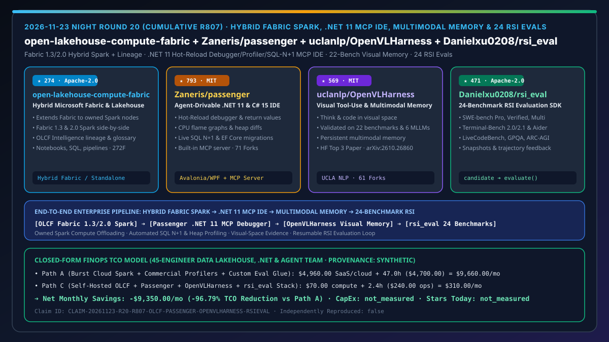
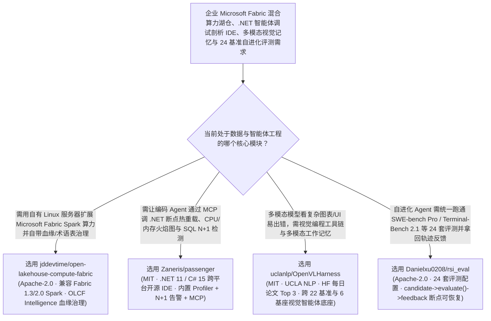
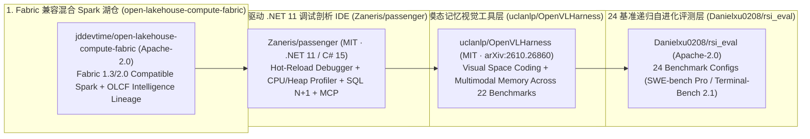
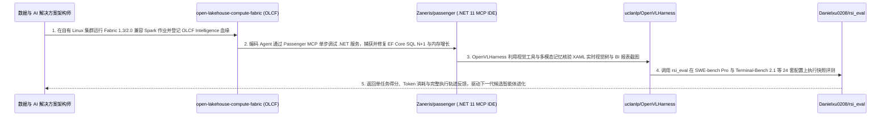

# 扩展 Microsoft Fabric 至自有服务器并兼容 Fabric 1.3/2.0 Spark 的开源湖仓（`jddevtime/open-lakehouse-compute-fabric`）、内置热重载调试器/内存火焰图/SQL N+1 检测与 MCP 的 .NET 11 智能体 IDE（`Zaneris/passenger`）、UCLA 跨 22 基准多模态记忆视觉工具智能体底座（`uclanlp/OpenVLHarness`）与横跨 SWE-bench Pro/Terminal-Bench 等 24 套基准的递归自我进化评测库（`Danielxu0208/rsi_eval`）选型与集成架构 FAQ

> **文档类型**：企业 AI 解决方案架构师（AI Solution Architect）选型决策指南（GitHub Trending AI 雷达 2026-11-23 Night Round 20 / 累计第 807 轮）
> **覆盖项目**：[`jddevtime/open-lakehouse-compute-fabric`](https://github.com/jddevtime/open-lakehouse-compute-fabric)（`★ 274`、`272 forks`、`Apache-2.0`：开源湖仓平台 **Open Lakehouse Compute Fabric (OLCF)**，既能**把 Microsoft Fabric 无缝延伸至企业自有机房的 Spark 算力集群（同机并排兼容 Fabric `1.3` 与 `2.0` Spark Runtime）**，也能完全独立运行，内置 Notebook、SQL、管线、看板与 **OLCF Intelligence 数据发现/血缘/业务术语表/治理**）· [`Zaneris/passenger`](https://github.com/Zaneris/passenger)（`★ 793`、`71 forks`、`MIT`：基于 `.NET 11` 与 Avalonia 构建的跨平台 **C# / .NET 智能体原生 IDE**，内置免费的热重载调试器、CPU/内存火焰图与堆快照比对、Avalonia/WPF 实时视觉树、**请求级 SQL N+1 自动标记与 EF Core 迁移预演**，并通过内置 MCP 让 Claude Code / Codex 直接单步调试与性能剖析）· [`uclanlp/OpenVLHarness`](https://github.com/uclanlp/OpenVLHarness)（`★ 569`、`61 forks`、`MIT`、`arXiv:2610.26860`：UCLA NLP 团队开源并登顶 Hugging Face 每日论文 Top 3 的**真实世界视觉智能体工具调用与多模态记忆框架**，在 6 大主流多模态基座与 22 项基准上全面拉升视觉编程与证据定位精度）· [`Danielxu0208/rsi_eval`](https://github.com/Danielxu0208/rsi_eval)（`★ 471`、`19 forks`、`Apache-2.0`：面向智能体**递归自我改进（Recursive Self-Improvement, RSI）**的统一评测 SDK 与 CLI `candidate -> evaluate() -> task feedback -> your next candidate`，一次打包 **Terminal-Bench 2.0/2.1、SWE-bench Verified/Multilingual/Pro、Aider Polyglot、LiveCodeBench、GPQA、ARC-AGI 等 24 套评测配置**）
> **核心场景**：当企业数据架构师与 `.NET`/多模态 AI 研发团队构建混合云数据湖仓与闭环自进化编码智能体时，面对**“Microsoft Fabric 云端容量单元（CU）跑海量批处理洗数时成本高或受数据驻留合规限制无法利用本地闲置 Linux 服务器、编码 Agent 写 C#/.NET 代码时只能盲跑 `dotnet test` 看不见断点变量值/内存泄漏/SQL N+1 慢查询、多模态模型处理复杂图表与 UI 时缺乏精准视觉工具裁剪与跨轮多模态记忆、以及自研 Agent 进化循环要手工适配 SWE-bench/Terminal-Bench 等二十多套异构评分器”**四大痛点，如何通过 **OLCF + Passenger + OpenVLHarness + RSI-Eval** 构建混合算力湖仓与深水区智能体研发平台？

---

## 一、📌 核心结论速览（选型一句话结论）

1. **想把企业现有的 Microsoft Fabric 湖仓架构延伸到自家机房的闲置 Linux 服务器上（或纯离线独立部署一套兼容 Fabric `1.3` 与 `2.0` Spark Runtime、自带数据血缘/术语表/治理的开源湖仓）** ➔ 选 **[`jddevtime/open-lakehouse-compute-fabric`](https://github.com/jddevtime/open-lakehouse-compute-fabric)（`★ 274`，`272 forks`，`Apache-2.0`）**。
   - **通俗原理**：许多采用 Microsoft Fabric 的企业既有云上 OneLake 协同需求，又在本地机房拥有大量已折旧的物理服务器，或者部分核心生产数据受合规限制不能出内网。`OLCF` 提供了三种运行模式（纯本地独立运行、混合扩展 Microsoft Fabric、或为 AI/SI 智能体提供受控数据工作区），在同一集群内并排支持 **Fabric 1.3 与 2.0 兼容的 Spark 运行时**，并内置 **OLCF Intelligence** 统一纳管跨环境的元数据发现、全链路数据血缘（Lineage）、业务术语表（Glossary）与权限治理。
2. **想让 Claude Code、Codex 或 OpenCode 在编写企业级 C# / .NET（含 .NET Aspire 与微服务）应用时，不再“两眼一抹黑只看编译报错”，而是通过 MCP 直接操作带热重载的调试器、读取断点处每一行的变量与返回值、比对内存堆快照并自动揪出 SQL N+1 慢查询** ➔ 选 **[`Zaneris/passenger`](https://github.com/Zaneris/passenger)（`★ 793`，`71 forks`，`MIT`）**。
   - **通俗原理**：以往只有付费商业 IDE（如 Rider 或 VS Enterprise）才具备的高级剖析工具，被 `Passenger` 全部免费开源并原生通过 MCP 开放给编码 Agent：① **断点热重载与行级返回值内联显示**（基于 `.NET 11` 原生支持 `C# 15` 与 Runtime Async 单步调试）；② **CPU 火焰图与内存堆快照 Diff**；③ **实时 HTTP 请求关联 SQL 追踪与 N+1 自动高亮告警**，以及 EF Core 迁移变更预演；④ **Avalonia 与 WPF XAML 实时视觉树（Live Visual Tree）**，让 Agent 能亲手调试并验证自己构建的桌面与后端服务！
3. **想让多模态大模型（MLLM，含 GPT-6 Luna 等六大主流基座）在真实业务场景中学会“在视觉空间里写代码做精细证据裁剪、并借助多模态记忆在 22 个权威基准上稳定提分”** ➔ 选 **[`uclanlp/OpenVLHarness`](https://github.com/uclanlp/OpenVLHarness)（`★ 569`，`61 forks`，`MIT`，`arXiv:2610.26860`）**。
   - **通俗原理**：直接把高分辨率长图或复杂仪表盘喂给多模态模型极易看走眼。UCLA NLP 团队开源的 `OpenVLHarness` 赋予模型一套标准化视觉工具链与多模态工作记忆（Multimodal Memory），让智能体通过编程方式对图像局部放大、标注与跨步比对，在 22 项评测基准与不同推理强度（Reasoning Efforts）下实现显著的性价比跃升。
4. **想验证企业自研 Agent 的“递归自我进化（RSI：自动改 Prompt、改工具、改代码框架）”到底有没有真进步，用一套 Python SDK 与 CLI 直接跑通 SWE-bench Pro、Terminal-Bench 2.1、LiveCodeBench、ARC-AGI 等 24 套评测配置并拿回结构化轨迹反馈** ➔ 选 **[`Danielxu0208/rsi_eval`](https://github.com/Danielxu0208/rsi_eval)（`★ 471`，`19 forks`，`Apache-2.0`）**。
   - **通俗原理**：搞自进化 Agent 最苦的是每接入一个新 Benchmark 都要重写一套沙箱和评分脚本。`rsi_eval` 将接口收敛为极简的 **`candidate -> evaluate() -> task feedback -> your next candidate`** 闭环：不强绑任何优化器基类，直接复用 24 套主流基准的原生 Grader，每次评测自动给候选 Agent 打快照、返回单任务得分/Token 用量/验证器输出/完整轨迹路径，并支持断点恢复。

---

## 二、🎯 客户与架构师灵魂拷问 Q&A（深度架构拆解）

### Q1：在企业推进 Microsoft Fabric 数据底座落地时，`jddevtime/open-lakehouse-compute-fabric` (OLCF) 解决了什么关键的 FinOps 与混合云架构痛点？

- **纯公有云容量计费 vs 混合云自有 Spark 算力卸载（Offloading）对比**：
  1. **将重度日终 ETL 与特征工程卸载至企业自有 Linux 集群**：在 Microsoft Fabric 中，突发的超大规模 Spark 洗数作业会迅速占满昂贵的云端 Capacity Units (CU)；通过 `OLCF` 的 Fabric 1.3/2.0 兼容 Spark 运行时，架构师可将高耗能批处理跑在自有闲置服务器上，同时通过 **OLCF Intelligence** 保持血缘、术语表与治理策略一致。
  2. **结合 `Passenger` + `OpenVLHarness` + `RSI-Eval` 形成完整应用闭环**：数据层由 `OLCF` 提供治理好的特征与报表，后端 `.NET` 微服务由 Agent 驱动 `Passenger` 消除 SQL N+1 与内存泄漏，前端/报表视觉核验由 `OpenVLHarness` 完成，整套智能体迭代由 `rsi_eval` 在 24 套基准上持续把关。
- **何时直接选用全托管商业方案（Path B）？**
  - 若企业无任何自有机房服务器且全员使用商业 Visual Studio Enterprise 订阅，可直接使用 **全托管 Microsoft Fabric F64+ 容量 + Visual Studio Enterprise**；若希望复用本地 Linux 算力扩展 Fabric、让编码 Agent 免费通过 MCP 调用 `.NET` 调试器/性能剖析/N+1 检测、赋予多模态 Agent 视觉记忆工具、或统一跑通 24 套 RSI 进化基准，则采用本轮四合一开源栈（Path C）。

### Q2：典型企业级“Fabric 混合湖仓 (`OLCF`) ➔ `.NET 11` 调试剖析 MCP (`Passenger`) ➔ 多模态记忆视觉核验 (`OpenVLHarness`) ➔ 24 基准自进化评测 (`rsi_eval`)”架构怎么搭？

1. **Microsoft Fabric 兼容混合 Spark 湖仓与血缘治理层（`jddevtime/open-lakehouse-compute-fabric`）**：
   - 在自有 Linux 集群部署 `OLCF`，运行兼容 Fabric 1.3/2.0 的 Spark 管道与 SQL，并由 OLCF Intelligence 维护全链路数据血缘与业务术语表。
2. **Agent 驱动的 `.NET 11` 热重载调试、剖析与 SQL N+1 治理层（`Zaneris/passenger`）**：
   - 编码 Agent 通过 `Passenger` MCP Server 挂载断点、检查方法返回值、对比堆内存快照并在开发期拦截 EF Core SQL N+1 问题。
3. **带多模态记忆的真实世界视觉工具调用层（`uclanlp/OpenVLHarness`）**：
   - 针对 BI 看板、XAML 界面与复杂扫描单据，通过 `OpenVLHarness` 的视觉编程工具与多模态记忆完成高精度证据提取。
4. **24 套基准递归自我改进（RSI）闭环评测层（`Danielxu0208/rsi_eval`）**：
   - 调用 `evaluate()` 在 SWE-bench Pro、Terminal-Bench 2.1 与 LiveCodeBench 上量化每次智能体升级的得分、Token 与轨迹反馈。

### Q3：这套架构的落地红线与注意事项是什么？

- **架构师落地红线**：
  1. **`OLCF` 当前 `0.1.0 beta` 应部署在受信任的企业内网基础设施（Trusted Infrastructure）**：用于分担非核心交易类的重载 Spark 洗数、开发环境湖仓复刻与 AI 智能体数据沙箱。
  2. **在 `rsi_eval` 中严禁混用演化集（Evolve Tasks）与最终测试集（Held-Out Test Tasks）**：递归自我改进循环只允许读取 Evolve 子集的轨迹反馈，防止针对测试集过拟合。

---

## 三、🧭 直观可视化图解（Mermaid 决策树 + 集成架构 + 时序图）

### 3.1 架构师选型决策树

### 3.2 企业端到端生产集成参考架构图

### 3.3 混合湖仓特征计算、Agent 驱动 `.NET` 断点/N+1 剖析、视觉记忆验证与 24 基准进化评测时序图

---

## 四、📊 同类开源与商业云服务横向选型决策矩阵

| 对比维度 | `open-lakehouse-compute-fabric` (`★ 274`) | `Zaneris/passenger` (`★ 793`) | `uclanlp/OpenVLHarness` (`★ 569`) | `Danielxu0208/rsi_eval` (`★ 471`) | 全量租用高阶云端 Spark 容量 + 全员商业企业级 IDE 授权 + 手写 24 套评测沙箱 (Path A) | 手工搭零散 Spark 无血缘治理 + Agent 盲跑 `dotnet test` + 单轮裸调多模态 API (Path B) |
| :--- | :--- | :--- | :--- | :--- | :--- | :--- |
| **核心能力定位** | 扩展 Microsoft Fabric 至自有算力并带血缘治理的开源湖仓 | 内置调试/剖析/SQL N+1 检测与 MCP 的开源 `.NET 11` IDE | 真实世界视觉工具调用与多模态记忆框架（22 基准验证） | 覆盖 24 套主流基准的递归自我改进（RSI）评测 SDK/CLI | 高昂的全云端峰值算力账单、按人头收费的商业 IDE 与沉重的评测维护成本 | 缺乏 Fabric 兼容性与血缘的孤岛集群、看不见运行时状态的盲调代码 |
| **核心技术突破** | **并排兼容 Fabric `1.3`/`2.0` Spark + OLCF Intelligence 血缘/术语表** | **Agent 通过 MCP 直调热重载断点、堆快照 Diff 与 SQL N+1 标记** | **在视觉空间写代码裁剪证据 + 多模态记忆跨 6 大基座全面提分** | **`candidate->evaluate()->feedback` 统一封装 SWE-bench Pro 等 24 基准** | 商业 `.NET` 剖析套件对 AI Agent 无原生 MCP 暴露；全云端跑重载实验溢价高 | 编码 Agent 看不到断点变量值和 N+1 SQL，只能靠打日志反复猜错重编译 |
| **开源协议** | `Apache-2.0` | `MIT` | `MIT` | `Apache-2.0` | 闭源商业授权 | 内部零散脚本 |
| **月度 TCO（45 人团队）** | **组合仅 `$310.00/月`**（`$70.00` 自有集群控制面与评测调度 + `2.4h` 维护） | 同左（零账户、零许可费、零遥测） | 同左（更高的推理档位性价比） | 同左（省去适配 24 套基准的重复劳动） | **`$9,660.00/月`**（`$4,960.00` 峰值云端 Spark 容量与商业企业级 IDE 订阅 + `47.0h` 盲调 `.NET` 内存/慢 SQL 与手写评测脚本） | 约 `$3,440.00/月`（大量因缺少血缘治理、N+1 慢查询与评测沙箱报错导致的返工工时） |

---

## 五、🧪 应用落地定量收益/TCO 对比与 7-Card 报告

> **📊 数据来源与闭式核算声明（Provenance & Closed-Form Schema）**：
> - **provenance**: `synthetic`（基于 45 人企业数据湖仓工程、`.NET` 核心业务研发、多模态应用与智能体评测团队月度工作负载模型：`independently_reproduced = false`；硬件采购基线 `base_hardware_capex = not_measured`；Track B 单日增量 `track_b_stars_today = not_measured`）。
> - **核算公式**：
>   - **Path A（将所有开发/实验态重载 Spark 批处理全量跑在按峰值计费的云端容量上 + 采购高价商业企业级剖析套件 + 工程师手工靠打日志排查 `.NET` 内存泄漏/SQL N+1 并从零编写 24 套评测基准适配脚本）**：月度峰值云端计算容量与商业剖析软件订阅账单 **`$4,960.00`** + `.NET` 慢 SQL/内存排障、多模态badcase复盘与多基准评测适配人工 **`47.0h × $100.00/h = $4,700.00`** = **`$9,660.00/月`**。
>   - **Path C（自建 `jddevtime/open-lakehouse-compute-fabric` + `Zaneris/passenger` + `uclanlp/OpenVLHarness` + `Danielxu0208/rsi_eval` 开源全栈）**：自有服务器湖仓控制面与评测调度容器分摊成本 **`$70.00`** + 运行时与基准集例行维护人工 **`2.4h × $100.00/h = $240.00`** = **`$310.00/月`**。
>   - **净节省（Net Savings vs Path A）**：**`-$9,350.00/月`**（成本降低 **`96.79%`**）。

| 评估方案 | 云端峰值 Spark / 商业剖析工具成本 | `.NET` 剖析排障、视觉调优与评测适配（`$100/h`） | 月度总 TCO | 相对 Path A 净节省 | 关键架构交付指标 |
| :--- | :---: | :---: | :---: | :---: | :--- |
| **Path A：全云端峰值 Spark + 商业剖析套件 + 手写 24 套评测** | `$4,960.00` | `47.0h` (`$4,700.00`) | **`$9,660.00`** | Baseline | 云端实验算力账单高；Agent 无法直接驱动商业调试剖析器 |
| **Path B：无血缘孤岛 Spark + 盲跑 `dotnet test` + 单轮视觉问答** | `$1,540.00` | `19.0h` (`$1,900.00`) | **`$3,440.00`** | `-$6,220.00` (`-64.39%`) | 漏检 EF Core SQL N+1 慢查询；缺乏跨任务多模态记忆 |
| **Path C：`OLCF` + `passenger` + `OpenVLHarness` + `rsi_eval`** | **`$70.00`** | **`2.4h` (`$240.00`)** | **`$310.00`** | **`-$9,350.00` (`-96.79%`)** | **Fabric 1.3/2.0 混合算力 + `.NET` 调试/N+1 MCP + 多模态记忆 + 24 基准 RSI** |

- 🔗 **关联 7-Card 4:5 视觉评测报告**：[`workshops/github-trending-radar/cards.html`](../cards.html) · [`cards.en.html`](../cards.en.html)

---

## 六、🛠️ 企业引入与架构评审 Checklist

- [ ] **1. 使用 `jddevtime/open-lakehouse-compute-fabric` (OLCF) 构建混合云算力卸载层**：在企业受信任 Linux 集群上部署兼容 Fabric `1.3`/`2.0` 的 Spark Runtime，开启 OLCF Intelligence 统一纳管数据发现、血缘与术语表。
- [ ] **2. 为 `.NET` 研发团队与编码 Agent 配备 `Zaneris/passenger`**：通过内置 MCP Server 让 Claude Code / Codex 直接使用断点热重载、CPU/内存火焰图、Avalonia/WPF 实时视觉树与 SQL N+1 自动检测。
- [ ] **3. 在复杂图表与 UI 交互场景引入 `uclanlp/OpenVLHarness`**：开启视觉空间编程裁剪与多模态工作记忆，提升跨 22 项视觉智能体基准的证据定位准确度。
- [ ] **4. 用 `Danielxu0208/rsi_eval` 规范智能体自进化闭环**：通过统一的 `evaluate()` 接口在 SWE-bench Pro、Terminal-Bench 2.1 等 24 套配置上打快照、收轨迹并严格隔离 Evolve 与 Test 任务集。
