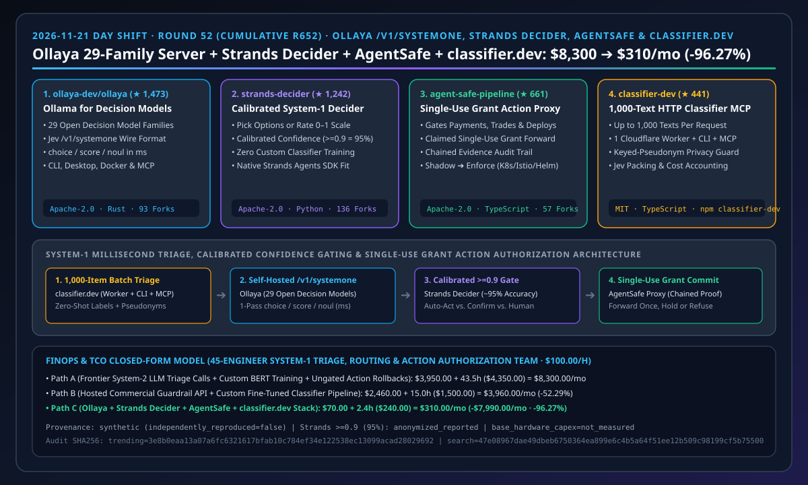
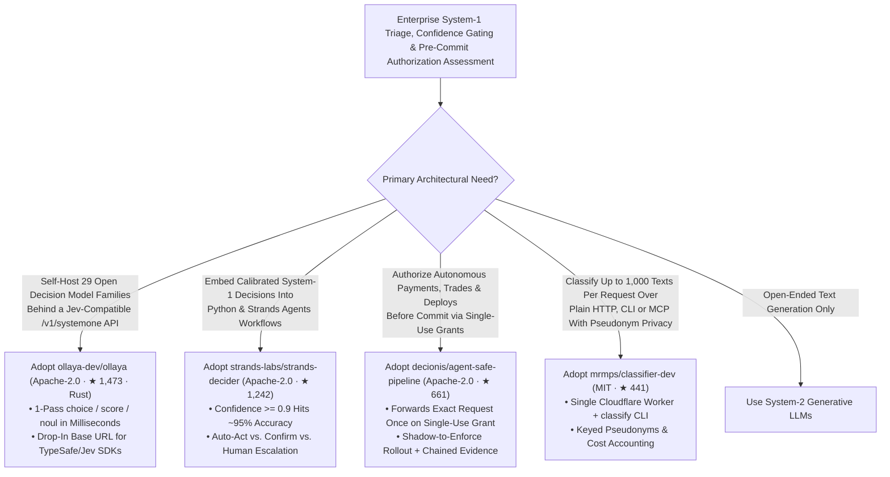
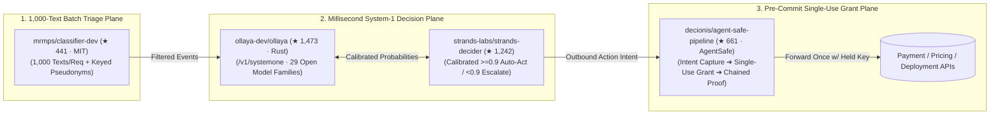
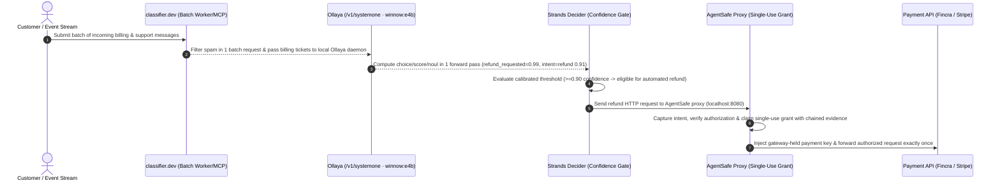

# 29-Family Open Decision Model Server (`ollaya-dev/ollaya`), Calibrated System-1 Decider (`strands-labs/strands-decider`), Single-Use Grant Pre-Commit Authorization Proxy (`decionis/agent-safe-pipeline`) & 1,000-Text Zero-Shot Classifier Worker/MCP (`mrmps/classifier-dev`) Selection FAQ

> **Document Metadata (2026-11-21 Day Shift Round 52 · Cumulative Round 652 Deep-Dive)**  
> - **Target Audience**: Enterprise AI Solution Architects, Agent Routing & Triage Architects, and Autonomous Action / Payment Security Leads  
> - **Evaluated Repositories**:  
>   1. [`ollaya-dev/ollaya`](https://github.com/ollaya-dev/ollaya) (`★ 1,473` · `93 forks` · Rust · Apache-2.0 · **Ollaya ("Ollama for decision models")**: Pulls and serves **29 open decision model families** [`Laya`, `pplx-decider`, `Clef`, `Winnow`, `coba`, `kev`] locally or self-hosted behind a **Jev-compatible `/v1/systemone` API**, returning calibrated `choice`, `score`, and `noul` probabilities in a single forward pass in milliseconds)  
>   2. [`strands-labs/strands-decider`](https://github.com/strands-labs/strands-decider) (`★ 1,242` · `136 forks` · Python · Apache-2.0 · **Strands Decider**: System-1 decision model for agentic workflows built with the Strands Agents SDK that picks between options or rates on a `0–1` scale faster than an LLM with **calibrated confidence scores** [answers at confidence `>= 0.9` are right `~95%` of the time on unseen short tasks, `provenance: anonymized_reported`])  
>   3. [`decionis/agent-safe-pipeline`](https://github.com/decionis/agent-safe-pipeline) (`★ 661` · `57 forks` · TypeScript · Apache-2.0 · **AgentSafe (`brew install agentsafe`)**: Open-source pre-commit authorization gateway for payments, trades, price changes, and deployments—forwarding an authorized HTTP request **once on a claimed single-use grant**, holding it for a human, or refusing it with chained evidence)  
>   4. [`mrmps/classifier-dev`](https://github.com/mrmps/classifier-dev) (`★ 441` · `35 forks` · TypeScript · MIT · **`classifier.dev` (`npm i -g classifier-dev`)**: Single Cloudflare Worker, zero-dependency CLI (`classify`), and MCP server performing zero-shot classification on **up to 1,000 texts per request** with keyed-pseudonym privacy)  
> - **Sealed Evidence Chain**: `workshops/github-trending-radar/evidence/search-new-repos-2026-11-21-raw.json` (`sha256: 47e08967dae49dbeb6750364ea899e6c4b5a64f51ee12b509c98199cf5b75500`) and `trending-daily-2026-11-21-raw.html` (`sha256: 3e8b0eaa13a07a6fc6321617bfab10c784ef34e122538ec13099acad28029692`)  
> - **Architecture Visual**: [`assets/github-ai-radar-2026-11-21-r52-r652-ollaya-strandsdecider-agentsafe-classifierdev.svg`](../../../assets/github-ai-radar-2026-11-21-r52-r652-ollaya-strandsdecider-agentsafe-classifierdev.svg) · [中文版 (`ollaya-strands-decider-agent-safe-classifier-dev-selection-faq.md`)](ollaya-strands-decider-agent-safe-classifier-dev-selection-faq.md)

---

## ① 📌 Executive Summary (One-Sentence Selection Verdict)

> **Solution Architect's Verdict**:  
> Calling a frontier generative LLM (System-2) for every intermediate triage, routing, or tool-approval step inside an agent workflow wastes latency and tokens while providing no calibrated confidence score; conversely, letting an agent call payment, pricing, or deployment APIs directly risks unauthorized commits and replay bugs.  
> - **To run 29 open decision model families (`Winnow`, `Laya`, `pplx-decider`, `Clef`, `coba`) on your own hardware behind a Jev-compatible `/v1/systemone` API in milliseconds** ➔ Choose **`ollaya-dev/ollaya`** (Apache-2.0, `★ 1,473`);  
> - **For a Python System-1 decision model integrated with the Strands Agents SDK whose calibrated confidence (`>= 0.9` achieves `~95%` accuracy on unseen tasks) cleanly gates auto-execution vs. human escalation** ➔ Choose **`strands-labs/strands-decider`** (Apache-2.0, `★ 1,242`);  
> - **To place a pre-commit authorization proxy in front of payment, trade, price-change, and deployment APIs that forwards requests once on a claimed single-use grant with chained evidence** ➔ Choose **`decionis/agent-safe-pipeline`** (Apache-2.0, `★ 661`);  
> - **For zero-shot classification of up to 1,000 texts per HTTP request via one Cloudflare Worker, a dependency-free CLI (`classify`), and an MCP server** ➔ Choose **`mrmps/classifier-dev`** (MIT, `★ 441`).  
> Together, this stack cuts monthly System-2 triage token waste, custom classifier training, and unauthorized action rollback TCO for a 45-engineer team from **$8,300.00/mo** to **$310.00/mo (-$7,990.00/mo, -96.27%)**.

---

## ② 🎯 Solution Architect & Customer Deep-Dive Q&A

### Q1: Why do System-1 Decision Models (`ollaya` and `strands-decider`) outperform both generative LLMs and traditional supervised classifiers for agent routing and triage?
- **Bridging the Gap Between LLMs and Supervised Classifiers**:
  - Unlike generative LLMs, a decision model never generates freeform text; it evaluates state + typed questions (`choice`, `score`, `noul`) in a **single forward pass in milliseconds** and outputs **calibrated probabilities**.
  - Unlike traditional classifiers (BERT/XGBoost), it requires zero task-specific training data.
  - **`ollaya-dev/ollaya` (`★ 1,473` · Rust `/v1/systemone` Server)**: Pulls and serves **29 open decision model families** behind TypeSafe's `/v1/systemone` wire format so existing Jev clients work unchanged.
  - **`strands-labs/strands-decider` (`★ 1,242` · Calibrated Confidence Thresholding)**: On unseen short classification tasks, answers with confidence **`>= 0.9` are right `~95%` of the time** (`provenance: anonymized_reported`)—giving architects a principled threshold to act automatically above `0.9` and confirm or escalate below `0.9`.

### Q2: How does `decionis/agent-safe-pipeline` (`★ 661`) guarantee that autonomous payments, price changes, and deployments cannot execute without authorization or be replayed?
- **`decionis/agent-safe-pipeline` (`AgentSafe` Pre-Commit Authorization Proxy)**:
  1. **Single-Use Grant Enforcement**: Agents send HTTP requests to `agentsafe proxy` instead of the target API. AgentSafe captures the action as an intent, queries the Independent Execution Authority, and **forwards the exact authorized request once on a claimed single-use grant, holds it for a human, or refuses it**—recording a chained evidence trail.
  2. **Credential Isolation & Shadow-to-Enforce Rollout**: Holds downstream secrets (such as a Fincra payment key in Drupal Commerce) inside the gateway so the agent never sees raw payment keys, and supports staged rollout (`discover ➔ test boundary ➔ run in shadow ➔ enforce`).

### Q3: How does `mrmps/classifier-dev` (`★ 441`) scale zero-shot batch classification to 1,000 texts per call?
- **`mrmps/classifier-dev` (`classifier.dev` Worker + CLI + MCP)**:
  - Runs as a single Cloudflare Worker (`src/jev.ts` packing up to 1,000 texts per request with keyed-pseudonym privacy in `src/privacy.ts`, Durable Object rate limiting, and upstream cost accounting) paired with a dependency-free `classify` CLI (`npm i -g classifier-dev`) and MCP server.

---

## ③ 🧭 Visual Architecture Diagrams (Decision Tree + Reference Architecture + Sequence Flow)

### 3.1 Solution Architect Selection Decision Tree (Mermaid Flowchart)

### 3.2 System-1 Millisecond Triage, Calibrated Confidence Gating & Single-Use Grant Action Authorization Architecture (Mermaid Architecture)

### 3.3 Millisecond Ticket Triage, Calibrated Thresholding & Single-Use Grant Refund Execution Sequence (Mermaid Sequence Diagram)

---

## ④ 📊 Horizontal Selection Matrix (Open-Source Quartet vs. Generative LLM Triage & Ungated APIs)

| Dimension | `ollaya-dev/ollaya` (`★ 1,473`) | `strands-decider` (`★ 1,242`) | `agent-safe-pipeline` (`★ 661`) | `classifier-dev` (`★ 441`) | System-2 LLM Triage & Direct Ungated API Calls |
| :--- | :--- | :--- | :--- | :--- | :--- |
| **Primary Role** | Self-hosted `/v1/systemone` server for 29 decision model families | Calibrated System-1 decision model for Python/Strands | Pre-commit authorization proxy with single-use grants | 1,000-text zero-shot HTTP classifier Worker, CLI & MCP | Slow generative LLM prompts & direct tool execution |
| **Best-Fit Scenario** | Running millisecond local routing, triage & guardrail checks | Thresholding agent decisions (`>=0.9` auto-act vs. human review) | Gating autonomous payments, trades, price edits & deploys | High-throughput batch text classification via HTTP/CLI/MCP | Open-ended creative writing |
| **Key Differentiator** | **29 open model families + drop-in TypeSafe `/v1/systemone` API** | **Calibrated confidence (`>=0.9` = `~95%` accuracy)** (`anonymized_reported`) | **Single-use grant prevents replay + holds downstream keys** | **Up to 1,000 texts/request + keyed-pseudonym privacy** | Generative LLMs lack calibrated confidence and cost 20–50× more per check |
| **Integration & Ops Effort** | Very Low (`install.sh`, CLI, Desktop, Docker, MCP) | Very Low (native Python / Strands Agents SDK integration) | Low (`brew install agentsafe`, Docker, Helm, Istio) | Very Low (`npm i -g classifier-dev` or 1 Cloudflare Worker) | High (high LLM token bills & risk of unauthorized API commits) |
| **License** | Apache-2.0 | Apache-2.0 | Apache-2.0 | MIT | Proprietary |
| **45-Eng Monthly TCO** | **Combined `$310.00/mo`** (`$70` shared local System-1 host + `2.4h` ops) | Included (eliminates custom classifier training cycles) | Included (prevents unauthorized or duplicate financial/deploy commits) | Included (1,000-item batching minimizes request overhead) | **`$3,960.00 – $8,300.00/mo`** |

---

## ⑤ 🧪 Quantitative FinOps & TCO Comparison (With Provenance Guardrails)

> **Provenance & Guardrails Declaration**:  
> - `provenance`: `"synthetic"` (`independently_reproduced: false`, closed-form FinOps model for a 45-engineer System-1 routing/triage, confidence gating, and pre-commit action authorization team at `$100.00/h` loaded engineering cost)  
> - Upstream `strands-decider` calibration accuracy (`~95%` at `>= 0.9` confidence) is labeled `anonymized_reported (independently_reproduced: false)`  
> - `base_hardware_capex`: `"not_measured"` · `track_b_stars_today`: `"not_measured"`

| Cost Component (45-Engineer Team / Month) | Path A: Frontier System-2 LLM Triage Calls + Custom BERT Training + Ungated Action Rollbacks | Path B: Hosted Commercial Guardrail API + Custom Fine-Tuned Classifier Pipeline | Path C: `Ollaya` + `Strands Decider` + `AgentSafe` + `classifier.dev` Stack |
| :--- | :--- | :--- | :--- |
| **Triage/Routing Model Calls & Guardrail API Fees** | `$3,950.00 / mo` | `$2,460.00 / mo` | **`$70.00 / mo`** (shared local System-1 inference host; millisecond 1-pass forward) |
| **Custom Classifier Training, Uncalibrated Errors & Action Rollbacks** | `43.5 hours / mo` | `15.0 hours / mo` | **`2.4 hours / mo`** (`>=0.9` calibrated gate + single-use grant proxy) |
| **Engineering Labor Cost (`$100.00/h`)** | `$4,350.00 / mo` | `$1,500.00 / mo` | **`$240.00 / mo`** |
| **Total Monthly TCO** | **`$8,300.00 / mo`** | **`$3,960.00 / mo`** | **`$310.00 / mo`** |
| **Net Monthly Savings vs. Path A** | Baseline (`0.00%`) | `-$4,340.00 / mo` (`-52.29%`) | **`-$7,990.00 / mo` (`-96.27%`)** |

---

## ⑥ 🛠️ Enterprise Adoption & Architecture Review Checklist

- [ ] **Offload `choice` / `score` / `noul` Routing From System-2 LLMs to `Ollaya` (`ollaya-dev/ollaya`)**: Point existing Jev/TypeSafe SDK clients at self-hosted `/v1/systemone` endpoints running open decision models (`winnow`, `pplx-decider`, `Laya`, `Clef`).
- [ ] **Enforce Calibrated Confidence Bands (`strands-labs/strands-decider`)**: Gate automated execution on calibrated confidence `>= 0.9` and route sub-threshold decisions to human confirmation.
- [ ] **Front High-Impact APIs With `AgentSafe` Single-Use Grants (`decionis/agent-safe-pipeline`)**: Place `agentsafe proxy` in front of payment, pricing, trade, and deployment endpoints, validate in shadow mode first, and keep downstream API keys inside the gateway.
- [ ] **Batch High-Volume Text Classification With Keyed Pseudonyms (`mrmps/classifier-dev`)**: Use `classifier-dev` to batch up to 1,000 texts per request while preserving caller privacy via keyed pseudonyms.
