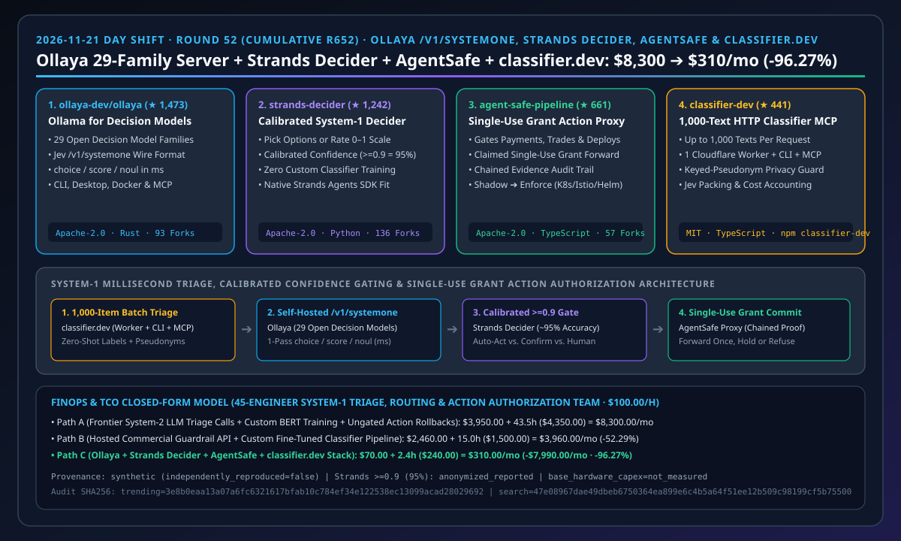
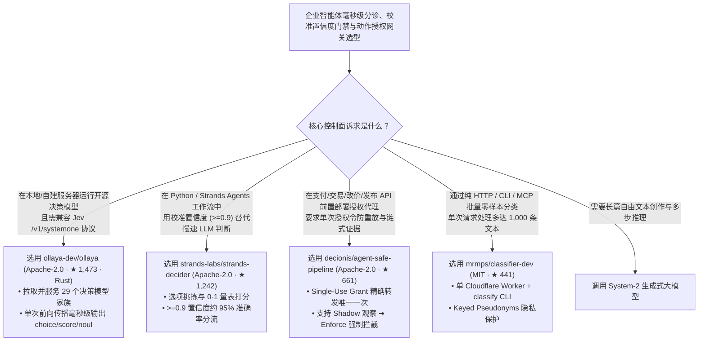
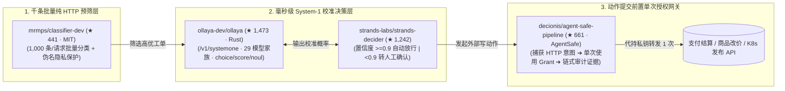
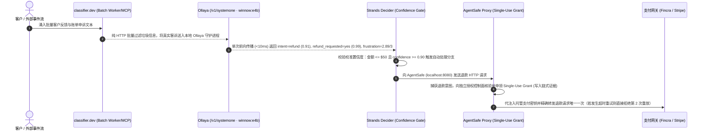

# 29 家族开源决策模型本地服务（`ollaya-dev/ollaya`）、校准置信度 System-1 决策器（`strands-labs/strands-decider`）、单次授权令动作提交前置网关（`decionis/agent-safe-pipeline`）与千条批量零样本分类 Worker/MCP（`mrmps/classifier-dev`）选型 FAQ

> **文档元数据（2026-11-21 白班 Day Round 52 · 累计第 652 轮深潜专题）**  
> - **面向对象**：企业 AI 解决方案架构师（AI Solution Architect）、智能体路由与分诊系统架构师、金融交易/支付/生产发布安全控制面负责人  
> - **本轮核心评估对象**：  
>   1. [`ollaya-dev/ollaya`](https://github.com/ollaya-dev/ollaya)（`★ 1,473` · `93 forks` · Rust · Apache-2.0 · **Ollaya——“决策模型界的 Ollama”**：在自有硬件上拉取并运行 **29 个开源决策模型家族**[`Laya`、`pplx-decider`、`Clef`、`Winnow`、`coba`、`kev` 等]，暴露与 TypeSafe Jev 完全兼容的 **`/v1/systemone`** 接口，单次前向传播毫秒级输出 `choice`、`score`、`noul` 校准概率）  
>   2. [`strands-labs/strands-decider`](https://github.com/strands-labs/strands-decider)（`★ 1,242` · `136 forks` · Python · Apache-2.0 · **Strands Decider**：面向 Strands Agents SDK 工作流的轻量级 **System-1 决策模型**，无需训练专用分类器即可比 LLM 更快地完成选项挑选与 `0–1` 评分，且附带**校准可靠性分数**[未见短分类任务上置信度 `>= 0.9` 时准确率达 `~95%`，`provenance: anonymized_reported`]）  
>   3. [`decionis/agent-safe-pipeline`](https://github.com/decionis/agent-safe-pipeline)（`★ 661` · `57 forks` · TypeScript · Apache-2.0 · **AgentSafe（`brew install agentsafe`）**：挡在智能体每次外部动作[支付、结算、交易、改价、部署]生效前的开源授权网关——将 HTTP 请求捕获为意图并凭**单次使用授权令（Single-Use Grant）仅转发一次**、挂起等待人工或直接拒绝，留下链式证据链）  
>   4. [`mrmps/classifier-dev`](https://github.com/mrmps/classifier-dev)（`★ 441` · `35 forks` · TypeScript · MIT · **`classifier.dev`（`npm i -g classifier-dev`）**：由单个 Cloudflare Worker、零依赖 CLI（`classify`）与 MCP Server 组成的纯 HTTP 零样本分类器，支持**单次请求批量分类多达 1,000 条文本**、密钥化伪名隐私保护与逐请求成本核算）  
> - **关联检索证据链**：`workshops/github-trending-radar/evidence/search-new-repos-2026-11-21-raw.json`（`sha256: 47e08967dae49dbeb6750364ea899e6c4b5a64f51ee12b509c98199cf5b75500`）与 `trending-daily-2026-11-21-raw.html`（`sha256: 3e8b0eaa13a07a6fc6321617bfab10c784ef34e122538ec13099acad28029692`）  
> - **高清架构图**：[`assets/github-ai-radar-2026-11-21-r52-r652-ollaya-strandsdecider-agentsafe-classifierdev.svg`](../../../assets/github-ai-radar-2026-11-21-r52-r652-ollaya-strandsdecider-agentsafe-classifierdev.svg) · [English Version (`ollaya-strands-decider-agent-safe-classifier-dev-selection-faq.en.md`)](ollaya-strands-decider-agent-safe-classifier-dev-selection-faq.en.md)

---

## ① 📌 核心结论速览（选型一句话结论）

> **架构师一句话选型结论**：  
> 在企业智能体工作流中，90% 的中间节点其实根本不需要调用昂贵且缓慢的 **System-2 生成式大模型（LLM）** 去写一段话，而只需要回答**“这张工单选哪个部门（`choice`）？用户愤怒程度几分（`score`）？是否请求退款（`noul`）？置信度够不够 0.9 自动放行？”**！如果用旗舰 LLM 做这些高频判断，不仅延迟高、成本贵，而且前沿 LLM API 根本不返回经过校准的可靠性概率（Calibrated Confidence）！  
> - **需要在自有硬件上像用 Ollama 跑大模型一样，通过兼容 Jev `/v1/systemone` 协议的本地 Rust 守护进程毫秒级拉取并运行 29 个开源决策模型家族（`winnow`、`pplx-decider`、`Laya` 等）** ➔ 选 **`ollaya-dev/ollaya`**（Apache-2.0，`★ 1,473`）；  
> - **需要在 Python 与 Strands Agents SDK 中引入具备校准置信度（`>= 0.9` 时准确率约 `95%`，低于阈值自动转人工确认）的 System-1 决策模型** ➔ 选 **`strands-labs/strands-decider`**（Apache-2.0，`★ 1,242`）；  
> - **需要通过单个 Cloudflare Worker、零依赖 CLI 或 MCP 单次批量对多达 1,000 条文本执行纯 HTTP 零样本分类** ➔ 选 **`mrmps/classifier-dev`**（MIT，`★ 441`）；  
> - **需要在智能体真正执行付款、交易、改价或生产发布 API 之前，通过独立执行授权面签发“单次使用授权令（Single-Use Grant）”并留存防篡改链式证据（支持先 Shadow 影子观察再 Enforce 强制拦截）** ➔ 选 **`decionis/agent-safe-pipeline`**（Apache-2.0，`★ 661`）。  
> 四者组合可将 45 人智能体路由分诊与生产安全控制团队的 System-2 大模型分诊 Token 浪费、自训传统 BERT 分类器工时及越权动作回滚总成本从 **$8,300.00/月** 降至 **$310.00/月（节省 $7,990.00/月，降幅 96.27%）**。

---

## ② 🎯 客户与架构师灵魂拷问 Q&A（业务痛点 · 架构集成 · 边界取舍）

### Q1：什么是“决策模型（Decision Model / System-1 Model）”？为什么它在智能体路由、工单分诊和护栏审批上能同时打败“生成式大模型（LLM）”和“传统自训 BERT 分类器”？
- **卡在 LLM 与传统分类器之间的黄金生态位**：
  - **对比传统分类器（BERT/XGBoost）**：传统分类器每换一个业务标签就要收集几千条标注数据重新训练；而决策模型（如 `strands-decider` 与 `ollaya` 托管的 29 个模型家族）支持**零样本/动态给定任意选项（`choice`）、区间打分（`score`）或二元判断（`noul`）**，免去标注与训练周期。
  - **对比生成式大模型（System-2 LLM）**：决策模型**绝不自回归生成自由文本**，而是在**单次前向传播（Single Forward Pass）**中直接输出经过校准的概率分布，耗时仅需**几毫秒**！
  - **校准置信度分流（Calibrated Reliability）**：`strands-labs/strands-decider` 实测表明，在从未见过的短文本分类任务上，当其输出置信度 **`>= 0.9` 时准确率高达约 `95%`**（`provenance: anonymized_reported`）——架构师可据此设定硬门禁：`>= 0.9` 自动执行（Act automatically），`< 0.9` 降级要求确认或转交人工（Confirm / Send to human）。

### Q2：如果企业出于数据隐私不想调云端 Jev API，如何把现有的 TypeSafe / Jev 客户端代码一行不改地切到本地开源决策模型？`ollaya-dev/ollaya`（`★ 1,473`）与 `mrmps/classifier-dev`（`★ 441`）怎么配合？
- **`ollaya-dev/ollaya`（`★ 1,473` · Rust 编写的 Jev `/v1/systemone` 兼容开源决策模型服务器）**：
  1. **零代码迁移**：实现了完整的 TypeSafe `/v1/systemone` 线协议，现有的 TypeSafe SDK 与 Jev 客户端只需将 `base_url` 指向本地 Ollaya 并指定开源模型名（支持 `Laya`、`pplx-decider`、`Clef`、`Winnow`、`coba`、`kev` 等 **29 个模型家族**）即可原样运行；
  2. **多问题单次前向并发回答**：例如一行 `ollaya run winnow:e4b --preset triage "..."` 即可在数毫秒内同时算出 `intent (0.91)`、`is_urgent (0.92)`、`frustration (2.89/3)`、`refund_requested (0.99)` 与 `churn_risk (0.99)`。
- **`mrmps/classifier-dev`（单 Cloudflare Worker + `classify` CLI + MCP 批量分类器）**：
  - 提供极简 URL/Query 零样本分类接口（单次请求最高支持 **1,000 条文本**批量打包至 `src/jev.ts`），内置 `src/privacy.ts` 密钥化伪名（Keyed Pseudonyms，确保日志绝不反指调用方）与每 15 分钟异常告警。

### Q3：就算决策模型算出了置信度，当智能体准备调用真实的支付接口（如 Fincra）、修改电商商品价格或触发 K8s 生产发布时，如何从网络网关层确保“未授权动作绝不落盘、已授权动作绝不被重放第二次”？
- **`decionis/agent-safe-pipeline`（`★ 661` · `AgentSafe` 动作提交前置授权网关）**：
  1. **意图捕获与单次使用授权令（Single-Use Grant）**：智能体不再直连目标业务 API，而是将 HTTP 请求发给 `agentsafe proxy`；网关将其捕获为结构化意图（Intent）并向独立执行授权控制面请求裁决——获批后凭**单次使用授权令（Claimed Single-Use Grant）精确转发唯一一次**，严防重放扣款！
  2. **先影子（Shadow）再强制（Enforce）的平滑上线路径**：支持先在旁路 Shadow 模式下观察暴露面并记录链式审计证据（Chained Evidence），验证无误后再切为 Enforce 模式；甚至在 Drupal Commerce 等电商场景下由网关直接托管支付密钥（如 Fincra Key），让 Agent 进程本身完全碰不到支付私钥。

---

## ③ 🧭 直观可视化图解（选型决策树 + 企业集成架构 + 业务流时序图）

### 3.1 架构师选型决策树（Mermaid Flowchart）

### 3.2 企业“批量分类预筛 + Ollaya/Strands 毫秒级校准决策 + AgentSafe 单次授权网关”架构图（Mermaid Architecture）

### 3.3 工单毫秒级多维分诊、置信度阈值分流与单次授权令退款执行时序图（Mermaid Sequence Diagram）

---

## ④ 📊 同类开源与商业云服务横向选型决策矩阵

| 评估维度 | `ollaya-dev/ollaya` (`★ 1,473`) | `strands-decider` (`★ 1,242`) | `agent-safe-pipeline` (`★ 661`) | `classifier-dev` (`★ 441`) | 调 System-2 大模型做分类 + 裸调支付 API |
| :--- | :--- | :--- | :--- | :--- | :--- |
| **核心定位** | 兼容 Jev `/v1/systemone` 的 29 家族开源决策模型服务 | 面向 Strands 工作流的校准置信度 System-1 决策模型 | 动作生效前的单次授权令（Single-Use Grant）安全代理 | 单 Worker + CLI + MCP 的千条批量零样本分类器 | 用生成式大模型回答 Yes/No + Agent 直持支付私钥 |
| **最适用场景** | 自托管运行 `Winnow`/`Laya`/`Clef` 等决策模型做毫秒级分诊与护栏 | 在 Python Agent 循环中按 `>=0.9` 校准置信度决定自动执行或转人工 | 在支付、交易、改价、部署 API 前置强制执行单次授权与链式取证 | 通过 `curl`、CLI 或 MCP 零配置完成大批量文本分类 | 极低频、对延迟和账单不敏感的原型 |
| **关键差异化机制** | **兼容 TypeSafe `/v1/systemone` 协议 + 29 个开源模型家族即拉即跑** | **校准置信度（`>=0.9` 约 `95%` 准确）**，弥补前沿 LLM 无校准概率短板 | **Single-Use Grant 防重放 + 网关代持支付密钥 + Shadow/Enforce** | **单次请求 1,000 条文本 + Keyed Pseudonyms 隐私脱敏** | LLM 每次分类耗数百毫秒与高额 Token；Agent 直持私钥极易越权或重放 |
| **集成与运维成本** | 极低（`install.sh` 一键安装 CLI/桌面端/Docker/MCP） | 极低（Python 包直接嵌入 Strands Agents SDK） | 低（Homebrew / Linux / Docker / Helm 一键代理 `--upstream`） | 极低（`npm i -g classifier-dev` 或单 Cloudflare Worker 部署） | 高（System-2 Token 浪费与自训 BERT 的标注/运维负担） |
| **开源协议** | Apache-2.0 | Apache-2.0 | Apache-2.0 | MIT | 商业专有 |
| **45 人团队月均 TCO** | **组合方案 `$310.00/月`**（含共享本地 System-1 推理节点 `$70` + 运维 `2.4h`） | 同左（免去标注数据与训练传统分类器的人力） | 同左（阻断未授权或重复提交的资金/生产事故） | 同左（批量打包省去逐条请求开销） | **`$3,960.00 ~ $8,300.00/月`** |

---

## ⑤ 🧪 应用落地定量收益 / FinOps TCO 对比（含数据血缘声明）

> **数据血缘与严谨性声明（Provenance & Guardrails）**：  
> - `provenance`: `"synthetic"`（`independently_reproduced: false`，基于 45 人智能体路由分诊、System-1 门禁与高风险动作授权团队在 `$100.00/h` 综合人力成本下的闭式参数建模）  
> - 上游 `strands-decider` 的 `>= 0.9` 置信度对应 `~95%` 准确率指标严格标注为 `anonymized_reported (independently_reproduced: false)`  
> - `base_hardware_capex`: `"not_measured"` · `track_b_stars_today`: `"not_measured"`

| 成本分项（45 人团队 / 月） | Path A：全用 System-2 大模型做二元分诊 + 自训维护传统分类器 + 越权动作回滚 | Path B：商业托管护栏 API + 自建微调分类流水线 | Path C：`Ollaya` + `Strands Decider` + `AgentSafe` + `classifier.dev` 栈 |
| :--- | :--- | :--- | :--- |
| **分诊/路由模型调用账单与商业护栏 API 费用** | `$3,950.00 / 月` | `$2,460.00 / 月` | **`$70.00 / 月`**（共享本地 System-1 决策模型节点，毫秒级单次前向推理） |
| **收集数据训练分类器、处理无校准盲目放行与重复扣款事故工时** | `43.5 小时 / 月` | `15.0 小时 / 月` | **`2.4 小时 / 月`**（`>=0.9` 校准置信度分流 + Single-Use Grant 防重放） |
| **折算工程人力成本（`$100.00/h`）** | `$4,350.00 / 月` | `$1,500.00 / 月` | **`$240.00 / 月`** |
| **月度总拥有成本（Total Monthly TCO）** | **`$8,300.00 / 月`** | **`$3,960.00 / 月`** | **`$310.00 / 月`** |
| **相对 Path A 净节省额与降幅** | 基准线（`0.00%`） | `-$4,340.00 / 月`（`-52.29%`） | **`-$7,990.00 / 月`（`-96.27%`）** |

---

## ⑥ 🛠️ 企业引入与架构评审 Checklist

- [ ] **将智能体工作流中的路由、分诊与打分节点从 System-2 LLM 剥离至本地 `Ollaya`（`ollaya-dev/ollaya`）**：把 `choice`、`score`、`noul` 类结构化判断统一指向自托管 `/v1/systemone` 端点（如 `winnow:e4b`），实现毫秒级单次前向推理与数据不出域。
- [ ] **依据校准置信度设立三档自动化门禁（`strands-labs/strands-decider`）**：对置信度 `>= 0.9` 的低风险分类自动放行，对中等置信度请求二次确认，对低置信度或高敏边缘案例强制转交人工。
- [ ] **在所有涉及资金、价格与生产变更的 API 前强制串接 `AgentSafe`（`decionis/agent-safe-pipeline`）**：先以 Shadow 模式跑通边界摸底，再切为 Enforce 模式；将支付私钥交由 `agentsafe proxy` 托管，确保每次动作凭 Single-Use Grant 仅能执行一次并留存链式证据。
- [ ] **对大宗文本反馈启用千条批量零样本预筛与伪名脱敏（`mrmps/classifier-dev`）**：利用 `classifier-dev` 单请求 1,000 条批处理能力与 `src/privacy.ts` 密钥化伪名机制，低成本完成海量工单与评论初筛。
