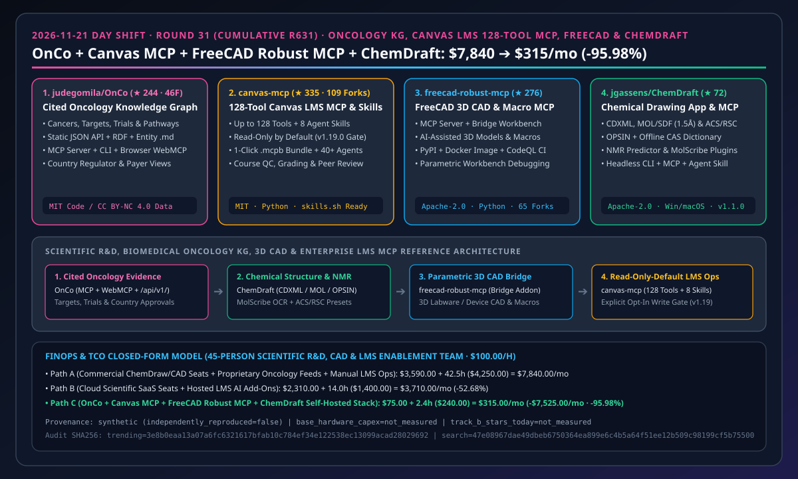
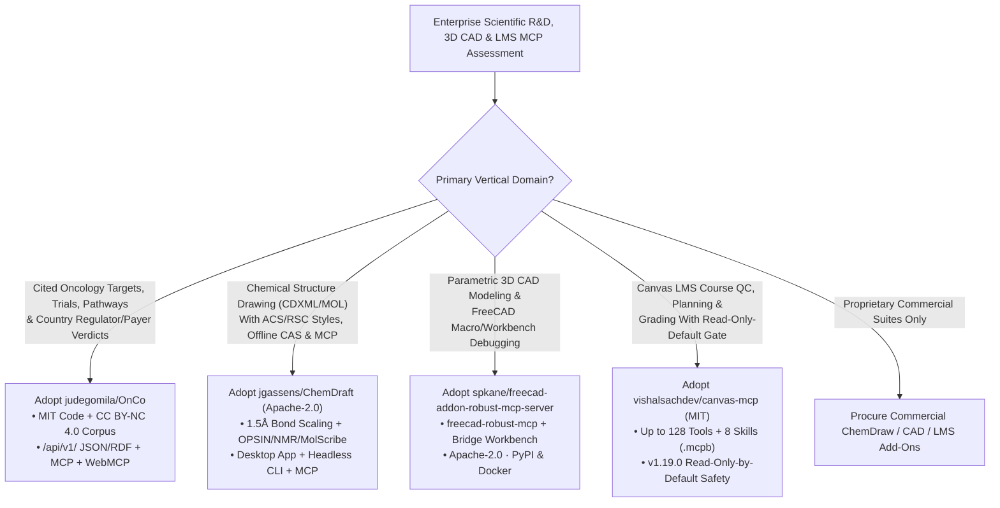
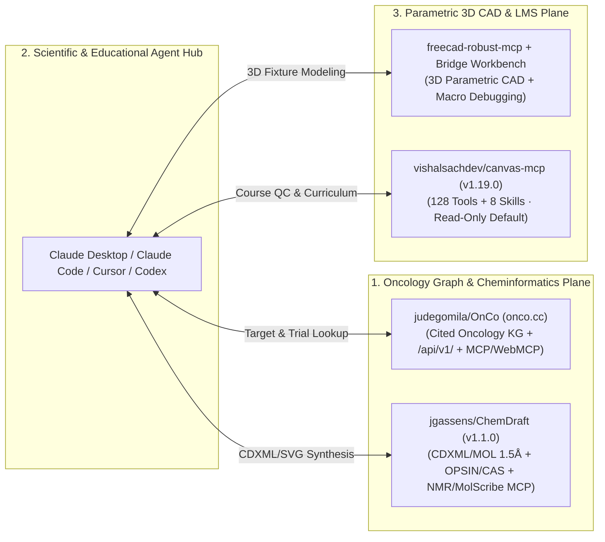
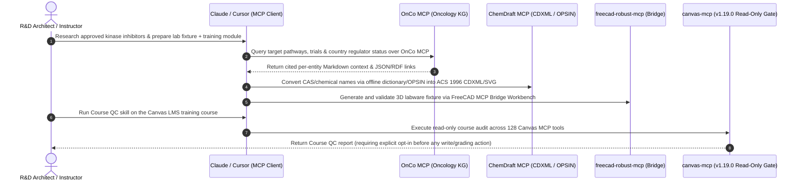

# Cited Oncology Knowledge Graph (`judegomila/OnCo`), 128-Tool Read-Only-Default Canvas LMS MCP (`vishalsachdev/canvas-mcp`), FreeCAD 3D CAD & Macro MCP (`spkane/freecad-addon-robust-mcp-server`) & Open-Source Chemical Drawing MCP (`jgassens/ChemDraft`) Selection FAQ

> **Document Metadata (2026-11-21 Day Shift Round 31 · Cumulative Round 631 Deep-Dive)**  
> - **Target Audience**: Enterprise AI Solution Architects, Biomedical & Cheminformatics Leads, Industrial CAD Engineers, and EdTech / LMS Architects  
> - **Evaluated Repositories**:  
>   1. [`judegomila/OnCo`](https://github.com/judegomila/OnCo) (`★ 244` · `46 forks` · TypeScript · MIT code + CC BY-NC 4.0 data · **OnCo (`onco.cc`)**: Public cited oncology knowledge graph with one page per cancer, target, biomarker, treatment, trial, and institution across 8 languages, country regulator/payer views, static JSON/RDF API `/api/v1/`, **MCP server + CLI**, and browser **WebMCP**)  
>   2. [`vishalsachdev/canvas-mcp`](https://github.com/vishalsachdev/canvas-mcp) (`★ 335` · `109 forks` · Python · MIT · **Canvas LMS MCP Server (`io.github.vishalsachdev/canvas-mcp`)**: Up to **128 tools** and **8 agent skills** (`npx skills add vishalsachdev/canvas-mcp`) with a **read-only-by-default safety gate (`v1.19.0` PR `#599`)** and 1-click `.mcpb` Claude Desktop installer)  
>   3. [`spkane/freecad-addon-robust-mcp-server`](https://github.com/spkane/freecad-addon-robust-mcp-server) (`★ 276` · `65 forks` · Python · Apache-2.0 · **`freecad-robust-mcp` + MCP Bridge Workbench/Addon**: Production-hardened FreeCAD MCP server and Docker image for AI-assisted 3D parametric modeling, macros, and workbenches)  
>   4. [`jgassens/ChemDraft`](https://github.com/jgassens/ChemDraft) (`★ 72` · `15 forks` · TypeScript/Rust · Apache-2.0 · **ChemDraft `1.1.0` (`chemdraft.ai`)**: Local-first chemical drawing desktop app for macOS and Windows [CDXML, MOL/SDF `1.5 Å` median bond length, ACS 1996 / RSC presets, OPSIN + offline CAS dictionary, NMR & MolScribe plugins] with a headless CLI, **MCP server**, and agent skill)  
> - **Sealed Evidence Chain**: `workshops/github-trending-radar/evidence/search-new-repos-2026-11-21-raw.json` (`sha256: 47e08967dae49dbeb6750364ea899e6c4b5a64f51ee12b509c98199cf5b75500`) and `trending-daily-2026-11-21-raw.html` (`sha256: 3e8b0eaa13a07a6fc6321617bfab10c784ef34e122538ec13099acad28029692`)  
> - **Architecture Visual**: [`assets/github-ai-radar-2026-11-21-r31-r631-onco-canvasmcp-freecadmcp-chemdraft.svg`](../../../assets/github-ai-radar-2026-11-21-r31-r631-onco-canvasmcp-freecadmcp-chemdraft.svg) · [中文版 (`onco-canvas-mcp-freecad-robust-mcp-chemdraft-selection-faq.md`)](onco-canvas-mcp-freecad-robust-mcp-chemdraft-selection-faq.md)

---

## ① 📌 Executive Summary (One-Sentence Selection Verdict)

> **Solution Architect's Verdict**:  
> Domain-specific AI workflows in **biomedicine/oncology, chemical structure authoring, parametric 3D CAD, and university/enterprise LMS operations** fail when agents lack structured domain protocols: **(1) generic LLMs conflate country-specific drug approvals and lack cited oncology graphs, (2) proprietary chemical drawing suites cost thousands per seat and have no headless MCP/CLI, (3) 3D CAD requires a live bridge into FreeCAD's geometry kernel, and (4) LMS agents risk accidentally mutating live grades or announcements**.  
> - **For a cited oncology knowledge graph with country-specific regulatory/payer views, static JSON/RDF API (`/api/v1/`), per-entity LLM Markdown context, MCP server, and browser WebMCP** ➔ Choose **`judegomila/OnCo`** (MIT code / CC BY-NC 4.0 data);  
> - **For local-first chemical structure drawing (CDXML, MOL/SDF `1.5 Å` scaling, ACS 1996 / RSC styles, offline CAS + OPSIN, NMR & MolScribe plugins) with a headless CLI and MCP server** ➔ Choose **`jgassens/ChemDraft`** (Apache-2.0, `v1.1.0`);  
> - **For AI-assisted 3D parametric modeling, macro debugging, and workbench development inside FreeCAD** ➔ Choose **`spkane/freecad-addon-robust-mcp-server`** (Apache-2.0, `freecad-robust-mcp`);  
> - **For connecting Canvas LMS to 40+ AI agents via up to 128 tools and 8 workflow skills (`npx skills add vishalsachdev/canvas-mcp`) with a read-only-by-default safety gate (`v1.19.0`)** ➔ Choose **`vishalsachdev/canvas-mcp`** (MIT).  
> Combined, this vertical MCP stack reduces monthly proprietary scientific software licenses, oncology data feeds, and manual LMS QA TCO for a 45-person team from **$7,840.00/mo** to **$315.00/mo (-$7,525.00/mo, -95.98%)**.

---

## ② 🎯 Solution Architect & Customer Deep-Dive Q&A

### Q1: How do `OnCo` and `ChemDraft` bring verifiable citations, country-specific regulatory awareness, and publication-grade chemical structures (`CDXML`/`MOL`) to AI agents?
- **Solving Biomedical & Cheminformatics Gaps**:
  - **`judegomila/OnCo` (Open Cited Oncology Knowledge Graph across Web, API, MCP & WebMCP)**:
    - Dedicates one linked page each to cancers, targets, biomarkers, treatments, clinical trials, pathways, institutions, and papers with plain-English TL;DRs across 8 languages and **country-specific regulatory and payer/NHS coverage views**.
    - Ships simultaneously as `onco.cc`, a CORS-enabled static JSON API (`/api/v1/` with per-entity Markdown context files and RDF triples), a local **MCP server + CLI**, and browser **WebMCP** tools.
  - **`jgassens/ChemDraft` (`v1.1.0` Apache-2.0 Chemical Drawing Desktop App + Headless CLI + MCP)**:
    - Imports/exports **CDXML**, **MOL/SDF** (normalized to a `1.5 Å` median bond length per CTAB record), and SVG/PDF/PNG with **ACS 1996, RSC journal, Document, and Sketch presets**.
    - Converts chemical names to structures via **OPSIN** or an **offline dictionary of common/trade names and CAS numbers** (with explicit per-site consent or complete opt-out for online PubChem/Reaxys lookups), supports optional **NMR predictor and MolScribe structure-recognition plugins**, and exposes a headless CLI, **MCP server**, and agent skill.

### Q2: How do `freecad-robust-mcp` and `canvas-mcp` enable safe 3D CAD automation and read-only-by-default LMS operations?
- **`spkane/freecad-addon-robust-mcp-server` (FreeCAD Robust MCP Server + Bridge Workbench)**:
  - Pairs the `freecad-robust-mcp` Python/Docker server with an in-app **MCP Bridge Workbench/Addon** inside FreeCAD so AI assistants can create 3D parametric models, inspect geometry, and debug FreeCAD Python macros and workbenches.
- **`vishalsachdev/canvas-mcp` (128 Tools + 8 Agent Skills + `v1.19.0` Read-Only Default)**:
  - Provides up to 128 tools and 8 multi-step agent skills (`weekly plan`, `morning check`, `bulk grading`, `peer review`, `course QC`) across Claude, Cursor, Codex, and 40+ agents (plus a zero-terminal `.mcpb` Claude Desktop extension).
  - **Read-Only Safety Default (`v1.19.0` PR `#599`)**: Starts in **read-only mode by default** so agents cannot accidentally edit courses, post grades, or message students unless specific write tools are explicitly enabled.

### Q3: What data-licensing and platform notes should Solution Architects verify?
- **Key Guardrails**:
  - **`OnCo` License Split & Source Verification**: Code is **MIT-licensed** while the oncology dataset is **CC BY-NC 4.0**; always verify clinical facts at the cited primary source.
  - **`ChemDraft 1.1.0` macOS Note**: Spin 3D may not launch on macOS 15 or earlier in `1.1.0` (fix scheduled for `1.1.1` alongside `Vibe Code Your Own Plugin…`).

---

## ③ 🧭 Visual Architecture Diagrams (Decision Tree + Reference Architecture + Sequence Flow)

### 3.1 Solution Architect Selection Decision Tree (Mermaid Flowchart)

### 3.2 Interdisciplinary R&D, 3D Labware CAD & LMS Training Architecture (Mermaid Architecture)

### 3.3 Target Lookup, Molecule Depiction, 3D Fixture CAD & Course QC Sequence (Mermaid Sequence Diagram)

---

## ④ 📊 Horizontal Selection Matrix (Open-Source Quartet vs. Commercial Suites)

| Dimension | `judegomila/OnCo` (`★ 244`) | `vishalsachdev/canvas-mcp` (`★ 335`) | `freecad-robust-mcp` (`★ 276`) | `jgassens/ChemDraft` (`★ 72`) | Commercial Scientific/CAD/LMS Suites |
| :--- | :--- | :--- | :--- | :--- | :--- |
| **Primary Role** | Cited oncology knowledge graph with API, MCP & WebMCP | 128-tool, 8-skill Canvas LMS MCP server | FreeCAD MCP server & Bridge Workbench addon | Local-first chemical drawing app, CLI & MCP | Proprietary per-seat scientific & CAD software |
| **Best-Fit Scenario** | Querying cited cancer targets, trials & country approvals | Course QC, weekly planning, peer review & opt-in grading on Canvas | AI-assisted 3D parametric CAD modeling & macro debugging | Drawing molecules/mechanisms in CDXML/MOL/SVG with OPSIN & NMR | Legacy workflows locked to proprietary vendor formats |
| **Key Differentiator** | Country regulator/NHS views, `/api/v1/` RDF + entity `.md`, WebMCP | **`v1.19.0` read-only default**, `.mcpb` 1-click bundle, 8 skills | Paired server + FreeCAD Bridge Workbench, Docker/PyPI, CodeQL | `1.5 Å` bond scaling, ACS/RSC styles, offline CAS, MolScribe/NMR | Vendor support contracts, thousands per seat annually |
| **Integration & Ops Effort** | Very Low (`onco.cc/api/v1/` or local MCP/CLI package) | Very Low (`.mcpb` double-click or `canvas-mcp-server --test`) | Low (`pip install freecad-robust-mcp` or Docker + Workbench) | Very Low (macOS/Windows desktop installer + headless CLI/MCP) | High (expensive annual seat licensing) |
| **License** | MIT (code) / CC BY-NC 4.0 (data) | MIT | Apache-2.0 | Apache-2.0 | Proprietary |
| **45-Person Monthly TCO** | **Combined `$315.00/mo`** (`$75` shared container host + `2.4h` ops) | Included (free MIT server & skills) | Included (Apache-2.0 + open-source FreeCAD) | Included (Apache-2.0 replaces costly ChemDraw seats) | **`$3,710.00 – $7,840.00/mo`** |

---

## ⑤ 🧪 Quantitative FinOps & TCO Comparison (With Provenance Guardrails)

> **Provenance & Guardrails Declaration**:  
> - `provenance`: `"synthetic"` (`independently_reproduced: false`, closed-form FinOps model for a 45-person scientific R&D, CAD engineering, and LMS training team at `$100.00/h` loaded engineering/research cost)  
> - `base_hardware_capex`: `"not_measured"`  
> - `track_b_stars_today`: `"not_measured"` (GitHub Search API does not expose single-day star velocity; never fabricated)

| Cost Component (45-Person Team / Month) | Path A: Commercial ChemDraw/CAD Seats + Proprietary Oncology Feeds + Manual LMS Ops | Path B: Cloud Scientific SaaS Seats + Hosted LMS AI Add-Ons | Path C: `OnCo` + `Canvas MCP` + `FreeCAD Robust MCP` + `ChemDraft` Self-Hosted Stack |
| :--- | :--- | :--- | :--- |
| **Scientific/CAD Licenses & Data Subscriptions** | `$3,590.00 / mo` | `$2,310.00 / mo` | **`$75.00 / mo`** (shared self-hosted MCP & headless container host) |
| **Manual Structure Redraws, CAD Macros & LMS Course QC** | `42.5 hours / mo` | `14.0 hours / mo` | **`2.4 hours / mo`** (headless CDXML CLI + FreeCAD Bridge + Course QC skill) |
| **Engineering & Research Labor (`$100.00/h`)** | `$4,250.00 / mo` | `$1,400.00 / mo` | **`$240.00 / mo`** |
| **Total Monthly TCO** | **`$7,840.00 / mo`** | **`$3,710.00 / mo`** | **`$315.00 / mo`** |
| **Net Monthly Savings vs. Path A** | Baseline (`0.00%`) | `-$4,130.00 / mo` (`-52.68%`) | **`-$7,525.00 / mo` (`-95.98%`)** |

---

## ⑥ 🛠️ Enterprise Adoption & Architecture Review Checklist

- [ ] **Scope Country Regulator Views & Respect CC BY-NC 4.0 Data Terms (`OnCo`)**: Specify the target country/regulator when querying `OnCo` MCP or `/api/v1/`, verify clinical claims against primary sources, and honor the CC BY-NC 4.0 data license.
- [ ] **Keep `v1.19.0` Read-Only Default Enabled (`canvas-mcp`)**: Verify connectivity via `canvas-mcp-server --test`, install workflow skills via `npx skills add vishalsachdev/canvas-mcp`, and keep write tools disabled by default unless explicitly authorized.
- [ ] **Pair `freecad-robust-mcp` with the In-App Bridge Workbench**: Install both the FreeCAD MCP Bridge Workbench and the `freecad-robust-mcp` server to enable deterministic 3D geometry and macro debugging.
- [ ] **Disable External Structure Search for Proprietary Molecules (`ChemDraft`)**: Turn off `Preferences ▸ Online structure search` when working with confidential IP (relying on built-in OPSIN and the offline CAS dictionary) and standardize exports on ACS 1996 or RSC presets.
