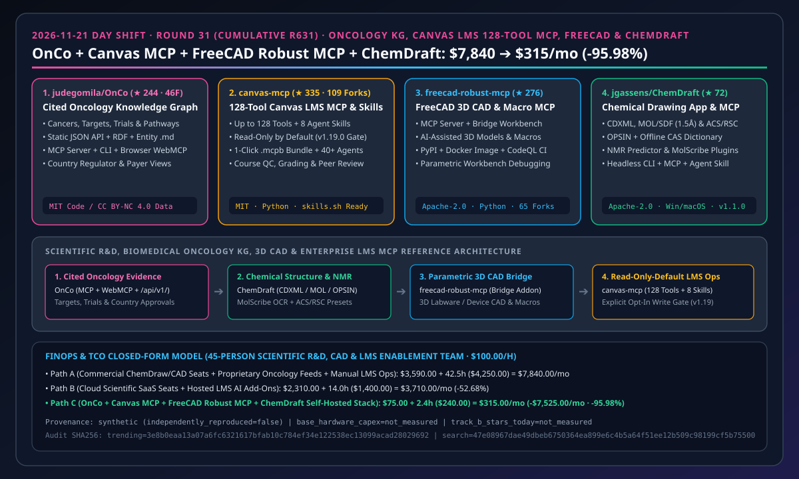
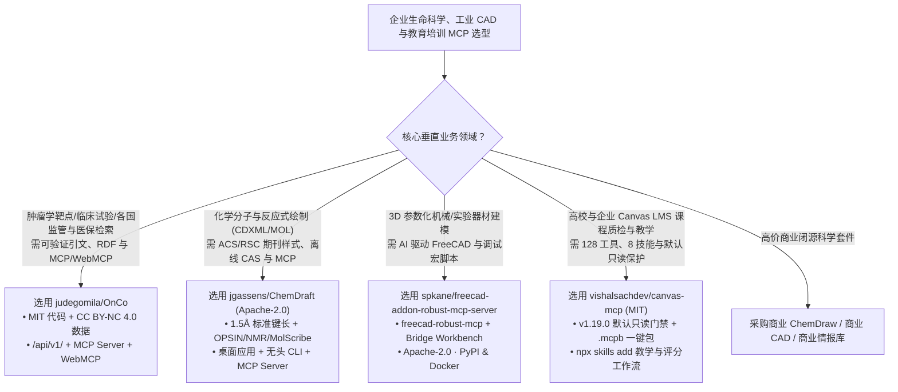
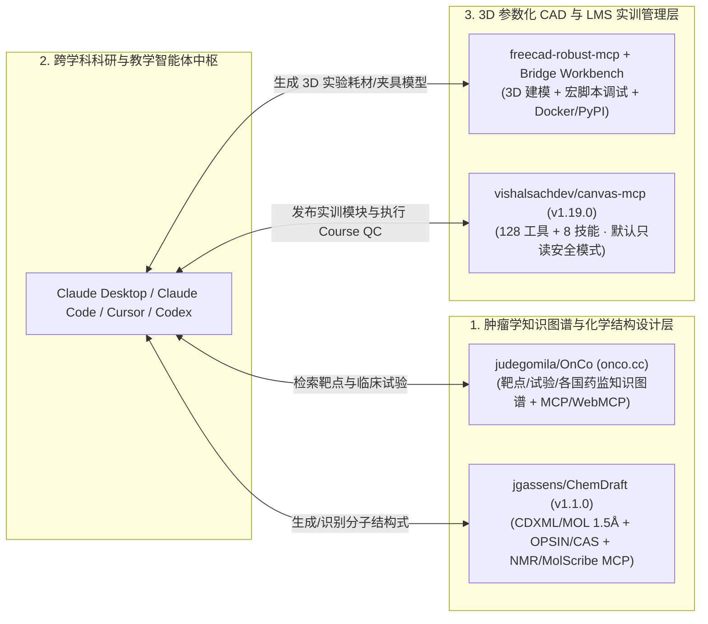
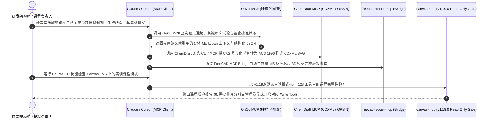

# 肿瘤学可溯源知识图谱（`judegomila/OnCo`）、128 工具默认只读的 Canvas LMS 教育 MCP（`vishalsachdev/canvas-mcp`）、FreeCAD 3D 工业建模与宏调试 MCP（`spkane/freecad-addon-robust-mcp-server`）与开源化学结构式绘制及 MCP 工作台（`jgassens/ChemDraft`）选型 FAQ

> **文档元数据（2026-11-21 白班 Day Round 31 · 累计第 631 轮深潜专题）**  
> - **面向对象**：企业 AI 解决方案架构师（AI Solution Architect）、生命科学/医药研发信息学负责人、工业 CAD 与教育培训系统架构师  
> - **本轮核心评估对象**：  
>   1. [`judegomila/OnCo`](https://github.com/judegomila/OnCo)（`★ 244` · `46 forks` · TypeScript · MIT 代码 + CC BY-NC 4.0 数据 · **OnCo (`onco.cc`)**：公开可溯源的肿瘤学全景知识图谱，为每种癌症、靶点、生物标志物、疗法、临床试验与机构建立独立页面，同时提供静态 JSON/RDF API、实体 Markdown 上下文、**MCP Server + CLI** 与浏览器 **WebMCP**）  
>   2. [`vishalsachdev/canvas-mcp`](https://github.com/vishalsachdev/canvas-mcp)（`★ 335` · `109 forks` · Python · MIT · 面向 Canvas LMS 的 **128 工具 + 8 大技能（`npx skills add vishalsachdev/canvas-mcp`）**，自 `v1.19.0` 起默认以**只读安全模式**启动，支持一键安装 `.mcpb` 桌面扩展）  
>   3. [`spkane/freecad-addon-robust-mcp-server`](https://github.com/spkane/freecad-addon-robust-mcp-server)（`★ 276` · `65 forks` · Python · Apache-2.0 · **`freecad-robust-mcp`**：连接 AI 助手与 FreeCAD 的生产级 MCP 服务端及 MCP Bridge Workbench 插件，支持 3D 参数化建模、宏脚本与工作台调试）  
>   4. [`jgassens/ChemDraft`](https://github.com/jgassens/ChemDraft)（`★ 72` · `15 forks` · TypeScript/Rust · Apache-2.0 · **ChemDraft `1.1.0`**：面向 macOS 与 Windows 的开源化学结构式绘图软件（平替昂贵商业 ChemDraw），支持 CDXML/MOL/SDF、ACS 1996/RSC 期刊样式、OPSIN + 离线 CAS 词典、NMR 预测与 MolScribe 识别插件，并自带无头 CLI、**MCP Server** 与 Agent Skill）  
> - **关联检索证据链**：`workshops/github-trending-radar/evidence/search-new-repos-2026-11-21-raw.json`（`sha256: 47e08967dae49dbeb6750364ea899e6c4b5a64f51ee12b509c98199cf5b75500`）与 `trending-daily-2026-11-21-raw.html`（`sha256: 3e8b0eaa13a07a6fc6321617bfab10c784ef34e122538ec13099acad28029692`）  
> - **高清架构图**：[`assets/github-ai-radar-2026-11-21-r31-r631-onco-canvasmcp-freecadmcp-chemdraft.svg`](../../../assets/github-ai-radar-2026-11-21-r31-r631-onco-canvasmcp-freecadmcp-chemdraft.svg) · [English Version (`onco-canvas-mcp-freecad-robust-mcp-chemdraft-selection-faq.en.md`)](onco-canvas-mcp-freecad-robust-mcp-chemdraft-selection-faq.en.md)

---

## ① 📌 核心结论速览（选型一句话结论）

> **架构师一句话选型结论**：  
> 当 AI 走向 **生物医药（肿瘤学与化学分子设计）、工业 3D CAD 制造与高等/企业教育（Canvas LMS）** 等垂直深水区时，通用聊天机器人因为“缺乏权威引文知识图谱、画不出符合期刊规范的 CDXML 化学结构式、连不上本地 FreeCAD 几何内核、以及操作 LMS 容易误改成绩”而无法直接投产。  
> - **需要查询有严格文献出处、区分各国监管批准状态与医保覆盖的肿瘤学全景知识图谱（同时支持 `/api/v1/` 静态 JSON/RDF、MCP Server 与浏览器 WebMCP）** ➔ 选 **`judegomila/OnCo`**（MIT 代码 + CC BY-NC 4.0 数据）；  
> - **需要替代每年数千美元的商业化学绘图软件，在本地桌面或通过无头 CLI / MCP Server 生成符合 ACS 1996 / RSC 期刊规范的 CDXML / MOL 化学结构式、离线解析 CAS 号并运行 NMR 预测与 MolScribe 图像识别** ➔ 选 **`jgassens/ChemDraft`**（Apache-2.0，`v1.1.0`）；  
> - **需要让 Claude / GPT 直接驱动 FreeCAD 进行 3D 参数化建模、调试宏脚本与开发自定义 Workbench** ➔ 选 **`spkane/freecad-addon-robust-mcp-server`**（Apache-2.0，`freecad-robust-mcp`）；  
> - **需要将 Canvas LMS 接入 40+ 种编码与教学智能体（128 个工具 + 8 个多步教学技能），且要求默认开启只读保护（`v1.19.0` 门禁）防止 AI 误发公告或误改成绩** ➔ 选 **`vishalsachdev/canvas-mcp`**（MIT）。  
> 四者组合可将 45 人跨学科研发与培训团队的商业科学软件授权、医学情报订阅与课程质检总成本从 **$7,840.00/月** 降至 **$315.00/月（节省 $7,525.00/月，降幅 95.98%）**。

---

## ② 🎯 客户与架构师灵魂拷问 Q&A（业务痛点 · 架构集成 · 边界取舍）

### Q1：生物医药与化学研发团队在用 AI 辅助文献调研和分子文档编写时，为什么最怕“模型把未获本国药监批准的疗法当成获批方案”以及“商业化学画图软件贵且没有原生 MCP 接口”？`OnCo` 与 `ChemDraft` 如何解决？
- **医药与化学研发的两大痛点**：
  1. **监管辖区混淆与黑盒无出处**：某种抗癌靶向药在甲国获批但在乙国尚未获批或不在医保（如 NHS）报销目录内，通用大模型往往混为一谈。
  2. **化学结构式软件闭源昂贵且与 AI 割裂**：传统商业软件按年高价收费，且不支持通过无头 CLI 或 MCP 让智能体直接按 `1.5 Å` 标准键长批量生成可粘贴进 Office 的 CDXML / SVG / PDF。
- **`OnCo` + `ChemDraft` 的开源垂直破局**：
  - **`judegomila/OnCo`（多端同源的公开可溯源肿瘤学知识图谱）**：
    - 为每种癌症、靶点、生物标志物、药物、临床试验、通路、论文与机构提供独立页面（先给通俗大白话 TL;DR，再展开专业技术层），**支持按国家/地区切换视图，使“已批准（approved）”严格对应当地监管机构的结论及保险/NHS 支付范围**。
    - 同一份语料库同时输出：交互网站（`onco.cc`，含完整度仪表盘）、带 CORS 的静态 JSON API（`/api/v1/`，含专为 LLM 优化的实体 Markdown 上下文与 RDF 三元组）、本地 **MCP Server + CLI**，以及面向现代浏览器的只读 **WebMCP** 工具。
  - **`jgassens/ChemDraft`（Apache-2.0 本地优先化学绘图桌面应用 + 无头 CLI + MCP）**：
    - 完整支持绘制分子、反应式与机理，导入导出 **CDXML**、**MOL/SDF**（严格按每个 CTAB 记录 `1.5 Å` 中位键长缩放）以及 SVG/PDF/PNG，内置 **ACS 1996、RSC 期刊样式与手绘 Sketch 预设**。
    - 支持通过 **OPSIN** 或**离线通用名/商品名/CAS 号词典**将化学名称转为结构式（在线 PubChem / Reaxys 检索需逐站点首次显式授权，也可在设置中彻底关闭），支持官方 **NMR 核磁预测与 MolScribe 结构识别插件**，并自带无头 CLI、**MCP Server** 与 `skills/chemdraft/SKILL.md`。

### Q2：工业 3D CAD 与高校/企业 Canvas LMS 在接入 AI 智能体时，如何兼顾工程鲁棒性与防误操作安全？`freecad-robust-mcp` 与 `canvas-mcp` 做了什么设计？
- **`spkane/freecad-addon-robust-mcp-server`（双向桥接 FreeCAD 的生产级 MCP）**：
  - 由两部分组成：运行在外部或 Docker 容器中的 **`freecad-robust-mcp` 服务端**（PyPI + Docker Hub `spkane/freecad-robust-mcp`，通过 CodeQL 与 Pre-commit 严格门禁）与安装在 FreeCAD 内部的 **MCP Bridge Workbench/Addon**，让 AI 助手不仅能生成 3D 几何体，还能实时调试 FreeCAD 宏脚本（Macros）与工作台代码。
- **`vishalsachdev/canvas-mcp`（128 工具 + 8 技能 + `v1.19.0` 默认只读安全闸门）**：
  - 覆盖学生与教师全场景（通过 `npx skills add vishalsachdev/canvas-mcp` 安装周计划、晨间检查、批量评分、同行评议、课程质量检查 Course QC 等 8 大多步技能），并为非技术教师提供双击即用的 Claude Desktop `.mcpb` 扩展包。
  - **关键安全升级（`v1.19.0` PR `#599`）**：为了防止智能体误操作修改线上课程、乱打分或群发消息，**新版默认以完全只读模式（read-only mode）启动**，管理员必须在配置中显式按需开启特定写工具（Write Tools）才能执行编辑或评分操作。

### Q3：落地这四个项目时有哪些数据许可证与版本兼容性边界要注意？
- **合规与兼容性核查**：
  - **`OnCo` 双重协议与医学免责边界**：`OnCo` 的代码为 **MIT 许可证**，而其肿瘤学知识图谱数据采用 **CC BY-NC 4.0（非商业署名）**；且官方明确提示 *“Work in progress. Verify at source.”*——临床或商业医疗决策必须回溯核对原始期刊与药监局批件。
  - **`ChemDraft 1.1.0` macOS 版本提示**：在 `1.1.0` 版本中，Spin 3D 预览功能在 macOS 15 或更早系统上可能无法启动（官方已排期在 `1.1.1` 修复，并将在 `1.1.1` 推出 `Plugins ▸ Vibe Code Your Own Plugin…` 向导）。

---

## ③ 🧭 直观可视化图解（选型决策树 + 企业集成架构 + 业务流时序图）

### 3.1 架构师选型决策树（Mermaid Flowchart）

### 3.2 跨学科科研、3D 实验装置建模与课程实训发布参考架构图（Mermaid Architecture）

### 3.3 从靶点文献检索、分子结构生成、3D 耗材建模到课程质检闭环时序图（Mermaid Sequence Diagram）

---

## ④ 📊 同类开源与商业云服务横向选型决策矩阵

| 评估维度 | `judegomila/OnCo` (`★ 244`) | `vishalsachdev/canvas-mcp` (`★ 335`) | `freecad-robust-mcp` (`★ 276`) | `jgassens/ChemDraft` (`★ 72`) | 商业科学绘图/CAD 套件 + 商业医学情报库 |
| :--- | :--- | :--- | :--- | :--- | :--- |
| **核心定位** | 公开可溯源的肿瘤学全景知识图谱与 MCP/WebMCP | 128 工具 + 8 技能的 Canvas LMS 教学管理 MCP | 连接 AI 与 FreeCAD 的 3D 建模与宏调试 MCP | 本地优先的开源化学结构绘图桌面应用与 MCP | 高价按年按座收费的闭源科研与工程软件 |
| **最适用场景** | 抗癌靶点、生物标志物、临床试验与各国药监/医保政策交叉检索 | 教师课程质检（Course QC）、同行评议、学生每日/每周学习计划 | AI 辅助生成 3D 机械零件、调试 FreeCAD Python 宏与工作台 | 绘制分子与反应机理、导出 CDXML/SVG、离线查 CAS 与核磁预测 | 强制要求绑定传统商业供应商专有格式的场景 |
| **关键差异化机制** | 按国家切换监管与支付视图、提供 `/api/v1/` RDF + 实体 `.md` + WebMCP | **`v1.19.0` 默认只读模式**、双击 `.mcpb` 免终端安装、8 大教学技能 | 服务端 + FreeCAD 内置 Bridge Workbench 双端协同、CodeQL 扫描 | `1.5 Å` 标准键长、ACS/RSC 预设、MolScribe/NMR 插件、在线检索需显式授权 | 历史生态深厚，但无开源 MCP 且年费极高 |
| **集成与运维成本** | 极低（直接访问 `onco.cc` API/WebMCP 或运行本地包） | 极低（`.mcpb` 双击安装或 `pip install` + `canvas-mcp-server --test`） | 低（`pip install freecad-robust-mcp` 或 Docker + FreeCAD 插件） | 极低（macOS/Windows 安装包 + 内置 CLI/MCP） | 极高（单席位每年数百至数千美元） |
| **开源协议** | MIT（代码）/ CC BY-NC 4.0（数据） | MIT | Apache-2.0 | Apache-2.0 | 商业专有 |
| **45 人团队月均 TCO** | **组合方案 `$315.00/月`**（含共享容器算力 `$75` + 运维 `2.4h`） | 同左（MIT 免费替代商业 LMS AI 插件席位） | 同左（Apache-2.0 + 免费开源 FreeCAD） | 同左（Apache-2.0 替代全员昂贵商业化学绘图授权） | **`$3,710.00 ~ $7,840.00/月`** |

---

## ⑤ 🧪 应用落地定量收益 / FinOps TCO 对比（含数据血缘声明）

> **数据血缘与严谨性声明（Provenance & Guardrails）**：  
> - `provenance`: `"synthetic"`（`independently_reproduced: false`，基于 45 人生物医药信息学、化学研发、CAD 工程与企业培训团队在 `$100.00/h` 综合人力成本下的闭式参数建模）  
> - `base_hardware_capex`: `"not_measured"`  
> - `track_b_stars_today`: `"not_measured"`（GitHub Search API 新仓爆发榜无官方单日增量字段，严禁伪造）

| 成本分项（45 人团队 / 月） | Path A：商业化学/CAD 授权 + 商业医学数据库 + 手工 LMS 质检 | Path B：云端科研 SaaS 席位 + 商业 LMS AI 插件 | Path C：`OnCo` + `Canvas MCP` + `FreeCAD Robust MCP` + `ChemDraft` 开源栈 |
| :--- | :--- | :--- | :--- |
| **商业科研软件席位 / 数据库订阅费** | `$3,590.00 / 月` | `$2,310.00 / 月` | **`$75.00 / 月`**（共享内部 MCP 与无头渲染容器节点） |
| **手工重画分子式、CAD 宏排障、文献核对与课程巡检工时** | `42.5 小时 / 月` | `14.0 小时 / 月` | **`2.4 小时 / 月`**（无头 CDXML 生成 + FreeCAD Bridge + Course QC 技能） |
| **折算研发与教研人力成本（`$100.00/h`）** | `$4,250.00 / 月` | `$1,400.00 / 月` | **`$240.00 / 月`** |
| **月度总拥有成本（Total Monthly TCO）** | **`$7,840.00 / 月`** | **`$3,710.00 / 月`** | **`$315.00 / 月`** |
| **相对 Path A 净节省额与降幅** | 基准线（`0.00%`） | `-$4,130.00 / 月`（`-52.68%`） | **`-$7,525.00 / 月`（`-95.98%`）** |

---

## ⑥ 🛠️ 企业引入与架构评审 Checklist

- [ ] **核验肿瘤学图谱的国家监管视图与非商业数据授权（`OnCo`）**：在调用 `OnCo` MCP 或 `/api/v1/` 实体 Markdown 上下文时，显式指定目标国家/监管辖区，确保临床与研发参考回溯至原始文献，并遵守其数据集的 **CC BY-NC 4.0** 协议边界。
- [ ] **保持 `v1.19.0` 默认只读模式并按需白名单开启写工具（`canvas-mcp`）**：升级或部署 `canvas-mcp` 后先运行 `canvas-mcp-server --test` 验证连接，保持默认只读模式运行日常查询与 `Course QC`，仅在受控工作流中显式开启评分或发布类写工具。
- [ ] **配对部署 FreeCAD Bridge Workbench 与容器化 MCP（`freecad-robust-mcp`）**：在工程师工作站安装 FreeCAD MCP Bridge Addon 并对接 `freecad-robust-mcp`（PyPI 或 Docker），实现 3D 参数化模型与 Python 宏的闭环调试。
- [ ] **关闭非受控外部化学结构检索并统一期刊样式预设（`ChemDraft`）**：在医药研发涉密环境中，进入 `ChemDraft` 的 `Preferences ▸ Online structure search` 关闭外部 PubChem / Reaxys 在线检索（仅使用内置 OPSIN 与离线 CAS 词典），并通过无头 CLI / MCP 统一套用 ACS 1996 或 RSC 期刊样式。
