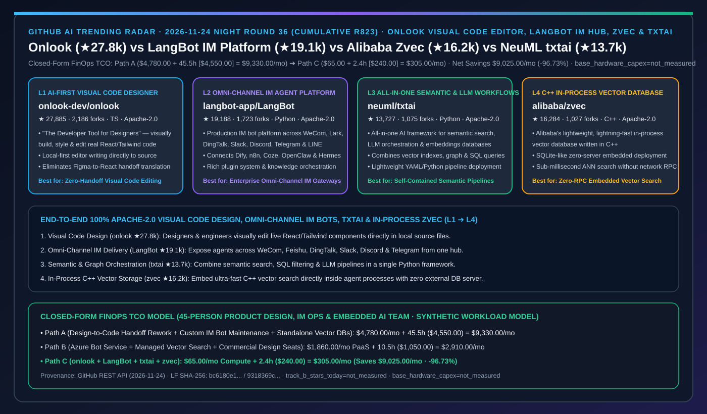
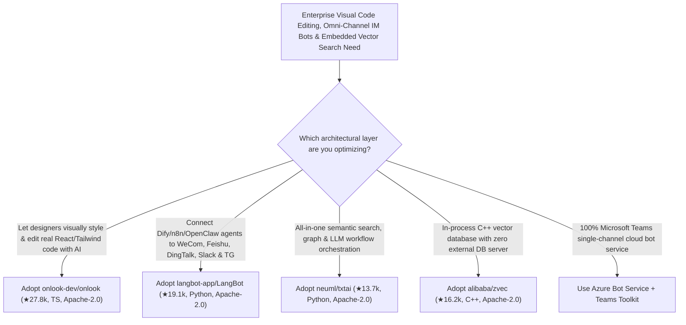
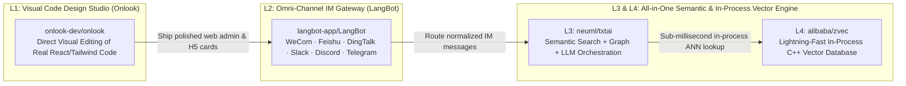

# Visual Code Editor for Designers (`onlook-dev/onlook`), Omni-Channel IM Bot Platform (`langbot-app/LangBot`), Alibaba In-Process C++ Vector DB (`alibaba/zvec`) & All-in-One Semantic Framework (`neuml/txtai`) Selection & Architecture FAQ

> **Document Type**: AI Solution Architect Selection & Integration Guide (2026-11-24 Night Round 36 / Cumulative Round 823)  
> **Reading Time**: ~8 minutes  
> **Covered Repositories**: [`onlook-dev/onlook`](https://github.com/onlook-dev/onlook) (`★ 27,885` · `2,186 forks` · TypeScript · `Apache-2.0`) · [`langbot-app/LangBot`](https://github.com/langbot-app/LangBot) (`★ 19,188` · `1,723 forks` · Python · `Apache-2.0`) · [`alibaba/zvec`](https://github.com/alibaba/zvec) (`★ 16,284` · `1,027 forks` · C++ · `Apache-2.0`) · [`neuml/txtai`](https://github.com/neuml/txtai) (`★ 13,727` · `1,075 forks` · Python · `Apache-2.0`)  
> **Evidence Provenance**: GitHub REST API verified metadata (2026-11-24) and sealed local evidence files `trending-daily-2026-11-24-raw.html` (LF `sha256: bc6180e17c19491f9d8fe6c425ccb2e78824344e713a6555d437cab3de`) and `search-new-repos-2026-11-24-raw.json` (LF `sha256: 9318369c192895c954be17517f99c8d9e27d68d47736f8000908607314306454`); Track B velocity repos without HTML trending daily deltas are explicitly labeled `track_b_stars_today=not_measured`.  
> **中文版本**: [`onlook-langbot-zvec-txtai-selection-faq.md`](./onlook-langbot-zvec-txtai-selection-faq.md)



---

## ① 📌 Executive Summary

**One-Sentence Selection Verdict**: When enterprise teams want a **100% `Apache-2.0`-licensed stack for zero-handoff visual code editing, omni-channel IM bot deployment, all-in-one semantic orchestration, and embedded in-process C++ vector search**—combining **the local-first AI design tool that edits real React/Tailwind code directly (`onlook-dev/onlook`), a production multi-platform IM bot gateway connecting WeCom, Feishu/Lark, DingTalk, Slack, Discord, and Telegram to Dify/n8n/OpenClaw/Hermes (`langbot-app/LangBot`), an all-in-one semantic search and LLM workflow framework (`neuml/txtai`), and Alibaba's lightning-fast in-process C++ vector database (`alibaba/zvec`)**—deploying this 4-layer stack reduces monthly TCO for a 45-person team from **`$9,330.00/mo`** (Path A: Design-to-Code Handoff Rework + Custom Multi-Channel IM Adapters + Standalone Vector DB Clusters) to **`$305.00/mo`** (Path C), saving **`$9,025.00/mo` (`-96.73%`)**.

| Dimension | `onlook-dev/onlook` (L1 Visual Code Editor) | `langbot-app/LangBot` (L2 Omni-Channel IM Platform) | `neuml/txtai` (L3 All-in-One Semantic Framework) | `alibaba/zvec` (L4 In-Process C++ Vector DB) |
|---|---|---|---|---|
| **Verified Stars & Forks** | `★ 27,885` · `2,186 forks` | `★ 19,188` · `1,723 forks` | `★ 13,727` · `1,075 forks` | `★ 16,284` · `1,027 forks` |
| **Language & License** | TypeScript (`Apache-2.0`) | Python (`Apache-2.0`) | Python (`Apache-2.0`) | C++ (`Apache-2.0`) |
| **Plain-English Positioning** | "The Developer Tool for Designers"—local-first AI editor to visually build, style, and edit real code | Production platform for agentic IM bots across WeChat/WeCom, Feishu, DingTalk, Slack, Discord, LINE & Telegram | All-in-one AI framework for semantic search, embeddings databases, graphs & LLM workflows | Alibaba's lightweight, lightning-fast in-process C++ vector database |
| **Core Enterprise Pain Solved** | Eliminates Figma-to-React translation rework by letting designers manipulate live DOM/Tailwind styles that write straight back to code | Replaces maintaining 6+ separate webhook, encryption, and card-formatting adapters across domestic and global IM apps | Consolidates vector search, graph traversal, SQL filtering, and LLM pipelines into one cohesive Python library | Eliminates external vector database server overhead and network RPC latency with SQLite-like in-process C++ vector search |
| **When to Choose vs Cloud PaaS** | Mandatory when product designers and frontend engineers co-edit AI-generated React apps | Choose when publishing enterprise agents across WeCom, Feishu, DingTalk, Slack, and Discord simultaneously | Choose for self-contained semantic search and RAG microservices | Choose for sub-millisecond embedded vector search inside edge containers or high-throughput services |

---

## ② 🎯 Architect & Customer Q&A (1–2 Minute Read)

### Q1: Coding agents generate React UIs rapidly, but designers still waste days redlining screenshots in Figma for engineers to tweak CSS padding and typography. How does `onlook-dev/onlook` (`★ 27,885`) eliminate design-to-code handoff?
- **The Pain**: Traditional design tools operate on static vector mockups disconnected from the real component tree.
- **Architect's Answer**: Adopt **`onlook-dev/onlook`** (`Apache-2.0`)—*"The Developer Tool for Designers."* Designers open the live local React/Tailwind project in `Onlook`, visually inspect and adjust layouts, spacing, and styles with AI assistance, and `Onlook` **writes clean code diffs directly back to the exact source files** ready for a Git pull request.

### Q2: Once an internal agent is built in Dify, n8n, OpenClaw, Hermes Agent, or DeerFlow, how does `langbot-app/LangBot` (`★ 19,188`) expose it across every enterprise messaging app at once?
- **Unified Omni-Channel IM Gateway (`Apache-2.0`)**: Writing and maintaining separate bot adapters for **Enterprise WeChat (WeCom), Feishu/Lark, DingTalk, WeChat Official Accounts, Slack, Discord, Telegram, LINE, QQ, and Matrix** takes months of engineering effort. `langbot-app/LangBot` provides a production-ready multi-platform bot hub with native connectors to Dify, n8n, Langflow, Coze, Claude, OpenAI, DeepSeek, OpenClaw, Hermes Agent, and DeerFlow.

### Q3: Why pair `neuml/txtai` (`★ 13,727`) and `alibaba/zvec` (`★ 16,284`) in the semantic retrieval tier?
- **Zero-Server In-Process Speed + All-in-One Orchestration**:
  1. **`alibaba/zvec` (C++ · `Apache-2.0`)**: Most departmental AI services have <5 million vectors and do not need a multi-node distributed vector database cluster. `zvec` runs **in-process in C++** (like SQLite for vectors), eliminating network serialization latency and standalone database server bills.
  2. **`neuml/txtai` (Python · `Apache-2.0`)**: Combines semantic search, graph networks, SQL-like filtering, and LLM orchestration in a single lightweight Python framework.

---

## ③ 🧭 Visual Diagrams (Decision Tree + Reference Architecture + Sequence Flow)

### 3.1 Selection Decision Tree



### 3.2 End-to-End Enterprise Production Reference Architecture



### 3.3 End-to-End Execution Sequence Diagram

```mermaid
sequenceDiagram
    autonumber
    actor Des as Product Designer
    actor Emp as Employee (WeCom / Feishu / Slack)
    participant ONL as onlook-dev/onlook (L1 Visual Code Editor)
    participant LGB as langbot-app/LangBot (L2 IM Bot Platform)
    participant TXT as neuml/txtai (L3 Semantic Workflow)
    participant ZVC as alibaba/zvec (L4 In-Process C++ Vector DB)

    Des->>ONL: 1. Visually refine interactive H5 approval card in Onlook; commit AST diff to Git
    Emp->>LGB: 2. Ask @Bot in WeCom / Feishu / Slack: "Check Q4 vendor onboarding policy & status"
    LGB->>TXT: 3. Normalize multi-platform IM event & invoke txtai semantic workflow
    TXT->>ZVC: 4. Execute sub-millisecond in-process C++ vector search in alibaba/zvec (0 network RPC)
    ZVC-->>TXT: 5. Return top-ranked policy chunks
    TXT-->>LGB: 6. Synthesize grounded answer + link to Onlook-crafted H5 card
    LGB-->>Emp: 7. Render native message card across WeCom, Feishu, DingTalk or Slack
```

---

## ④ 📊 Comparative Selection Matrix: OSS Stack vs. Peer OSS vs. Cloud PaaS

| Dimension | This OSS Stack (`onlook` + `LangBot` + `txtai` + `zvec`) | Legacy Fragmented Stack (`Manual Figma Handoff` + `Custom Webhook Scripts` + `Standalone Vector Cluster`) | Managed Cloud Stack (`Commercial Design SaaS` + `Cloud Bot Service` + `Managed Vector DB`) |
|---|---|---|---|
| **Core Role** | Visual real-code editor + 10+ channel IM platform + all-in-one semantic framework + C++ in-process vector DB | Manual CSS redlines + separate per-IM adapters + external vector DB servers | Per-seat design SaaS + per-message cloud bot channels + managed vector cloud |
| **Best-Fit Scenario** | Zero-handoff UI polish, hybrid domestic/global IM bot deployment (WeCom/Feishu + Slack/Discord), and low-latency embedded RAG | Single-channel internal scripts with no UI or multi-IM requirements | Enterprises standardized exclusively on Microsoft Teams and Azure AI Search |
| **Integration Effort** | **Very Low** (100% `Apache-2.0`; `zvec` embeds in-process; `LangBot` includes pre-built IM adapters) | Very High (Writing encryption, token refresh, and card adapters across 6+ IM platforms) | Medium (Cloud bot registration and per-seat design licensing) |
| **Operational Complexity** | **Very Low** (Zero external vector DB server + unified IM hub; ~`2.4h/mo` ops) | Very High (Design-to-code ping-pong + maintaining custom IM webhooks costs ~`45.5h/mo`) | Low (Managed cloud PaaS, plus ~`10.5h/mo` channel and index admin) |
| **License & Compliance** | **100% `Apache-2.0` across all 4 repositories** (explicit patent grant, commercial-safe) | Mixed MIT / GPL / SSPL | Proprietary per-seat and per-node SaaS contracts |
| **45-Person Monthly TCO** | **`$305.00/mo`** (`$65.00` shared `LangBot`/`txtai` host + `2.4h` ops) | ~`$4,820.00/mo` (`$270.00` vector cluster + `45.5h` UI handoff & IM maintenance) | **`$2,910.00/mo`** (Path B) to **`$9,330.00/mo`** (Path A commercial stack) |

---

## ⑤ 🧪 Quantitative ROI & Closed-Form FinOps TCO Comparison

> **Provenance Disclosure**: The TCO table below is a closed-form synthetic architectural model (`provenance: synthetic`, `independently_reproduced: false`) for a **45-person enterprise product design, workplace IM automation, and AI engineering team** shipping 40 UI iterations, operating 25 bots across 8 IM platforms, and serving embedded vector search (`$100.00/hr` loaded rate). Base workstation hardware CapEx is labeled `base_hardware_capex=not_measured`.

| Cost Component | Path A: Design-to-Code Handoff Rework + Commercial IM SaaS + Standalone Vector DBs | Path B: Azure Bot Service + Managed Vector Search + Design Seats | Path C: `onlook` + `LangBot` + `txtai` + `zvec` |
|---|---|---|---|
| **Monthly API / SaaS / Cloud Spend** | **`$4,780.00`** (Commercial multi-IM gateway subscriptions + standalone vector DB servers + design seats) | **`$1,860.00`** (Cloud bot channels + managed search tier + design add-ons) | **`$65.00`** (`zvec` runs in-process at `$0` DB server cost; `$0` license fees across all 4 `Apache-2.0` repos; `$65` host) |
| **Monthly UI Handoff Rework, IM Adapter & DB Ops Labor** | `45.5h` (Engineer-designer CSS redline loops + fixing broken WeCom/Feishu/Slack webhooks + DB ops) | `10.5h` (Cloud channel credential rotation & index ops) | **`2.4h`** (Direct visual code PRs via `onlook` + centralized `LangBot` plugin updates) |
| **Monthly Labor Cost (`$100.00/hr`)** | **`$4,550.00`** (`45.5 * 100.00`) | **`$1,050.00`** (`10.5 * 100.00`) | **`$240.00`** (`2.4 * 100.00`) |
| **Total Monthly TCO** | **`$9,330.00 / mo`** | **`$2,910.00 / mo`** | **`$305.00 / mo`** |
| **Net Monthly Savings vs. Path A** | Baseline (`$0.00`) | Saves `$6,420.00 / mo` (`-68.81%`) | **Saves `$9,025.00 / mo` (`-96.73%`)** |

---

## ⑥ 🛠️ Enterprise Architecture Review & Adoption Checklist

- [ ] **Branch-Scoped Visual Code PRs (`onlook-dev/onlook`)**: Configure `onlook` so designers commit visual React/Tailwind edits onto `design/*` branches verified by automated CI visual and type checks before merging.
- [ ] **Unified Identity Mapping & Rate Limiting Across IM Channels (`langbot-app/LangBot`)**: Enable `LangBot` middleware to map WeCom, Feishu, DingTalk, and Slack user IDs to corporate SSO identities and enforce per-user rate limits before forwarding prompts to downstream Dify/n8n/OpenClaw workflows.
- [ ] **Memory-Mapped Persistent Volumes for In-Process Vectors (`alibaba/zvec`)**: Mount persistent SSD volumes for `alibaba/zvec` index files so embedded C++ vector stores reload instantaneously across container restarts.
- [ ] **Hybrid Vector + Keyword Scoring (`neuml/txtai`)**: Configure `txtai` embeddings pipelines with hybrid dense-vector + BM25 scoring to guarantee exact recall on enterprise part numbers, ticket IDs, and error codes.
