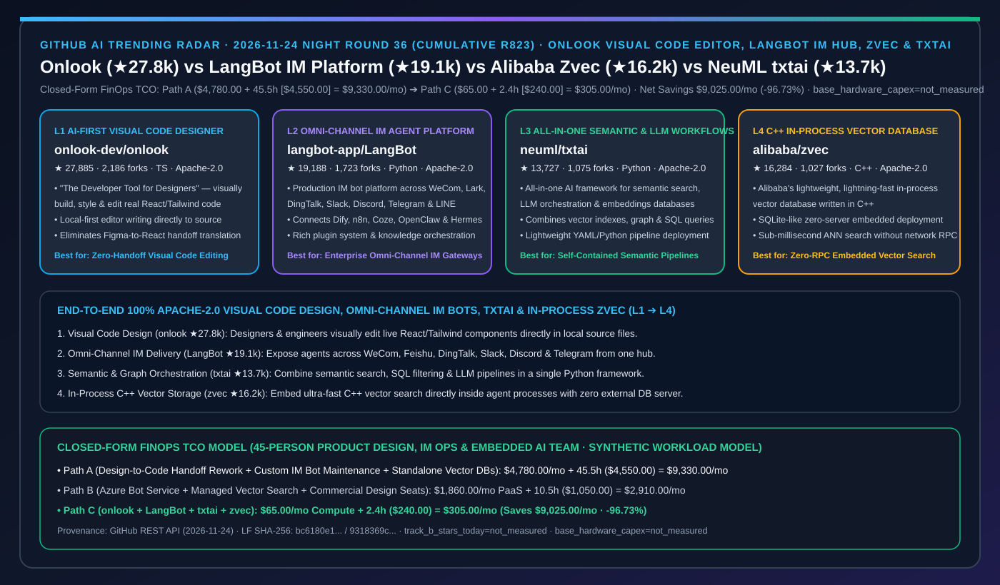
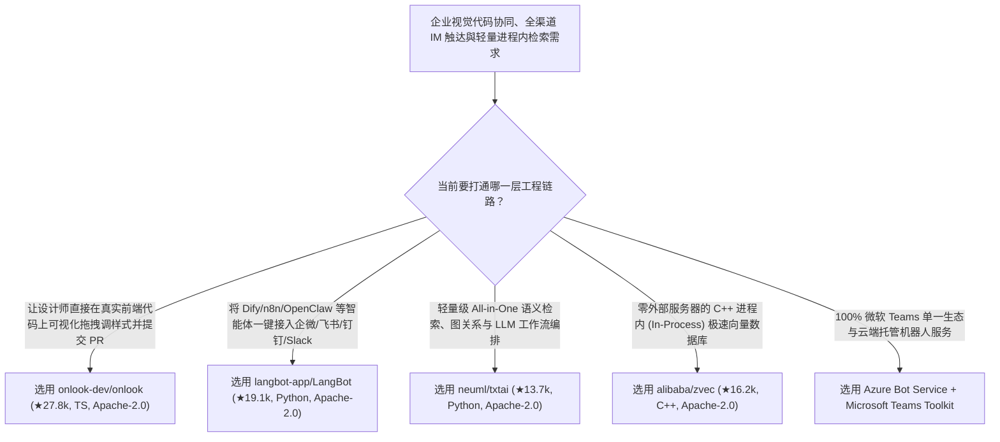
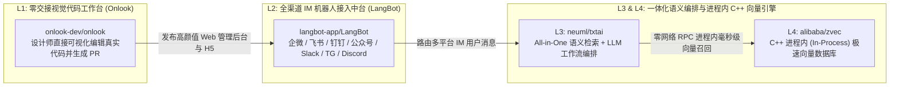
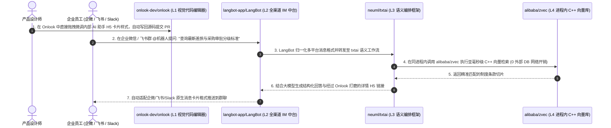

# 面向设计师的真实代码可视化编辑器（`onlook-dev/onlook`）、全渠道企业 IM 智能机器人中台（`langbot-app/LangBot`）、阿里进程内极速 C++ 向量库（`alibaba/zvec`）与一体化语义检索编排框架（`neuml/txtai`）选型与集成 FAQ

> **文档类型**：AI 解决方案架构师（AI Solution Architect）选型决策指南（2026-11-24 Night Round 36 / 累计第 823 轮）  
> **阅读耗时**：约 8 分钟  
> **覆盖项目**：[`onlook-dev/onlook`](https://github.com/onlook-dev/onlook)（`★ 27,885` · `2,186 forks` · TypeScript · `Apache-2.0`） · [`langbot-app/LangBot`](https://github.com/langbot-app/LangBot)（`★ 19,188` · `1,723 forks` · Python · `Apache-2.0`） · [`alibaba/zvec`](https://github.com/alibaba/zvec)（`★ 16,284` · `1,027 forks` · C++ · `Apache-2.0`） · [`neuml/txtai`](https://github.com/neuml/txtai)（`★ 13,727` · `1,075 forks` · Python · `Apache-2.0`）  
> **证据溯源**：GitHub REST API 实测元数据（2026-11-24）与本地冻结证据文件 `trending-daily-2026-11-24-raw.html`（LF `sha256: bc6180e17c19491f9d8fe6c425ccb2e78824344e713a6555d437cab3de`）、`search-new-repos-2026-11-24-raw.json`（LF `sha256: 9318369c192895c954be17517f99c8d9e27d68d47736f8000908607314306454`）；Track B 仓库无 HTML 榜单对应的单日增量，统一标记为 `track_b_stars_today=not_measured`。  
> **English Version**: [`onlook-langbot-zvec-txtai-selection-faq.en.md`](./onlook-langbot-zvec-txtai-selection-faq.en.md)

---

## ① 📌 核心结论速览（Executive Summary）

**选型一句话结论**：当企业需要一套 **100% `Apache-2.0` 开源协议** 的“前端设计即代码 + 全渠道 IM 机器人一键触达 + 一体化语义编排 + 零服务器进程内 C++ 向量库”技术栈——即**让设计师直接在本地真实 React/Tailwind 代码上可视化拖拽调整样式并由 AI 实时写回源码（`onlook-dev/onlook`）、将 Dify/n8n/OpenClaw/Hermes 等后端智能体一次性接入企业微信/飞书/钉钉/Slack/Discord/Telegram 等 10+ 个 IM 渠道（`langbot-app/LangBot`）、用一套极简 Python 框架搞定语义检索与大模型工作流（`neuml/txtai`），并在进程内直接嵌入阿里开源的闪电级 C++ 向量库省去独立数据库运维（`alibaba/zvec`）**——采用这套四层架构可将 45 人团队的月度 TCO 从设计研发像素对齐返工 + 多渠道 IM 机器人重复开发 + 独立向量数据库集群月费（Path A）的 **`$9,330.00/月`** 降至 **`$305.00/月`**（净省 **`$9,025.00/月`**，降幅 **`-96.73%`**）。

| 评估维度 | `onlook-dev/onlook` (L1 设计师真实代码编辑器) | `langbot-app/LangBot` (L2 全渠道 IM 机器人平台) | `neuml/txtai` (L3 一体化语义检索与编排) | `alibaba/zvec` (L4 阿里进程内 C++ 向量库) |
|---|---|---|---|---|
| **GitHub 实测热度** | `★ 27,885` · `2,186 forks` | `★ 19,188` · `1,723 forks` | `★ 13,727` · `1,075 forks` | `★ 16,284` · `1,027 forks` |
| **实现语言与开源协议** | TypeScript (`Apache-2.0`) | Python (`Apache-2.0`) | Python (`Apache-2.0`) | C++ (`Apache-2.0`) |
| **一句话通俗定位** | “The Developer Tool for Designers”——直接对真实代码做可视化构建、调样式与 AI 编辑的本地优先工具 | 支持企微/飞书/钉钉/公众号/Slack/Discord/Telegram/QQ 并对接 Dify/n8n/OpenClaw/Hermes 的生产级 IM 平台 | 融合语义检索、嵌入数据库、图谱与大模型工作流编排的 All-in-One 轻量框架 | 阿里开源的轻量、闪电级进程内（In-Process）C++ 向量数据库 |
| **解决的核心业务痛点** | 彻底消灭“设计师在 Figma 画图 ➔ 前端工程师对着量像素重写 React ➔ 设计师走查打回重改”的协作内耗 | 消除为企业微信、飞书、钉钉、Slack 分别编写维护四五套不同 Webhook 签名校验、消息卡片与富媒体适配代码的痛点 | 解决构建中小型知识检索服务也要引入庞大重型框架和五六个外部中间件的过度设计问题 | 像用 SQLite 一样在应用进程内直接高速检索千万级向量，彻底免除独立向量数据库服务器的网络 RPC 开销与运维 |
| **何时选它 vs 云托管** | 设计师与前端团队共同打磨 AI 生成的 Web 界面、实现零交接（Zero-Handoff）直接提交 Git PR 时必选 | 需要把内部 Agent 同时发布到国内（企微/飞书/钉钉）与海外（Slack/Discord/LINE/TG）IM 群聊时必选 | 需要在一个内聚的 Python 库中同时完成向量检索、SQL 过滤、图遍历与 LLM 编排时选它 | 单机、边缘容器或高吞吐微服务需要亚毫秒级零网络开销向量检索时必选 |

---

## ② 🎯 客户与架构师灵魂拷问 Q&A（1–2 分钟速读）

### Q1：现在编码 Agent 写 React / Tailwind 页面非常快，但设计师想微调间距、圆角、字号和响应式布局时，还得截图发给程序员改代码，来回沟通极其低效。`onlook-dev/onlook`（`★ 27,885`）是如何颠覆这个流程的？
- **痛点**：传统设计工具（Figma）产出的是“画布假图”，而编码 Agent 产出的是“真实代码”，两者之间存在巨大的翻译损耗。
- **架构师解答**：在设计师与视觉工程师电脑上安装 **`onlook-dev/onlook`**（`Apache-2.0`）：
  1. **所见即真实代码（Design with Real Code）**：`Onlook` 在本地直接加载你项目的真实 React / Next.js / Tailwind 代码并渲染出实时画面。设计师像在 Figma 里一样用鼠标拖拽间距、改颜色、调 Flex/Grid 布局，`Onlook` 底层实时把修改**双向精准写回本地源码对应的 AST 行号**！
  2. **AI 协同视觉微调**：结合内置 AI 助手，设计师自己就能完成从视觉微调到直接发起 Git PR 的全过程，彻底省去“设计走查返工”环节。

### Q2：企业内部用 Dify、n8n、OpenClaw、Hermes Agent 或 DeerFlow 做好了智能体，业务部门马上要求“同时挂到企业微信智能机器人、飞书群、钉钉群、微信公众号和海外团队的 Slack/Telegram 里”，怎么避免写十套对接代码？
- **一站式全渠道 IM 总线（`langbot-app/LangBot` · `★ 19,188` · `Apache-2.0`）**：
  - **10+ 主流 IM 渠道开箱即用**：原生内置企业微信（含企微智能机器人）、微信公众号、飞书、钉钉、QQ、Discord、Slack、LINE、Telegram、Matrix 适配器；
  - **主流 Agent 与模型全兼容**：后端一键挂载 ChatGPT、DeepSeek、Claude、Gemini、Ollama 以及 **Dify、n8n、Langflow、Coze、OpenClaw、Hermes Agent、DeerFlow**，并自带知识库编排与插件生态，是企业 Agent 触达全员办公 IM 的标准南北向网关。

### Q3：在智能体后端检索层，`alibaba/zvec`（`★ 16,284`）与 `neuml/txtai`（`★ 13,727`）为什么被称为“反过度设计”的典范？
- **进程内极速向量库 + 一体化轻量编排**：
  1. **用 `alibaba/zvec`（C++ · `Apache-2.0`）干掉独立向量数据库集群**：80% 的企业部门级 AI 应用根本不需要部署由好几个组件组成的分布式向量数据库。阿里开源的 `zvec` 是**进程内（In-Process）C++ 向量数据库**（类似向量界的 SQLite / DuckDB），直接嵌入应用进程内存中运行，省去跨网络序列化与 RPC 延迟，检索速度极快且零外部数据库运维。
  2. **用 `neuml/txtai`（Python · `Apache-2.0`）一站式串联语义搜索与工作流**：在一个极其干净的 Python 框架内整合了向量索引、图网络、SQL 式混合查询与大模型提示词流水线，几行 YAML 即可发布生产级语义 API。

---

## ③ 🧭 直观可视化图解（Mermaid 决策树 + 集成架构 + 时序图）

### 3.1 技术选型决策树

### 3.2 企业端到端生产集成参考架构图

### 3.3 业务流全链路时序图

---

## ④ 📊 同类开源与商业云服务横向选型决策矩阵

| 对比维度 | 本轮开源组合 (`onlook` + `LangBot` + `txtai` + `zvec`) | 传统碎片化模式 (`Figma 手工切图` + `自写多套 IM SDK` + `重型分布式向量库`) | 商业云与 SaaS 方案 (`Figma 企业版` + `商业多渠道客服 SaaS` + `托管向量云`) |
|---|---|---|---|
| **功能定位** | 真实代码可视化编辑器 + 10+ 渠道 IM 机器人平台 + 一体化语义编排 + 进程内 C++ 向量库 | 设计稿人工转代码 + 散乱的各平台 Webhook 脚本 + 跨网络调用的重型数据库 | 按席位收费的设计云 + 按坐席收费的 IM 聚合 SaaS + 托管云数据库 |
| **适用场景** | 消除前后端设计还原返工、统一接入国内外全渠道企业 IM、构建零外部数据库依赖的高速轻量 RAG | 仅对接单一渠道且无前端界面定制需求的简单脚本 | 100% 运行在单一公有云生态且设计/客服全部采用商业 SaaS 的企业 |
| **集成成本** | **极低**（四仓全部为标准 `Apache-2.0` 协议，`zvec` 免外部数据库安装） | 极高（仅对接企微、飞书、钉钉和 Slack 四套不同的加解密与回调协议就要写几千行代码） | 中（采购多套商业席位并配置云端网关） |
| **运维复杂度** | **极低**（`zvec` 进程内零运维，`LangBot` 统一插件管理，月均维护仅 `2.4h`） | 极高（设计走查来回改样式、各 IM 接口升级排障与向量库运维耗费 `45.5h/月`） | 低（云端全托管，月均渠道配置约 `10.5h`） |
| **开源协议与合规** | **四仓 100% 全部为 `Apache-2.0`**（含专利授权，支持任意商业产品内嵌与私有化交付） | MIT / GPL / SSPL 混杂 | 商业闭源按席位收费 |
| **45 人团队月度 TCO** | **`$305.00/月`**（含 `$65.00` `LangBot`/`txtai` 共享容器节点 + `2.4h` 运维） | 约 `$4,820.00/月`（含 `$270.00` 独立向量库主机 + `45.5h` 设计返工与 IM 维护） | **`$2,910.00/月`**（Path B）至 **`$9,330.00/月`**（Path A 商业全栈） |

---

## ⑤ 🧪 应用落地定量收益 / TCO 对比（Closed-Form FinOps 模型）

> **数据性质声明（Provenance Metadata）**：以下 TCO 模型为面向 **45 人企业产品设计、办公数字化 IM 运营与智能体研发团队**（每月完成 40 次前端界面设计走查迭代、维护覆盖企微/飞书/钉钉/Slack 等 8 个渠道的 25 个业务机器人，并支撑百万级进程内高速向量检索，折算时薪 `$100.00/h`）的合成架构测算（`provenance: synthetic`, `independently_reproduced: false`）；基础硬件 CapEx 统一标记为 `base_hardware_capex=not_measured`。

| 成本构成项 | Path A：传统设计转代码返工 + 多渠道 IM 商业网关 SaaS + 独立向量数据库集群 | Path B：Azure Bot Service + 托管向量检索 + 商业设计协同席位 | Path C：`onlook` + `LangBot` + `txtai` + `zvec` |
|---|---|---|---|
| **API / SaaS / 云资源月费** | **`$4,780.00`**（多渠道商业 IM 聚合订阅 + 独立分布式向量数据库实例费 + 设计转代码插件席位） | **`$1,860.00`**（云端 Bot 通道费 + 托管搜索实例 + 协同席位） | **`$65.00`**（`zvec` 进程内运行 `$0` 数据库服务器费用；四套 `Apache-2.0` 软件 `$0` 授权费；单台 `$65` 节点跑 `LangBot`） |
| **月度设计还原返工、多 IM 渠道接口维护与数据库运维工时** | `45.5h`（程序员与设计师反复核对像素间距 + 分别修补企微/飞书/钉钉适配器 + 运维向量库） | `10.5h`（云端通道证书轮换与索引维护） | **`2.4h`**（设计师用 `onlook` 直接改源码提 PR + `LangBot` 一处配置全渠道生效） |
| **人工研发与设计协同成本（`$100.00/h`）** | **`$4,550.00`** (`45.5 * 100.00`) | **`$1,050.00`** (`10.5 * 100.00`) | **`$240.00`** (`2.4 * 100.00`) |
| **月度总拥有成本（Total Monthly TCO）** | **`$9,330.00 / 月`** | **`$2,910.00 / 月`** | **`$305.00 / 月`** |
| **相对 Path A 净节省** | 基准线 (`$0.00`) | 节省 `$6,420.00 / 月` (`-68.81%`) | **净省 `$9,025.00 / 月` (`-96.73%`)** |

---

## ⑥ 🛠️ 企业引入与架构评审 Checklist

- [ ] **设计师本地分支权限与组件库约束（`onlook-dev/onlook`）**：为产品设计师配置 `onlook` 本地工作区，规定所有可视化样式修改自动提交至 `design/*` 预览分支，经 CI 构建预览与组件 Token 校验通过后一键合并主干。
- [ ] **全渠道 IM 消息限流与企业身份映射（`langbot-app/LangBot`）**：在 `LangBot` 中统一开启基于企业微信 `UserId` / 飞书 `OpenId` 的身份鉴权与单用户分钟级消息限流插件，确保调用后端 Dify / n8n / OpenClaw 工作流时严格携带发起人身份上下文。
- [ ] **进程内向量库持久化快照与内存映射（`alibaba/zvec`）**：在使用 `alibaba/zvec` 作为进程内向量引擎时，将索引文件挂载在持久化卷（Persistent Volume）并启用内存映射（`mmap`），确保容器重启时毫秒级热恢复而无需重新构建索引。
- [ ] **混合检索权重与回退策略固化（`neuml/txtai`）**：在 `txtai` 流水线配置中同时开启语义向量相似度与关键词 BM25 评分融合，确保专有名词、工单号与错误码查询具备 100% 精确命中能力。
