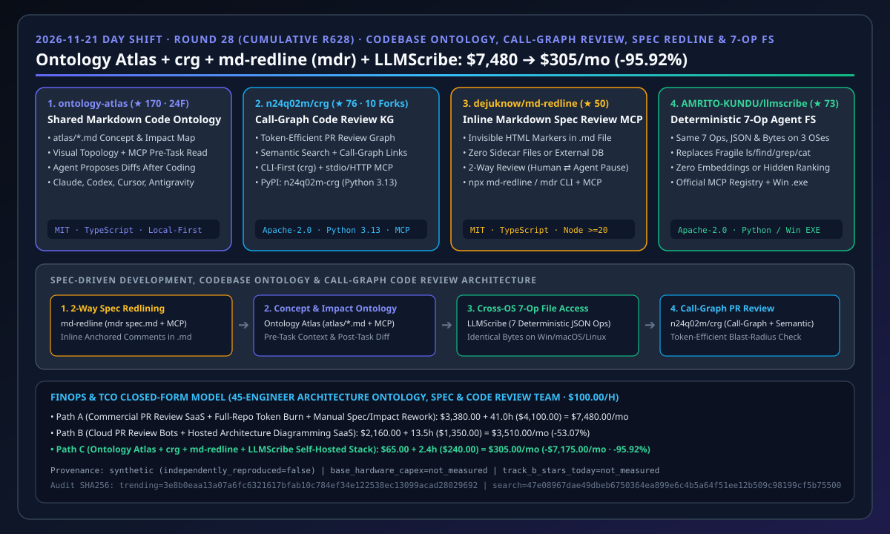
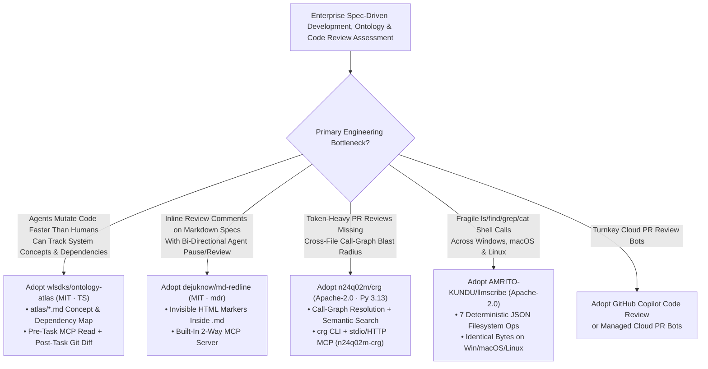
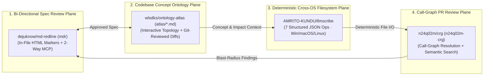
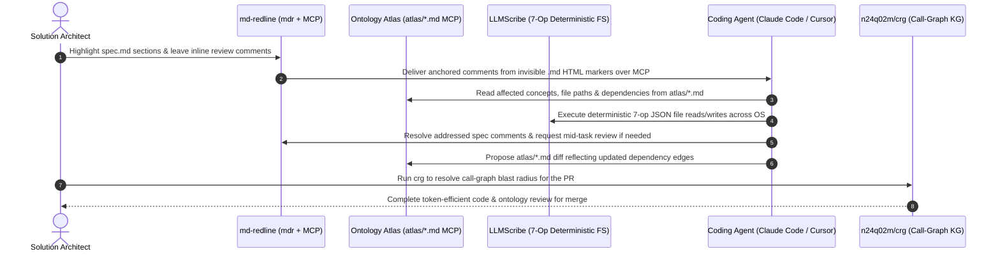

# Shared Codebase Ontology (`wlsdks/ontology-atlas`), Call-Graph Code Review KG (`n24q02m/crg`), Bi-Directional Markdown Spec Redlining (`dejuknow/md-redline`) & Deterministic 7-Op Filesystem Layer (`AMRITO-KUNDU/llmscribe`) Selection FAQ

> **Document Metadata (2026-11-21 Day Shift Round 28 · Cumulative Round 628 Deep-Dive)**  
> - **Target Audience**: Enterprise AI Solution Architects, Spec-Driven Development Leads, and Code Review / Developer Experience Architects  
> - **Evaluated Repositories**:  
>   1. [`wlsdks/ontology-atlas`](https://github.com/wlsdks/ontology-atlas) (`★ 170` · `24 forks` · TypeScript · MIT · Shared Markdown ontology `atlas/*.md` for humans and coding agents [Claude Code, Codex, Cursor, Antigravity]—visualized as an interactive dependency map for humans, queried over MCP before tasks, and updated via Git-reviewed Markdown diffs)  
>   2. [`n24q02m/crg`](https://github.com/n24q02m/crg) (`★ 76` · `10 forks` · Python 3.13 · Apache-2.0 · **Better Code Review Graph (`n24q02m-crg` / `io.github.n24q02m/crg`)**: CLI-first `crg` + stdio/HTTP MCP knowledge graph combining semantic search and call-graph resolution for token-efficient code reviews)  
>   3. [`dejuknow/md-redline`](https://github.com/dejuknow/md-redline) (`★ 50` · `11 forks` · TypeScript · MIT · `npx md-redline` / `mdr`: Bi-directional inline review comments for Markdown specs and prompts stored as invisible HTML markers inside the `.md` file itself and handed directly to AI agents over MCP)  
>   4. [`AMRITO-KUNDU/llmscribe`](https://github.com/AMRITO-KUNDU/llmscribe) (`★ 73` · `1 fork` · Python · Apache-2.0 · `io.github.AMRITO-KUNDU/llmscribe`: Deterministic cross-OS filesystem layer exposing the exact same 7 JSON operations and bytes across Linux, macOS, and Windows with zero hidden embeddings or ranking)  
> - **Sealed Evidence Chain**: `workshops/github-trending-radar/evidence/search-new-repos-2026-11-21-raw.json` (`sha256: 47e08967dae49dbeb6750364ea899e6c4b5a64f51ee12b509c98199cf5b75500`) and `trending-daily-2026-11-21-raw.html` (`sha256: 3e8b0eaa13a07a6fc6321617bfab10c784ef34e122538ec13099acad28029692`)  
> - **Architecture Visual**: [`assets/github-ai-radar-2026-11-21-r28-r628-ontologyatlas-crg-mdredline-llmscribe.svg`](../../../assets/github-ai-radar-2026-11-21-r28-r628-ontologyatlas-crg-mdredline-llmscribe.svg) · [中文版 (`ontology-atlas-crg-md-redline-llmscribe-selection-faq.md`)](ontology-atlas-crg-md-redline-llmscribe-selection-faq.md)

---

## ① 📌 Executive Summary (One-Sentence Selection Verdict)

> **Solution Architect's Verdict**:  
> Coding agents now mutate repositories faster than engineering teams can maintain a mental model of the system—creating four acute bottlenecks: **(1) engineers lose track of what capabilities exist, which files implement them, and what a change might break, (2) reviewing Markdown specs and prompts requires clunky copy-pasting between viewers and agent chats, (3) PR reviews burn massive token budgets loading irrelevant files instead of following the true call graph, and (4) shell commands (`ls`/`find`/`grep`/`cat`) behave inconsistently across Windows, macOS, and Linux**.  
> - **To maintain a shared, Git-reviewed Markdown ontology (`atlas/*.md`) visualized as a live topology map for humans and read/updated by coding agents over MCP** ➔ Choose **`wlsdks/ontology-atlas`** (MIT, `★ 170`);  
> - **For bi-directional inline review comments on Markdown specs (`mdr spec.md`) stored as invisible HTML markers inside the `.md` file itself and wired directly to agents via MCP** ➔ Choose **`dejuknow/md-redline`** (MIT);  
> - **For token-efficient code reviews powered by semantic search and call-graph resolution (`crg` CLI + stdio/HTTP MCP)** ➔ Choose **`n24q02m/crg`** (Apache-2.0, `n24q02m-crg`);  
> - **For a deterministic cross-OS filesystem MCP layer delivering the exact same 7 operations, JSON schema, and bytes across Linux, macOS, and Windows** ➔ Choose **`AMRITO-KUNDU/llmscribe`** (Apache-2.0).  
> Combined, this stack reduces monthly commercial code-review SaaS fees, full-repo context token burn, and spec/cross-OS rework TCO for a 45-engineer team from **$7,480.00/mo** to **$305.00/mo (-$7,175.00/mo, -95.92%)**.

---

## ② 🎯 Solution Architect & Customer Deep-Dive Q&A

### Q1: *"Coding agents now change code faster than a team can keep a picture of it in their heads."* How do `ontology-atlas` and `md-redline` keep human architects in control of both specs and system structure?
- **Two Spec & Architecture Drift Bottlenecks**:
  1. **Mental Model Erosion**: Agents ship features rapidly, leaving humans unsure which files implement a domain capability or what downstream systems depend on it.
  2. **Spec Review Friction**: In spec-driven development (*"specs are the new code"*), reviewing a Markdown spec means manually copying paragraphs into a chat prompt.
- **How `ontology-atlas` + `md-redline` Close the Loop**:
  - **`wlsdks/ontology-atlas` (Git-Versioned `atlas/*.md` Ontology & Interactive Topology)**:
    - Stores one Markdown file per concept in an `atlas/` folder recording what each part is for, which files implement it, what depends on what, and open questions.
    - Claude Code, Codex, Cursor, and Antigravity read the ontology over MCP **before** a task and propose `atlas/*.md` updates **after** coding—which humans accept, edit, or reject as normal Git diffs alongside an interactive visual map.
  - **`dejuknow/md-redline` (Zero-Sidecar Bi-Directional Markdown Spec Redlining)**:
    - `npx md-redline /path/to/spec.md` (`mdr`) lets you highlight text in a rendered document and leave inline comments stored as **invisible HTML markers inside the `.md` file itself** (no sidecar files, no database).
    - Through its built-in MCP server, review works **in both directions**: humans highlight and comment for the agent to resolve, or the agent pauses mid-task to request human review / leaves anchored questions on a spec you wrote.

### Q2: How do `llmscribe` and `n24q02m/crg` replace fragile shell file commands and bloated full-repo PR reviews?
- **`AMRITO-KUNDU/llmscribe` (7 Deterministic Cross-Platform Filesystem Operations)**:
  - Shell utilities (`ls`, `find`, `grep`, `cat`) were built for humans reading terminals and break across Windows PowerShell vs. Unix shells.
  - `llmscribe` (listed in the Official MCP Registry with PyPI and standalone Windows `.exe` builds) provides **one structured interface with the same 7 operations, the same JSON, and the same bytes across Linux, macOS, and Windows**—with zero AI, zero embeddings, and zero hidden ranking.
- **`n24q02m/crg` (Call-Graph Resolution & Semantic Search for Token-Efficient Code Reviews)**:
  - Distributed on PyPI as `n24q02m-crg` (`crg` CLI + stdio/HTTP self-hosted MCP), `crg` builds a codebase knowledge graph that resolves exact call graphs and semantic neighbors so code-review agents inspect only the true blast radius of a diff.

### Q3: What package-naming and runtime requirements should Solution Architects verify?
- **Key Engineering Notes**:
  - **`n24q02m/crg` Package Rename**: Formerly `better-code-review-graph`, the repository is now `crg` and the PyPI package is **`n24q02m-crg`** (requiring Python 3.13, with CLI `crg` as the primary interface and MCP as the secondary surface).
  - **`md-redline` Session Lifecycle**: Requires Node 20+; manage active review servers via `mdr sessions`, `mdr sessions --kill ID`, and `mdr --stop`.

---

## ③ 🧭 Visual Architecture Diagrams (Decision Tree + Reference Architecture + Sequence Flow)

### 3.1 Solution Architect Selection Decision Tree (Mermaid Flowchart)

### 3.2 Spec-Driven Development, Codebase Ontology & Call-Graph Review Architecture (Mermaid Architecture)

### 3.3 Inline Spec Redlining, Ontology-Guided Coding & Call-Graph Review Sequence (Mermaid Sequence Diagram)

---

## ④ 📊 Horizontal Selection Matrix (Open-Source Quartet vs. Commercial SaaS)

| Dimension | `wlsdks/ontology-atlas` (`★ 170`) | `n24q02m/crg` (`★ 76`) | `dejuknow/md-redline` (`★ 50`) | `AMRITO-KUNDU/llmscribe` (`★ 73`) | Commercial PR Review & Cloud Doc SaaS |
| :--- | :--- | :--- | :--- | :--- | :--- |
| **Primary Role** | Shared `atlas/*.md` codebase ontology & visual map | Call-graph & semantic search code-review knowledge graph | Bi-directional inline Markdown spec review tool & MCP | Deterministic 7-operation cross-OS filesystem MCP | Per-seat cloud PR review bots & hosted doc editors |
| **Best-Fit Scenario** | Keeping human and agent understanding of codebase structure aligned | Cutting PR review token usage via call-graph blast-radius resolution | Reviewing Markdown specs, prompts & design docs in place | Replacing fragile shell file commands across Windows, macOS & Linux | Teams relying exclusively on hosted browser SaaS |
| **Key Differentiator** | One `.md` per concept in Git, interactive map, pre/post-task MCP loop | CLI-first `crg` + stdio/HTTP MCP, call-graph + semantic hybrid | Comments stored as invisible HTML markers inside `.md`, 2-way MCP | Same 7 ops, JSON & bytes across 3 OSes, zero embeddings/ranking | Turnkey cloud setup, recurring per-seat subscription fees |
| **Integration & Ops Effort** | Low (`atlas/` folder in repo + `.mcp.json`) | Low (`pip install n24q02m-crg` on Python 3.13 or Docker) | Very Low (`npx md-redline /path/to/spec.md`, Node `>=20`) | Very Low (`pip install llmscribe` or standalone Windows `.exe`) | Low (high monthly per-developer seat billing) |
| **License** | MIT | Apache-2.0 | MIT | Apache-2.0 | Proprietary |
| **45-Eng Monthly TCO** | **Combined `$305.00/mo`** (`$65` shared `crg` HTTP host + `2.4h` ops) | Included (slashes PR review token consumption) | Included (zero external DB or cloud service) | Included (100% local deterministic binary) | **`$3,510.00 – $7,480.00/mo`** |

---

## ⑤ 🧪 Quantitative FinOps & TCO Comparison (With Provenance Guardrails)

> **Provenance & Guardrails Declaration**:  
> - `provenance`: `"synthetic"` (`independently_reproduced: false`, closed-form FinOps model for a 45-engineer architecture ontology, spec-driven development, and code-review team at `$100.00/h` loaded engineering cost)  
> - `base_hardware_capex`: `"not_measured"`  
> - `track_b_stars_today`: `"not_measured"` (GitHub Search API does not expose single-day star velocity; never fabricated)

| Cost Component (45-Engineer Team / Month) | Path A: Commercial PR Review SaaS + Full-Repo Token Burn + Manual Spec/Impact Rework | Path B: Cloud PR Review Bots + Hosted Architecture Diagramming SaaS | Path C: `Ontology Atlas` + `crg` + `md-redline` + `LLMScribe` Self-Hosted Stack |
| :--- | :--- | :--- | :--- |
| **PR Review SaaS Seats / Redundant Context Tokens** | `$3,380.00 / mo` | `$2,160.00 / mo` | **`$65.00 / mo`** (shared self-hosted `crg` HTTP knowledge-graph node) |
| **Cross-OS Shell Fixes, Spec Copy-Paste & Impact Analysis** | `41.0 hours / mo` | `13.5 hours / mo` | **`2.4 hours / mo`** (`mdr` inline MCP + `atlas/` diffs + 7-op JSON FS) |
| **Engineering Labor Cost (`$100.00/h`)** | `$4,100.00 / mo` | `$1,350.00 / mo` | **`$240.00 / mo`** |
| **Total Monthly TCO** | **`$7,480.00 / mo`** | **`$3,510.00 / mo`** | **`$305.00 / mo`** |
| **Net Monthly Savings vs. Path A** | Baseline (`0.00%`) | `-$3,970.00 / mo` (`-53.07%`) | **`-$7,175.00 / mo` (`-95.92%`)** |

---

## ⑥ 🛠️ Enterprise Adoption & Architecture Review Checklist

- [ ] **Version-Control `atlas/*.md` Concept Maps (`ontology-atlas`)**: Configure coding agents (Claude Code, Codex, Cursor, Antigravity) to read `atlas/*.md` over MCP before starting tasks and require PRs to include updated ontology diffs when dependencies change.
- [ ] **Standardize Inline Spec Reviews (`md-redline`)**: Use `mdr /path/to/spec.md` (`npx md-redline`) with its built-in MCP server so spec feedback stays anchored as invisible HTML markers inside the `.md` file itself.
- [ ] **Resolve Call-Graph Blast Radius in Code Reviews (`n24q02m/crg`)**: Install `n24q02m-crg` on Python 3.13 (`crg` CLI + stdio/HTTP MCP) so review agents fetch exact call-graph neighbors rather than entire repositories.
- [ ] **Replace Ad-Hoc Shell File Scripts with `llmscribe`**: Register `AMRITO-KUNDU/llmscribe` across Windows, macOS, and Linux workstations so agents rely on its 7 deterministic JSON operations.
