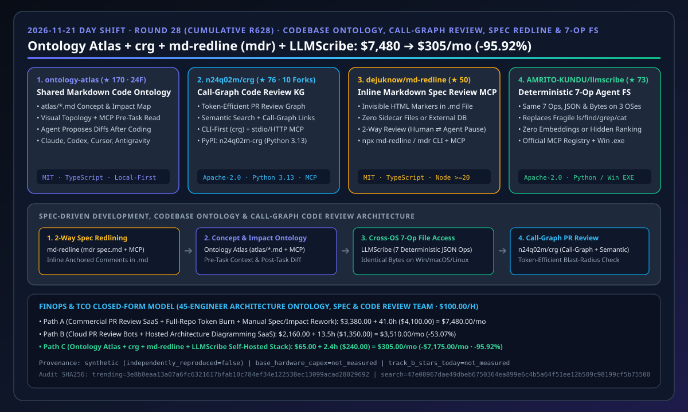
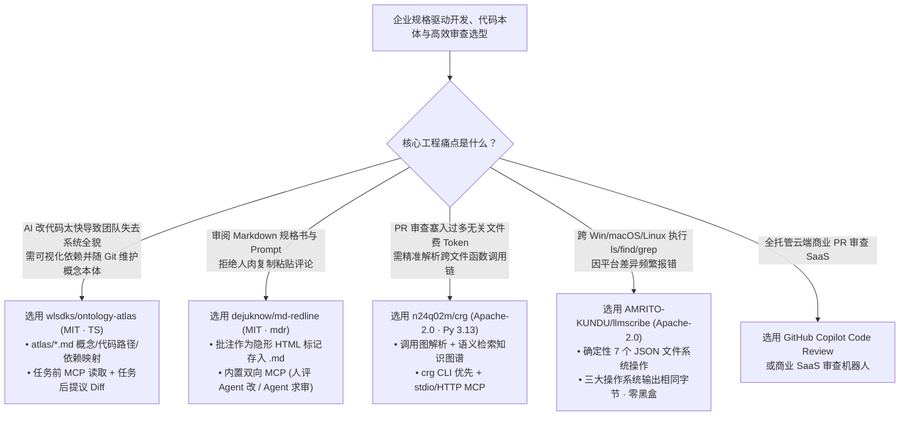
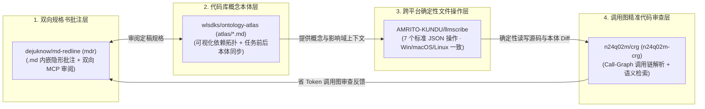
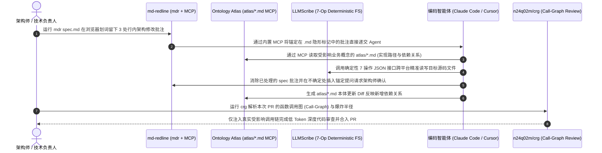

# 代码库共享本体地图（`wlsdks/ontology-atlas`）、省 Token 调用图代码审查（`n24q02m/crg`）、Markdown 规格书双向行内批注 MCP（`dejuknow/md-redline`）与跨平台确定性 7 操作文件系统层（`AMRITO-KUNDU/llmscribe`）选型 FAQ

> **文档元数据（2026-11-21 白班 Day Round 28 · 累计第 628 轮深潜专题）**  
> - **面向对象**：企业 AI 解决方案架构师（AI Solution Architect）、研发效能负责人、规格驱动开发（Spec-Driven Development）推动者  
> - **本轮核心评估对象**：  
>   1. [`wlsdks/ontology-atlas`](https://github.com/wlsdks/ontology-atlas)（`★ 170` · `24 forks` · TypeScript · MIT · 人与编码智能体共享的代码库 Markdown 本体图谱 `atlas/*.md`：人类看交互式依赖拓扑，Claude/Codex/Cursor/Antigravity 任务前经 MCP 读取概念与影响域、任务后提交本体 Diff 供 Git 评审）  
>   2. [`n24q02m/crg`](https://github.com/n24q02m/crg)（`★ 76` · `10 forks` · Python 3.13 · Apache-2.0 · **Better Code Review Graph (`n24q02m-crg`)**：融合语义搜索与调用图解析（call-graph resolution）的高效代码审查知识图谱，提供 `crg` CLI 与 stdio/HTTP MCP）  
>   3. [`dejuknow/md-redline`](https://github.com/dejuknow/md-redline)（`★ 50` · `11 forks` · TypeScript · MIT · `npx md-redline` / `mdr`：面向 Markdown 架构规格书与 Prompt 的行内批注工具，批注以隐形 HTML 标记直接保存在 `.md` 文件内，并通过内置 MCP 实现“人评 Agent 改”与“Agent 提问暂停等人批注”的双向协同）  
>   4. [`AMRITO-KUNDU/llmscribe`](https://github.com/AMRITO-KUNDU/llmscribe)（`★ 73` · `1 fork` · Python · Apache-2.0 · 官方 MCP Registry 收录的跨平台确定性文件系统层，用统一的 **7 个结构化 JSON 操作**替代脆弱的 `ls`/`find`/`grep`/`cat` 终端命令，在 Linux、macOS 与 Windows 上输出完全一致的字节）  
> - **关联检索证据链**：`workshops/github-trending-radar/evidence/search-new-repos-2026-11-21-raw.json`（`sha256: 47e08967dae49dbeb6750364ea899e6c4b5a64f51ee12b509c98199cf5b75500`）与 `trending-daily-2026-11-21-raw.html`（`sha256: 3e8b0eaa13a07a6fc6321617bfab10c784ef34e122538ec13099acad28029692`）  
> - **高清架构图**：[`assets/github-ai-radar-2026-11-21-r28-r628-ontologyatlas-crg-mdredline-llmscribe.svg`](../../../assets/github-ai-radar-2026-11-21-r28-r628-ontologyatlas-crg-mdredline-llmscribe.svg) · [English Version (`ontology-atlas-crg-md-redline-llmscribe-selection-faq.en.md`)](ontology-atlas-crg-md-redline-llmscribe-selection-faq.en.md)

---

## ① 📌 核心结论速览（选型一句话结论）

> **架构师一句话选型结论**：  
> 当今编码智能体改代码的速度，已经远远超过了人类研发团队在脑海里更新系统全貌的速度——随之而来的是 **“改完代码团队没人知道波及了哪些上下游概念、审查 Markdown 设计文档还要人肉把评论复制粘贴回对话框、跨 Windows/Linux 跑 Shell 文件命令频繁报错、以及 PR 审查把无关文件全塞进上下文烧光 Token”**。  
> - **需要一张随代码保存在 `atlas/*.md` 目录里、人类能可视化点击查看上下游依赖、Agent 改代码前通过 MCP 读取并在改完后自动提议更新 Diff 的“活体系统本体地图”** ➔ 选 **`wlsdks/ontology-atlas`**（MIT，`★ 170`）；  
> - **践行“Specs are the new code”：想在浏览器渲染的 Markdown 架构文档上直接划词写行内批注（无外部数据库、作为隐形 HTML 标记存在 `.md` 内），并通过 MCP 让 Agent 直接读取批注或主动请求人类审阅** ➔ 选 **`dejuknow/md-redline`**（MIT，`mdr`）；  
> - **在 PR 代码审查中需要结合语义搜索与真实函数调用图（Call-Graph）精准圈定爆炸半径以大幅节省 Token** ➔ 选 **`n24q02m/crg`**（Apache-2.0，`n24q02m-crg`）；  
> - **需要用一套跨 Linux、macOS、Windows 字节级完全一致的 7 个结构化 JSON 文件操作替代脆弱的 `ls`/`find`/`grep`/`cat` 终端脚本** ➔ 选 **`AMRITO-KUNDU/llmscribe`**（Apache-2.0）。  
> 四者组合可将 45 人研发与架构团队的商业代码审查 SaaS、全仓 Token 浪费与设计文档/跨平台排障总成本从 **$7,480.00/月** 降至 **$305.00/月（节省 $7,175.00/月，降幅 95.92%）**。

---

## ② 🎯 客户与架构师灵魂拷问 Q&A（业务痛点 · 架构集成 · 边界取舍）

### Q1：“Coding agents now change code faster than a team can keep a picture of it in their heads.”——当智能体一天提交十几个 PR 时，如何用 `ontology-atlas` 与 `md-redline` 守住架构设计与业务概念的一致性？
- **高流速 AI 研发的两大失控现场**：
  1. **心智模型落后于代码演进**：智能体写完一堆新文件，架构师只看了语法没毛病就合入了，结果三个月后没人说得清某个核心概念到底由哪几个文件实现、依赖什么、还有哪些未知悬念。
  2. **Markdown 设计规格书审阅链路断裂**：架构师看 Agent 生成的 `spec.md`，发现第 3 段和第 8 段有问题，只能在聊天框里打字说“把第 3 段改成……”，来回切换极其低效。
- **`ontology-atlas` + `md-redline` 的双向闭环**：
  - **`wlsdks/ontology-atlas`（仓库级 `atlas/*.md` 概念本体与影响域可视化）**：
    - 每个核心业务概念对应 `atlas/` 下的一个 Markdown 文件，记录该模块的目标、实现代码路径、上下游依赖与未决问题（open questions）。
    - **任务前读取、任务后提议更新**：Claude Code、Codex、Cursor 与 Antigravity 在动手写代码前先通过 MCP 读取相关概念与依赖链路；代码改完后，智能体自动提议对 `atlas/*.md` 的更新，架构师像审代码一样通过 Git Diff 决定保留、修正或拒绝。
  - **`dejuknow/md-redline`（零 Sidecar 文件的双向 Markdown 行内批注 MCP）**：
    - 执行 `npx md-redline /path/to/spec.md`（或 `mdr`）即可在浏览器高亮划词批注；所有批注以**隐形 HTML 标记直接嵌在原 `.md` 文件内**，无需外部数据库或伴生文件，Markdown 自身始终是唯一事实源（Single Source of Truth）。
    - **双向 MCP 协同**：既支持人类划词批注后让 Agent 直接通过 MCP 读取并逐条修改，也支持 Agent 在任务中途主动发起审阅请求并暂停等待人类反馈，或者由 Agent 审查人类写的文档并留下锚定批注。

### Q2：为什么 Agent 在 Windows 和 Linux 混合环境下跑 `find`/`grep` 总是翻车？PR 审查又如何避免把整个代码库塞进上下文？`llmscribe` 与 `n24q02m/crg` 提供了什么解法？
- **`AMRITO-KUNDU/llmscribe`（跨三端字节级一致的 7 操作结构化文件系统层）**：
  - 传统 `ls`、`find`、`grep`、`cat` 是为人类看终端设计的，在 Windows PowerShell 与 Linux Bash 下的参数、路径分隔符与换行符截然不同。
  - `llmscribe`（已收录于官方 MCP Registry，提供 PyPI 包与独立 Windows `.exe`）完全不引入黑盒 AI、不搞向量嵌入或隐藏重排，而是提供**确定性的 7 个标准操作**：在 Linux、macOS 与 Windows 上返回完全一致的 JSON 结构与字节流，适配 Cursor、Claude Code、Codex、VS Code、Windsurf、Zed、JetBrains 等 11+ 客户端。
- **`n24q02m/crg`（调用图 + 语义搜索驱动的省 Token 代码审查图谱）**：
  - 针对 PR 代码审查场景（PyPI 包名 `n24q02m-crg`，命令 `crg`，支持 stdio 与自托管 HTTP 双模式），将**函数调用图解析（call-graph resolution）与语义检索**结合，精准提取某次代码改动真正影响的上下游调用链，用最少的 Token 让审查 Agent 看清完整调用上下文。

### Q3：这四个项目在落地时有哪些命名变更与环境要求需要注意？
- **工程落地关键细节**：
  - **`n24q02m/crg` 包名与命令规范**：项目已由旧名 `better-code-review-graph` 正式更名为 `crg`，PyPI 安装包名为 **`n24q02m-crg`**（保留旧命令别名兼容），设计上坚持 **CLI 优先（`crg` 命令）**、MCP Server 为辅，运行需 Python 3.13。
  - **`md-redline` 环境与会话管理**：需 Node 20+，可通过 `mdr sessions` 查看当前打开的审阅会话、用 `mdr sessions --kill <ID>` 关闭指定会话或 `mdr --stop` 停止本地服务。

---

## ③ 🧭 直观可视化图解（选型决策树 + 企业集成架构 + 业务流时序图）

### 3.1 架构师选型决策树（Mermaid Flowchart）

### 3.2 企业规格批注、本体导航与调用图代码审查参考架构图（Mermaid Architecture）

### 3.3 从规格书行内批注、本体读取编码到调用图 PR 审查全链路时序图（Mermaid Sequence Diagram）

---

## ④ 📊 同类开源与商业云服务横向选型决策矩阵

| 评估维度 | `wlsdks/ontology-atlas` (`★ 170`) | `n24q02m/crg` (`★ 76`) | `dejuknow/md-redline` (`★ 50`) | `AMRITO-KUNDU/llmscribe` (`★ 73`) | 商业 PR 审查 SaaS + 云端文档协同平台 |
| :--- | :--- | :--- | :--- | :--- | :--- |
| **核心定位** | 人机共享的 `atlas/*.md` 代码库概念本体与拓扑图 | 融合调用图与语义搜索的省 Token 代码审查图谱 | 零外部依赖的 Markdown 规格书双向行内批注 MCP | 跨三端字节级一致的 7 操作结构化文件系统层 | 按席位收费的云端审查机器人与在线文档 SaaS |
| **最适用场景** | 在高频 AI 改代码过程中保持团队对系统架构与影响域的掌控 | 大型代码库 PR 审查时精准提取上下游调用链、削减无效 Token | 审阅修改 `spec.md`、架构设计文档与复杂系统 Prompt | 替代跨 Windows/macOS/Linux 易出错的 `ls`/`find`/`grep` 命令 | 纯云端办公且预算充裕的商业采购 |
| **关键差异化机制** | 每概念一 Markdown、可视化点击高亮依赖、Agent 提议本体 Diff | CLI 优先（`crg`）+ stdio/HTTP MCP、调用图爆炸半径解析 | 批注作为隐形 HTML 标记存于 `.md` 内、支持 Agent 暂停求审 | 确定性 7 操作、零嵌入/零隐藏排序、官方 MCP Registry + Win `.exe` | 免本地安装，但设计文档与代码仓脱节且按人头收费 |
| **集成与运维成本** | 低（本地优先桌面/Web 拓扑 + `.mcp.json` 一键挂载） | 低（`pip install n24q02m-crg` 或 Docker 自托管 HTTP） | 极低（`npx md-redline spec.md`，Node `>=20`） | 极低（`pip install llmscribe` 或直接运行独立 Windows `.exe`） | 低（持续发生每开发者每月商业订阅费） |
| **开源协议** | MIT | Apache-2.0 | MIT | Apache-2.0 | 商业专有 |
| **45 人团队月均 TCO** | **组合方案 `$305.00/月`**（含共享自托管 `crg` 节点 `$65` + 运维 `2.4h`） | 同左（调用图精准裁剪大幅降低审查 Token 账单） | 同左（零数据库零云端费用） | 同左（100% 本机运行零网络开销） | **`$3,510.00 ~ $7,480.00/月`** |

---

## ⑤ 🧪 应用落地定量收益 / FinOps TCO 对比（含数据血缘声明）

> **数据血缘与严谨性声明（Provenance & Guardrails）**：  
> - `provenance`: `"synthetic"`（`independently_reproduced: false`，基于 45 人架构治理、规格驱动开发与代码审查工程团队在 `$100.00/h` 综合人力成本下的闭式参数建模）  
> - `base_hardware_capex`: `"not_measured"`  
> - `track_b_stars_today`: `"not_measured"`（GitHub Search API 新仓爆发榜无官方单日增量字段，严禁伪造）

| 成本分项（45 人团队 / 月） | Path A：商业 PR 审查 SaaS + 全仓塞上下文 Token 费 + 手工规格返工 | Path B：云端 PR 审查机器人 + 在线架构图 SaaS | Path C：`Ontology Atlas` + `crg` + `md-redline` + `LLMScribe` 自建栈 |
| :--- | :--- | :--- | :--- |
| **商业审查与文档 SaaS 席位 / 冗余审查 Token 费** | `$3,380.00 / 月` | `$2,160.00 / 月` | **`$65.00 / 月`**（共享自托管 `crg` 图谱服务节点） |
| **跨系统 Shell 报错、规格书复制粘贴与影响域排查工时** | `41.0 小时 / 月` | `13.5 小时 / 月` | **`2.4 小时 / 月`**（`mdr` 行内批注 + `atlas/` 本体 + 7 操作确定性读写） |
| **折算工程人力成本（`$100.00/h`）** | `$4,100.00 / 月` | `$1,350.00 / 月` | **`$240.00 / 月`** |
| **月度总拥有成本（Total Monthly TCO）** | **`$7,480.00 / 月`** | **`$3,510.00 / 月`** | **`$305.00 / 月`** |
| **相对 Path A 净节省额与降幅** | 基准线（`0.00%`） | `-$3,970.00 / 月`（`-53.07%`） | **`-$7,175.00 / 月`（`-95.92%`）** |

---

## ⑥ 🛠️ 企业引入与架构评审 Checklist

- [ ] **建立随仓演进的 `atlas/*.md` 本体规范（`ontology-atlas`）**：在核心仓库初始化 `atlas/` 目录并配置 `.mcp.json`，要求编码智能体在修改跨模块代码前先读取概念本体，并在 PR 中一并提交 `atlas/*.md` 的变更 Diff。
- [ ] **用行内隐形批注重构设计评审流程（`md-redline`）**：安装 `npm install -g md-redline`（`mdr`），对所有架构规格书与复杂 Prompt 使用 `mdr /path/to/spec.md` 进行双向 MCP 行内批注审阅，保持 `.md` 单文件为唯一事实源。
- [ ] **在 PR 流水线启用调用图精准审查（`n24q02m/crg`）**：在 Python 3.13 环境安装 `pip install n24q02m-crg`，使用 `crg` CLI 或 HTTP 自托管 MCP 为代码审查 Agent 提供精确的跨文件调用链（call-graph）上下文。
- [ ] **在跨 OS 团队统一挂载确定性文件系统 MCP（`llmscribe`）**：为 Windows、macOS 与 Linux 开发者的 IDE 统一配置 `AMRITO-KUNDU/llmscribe`，用 7 个标准 JSON 文件系统操作替代易受 Shell 方言影响的终端脚本。
