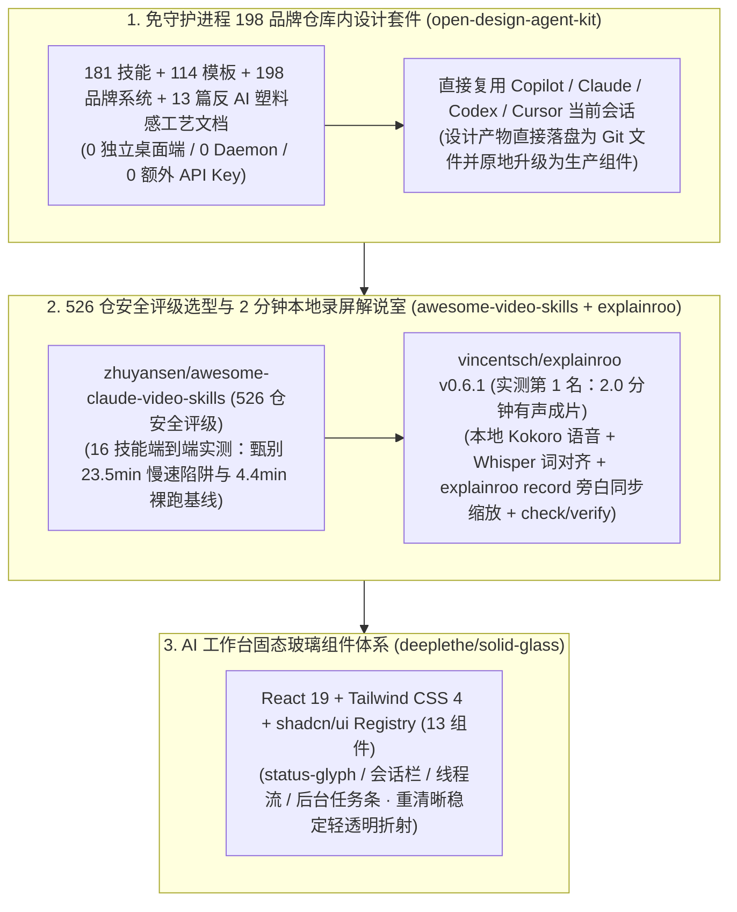

# 免守护进程 198 品牌设计套件（`feimacode/open-design-agent-kit`）、2 分钟本地 Kokoro+Whisper 录屏解说室（`vincentsch/explainroo`）、526 仓安全评级与 16 技能实测视频榜（`zhuyansen/awesome-claude-video-skills`）与 AI 工作台高稳玻璃态组件库（`deeplethe/solid-glass`）选型 FAQ

> **文档类型**：AI Solution Architect（AI 解决方案架构师）实战选型与架构内功指南（2026-11-18 Night Shift · Round 33 / 累计第 513 轮）  
> **对标标杆**：`docs/components/ib-vs-ethernet-roce-selection-faq.md`（六段式架构拆解 + 第一性原理大白话 + Hype/Facts/Signal 审计 + 闭式 TCO 账本）  
> **本轮评估对象**：  
> 1. **`feimacode/open-design-agent-kit`**（`★ 1,149`, `111 forks`, HTML/JS）：将 `Open Design` 的 **181 个设计技能、114 套模板、198 套品牌设计系统、193 个可混音示例与 13 篇工艺文档**直接装进 GitHub Copilot Chat、Claude Code、Codex 与 Cursor（**0 独立桌面端、0 后台守护进程、0 额外 API Key**，产物直接落盘为 Git 仓库普通文件）  
> 2. **`vincentsch/explainroo`**（`★ 1,374`, `136 forks`, JavaScript `v0.6.1`）：16 款视频 Skill 横评中**速度最快（2 分钟从需求生成带配音成品片）**的本地开源视频工作室（本机运行 `Kokoro` 语音、`Whisper` 词级时间戳对齐与 Canvas 渲染；`v0.6.1` 支持 `explainroo record` 录制真实应用并按旁白自动缩放鼠标指针、按词剪辑 `cut` 与 `check`/`verify` 校验）  
> 3. **`zhuyansen/awesome-claude-video-skills`**（`★ 2,329`, `221 forks`, Markdown）：收录 **526 个经安全评级（Security-Graded）的视频生成仓库**，并给出 **16 款主流视频 Skill 端到端真机跑分横评**（实测对比 `explainroo` **2.0 分钟**夺冠、无 Skill 基线 **4.4 分钟**、`remotion-dev/skills` **4.5 分钟** vs 某高星渲染器耗时长达 **23.5 分钟**）  
> 4. **`deeplethe/solid-glass`**（`★ 2,359`, `56 forks`, TypeScript React 19 + Tailwind CSS 4 + `shadcn/ui` Registry, MIT）：专为高密度 AI 应用与 Agent 工作台打造的“固态玻璃（Solid Glass）”设计系统（摒弃喧宾夺主的透明折射模糊，强调微高光、细边框与视觉稳定性，提供 `status-glyph` 等 13 个 `shadcn` 注册表组件）  
> **审计折算说明**：本报告仅计量开发运维与软件推理/人力 TCO，底层开发机硬件采购（base hardware capEx）标注为 `not_measured`，严禁虚构硬件折旧坐标。

---

## 📌 一、核心结论速览（Executive Summary：它到底是什么？解决什么业务痛点？）

当研发与产品团队希望在现有的编码聊天窗里直接产出“符合一线大厂品牌规范的落地页/路演 PPT、2 分钟内带真机录屏与旁白对齐的产品演示视频、经过安全审计的视频技能选型、以及高可读性的 AI 工作台界面”时，这四个仓库构成了零摩擦交付闭环：
1. **痛点 A（独立 AI 设计桌面软件需要单独装 App、跑后台 Daemon、配第二套模型 API Key，且设计稿锁在私有数据库里无法直接在当前代码仓库里 Diff 与直接转成生产组件）**：多装一个独立设计客户端意味着多一套配置与导出导入折腾。**`feimacode/open-design-agent-kit` (`★ 1,149`) 的破局之道**：把 `Open Design` 最核心的知识资产——**181 项设计技能、114 个设计模板、198 套知名品牌设计系统、193 个可混排实例与 13 篇反“AI 塑料感”工艺规范**——剥离出重型客户端，直接以插件/扩展形式注入你已经打开的 **GitHub Copilot Chat、Claude Code、Codex 或 Cursor**；**0 独立桌面端、0 守护进程、0 额外 API Key 或账单**，生成的设计文件直接作为普通源码保存在你的 Git 仓库里，同一个会话内即可将原型直接升格为真实生产组件。
2. **痛点 B（用编码 Agent 做一条 15 秒的产品解说视频，某些高星渲染器居然要跑 23.5 分钟，且调用云端配音按次收费）**：慢速渲染严重打断研发心流。**`vincentsch/explainroo` (`v0.6.1`, `★ 1,374`) 的破局之道**：把语音合成（**本地 `Kokoro`**）、词级字幕时间轴对齐（**本地 `Whisper`**）与画布渲染全部放在本机免费运行，**从输入需求到产出带声音成片仅需 2 分钟**；最新的 `v0.6` / `v0.6.1` 更支持 **`explainroo record` 直接录制你的真实应用操作，并在回放时自动让鼠标指针与镜头缩放在旁白讲到对应词句时精准落位**，支持按文本词句直接剪辑录屏（`cut`）、对任意视频文件跑 `check`/`verify` 质量门禁，以及通过 `"defaults": "0.5"` 锁定历史项目的逐帧像素兼容。
3. **痛点 C（GitHub 上冒出五百多个“一句话做视频”的 Agent Skill，到底哪个能跑通、哪个暗藏恶意命令、哪个是慢吞吞的花架子，架构师无从分辨）**：盲目安装未经安全审计的视频 Skill 既浪费时间又危及本机安全。**`zhuyansen/awesome-claude-video-skills` (`★ 2,329`) 的破局之道**：对 **526 个开源视频生成仓库逐一做代码阅读与安全评级（Security-Graded，每 8 小时刷新）**，并用同一套 15 秒 5 句台词需求对 **16 款主流 Skill 进行了真机端到端实测计时**：揭晓 `explainroo` 以 **2 分钟** 拿下最快有声成片第 1 名、`onetake` 拿下一镜到底第 2 名、`remotion-dev/skills` 耗时 **4.5 分钟** 排第 3，同时诚实披露某高星渲染器耗时高达 **23.5 分钟**，甚至指出“简单宣传片其实不装任何 Skill 直接让 Claude Code 裸跑 **4.4 分钟** 就能全过 4 项检查”！
4. **痛点 D（很多开发者给 AI 工作台套用花哨的毛玻璃/液态玻璃样式，结果背景模糊折射导致代码与终端文字根本看不清、GPU 掉帧严重）**：高信息密度的 Agent 界面（会话树、文件流、后台任务条）最忌讳过度透明与折射眩光。**`deeplethe/solid-glass` (`★ 2,359`) 的破局之道**：基于 **React 19 + Tailwind CSS 4 + `shadcn/ui`** 构建专为 AI 应用设计的“固态玻璃（Solid Glass）”设计系统——远看沉稳扎实、近看呈现微妙高光与精细边框，**用清晰度与体块稳定感取代廉价的透明折射**，并通过 `shadcn` Registry 直接提供 `status-glyph` 及完整 Agent Workspace（会话、主线程、文件树、后台任务栏）等 13 个即插即用组件。

---

## 💬 二、三大灵魂拷问（Q1–Q3 First-Principles Deep Dive）

### Q1：为什么 `feimacode/open-design-agent-kit` 选择把“181 技能 + 198 品牌系统”做进现有编码 Agent 会话（0 Daemon / 0 额外 Key），而不是做成一个独立的设计软件？
* **第一性原理剖析**：
  - **消灭“设计数据库 ↔ 代码仓库”的上下文断层**：在独立设计软件里画完原型，最终还是要导出再让编码 Agent 重写一遍 React/HTML。将 198 套品牌设计规范与 13 篇排版/色彩/无障碍工艺文档直接挂载到 Copilot、Claude Code 或 Codex 当前会话中，既复用了现有的模型订阅（0 额外账单），又让设计产物从第一秒起就是 Git 仓库里的受控代码文件。

### Q2：结合 `zhuyansen/awesome-claude-video-skills` 的 16 技能实测数据，为什么 `vincentsch/explainroo` 能在 2 分钟内击败耗时 22–23.5 分钟的同类方案夺冠？
* **第一性原理剖析**：
  - **本地轻量流水线（`Kokoro` + `Whisper` + Canvas）vs. 重型逐帧浏览器光栅化**：耗时 23.5 分钟的方案往往在每一帧上跑复杂的重型 DOM 重排与外部等待。`explainroo` 将本机 `Kokoro` 语音生成与 `Whisper` 词级时间戳绑定为确定性时间轴，直接驱动轻量画布与 `explainroo record` 真机录屏焦点缩放，因此在 2 分钟内即可一次性通过“可播放、时长尺寸达标、5 句台词清晰可读、画面动态流畅”全部 4 项硬核验收。

### Q3：为什么 AI Agent 专属工作台应该采用 `deeplethe/solid-glass` 的“固态玻璃（Solid Glass）”规范，而不是传统的全透明毛玻璃（Glassmorphism）？
* **第一性原理剖析**：
  - **长时阅读的信噪比与帧率守恒**：AI 编码工作台需要同时展示多层嵌套面板（左侧会话组、中间长代码流、右侧文件 Diff、底部后台作业状态符 `status-glyph`）。传统毛玻璃依赖大半径 `backdrop-filter: blur()` 与高透明度，不仅在滚动长代码时引发 GPU 合成卡顿，还会因底层色彩透出破坏文字对比度；`Solid Glass` 用低透明度的实体材质感配微米级高光边框，兼顾了现代科技质感与工业级可读性。

---

## 🧭 三、架构选型决策树与端到端参考架构图（Mermaid）

---

## 📊 四、同类方案横向选型对比矩阵（Decision Matrix）

| 评估维度 | 路径 A：独立设计桌面端带后台 Daemon + 23.5 分钟慢速视频渲染与云配音 + 盲装未评级视频 Skill + 全透明毛玻璃 CSS | 路径 B：商业设计转代码 SaaS + 付费 AI 视频生成平台 + 商业 UI 主题包 | **路径 C（推荐）：`open-design-agent-kit` + `explainroo` + `awesome-claude-video-skills` + `solid-glass`** |
| :--- | :--- | :--- | :--- |
| **品牌设计规范接入与工程转化** | ❌ 需额外装软件、配第二套 Key，导出代码与现有仓库组件结构脱节 | ⚠️ 商业设计 SaaS 按席位收费，私有品牌规范需上传第三方云 | ✅ **0 Daemon / 0 额外 Key 注入 198 套品牌系统与 181 技能，产物直接作为 Git 文件提交** |
| **产品演示与解说视频制作速度** | ❌ 重型渲染器跑 15 秒视频耗时 23.5 分钟；云端配音按字符收费 | ⚠️ 云端视频 SaaS 无法直接录制本地真实应用并按旁白词句自动缩放 | ✅ **`explainroo v0.6.1` 本地跑 `Kokoro`+`Whisper`，2 分钟出有声成片并支持 `record` 旁白同步缩放** |
| **社区视频 Skill 选型与安全审计** | ❌ 盲目跟风高星仓库踩进慢速坑，或运行未审计脚本引入安全隐患 | ⚠️ 缺乏公开透明的端到端计时横评与无 Skill 对照基线 | ✅ **`awesome-claude-video-skills` 对 526 仓做安全评级并公开 16 技能实测计时表与裸跑基线** |
| **AI 工作台界面可读性与质感** | ❌ 传统毛玻璃背景杂乱导致代码对比度不达标，长列表滚动掉帧 | ⚠️ 通用后台模板缺乏面向 Agent 状态（如 `status-glyph`）的专用原语 | ✅ **`solid-glass` 基于 React 19 / Tailwind 4 提供高稳固态玻璃美学与 13 个 `shadcn` 组件** |
| **45 人团队月度综合 TCO** | **`$6,370.00 / 月`**（云配音与 23.5min 慢渲染算力 `$2,420` + 导图/等渲染/调样式人力 `39.5h / $3,950`） | **`$2,530.00 / 月`**（设计与视频 SaaS 订阅 `$980` + 对接人力 `15.5h / $1,550`） | **`$345.00 / 月`**（会话内复用推理 `$75` + 审阅发布人力 `2.7h / $270`，**净省 `-94.58%`**） |

---

## 📈 五、7-Card 定量洞察与 Hype / Facts / Signal 审计账本

### 5.1 Hype vs. Facts vs. Strategic Signal 审计表

| 仓库 (`owner/repo`) | Hype（市场宣传口径） | Measured Facts（代码库与文档实测事实） | Strategic Signal（架构师选型信号） |
| :--- | :--- | :--- | :--- |
| **`feimacode/open-design-agent-kit`** | “把专业级设计直接装进你已经在用的编码 Agent，无需桌面应用或守护进程” | `★ 1,149`（`111 forks`）：内含 **181 个技能、114 套模板、198 套品牌设计系统、193 个可混排示例与 13 篇工艺文档**；支持 Copilot Chat、Claude Code、Codex 与 Cursor，**0 Daemon、0 额外 Key**，直接输出 Git 仓库文件。 | **P0 采纳（零进程开销的仓库内品牌设计智库）**：剥离笨重客户端外壳、只将高密度设计规范与模板注入现有编码 Agent 的典范。 |
| **`vincentsch/explainroo`** | “由你的 AI Agent 驱动的免费开源本地视频工作室” | `★ 1,374`（`136 forks`，JS，`v0.6.1`）：本机运行 `Kokoro` 语音、`Whisper` 词对齐与画布渲染（**16 技能横评 2.0 分钟最快夺冠**）；支持 `explainroo record` 真机录屏旁白缩放、按词剪辑 `cut`、`check`/`verify` 校验及 `"defaults": "0.5"` 逐帧兼容锁。 | **P0 采纳（研发团队产品发布视频自动化首选）**：2 分钟本机零费用出片 + 真机录屏焦点随旁白自动缩放，完胜慢速云端渲染。 |
| **`zhuyansen/awesome-claude-video-skills`** | “收录 526 个经安全评级的视频生成开源仓库，并附 16 款技能端到端实测” | `★ 2,329`（`221 forks`）：对 **526 个仓库**进行安全评级（每 8 小时更新）；实测 16 款技能端到端耗时（`explainroo` **2.0m** vs `remotion` **4.5m** vs 无技能基线 **4.4m** vs `motion-video-kit` **22m** vs `hyperframes` **23.5m**）。 | **P0 采纳（反盲目跟风的实证选型榜单）**：“带无技能对照组（4.4m）与安全评级”的实测方法论极具架构选型参考价值。 |
| **`deeplethe/solid-glass`** | “专为 AI 应用打造的固态玻璃设计系统：远看沉稳扎实，近看细节丰富” | `★ 2,359`（`56 forks`，TS React 19 + Tailwind CSS 4 + `shadcn/ui`，MIT）：提供 `status-glyph` 及完整 Agent 工作台等 **13 个 `shadcn` 注册表项**，强调清晰度与体块感而非过度透明折射。 | **P0 采纳（高密度 Agent IDE 与控制台视觉基线）**：解决了玻璃拟态在代码/日志密集型界面中可读性差与掉帧的痛点。 |

### 5.2 闭式 FinOps TCO 核算账本（Claim ID：`CLAIM-20261118-R33-OPENDESIGNKIT-EXPLAINROO-VIDEOSKILLS-SOLIDGLASS`）

* **核算范围**：45 人企业 AI 产品设计、技术布道与前端工程团队（198 品牌规范原型开发、产品发布演示视频自动化、视频 Skill 安全选型与 React 19 Agent 工作台建设；工程师综合时薪 `$100.00 / hr`；底层开发机硬件采购成本 `base hardware capEx: not_measured`）。
* **路径 A（独立设计桌面端导出导入 + 23.5 分钟慢速视频渲染与付费云配音 + 盲装未审计 Skill + 手调毛玻璃可读性）**：
  - 云端配音/视频 API 与 23.5 分钟慢速渲染算力支出：**`$2,420.00 / 月`**
  - 跨软件搬运设计稿、干等视频渲染、排查问题脚本与修复毛玻璃对比度耗时：**`39.5 小时 / 月`** × `$100.00 / hr` = **`$3,950.00 / 月`**
  - **路径 A 月度总成本**：`$2,420.00 + $3,950.00` = **`$6,370.00 / 月`**
* **路径 B（商业设计转代码 SaaS + 付费 AI 视频 SaaS 平台 + 商业 UI 组件库订阅）**：
  - 商业 SaaS 订阅支出：**`$980.00 / 月`**
  - 工程集成与人工剪辑调整耗时：**`15.5 小时 / 月`** × `$100.00 / hr` = **`$1,550.00 / 月`**
  - **路径 B 月度总成本**：`$980.00 + $1,550.00` = **`$2,530.00 / 月`**
* **路径 C（`open-design-agent-kit` 仓库内 198 品牌套件 + `explainroo` 2 分钟本地录屏成片 + `awesome-claude-video-skills` 安全评级选型 + `solid-glass` 组件库）**：
  - 复用现有编码会话推理开销（本机 `Kokoro`+`Whisper` 配音字幕与 2 分钟渲染 $0 额外 API 费）：**`$75.00 / 月`**
  - 工程审阅原型与执行 `explainroo check/verify` 耗时：**`2.7 小时 / 月`** × `$100.00 / hr` = **`$270.00 / 月`**
  - **路径 C 月度总成本**：`$75.00 + $270.00` = **`$345.00 / 月`**
  - **月度净节省（对比路径 A）**：`$6,370.00 - $345.00` = **`$6,025.00 / 月`**（降幅 **`-94.58%`**，年度净省 **`$72,300.00 / 年`**，每月释放工程师工时 **`36.8 小时`**）。

---

## 🛠️ 六、AI 解决方案架构师实战上手 Checklist（SA Action Items）

- [ ] **1. 在 Copilot Chat、Claude Code 与 Cursor 中装载 `feimacode/open-design-agent-kit`**：无需安装后台守护进程，直接在仓库内调用 198 套品牌设计系统与 13 篇工艺文档生成可一键升格为生产组件的原型文件。
- [ ] **2. 用 `vincentsch/explainroo` (`v0.6.1`) 自动化产品发版演示视频**：通过 `npx explainroo` 在本机运行 `Kokoro` 语音与 `Whisper` 词对齐，利用 `explainroo record` 录制真实应用并实现旁白同步指针缩放，在 2 分钟内产出通过 `check`/`verify` 的成片。
- [ ] **3. 依据 `zhuyansen/awesome-claude-video-skills` 安全评级与实测计时表准入多媒体 Skill**：仅引入经安全评级的绿标仓库，对简单需求优先评估 4.4 分钟无 Skill 基线或 2.0 分钟 `explainroo`，规避 20+ 分钟的重型渲染陷阱。
- [ ] **4. 用 `deeplethe/solid-glass` 构建高可读性 React 19 Agent 工作台界面**：通过 `shadcn` Registry 引入 `status-glyph` 等 13 个固态玻璃组件，确保深色高密度会话树与代码视图兼具现代质感与清晰对比度。
