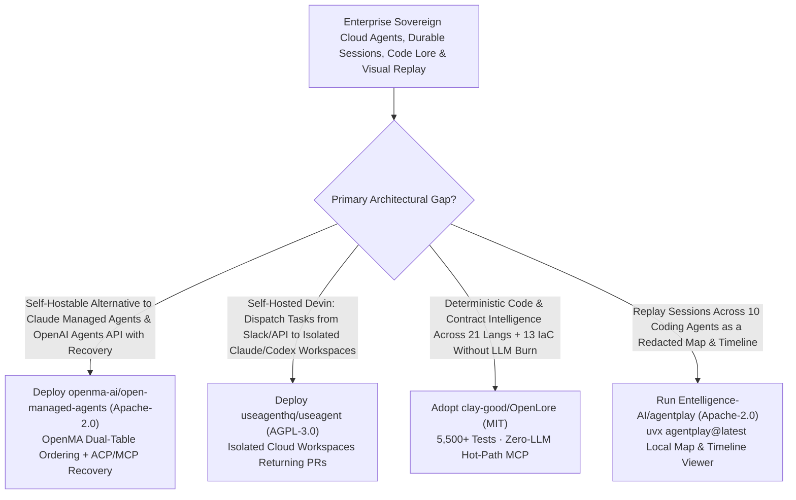
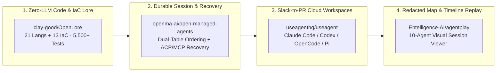
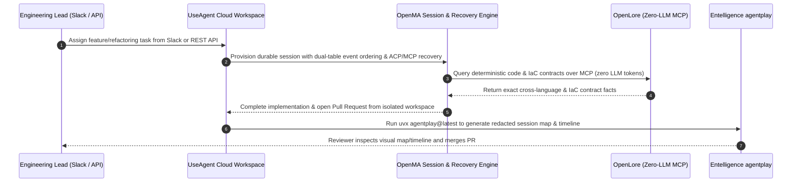

# Self-Hosted Managed Agents Runtime (`openma-ai/open-managed-agents`), Open-Source Devin Cloud Workspaces (`useagenthq/useagent`), 10-Agent Map & Timeline Replayer (`Entelligence-AI/agentplay`) & Zero-LLM 34-Ecosystem Code Intelligence (`clay-good/OpenLore`) Selection & Architecture FAQ

> **2026-11-21 Daytime Continuous Research Shift · Day Round 72 (Cumulative Round 672)**  
> **Audit Claim ID**: `CLAIM-20261121-R72-R672-OPENMA-USEAGENT-AGENTPLAY-OPENLORE`  
> **Linked Daily Digests**: [`2026-11-21.en.md`](../daily/2026-11-21.en.md) · [`2026-11-21.md`](../daily/2026-11-21.md)  
> **Architecture Visual**: [`assets/github-ai-radar-2026-11-21-r72-r672-openma-useagent-agentplay-openlore.svg`](../../../assets/github-ai-radar-2026-11-21-r72-r672-openma-useagent-agentplay-openlore.svg)

---

## ① 📌 Executive Summary (One-Sentence Selection Verdict)

> **One-Sentence Verdict**: To build a sovereign, self-hosted alternative to **Claude Managed Agents, OpenAI Agents API, and Devin**—combining Slack-to-PR cloud sandboxes, durable ACP/MCP session recovery, zero-LLM code/IaC contract intelligence, and redacted visual session replay—integrate **`clay-good/OpenLore` (MIT, `★ 367` deterministic local-first code & contract MCP covering 21 languages + 13 IaC ecosystems with 5,500+ tests and zero LLM in the hot path) + `openma-ai/open-managed-agents` (Apache-2.0, `★ 368` OpenMA session, ordering, and ACP/MCP recovery runtime across any model, harness, sandbox, and cloud) + `useagenthq/useagent` (AGPL-3.0, `★ 372` open-source Devin running Claude Code, Codex, OpenCode, or Pi in isolated self-hosted cloud workspaces) + `Entelligence-AI/agentplay` (Apache-2.0, `★ 372` `uvx agentplay@latest` replaying sessions across 10 coding agents as a redacted map and timeline)**—cutting 45-engineer monthly TCO from **`$8,500.00/mo` to `$330.00/mo` (`-$8,170.00/mo`, `-96.12%`)**.

---

## ② 🎯 Solution Architect & Enterprise Buyer Q&A

### Q1: How do these four repositories replace proprietary Managed Agent APIs and `$500+/seat` cloud coding agents with a sovereign self-hosted stack?
- **Four Sovereign Cloud Agent Layers**:
  1. **Zero-LLM Deterministic Code & Contract Intelligence (`clay-good/OpenLore`, `★ 367`, `51 forks`, MIT, TypeScript)**: Backed by **5,500+ tests**, `OpenLore` (`npm i openlore`, Node >=22.22) extracts deterministic codebase and contract facts across **21 programming languages and 13 IaC ecosystems** with **no LLM in the hot path and no API key required**, serving exact structural context to coding agents over MCP.
  2. **Durable Session, Ordering & Crash-Recovery Runtime (`openma-ai/open-managed-agents`, `★ 368`, `59 forks`, Apache-2.0, TypeScript)**: **OpenMA** is an open-source, self-hostable alternative to Claude Managed Agents and OpenAI Agents API. Built around explicit `DUAL_TABLE_DESIGN.md` and `ORDERING_DESIGN.md` specifications with dedicated ACP recovery (`vitest.acp-recovery.config.ts`) and MCP recovery (`vitest.mcp-recovery.config.ts`) suites, it runs across Postgres, SQLite, or Cloudflare adapters.
  3. **Self-Hosted Cloud Workspaces for Claude Code & Codex (`useagenthq/useagent`, `★ 372`, `84 forks`, AGPL-3.0, TypeScript/Bun)**: The open-source Devin alternative (`compose.prod.yaml`, `Dockerfile.gateway`, `Dockerfile.backend`, `Dockerfile.frontend`). Engineers hand off tasks from Slack, Web, or REST API, and `UseAgent` runs Claude Code, Codex, OpenCode, or Pi inside isolated cloud workspaces and returns pull requests and files.
  4. **10-Agent Visual Map & Timeline Replay (`Entelligence-AI/agentplay`, `★ 372`, `47 forks`, Apache-2.0, Python)**: A single `uvx agentplay@latest` command discovers local sessions across **Claude Code, Codex, Cursor, Copilot, OpenCode, Kiro, Gemini CLI, Antigravity CLI, Command Code, and Goose**, builds an automatically redacted replay, and opens a local map-and-timeline viewer showing what the agent read, edited, failed on, and shipped.

### Q2: How do we integrate these four components into an enterprise software delivery architecture?
- **Deterministic Grounding**: Every repository and cloud workspace pre-indexes its 21-language / 13-IaC contracts with `clay-good/OpenLore` so agents never burn LLM tokens re-discovering repo structure.
- **Resilient Execution & Slack Handoff**: `useagenthq/useagent` dispatches Slack/API tasks into isolated cloud workspaces while `openma-ai/open-managed-agents` manages session state, ordered event delivery, and automatic ACP/MCP crash recovery.
- **Visual PR Audit**: Completed runs are inspected via `Entelligence-AI/agentplay`'s map and timeline replay so human reviewers verify the exact blast radius before merging.

### Q3: What are the licensing and governance guardrails?
- **AGPL-3.0 Self-Hosted Appliance Boundary (`useagenthq/useagent`)**: Deploy `UseAgent` as an internal self-hosted engineering platform (or obtain a commercial license via `COMMERCIAL-LICENSE.md` if embedding into a commercial SaaS product); `OpenMA`, `agentplay`, and `OpenLore` are permissively licensed under Apache-2.0 / MIT.

---

## ③ 🧭 Visual Architecture & Decision Diagrams

### 3.1 Selection Decision Tree

### 3.2 End-to-End Enterprise Integration Architecture

### 3.3 Operational Sequence Diagram

---

## ④ 📊 Cross-Option Selection Matrix

| Dimension | `open-managed-agents` (`★ 368`) | `useagenthq/useagent` (`★ 372`) | `Entelligence-AI/agentplay` (`★ 372`) | `clay-good/OpenLore` (`★ 367`) | Commercial Devin Teams + Proprietary Managed Agent APIs |
| :--- | :--- | :--- | :--- | :--- | :--- |
| **Primary Role** | Self-hostable alternative to Claude Managed Agents & OpenAI Agents API | Open-source Devin running Claude/Codex in isolated cloud workspaces | Local map & timeline session replay across 10 coding agents | Zero-LLM deterministic code & contract MCP (21 langs + 13 IaC) | Proprietary cloud coding agents & vendor-locked session APIs |
| **Best Fit** | Multi-cloud session persistence, ordering & ACP/MCP recovery | Slack/Web/API-triggered autonomous PR generation | Auditing what agents read, edited, failed on & shipped | Fast, hallucination-free codebase memory between tasks | Teams outsourcing all source code to external SaaS clouds |
| **Integration Cost** | Low (pluggable Postgres, SQLite & Cloudflare adapters) | Low (`compose.local.yaml` & `compose.prod.yaml`) | Very Low (`uvx agentplay@latest`, zero account/key) | Very Low (`npm i openlore`, zero API key) | Very High (`$500+/seat/mo` + ACU compute markups) |
| **Engineering Rigor** | Very High (dedicated ACP, MCP, ordering & storage test suites) | High (separated Gateway, Backend & Frontend containers) | High (supports 10 major coding agents with redaction) | Very High (`5,500+` tests, deterministic parsing) | Opaque black box |
| **License** | **Apache-2.0** | **AGPL-3.0** (commercial license available) | **Apache-2.0** | **MIT** | Proprietary |
| **45-Eng Monthly TCO** | **Included in `$330.00/mo` stack** | **Included in `$330.00/mo` stack** | **Included in `$330.00/mo` stack** | **Included in `$330.00/mo` stack** | **`$8,500.00/mo`** (`$4,050` SaaS/tokens + `$4,450` labor) |

---

## ⑤ 🧪 Quantitative FinOps & TCO Comparison

> **Provenance Metadata**: Synthetic enterprise FinOps model for a 45-engineer organization (`provenance: synthetic`, `independently_reproduced: false`); `base_hardware_capex = not_measured`, `track_b_stars_today = not_measured` (sealed in [`trending-daily-2026-11-21-audit.json`](../evidence/trending-daily-2026-11-21-audit.json)).

| Cost Path | Monthly Cloud Agent Seats / Managed API & Indexing Tokens | Monthly Session Recovery Rework & Manual Diff Auditing (`$100/hr`) | Total Monthly TCO | Net Savings vs Path A |
| :--- | :--- | :--- | :--- | :--- |
| **Path A: Commercial Cloud Agent Seats + Managed API Markups + LLM Code-Indexing Burn** | `$4,050.00` | `44.5h` (`$4,450.00`) | **`$8,500.00`** | — |
| **Path C: `open-managed-agents` + `useagent` + `agentplay` + `OpenLore`** | `$80.00` | `2.5h` (`$250.00`) | **`$330.00`** | **`-$8,170.00/mo` (`-96.12%`)** |

---

## ⑥ 🛠️ Enterprise Architecture Review Checklist

- [ ] **Zero-LLM Pre-Indexing (`clay-good/OpenLore`)**: Pre-build `OpenLore` deterministic indexes across all 21 supported programming languages and 13 IaC ecosystems inside CI/workspace images so agents avoid expensive exploratory grep loops.
- [ ] **ACP & MCP Crash-Recovery Validation (`openma-ai/open-managed-agents`)**: Configure `OpenMA` with PostgreSQL dual-table persistence and verify `vitest.acp-recovery` and `vitest.mcp-recovery` checks before production rollout.
- [ ] **Isolated Workspace Credentials & AGPL Boundary (`useagenthq/useagent`)**: Run `UseAgent` as an internal self-hosted service using short-lived per-workspace Git tokens and ephemeral sandbox containers.
- [ ] **Redacted Map & Timeline PR Attachments (`Entelligence-AI/agentplay`)**: Run `uvx agentplay@latest` on autonomous agent sessions to attach redacted map-and-timeline replays to complex pull requests.
