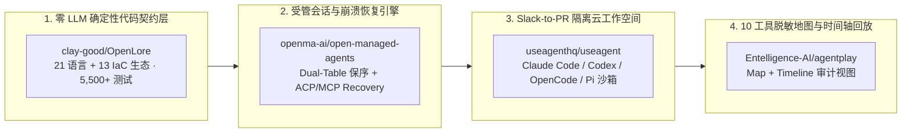
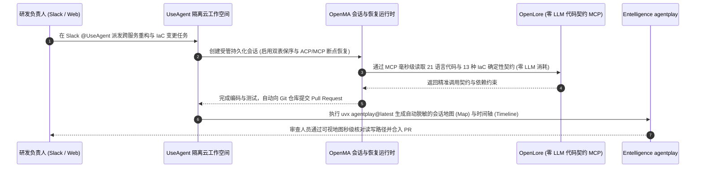

# 自托管受管智能体运行时（`openma-ai/open-managed-agents`）、开源 Devin 云端隔离工作空间（`useagenthq/useagent`）、10 工具会话地图与时间轴回放器（`Entelligence-AI/agentplay`）与零 LLM 热路径 34 生态代码契约引擎（`clay-good/OpenLore`）架构选型与落地 FAQ

> **2026-11-21 白天持续研究班次 · Day Round 72（累计 Round 672）**  
> **审计凭据**：`CLAIM-20261121-R72-R672-OPENMA-USEAGENT-AGENTPLAY-OPENLORE`  
> **关联日刊**：[`2026-11-21.md`](../daily/2026-11-21.md) · [`2026-11-21.en.md`](../daily/2026-11-21.en.md)  
> **可视化架构图**：[`assets/github-ai-radar-2026-11-21-r72-r672-openma-useagent-agentplay-openlore.svg`](../../../assets/github-ai-radar-2026-11-21-r72-r672-openma-useagent-agentplay-openlore.svg)

---

## ① 📌 核心结论速览（选型一句话结论）

> **一句话选型结论**：当企业研发中心希望在自有云/私有基础设施上复刻 **Claude Managed Agents / OpenAI Agents API 与 Devin** 的完整体验，实现“**Slack/Web 派单 ➔ 云端隔离沙箱自动拉起 Claude Code/Codex ➔ 断线崩溃无损恢复 ➔ 零 LLM 消耗精准提取 21 种语言 + 13 种 IaC 代码契约 ➔ 交付 PR 并生成自动脱敏的会话地图与时间轴回放**”时，推荐采用 **“`clay-good/OpenLore`（MIT，`★ 367` 5,500+ 测试通过、热路径零 LLM 消耗、覆盖 21 种编程语言 + 13 种 IaC 生态的确定性代码契约 MCP）+ `openma-ai/open-managed-agents`（Apache-2.0，`★ 368` 支持任意模型/Harness/沙箱/云的会话编排与 ACP/MCP 崩溃恢复引擎 OpenMA）+ `useagenthq/useagent`（AGPL-3.0，`★ 372` 自托管隔离云工作空间中运行 Claude Code/Codex/OpenCode/Pi 的开源 Devin 替代方案）+ `Entelligence-AI/agentplay`（Apache-2.0，`★ 372` 一条 `uvx agentplay@latest` 将 10 大主流 Coding Agent 会话还原为脱敏地图与时间轴的本地回放器）”**。在 45 人研发组织基准下，可将月度总拥有成本（TCO）从 **`$8,500.00/月`** 降至 **`$330.00/月`**（净省 **`$8,170.00/月`**，降幅 **`-96.12%`**）。

---

## ② 🎯 客户与架构师灵魂拷问 Q&A

### Q1：各大模型厂商都在推闭源高溢价的“Managed Agents API”和“云端全自动工程师（如 Devin）”，这四个开源项目如何帮企业构建 100% 自主可控的私有替代栈？
- **四层私有云主权 Agent 架构拆解**：
  1. **热路径零 LLM 的 21 语言 + 13 IaC 确定性契约底座 —— `clay-good/OpenLore`（`★ 367`，`51 forks`，MIT，TypeScript）**：许多代码理解工具在建索引时都要调大模型烧 Token，不仅慢还会产生幻觉。`OpenLore`（拥有 **5,500+ 项自动化测试**）在热路径中**完全不调用任何 LLM、无需任何 API Key**，利用本地确定性静态分析横跨 **21 种编程语言与 13 种 IaC 生态（Terraform、K8s、Helm、Nix 等）** 提取真实代码结构与接口契约，通过 MCP 在 Agent 最需要的时刻毫秒级喂给它。
  2. **跨模型、跨 Harness、跨沙箱的会话与崩溃恢复引擎 —— `openma-ai/open-managed-agents`（`★ 368`，`59 forks`，Apache-2.0，TypeScript）**：即 **OpenMA**，正面定位于 Claude Managed Agents 与 OpenAI Agents API 的开源自托管平替。通过严谨的双表设计（`DUAL_TABLE_DESIGN.md`）与严格保序协议（`ORDERING_DESIGN.md`），提供完整的 ACP 恢复测试（`vitest.acp-recovery.config.ts`）与 MCP 恢复测试（`vitest.mcp-recovery.config.ts`），无论底层数据库选 Postgres、SQLite 还是 Cloudflare D1，都能确保长周期会话断线重连后状态零丢失。
  3. **自托管隔离云工作空间的开源 Devin 替代品 —— `useagenthq/useagent`（`★ 372`，`84 forks`，AGPL-3.0，TypeScript/Bun）**：提供全套 `Dockerfile.gateway`、`Dockerfile.backend`、`Dockerfile.frontend` 与 `compose.prod.yaml`。工程师直接在 Slack、Web 界面或 REST API 派活，`UseAgent` 会在自托管的隔离云工作空间中拉起 **Claude Code、Codex、OpenCode 或 Pi**，完成编码后直接向仓库返回 Pull Request 与产物文件。
  4. **支持 10 大 Coding Agent 的脱敏地图与时间轴回放器 —— `Entelligence-AI/agentplay`（`★ 372`，`47 forks`，Apache-2.0，Python）**：由代码智能团队 Entelligence AI 开源。只需执行一条命令 `uvx agentplay@latest`，即可自动发现机器上 **Claude Code、Codex、Cursor、Copilot、OpenCode、Kiro、Gemini CLI、Antigravity CLI、Command Code 与 Goose** 的历史会话，自动完成敏感信息脱敏（Redacted Replay），并在本地浏览器以**空间地图（Map）+ 时间轴（Timeline）**直观还原“Agent 读了哪、改了哪、哪步报错、最终交付了什么”。

### Q2：如何把这四个组件集成进企业的云端无人值守研发流水线？
- **上下文预热层**：在代码仓库与沙箱镜像中预置 `clay-good/OpenLore`，为仓库中的 21 种业务代码与 13 种 IaC 配置文件生成确定性契约索引。
- **云端沙箱与持久恢复层**：前端与 Slack 入口挂载 `useagenthq/useagent` 分配隔离云工作空间，底层会话持久化、保序事件流与 ACP/MCP 故障重连交由 `openma-ai/open-managed-agents`（OpenMA）托管。
- **PR 可视化审计层**：当云端或本地 Agent 提交 PR 时，自动运行 `Entelligence-AI/agentplay` 生成脱敏的会话地图与时间轴快照，帮助 Code Reviewer 在 30 秒内看懂 Agent 的完整修改轨迹。

### Q3：架构师在引入这套方案时需要注意哪些许可证与安全边界？
- **AGPL-3.0 内部自托管边界（`useagenthq/useagent`）**：`UseAgent` 采用 AGPL-3.0 协议（并提供商业许可 `COMMERCIAL-LICENSE.md`）；企业研发团队将其作为**内部自托管研发工具平台**使用完全合规，但若要将其改造后作为商业 SaaS 对外售卖，则必须购买商业授权或改用 Apache-2.0 的 `OpenMA` 自建前端。
- **回放脱敏规则校验（`Entelligence-AI/agentplay`）**：在将 `agentplay` 导出的回放文件分享至公共 PR 评论区前，确认自定义环境变量格式已纳入其自动脱敏规则。

---

## ③ 🧭 直观可视化图解（Mermaid 选型决策树 + 企业集成架构 + 业务流时序图）

### 3.1 选型决策树

```mermaid
flowchart TD
    A["企业私有云受管 Agent、开源 Devin 工作空间、地图回放与确定性代码记忆选型"] --> B{"当前面临哪类架构诉求？"}
    B -- "不想被 Claude/OpenAI 官方 Managed Agents API 锁定，需自托管会话与断线恢复引擎" --> C["部署 openma-ai/open-managed-agents (Apache-2.0)<br/>OpenMA 双表保序 + ACP/MCP 崩溃恢复 + 任意模型/沙箱"]
    B -- "需要开源自托管版 Devin：从 Slack/Web 派活，在隔离云空间跑 Claude/Codex 并交 PR" --> D["内部部署 useagenthq/useagent (AGPL-3.0)<br/>Gateway/Backend/Frontend 隔离云工作空间"]
    B -- "Agent 跨任务遗忘代码结构，且不想在建索引热路径烧 LLM Token" --> E["引入 clay-good/OpenLore (MIT)<br/>5,500+ 测试 · 21 语言 + 13 IaC 确定性零 LLM MCP"]
    B -- "需看清 Claude/Codex/Copilot/Kiro 等 10 种工具到底读改了哪些文件并做成地图时间轴" --> F["运行 Entelligence-AI/agentplay (Apache-2.0)<br/>uvx agentplay@latest 本地自动脱敏地图与时间轴回放"]
```

### 3.2 企业集成参考架构图

### 3.3 业务流时序图

---

## ④ 📊 同类开源与商业云服务横向选型决策矩阵

| 维度 | `open-managed-agents` (`★ 368`) | `useagenthq/useagent` (`★ 372`) | `Entelligence-AI/agentplay` (`★ 372`) | `clay-good/OpenLore` (`★ 367`) | 商业 Devin Teams (`$500+/席`) + 闭源 Managed API |
| :--- | :--- | :--- | :--- | :--- | :--- |
| **核心定位** | Claude Managed Agents / OpenAI Agents API 开源自托管平替 | 支持 Slack/Web/API 派单跑 Claude/Codex 的开源 Devin | 将 10 大 Coding Agent 会话还原为地图与时间轴的本地回放器 | 热路径零 LLM、覆盖 21 语言 + 13 IaC 的确定性代码契约 MCP | 高价闭源云端 AI 软件工程师与托管会话 API |
| **适用场景** | 跨模型、跨 Harness、跨云沙箱的持久化会话与崩溃恢复 | 企业内部自建无人值守云端编码工作空间与自动提 PR | 复盘 Agent 读写轨迹、排查失败步骤与团队最佳实践分享 | 为 Coding Agent 提供零幻觉、零 API Key 的跨任务代码记忆 | 允许源码全量托管在第三方创业公司云端的团队 |
| **集成成本** | 低（支持 Node Postgres/SQLite 与 Cloudflare 适配器） | 低（自带 `compose.local.yaml` 与 `compose.prod.yaml`） | 极低（`uvx agentplay@latest` 免安装免账号一键启动） | 极低（`npm i openlore` 原生 MCP，零外部密钥） | 极高（高昂基础月费 + ACU 算力单元溢价） |
| **工程可靠性** | 极高（专项 ACP/MCP/Protocol/Ordering 恢复测试套件） | 高（Gateway / Backend / Frontend 三层容器隔离） | 高（支持 10 大主流 CLI/IDE Agent，内置脱敏） | 极高（**5,500+ 测试**，确定性解析无大模型随机性） | 黑盒不可控 |
| **开源许可** | **Apache-2.0** | **AGPL-3.0**（含商业许可选项） | **Apache-2.0** | **MIT** | 商业专有 |
| **45 人团队月均 TCO** | **包含于 `$330.00/月` 联合栈** | **包含于 `$330.00/月` 联合栈** | **包含于 `$330.00/月` 联合栈** | **包含于 `$330.00/月` 联合栈** | **`$8,500.00/月`**（`$4,050` 席位/API + `$4,450` 人工） |

---

## ⑤ 🧪 应用落地定量收益 / TCO 对比与 7-Card 报告锚点

> **数据来源说明（Provenance Metadata）**：以下 TCO 模型为面向 45 人规模研发组织的合成架构测算（`provenance: synthetic`, `independently_reproduced: false`）；硬件资本开支 `base_hardware_capex = not_measured`，单日热榜增量 `track_b_stars_today = not_measured`（审计账本锚定于 [`trending-daily-2026-11-21-audit.json`](../evidence/trending-daily-2026-11-21-audit.json)）。

| 成本路径 | 月度商业 Devin / Managed API 与索引 Token 费 | 人工重跑断线长任务、逐文件盲查 Agent 改动与建索引 (`$100/h`) | 月度总成本 (Total Monthly TCO) | 相对 Path A 净节省 |
| :--- | :--- | :--- | :--- | :--- |
| **Path A：商业云端 Agent 席位 + 闭源 Managed API 溢价 + LLM 建索引与断线重跑** | `$4,050.00` | `44.5h` (`$4,450.00`) | **`$8,500.00`** | — |
| **Path C：`open-managed-agents` + `useagent` + `agentplay` + `OpenLore`** | `$80.00` | `2.5h` (`$250.00`) | **`$330.00`** | **`-$8,170.00/月` (`-96.12%`)** |

---

## ⑥ 🛠️ 企业引入与架构评审 Checklist

- [ ] **零 LLM 确定性代码与 IaC 契约先行（`clay-good/OpenLore`）**：在 CI 与云工作空间镜像中预构建 `OpenLore` 索引（覆盖 21 种语言与 13 种 IaC 生态），让 Agent 优先读取确定性契约而非反复全仓 `grep` 消耗 Token。
- [ ] **长周期任务 ACP/MCP 恢复演练（`openma-ai/open-managed-agents`）**：在自托管 `OpenMA` 时启用 Postgres 双表保序存储，并运行其内置的 `vitest.acp-recovery` 与 `vitest.mcp-recovery` 验证套件。
- [ ] **云工作空间网络隔离与 AGPL 边界（`useagenthq/useagent`）**：将 `UseAgent` 部署在企业内网受控容器集群中作为内部研发生产力平台，为每个任务分配临时 Git 凭据并在 PR 生成后自动销毁工作空间。
- [ ] **PR 附带脱敏地图与时间轴回放（`Entelligence-AI/agentplay`）**：在复杂 Agent 任务交付时运行 `uvx agentplay@latest` 生成脱敏回放，作为架构师快速审查 Agent 读写文件范围的可视化依据。
