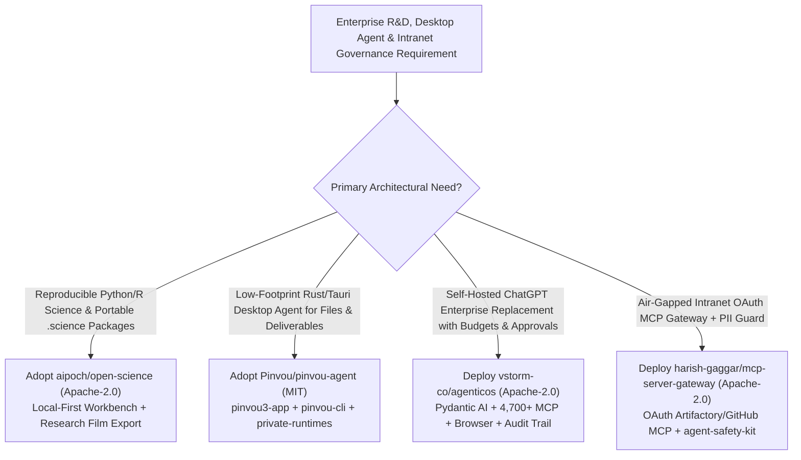
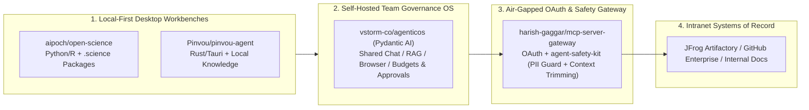
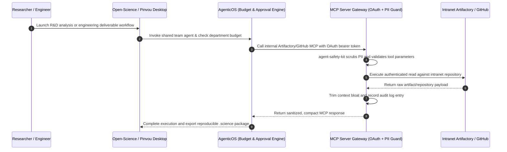

# Reproducible R&D Workbench (`aipoch/open-science`), Rust/Tauri Desktop Deliverable Agent (`Pinvou/pinvou-agent`), Self-Hosted Enterprise Agent OS (`vstorm-co/agenticos`) & Air-Gapped OAuth MCP Gateway (`harish-gaggar/mcp-server-gateway`) Selection & Architecture FAQ

> **2026-11-21 Daytime Continuous Research Shift · Day Round 55 Milestone (Cumulative Round 655)**  
> **Audit Claim ID**: `CLAIM-20261121-R55-R655-OPENSCIENCE-PINVOU-AGENTICOS-MCPGATEWAY`  
> **Linked Daily Digests**: [`2026-11-21.en.md`](../daily/2026-11-21.en.md) · [`2026-11-21.md`](../daily/2026-11-21.md)  
> **Architecture Visual**: [`assets/github-ai-radar-2026-11-21-r55-r655-openscience-pinvou-agenticos-mcpgateway.svg`](../../../assets/github-ai-radar-2026-11-21-r55-r655-openscience-pinvou-agenticos-mcpgateway.svg)

---

## ① 📌 Executive Summary (One-Sentence Selection Verdict)

> **One-Sentence Verdict**: When building a private, local-first, and air-gap-ready enterprise AI workspace that replaces per-seat SaaS lock-in (e.g., ChatGPT Enterprise) with reproducible scientific/R&D execution, lightweight desktop deliverables, multi-tenant governance, and OAuth/PII-guarded intranet MCP access, combine **`aipoch/open-science` (Apache-2.0, `★ 5,556` local-first scientific workbench with Python/R execution and portable `.science` Research Packages) + `Pinvou/pinvou-agent` (MIT, `★ 3,043` Rust/Tauri desktop AI agent for local files, knowledge, and deliverables) + `vstorm-co/agenticos` (Apache-2.0, `★ 484` Pydantic AI self-hosted enterprise agent platform with shared chat, RAG, browser sandbox, 4,700+ MCP servers, budgets, approvals, and audit trails) + `harish-gaggar/mcp-server-gateway` (Apache-2.0, `★ 588` air-gapped OAuth MCP gateway with Artifactory/GDrive/GitHub servers and `agent-safety-kit` PII guard/context trimming)**—reducing 45-engineer monthly TCO from **`$8,470.00/mo` to `$330.00/mo` (`-$8,140.00/mo`, `-96.10%`)**.

---

## ② 🎯 Solution Architect & Enterprise Buyer Q&A

### Q1: How do these four repositories complement each other across desktop R&D, team collaboration, and restricted enterprise networks?
- **Four Distinct Architectural Layers**:
  1. **Reproducible Scientific & R&D Workbench (`aipoch/open-science`, `★ 5,556`, `561 forks`, Apache-2.0, TypeScript/Electron)**: Local-first, model-agnostic desktop workbench executing Python and R alongside MCP tools and extensible skills. Exports portable **`.science` Research Packages** and **Research Films** (Zenodo DOI `10.5281/zenodo.22252246`) so peers and auditors can inspect and reproduce every step behind an analytical result.
  2. **Lightweight Rust/Tauri Desktop Deliverable Workspace (`Pinvou/pinvou-agent`, `★ 3,043`, `434 forks`, MIT, Rust/Tauri)**: Native cross-platform desktop agent (`pinvou3-app`, `pinvou-cli`, `pinvou-knowledge`, `private-runtimes`, `remote-control-relay`) built for low-memory local file orchestration, private knowledge retrieval, design, and coding deliverables.
  3. **Self-Hosted Multi-Tenant Enterprise Agent Platform (`vstorm-co/agenticos`, `★ 484`, `92 forks`, Apache-2.0, Python/Pydantic AI)**: Recipient of the 2026 AAIF Open Agentic AI Innovation Award. Provides a self-hosted alternative to ChatGPT Enterprise featuring shared team chat, RAG, `AGENTS.md` skills, a real browser sandbox, 4,700+ MCP servers, team budgets, human approvals, and immutable audit trails across server, desktop, and mobile.
  4. **Air-Gapped OAuth MCP Gateway & PII Safety Kit (`harish-gaggar/mcp-server-gateway`, `★ 588`, `27 forks`, Apache-2.0, Python/LangGraph)**: Reference enterprise stack designed for restricted or air-gapped networks, shipping `mcp-gateway`, OAuth-secured MCP servers (`artifactory`, `gdrive`, `github`), `agent-safety-kit` (PII redaction + context trimming), and a governed LangGraph agent (`Agents/jfrog-agent`).

### Q2: How do we wire these four projects into a unified enterprise architecture?
- **Endpoint Layer**: Data scientists and R&D engineers use `aipoch/open-science` to run Python/R experiments and export `.science` packages, while software/design engineers use `Pinvou/pinvou-agent` for local workspace automation.
- **Team Collaboration & Governance Layer**: Shared team agents, company RAG, browser tasks, department token budgets, and human approval workflows run centrally on self-hosted `vstorm-co/agenticos` (deployed via Helm `charts/` or Traefik Docker Compose).
- **Intranet Security Boundary**: All MCP tool calls from `agenticos` or desktop agents to internal JFrog Artifactory, GitHub Enterprise, or document stores pass through `harish-gaggar/mcp-server-gateway` for OAuth verification, PII scrubbing, and context trimming.

### Q3: When should an enterprise choose managed Microsoft Copilot Studio / Azure AI Foundry instead?
- **Choose Microsoft Copilot Studio / Azure AI Foundry** when the organization is deeply standardized on Microsoft 365 (Teams, SharePoint, Purview) and wants zero-ops managed SaaS governance.
- **Choose this 4-Repository Open Stack** when operating in air-gapped/VPC-isolated environments, requiring portable `.science` reproducibility artifacts, or eliminating `$60/seat/mo` SaaS fees under 100% permissive Apache-2.0 / MIT licensing.

---

## ③ 🧭 Visual Architecture & Decision Diagrams

### 3.1 Selection Decision Tree

### 3.2 End-to-End Enterprise Integration Architecture

### 3.3 Operational Sequence Diagram

---

## ④ 📊 Cross-Option Selection Matrix

| Dimension | `aipoch/open-science` (`★ 5,556`) | `Pinvou/pinvou-agent` (`★ 3,043`) | `vstorm-co/agenticos` (`★ 484`) | `mcp-server-gateway` (`★ 588`) | Commercial Per-Seat SaaS (ChatGPT Enterprise) |
| :--- | :--- | :--- | :--- | :--- | :--- |
| **Primary Role** | Local-first scientific workbench (`.science` + Python/R) | Rust/Tauri desktop AI agent for files, knowledge & deliverables | Self-hosted multi-tenant enterprise AI teammate platform | Air-gapped OAuth MCP gateway + PII guard + LangGraph agent | Cloud-hosted proprietary enterprise chat SaaS |
| **Best Fit** | Quantitative R&D, data science & reproducible experiments | Low-memory desktop file workflows, coding & design deliverables | Self-hosted team chat, RAG, browser sandbox & budget governance | Restricted networks connecting agents to Artifactory/GitHub | Cloud-permissive general office productivity |
| **Integration Cost** | Low (native desktop installers + MCP connectors) | Low (Windows/macOS/Linux Tauri app + CLI) | Low-Medium (Docker Compose, Traefik & Helm charts included) | Low (Docker Compose quickstart with OAuth + safety kit) | Low initial setup, high intranet connector friction |
| **Ops Complexity** | Very Low (local desktop app) | Very Low (Rust/Tauri native binary) | Medium (self-hosted web/backend/sandbox stack) | Low (modular Python containers) | Very Low (vendor-managed cloud) |
| **License** | **Apache-2.0** | **MIT** | **Apache-2.0** | **Apache-2.0** | Proprietary (`~$60/user/mo` annual lock-in) |
| **45-Eng Monthly TCO** | **Included in `$330.00/mo` stack** | **Included in `$330.00/mo` stack** | **Included in `$330.00/mo` stack** | **Included in `$330.00/mo` stack** | **`$8,470.00/mo`** (`$4,020` seats/API + `$4,450` labor) |

---

## ⑤ 🧪 Quantitative FinOps & TCO Comparison

> **Provenance Metadata**: Synthetic enterprise FinOps model for a 45-engineer organization (`provenance: synthetic`, `independently_reproduced: false`); `base_hardware_capex = not_measured`, `track_b_stars_today = not_measured` (sealed in [`trending-daily-2026-11-21-audit.json`](../evidence/trending-daily-2026-11-21-audit.json)).

| Cost Path | Monthly SaaS / API / Compute | Monthly R&D Reproducibility & Intranet Ops (`$100/hr`) | Total Monthly TCO | Net Savings vs Path A |
| :--- | :--- | :--- | :--- | :--- |
| **Path A: Commercial Per-Seat Enterprise SaaS + Manual R&D Packaging + Custom Intranet OAuth Glue** | `$4,020.00` | `44.5h` (`$4,450.00`) | **`$8,470.00`** | — |
| **Path C: `open-science` + `pinvou-agent` + `agenticos` + `mcp-server-gateway`** | `$80.00` | `2.5h` (`$250.00`) | **`$330.00`** | **`-$8,140.00/mo` (`-96.10%`)** |

---

## ⑥ 🛠️ Enterprise Architecture Review Checklist

- [ ] **Portable `.science` Artifact Mandate (`aipoch/open-science`)**: Require R&D and benchmark teams to archive portable `.science` packages alongside major technical decisions so Python/R outputs remain verifiable.
- [ ] **Scoped Workspace Directories (`Pinvou/pinvou-agent`)**: Configure `pinvou-agent` `private-runtimes` to restrict local file access to approved project directories.
- [ ] **Department Budgets & Action Approvals (`vstorm-co/agenticos`)**: Enforce per-team token budget caps and human-in-the-loop approval gates in `agenticos` before enabling browser or external write tools.
- [ ] **Mandatory OAuth & PII Scrubbing (`harish-gaggar/mcp-server-gateway`)**: Route all intranet Artifactory, GitHub, and document MCP traffic through `mcp-server-gateway` with `agent-safety-kit` PII redaction and context trimming active.
