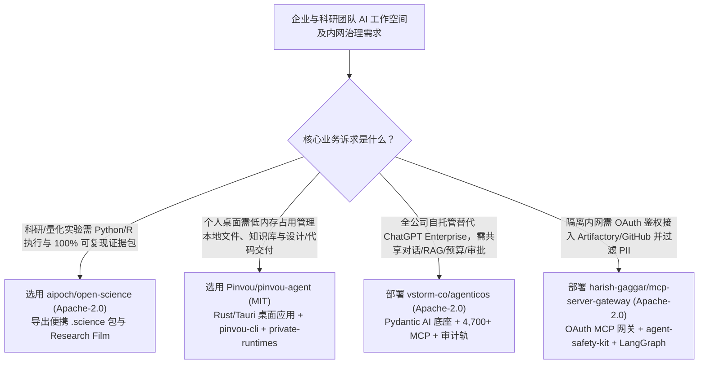
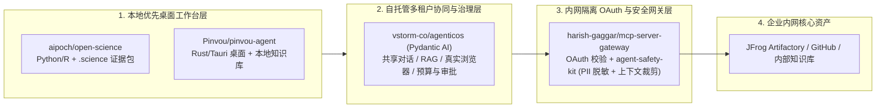
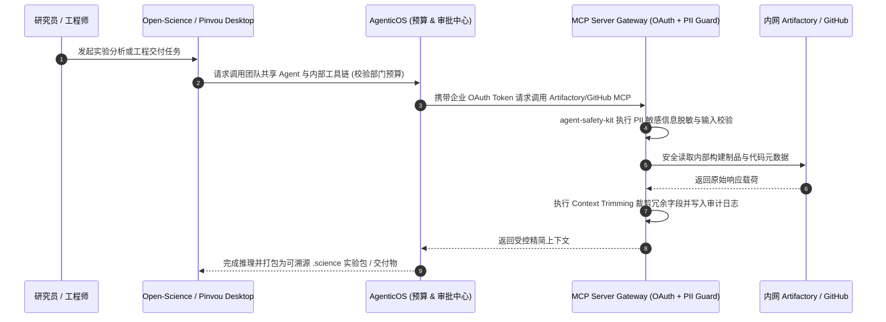

# 可复现科研与实验工作台（`aipoch/open-science`）、Rust/Tauri 桌面交付智能体（`Pinvou/pinvou-agent`）、自托管企业协同 Agent 平台（`vstorm-co/agenticos`）与内网隔离 OAuth MCP 网关（`harish-gaggar/mcp-server-gateway`）架构选型与落地 FAQ

> **2026-11-21 白天持续研究班次 · Day Round 55 里程碑（累计 Round 655）**  
> **审计凭据**：`CLAIM-20261121-R55-R655-OPENSCIENCE-PINVOU-AGENTICOS-MCPGATEWAY`  
> **关联日刊**：[`2026-11-21.md`](../daily/2026-11-21.md) · [`2026-11-21.en.md`](../daily/2026-11-21.en.md)  
> **可视化架构图**：[`assets/github-ai-radar-2026-11-21-r55-r655-openscience-pinvou-agenticos-mcpgateway.svg`](../../../assets/github-ai-radar-2026-11-21-r55-r655-openscience-pinvou-agenticos-mcpgateway.svg)

---

## ① 📌 核心结论速览（选型一句话结论）

> **一句话选型结论**：当企业研发、算法实验与内网办公团队需要告别按席位高价收费的公有云黑盒（如 ChatGPT Enterprise），构建“**本地实验可复现 + 桌面端低资源交付 + 团队共享与预算审批治理 + 内网隔离 OAuth/PII 安全接入**”的私有化 AI 工作空间时，推荐采用全宽松协议（Apache-2.0 / MIT）的四层架构：**“`aipoch/open-science`（Apache-2.0，`★ 5,556` 支持 Python/R 执行与便携 `.science` 证据包的本地优先科研/实验工作台）+ `Pinvou/pinvou-agent`（MIT，`★ 3,043` 基于 Rust/Tauri 的跨平台桌面交付与本地知识库智能体）+ `vstorm-co/agenticos`（Apache-2.0，`★ 484` 基于 Pydantic AI 的自托管多租户企业 Agent 平台，内置 4,700+ MCP、真实浏览器、预算限额、审批与审计轨）+ `harish-gaggar/mcp-server-gateway`（Apache-2.0，`★ 588` 面向隔离内网的 OAuth MCP 网关、Artifactory/GDrive/GitHub 连接器与 `agent-safety-kit` PII 脱敏套件）”**。在 45 人工程组织基准下，可将月度总拥有成本（TCO）从 **`$8,470.00/月`** 降至 **`$330.00/月`**（净省 **`$8,140.00/月`**，降幅 **`-96.10%`**）。

---

## ② 🎯 客户与架构师灵魂拷问 Q&A

### Q1：同样是“企业/桌面 AI 智能体工作台”，这四个高热度开源项目各自解决哪类业务场景的痛点？
- **四层互补定位**：
  1. **可复现科学计算与量化研发实验台 —— `aipoch/open-science`（`★ 5,556`，`561 forks`，Apache-2.0，TypeScript/Electron）**：面向生物医药、量化金融、数据科学与企业 R&D 团队的本地优先（Local-First）、模型无关工作台。内置 Python/R 代码执行环境、可扩展 Skills 与 MCP 连接器，最核心的差异化是可将全部实验过程、数据与结论打包为便携式 **`.science` Research Package** 或导出 **Research Film**，让同行评审与合规审计 100% 复现实验证据链（拥有 Zenodo DOI `10.5281/zenodo.22252246`）。
  2. **轻量级 Rust/Tauri 个人与离线交付工作空间 —— `Pinvou/pinvou-agent`（`★ 3,043`，`434 forks`，MIT，Rust/Tauri）**：面向日常办公、设计与编码交付的原生桌面 Agent（含 `pinvou3-app`、`pinvou-cli`、`pinvou-knowledge`、`private-runtimes` 与 `remote-control-relay`），相比重型 Electron 套壳内存占用大幅降低，擅长本地文件编排、私有知识检索与端到端真实交付物生成。
  3. **多租户自托管企业 AI 队友平台（ChatGPT Enterprise 开源替代） —— `vstorm-co/agenticos`（`★ 484`，`92 forks`，Apache-2.0，Python/Pydantic AI）**：2026 AAIF 开源智能体创新奖获奖项目。在企业自有服务器上提供共享对话、企业 RAG、`AGENTS.md` 标准技能、真实浏览器沙箱、4,700+ MCP 服务接入、部门预算控制（Budgets）、高危动作人工审批（Approvals）与全链路审计日志（Audit Trail），同时提供 Server、Desktop 与 Mobile 端。
  4. **内网/气隙环境（Air-Gapped）OAuth MCP 安全网关 —— `harish-gaggar/mcp-server-gateway`（`★ 588`，`27 forks`，Apache-2.0，Python/LangGraph）**：专门解决金融、军工与核心研发内网“无法直接连公网 SaaS MCP”的痛点。提供生产级 `mcp-gateway`、受 OAuth 保护的内部 MCP Server（JFrog Artifactory、Google Drive、GitHub），以及内置 PII 过滤与上下文裁剪的 `agent-safety-kit`。

### Q2：如何将这四个项目组合成一套端到端的企业级 AI 研发与办公底座？
- **终端层（研究员与工程师桌面）**：算法与数据分析师使用 `aipoch/open-science` 执行本地 Python/R 实验并导出 `.science` 证据包；应用研发与产品设计人员使用轻量级 Rust/Tauri 客户端 `Pinvou/pinvou-agent` 处理本地文件与知识库。
- **团队协同与治理中枢层**：部门级共享 Agent、跨团队知识库问答、真实浏览器自动化与月度 Token 预算管控统一收敛到自托管的 `vstorm-co/agenticos`（支持 Kubernetes Helm `charts/` 或 Traefik Docker Compose 部署）。
- **内网边界与工具安全层**：当桌面端或 `agenticos` 需要访问企业内部制品库（JFrog Artifactory）、代码库（GitHub Enterprise）或内部文档时，统一经由 `harish-gaggar/mcp-server-gateway` 进行 OAuth 令牌校验、`agent-safety-kit` PII 敏感字段脱敏与上下文瘦身。

### Q3：这套开源组合与直接采购 ChatGPT Enterprise / Microsoft Copilot Studio 相比，选型分界线在哪里？
- **优先选 Microsoft Copilot Studio / Azure AI Foundry 的场景**：企业全面基于 Microsoft 365（Teams、SharePoint、Power Platform）办公，且希望零服务器运维直接复用 Entra ID 条件访问与 Purview 合规策略。
- **优先选本轮四层开源栈的场景**：
  1. 处于**严格内网/气隙隔离（Air-Gapped）环境**，严禁代码、实验数据或制品库元数据出境；
  2. 科研与量化团队强制要求生成可独立验证的 **`.science` 实验证据包**；
  3. 需要规避昂贵的按人头（`$60/人/月`）商业席位费，在自有 GPU/VPC 上以 Apache-2.0/MIT 零锁定协议运行。

---

## ③ 🧭 直观可视化图解（Mermaid 选型决策树 + 企业集成架构 + 业务流时序图）

### 3.1 选型决策树

### 3.2 企业集成参考架构图

### 3.3 业务流时序图

---

## ④ 📊 同类开源与商业云服务横向选型决策矩阵

| 维度 | `aipoch/open-science` (`★ 5,556`) | `Pinvou/pinvou-agent` (`★ 3,043`) | `vstorm-co/agenticos` (`★ 484`) | `mcp-server-gateway` (`★ 588`) | 商业按席位 SaaS (ChatGPT Enterprise) |
| :--- | :--- | :--- | :--- | :--- | :--- |
| **核心定位** | 本地优先可复现科研工作台（`.science` 包 + Python/R） | Rust/Tauri 跨平台桌面工作、设计与编码交付 Agent | 基于 Pydantic AI 的自托管企业级多租户 Agent 平台 | 面向隔离内网的 OAuth MCP 网关与 PII 安全套件 | 公有云托管通用企业对话与助手 SaaS |
| **适用场景** | 数据科学、量化回测、生物医药与需证据复现的 R&D | 本地文件自动化、私有知识库与低资源桌面交付 | 企业私有化部署共享助手、预算审批与真实浏览器沙箱 | 金融/政企内网安全连接 Artifactory/GitHub/GDrive | 允许数据上公有云的标准化办公问答 |
| **集成成本** | 低（开箱即用桌面安装包 + MCP 扩展） | 低（原生 Windows/macOS/Linux 安装包 + CLI） | 中低（自带 Docker Compose / Traefik / Helm Charts） | 低（Docker Compose 一键拉起网关、OAuth 与安全套件） | 低（采购即用，但内网系统打通繁琐） |
| **运维复杂度** | 极低（本地桌面应用） | 极低（Rust/Tauri 轻量级运行时） | 中（需维护后端、数据库与浏览器沙箱容器） | 低（模块化 Python 容器栈） | 极低（全托管，但定制受限） |
| **开源许可** | **Apache-2.0** | **MIT** | **Apache-2.0** | **Apache-2.0** | 商业专有（按席位年框计费） |
| **45 人团队月均 TCO** | **包含于 `$330.00/月` 联合栈** | **包含于 `$330.00/月` 联合栈** | **包含于 `$330.00/月` 联合栈** | **包含于 `$330.00/月` 联合栈** | **`$8,470.00/月`**（`$4,020` 席位/API + `$4,450` 人工） |

---

## ⑤ 🧪 应用落地定量收益 / TCO 对比与 7-Card 报告锚点

> **数据来源说明（Provenance Metadata）**：以下 TCO 模型为面向 45 人规模研发与科研组织的合成架构测算（`provenance: synthetic`, `independently_reproduced: false`）；硬件资本开支 `base_hardware_capex = not_measured`，单日热榜增量 `track_b_stars_today = not_measured`（审计账本锚定于 [`trending-daily-2026-11-21-audit.json`](../evidence/trending-daily-2026-11-21-audit.json)）。

| 成本路径 | 月度席位 / API / 容器算力费 | 人工实验复现核对与内网 OAuth 胶水维护 (`$100/h`) | 月度总成本 (Total Monthly TCO) | 相对 Path A 净节省 |
| :--- | :--- | :--- | :--- | :--- |
| **Path A：商业企业版按席位订阅 + 人工整理实验复现材料 + 自写内网网关** | `$4,020.00` | `44.5h` (`$4,450.00`) | **`$8,470.00`** | — |
| **Path C：`open-science` + `pinvou-agent` + `agenticos` + `mcp-server-gateway`** | `$80.00` | `2.5h` (`$250.00`) | **`$330.00`** | **`-$8,140.00/月` (`-96.10%`)** |

---

## ⑥ 🛠️ 企业引入与架构评审 Checklist

- [ ] **实验成果 `.science` 归档规范（`aipoch/open-science`）**：要求算法与数据科学团队在提交关键评测结论时，必须附上由 `open-science` 导出的 `.science` Research Package，确保 Python/R 脚本、输入数据指纹与模型输出可被一键复现。
- [ ] **桌面端私有运行时隔离（`Pinvou/pinvou-agent`）**：在工程师终端启用 `pinvou-agent` 的 `private-runtimes` 模式，限制工作目录访问范围，防止 Agent 误扫全盘敏感凭证。
- [ ] **多租户预算与高危动作审批（`vstorm-co/agenticos`）**：在 `agenticos` 管理后台为各研发小组配置月度 Token 预算上限（Budgets），并对外部邮件发送、生产库写入等工具开启强制人工审批（Approvals）。
- [ ] **内网 MCP 统一 OAuth 与 PII 脱敏（`harish-gaggar/mcp-server-gateway`）**：禁止 Agent 直连内网 Artifactory 或 GitHub，强制所有 MCP 流量经过 `mcp-server-gateway` 完成 OAuth 令牌验证与 `agent-safety-kit` PII 脱敏及上下文裁剪。
