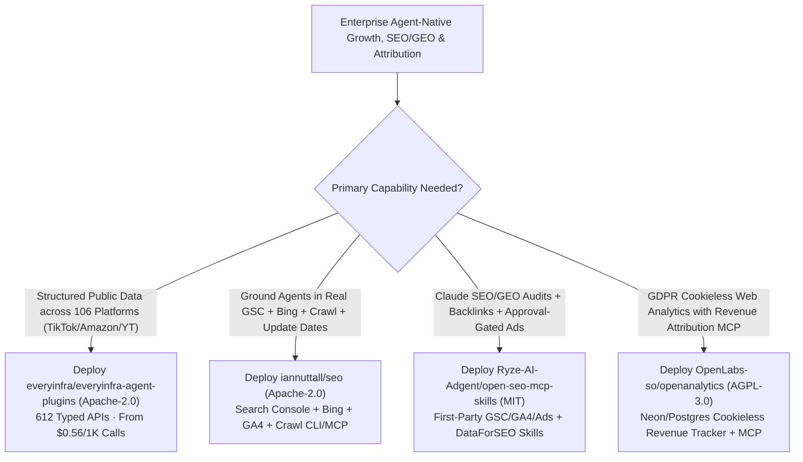
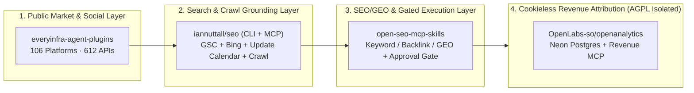
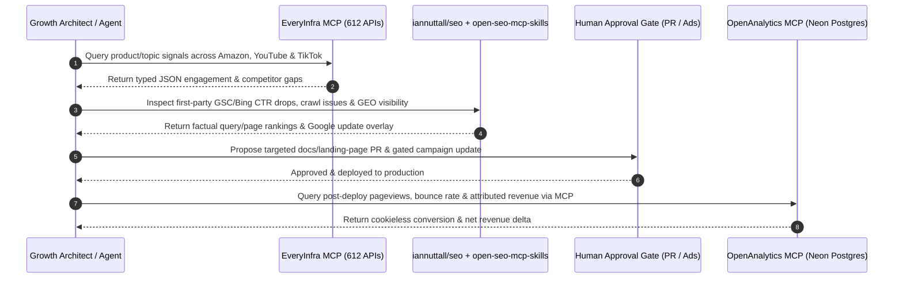

# First-Party SEO/GEO MCP Skills (`Ryze-AI-Adgent/open-seo-mcp-skills`), Multi-Search & Crawl CLI/MCP (`iannuttall/seo`), Cookieless Revenue Analytics (`OpenLabs-so/openanalytics`) & 106-Platform Public Data MCP (`everyinfra/everyinfra-agent-plugins`) Selection & Architecture FAQ

> **2026-11-21 Daytime Continuous Research Shift · Day Round 54 (Cumulative Round 654)**  
> **Audit Claim ID**: `CLAIM-20261121-R54-R654-OPENSEOMCP-SEOSKILL-OPENANALYTICS-EVERYINFRA`  
> **Linked Daily Digests**: [`2026-11-21.en.md`](../daily/2026-11-21.en.md) · [`2026-11-21.md`](../daily/2026-11-21.md)  
> **Architecture Visual**: [`assets/github-ai-radar-2026-11-21-r54-r654-openseomcp-seoskill-openanalytics-everyinfra.svg`](../../../assets/github-ai-radar-2026-11-21-r54-r654-openseomcp-seoskill-openanalytics-everyinfra.svg)

---

## ① 📌 Executive Summary (One-Sentence Selection Verdict)

> **One-Sentence Verdict**: When building an agent-native growth engineering, search/AI visibility (SEO/GEO), cross-platform market intelligence, and cookieless revenue attribution stack, replace fragmented legacy SEO/scraper SaaS subscriptions and generic keyword-slop generation with **`everyinfra/everyinfra-agent-plugins` (Apache-2.0, `★ 663` unified MCP/plugin exposing 612 typed public web data APIs across 106 platforms from `$0.56/1K` calls) + `iannuttall/seo` (Apache-2.0, `★ 642` agent-native CLI/MCP grounding agents in real Google Search Console, Bing, GA4/Simple Analytics, Google update dates, and site crawls) + `Ryze-AI-Adgent/open-seo-mcp-skills` (MIT, `★ 10,621` open SEO & GEO skills connecting real GSC/GA4/Ads + DataForSEO with approval-gated changes) + `OpenLabs-so/openanalytics` (AGPL-3.0, `★ 652` self-hostable cookieless web analytics with direct revenue attribution and a built-in MCP server on Neon/Postgres)**—cutting 45-engineer monthly TCO from **`$8,380.00/mo` to `$325.00/mo` (`-$8,055.00/mo`, `-96.12%`)**.

---

## ② 🎯 Solution Architect & Enterprise Buyer Q&A

### Q1: Why do most AI SEO and growth workflows produce zero-conversion "slop", and how do these four repositories solve it end-to-end?
- **The Core Bottleneck**: Most AI marketing wrappers hand agents a generic SEO checklist or third-party keyword estimates without ever seeing your real site impressions, CTR drop-offs, Google algorithm update impact dates, or which pages actually generate paid revenue.
- **How the 4-Layer Stack Works Together**:
  1. **Cross-Platform Social & E-Commerce Intelligence (`everyinfra/everyinfra-agent-plugins`, `★ 663`, Apache-2.0, Python)**: Provides a single MCP endpoint (`https://api.everyinfra.com/mcp`) and multi-IDE plugins (`.claude-plugin`, `.cursor-plugin`, `.kimi-plugin`, `.qoder-plugin`) covering **612 typed data APIs across 106 platforms** (TikTok, Instagram, Amazon, YouTube, Xiaohongshu, Douyin) starting at `$0.56 / 1,000` calls.
  2. **First-Party Search Facts & Site Crawl Grounding (`iannuttall/seo`, `★ 642`, Apache-2.0, TypeScript)**: Gives agents real clicks, impressions, and positions from Google Search Console, Bing Webmaster data, visits from GA4/Clicky/Simple Analytics, Google algorithm update dates, and a full crawl of your site via MCP and CLI.
  3. **SEO + GEO Visibility & Approval-Gated Execution (`Ryze-AI-Adgent/open-seo-mcp-skills`, `★ 10,621`, MIT, Shell)**: Open-source SEO and Generative Engine Optimization (GEO) skills for Claude running on real GSC, GA4, and Ads data with built-in DataForSEO backlink/gap enrichment and mandatory human approval gates before any campaign or site changes execute.
  4. **Cookieless Revenue Attribution Loop (`OpenLabs-so/openanalytics`, `★ 652`, AGPL-3.0, TypeScript)**: Privacy-first, cookieless web analytics monorepo backed by Neon/Postgres with native revenue attribution per page/referrer and a built-in MCP server so agents optimize for closed revenue rather than vanity traffic.

### Q2: How do we integrate these four components into an enterprise growth and documentation pipeline?
- **Signal Ingestion**: Growth/docs agents query `everyinfra-agent-plugins` for real user questions and competitor positioning across Amazon/YouTube/TikTok, then run `iannuttall/seo` to inspect first-party GSC/Bing pages with high impressions but decaying CTR or post-update drops.
- **Audit & Controlled Execution**: Agents invoke `open-seo-mcp-skills` to audit technical SEO, backlink gaps, and AI search visibility (GEO), proposing targeted PRs or ad adjustments behind human approval gates.
- **Closed-Loop Revenue Verification**: Post-deployment, agents query `OpenLabs-so/openanalytics` via its MCP server to verify visitor engagement, bounce rate, and direct revenue attribution per page.

### Q3: What are the license and governance boundaries?
- **AGPL-3.0 Isolation (`OpenLabs-so/openanalytics`)**: Deploy `openanalytics` as a standalone analytics microservice on Neon/Postgres interacting only via its lightweight frontend tracker and read-only MCP endpoint; never embed modified AGPL-3.0 code inside proprietary distributed software.
- **Approval Gates & Data Compliance**: Enforce human-in-the-loop approval gates on all Google/Meta Ads or production CMS writes via `open-seo-mcp-skills`, and restrict `everyinfra-agent-plugins` strictly to public market intelligence.

---

## ③ 🧭 Visual Architecture & Decision Diagrams

### 3.1 Selection Decision Tree

### 3.2 End-to-End Enterprise Integration Architecture

### 3.3 Operational Sequence Diagram

---

## ④ 📊 Cross-Option Selection Matrix

| Dimension | `open-seo-mcp-skills` (`★ 10,621`) | `iannuttall/seo` (`★ 642`) | `OpenLabs-so/openanalytics` (`★ 652`) | `everyinfra-agent-plugins` (`★ 663`) | Legacy SEO/Scraper Suites (Ahrefs/SEMrush/GA360) |
| :--- | :--- | :--- | :--- | :--- | :--- |
| **Primary Role** | Claude SEO/GEO skills + GSC/GA4/Ads/DataForSEO MCP | Agent-native GSC + Bing + GA4 + update dates + crawl CLI/MCP | Cookieless web analytics with revenue attribution & MCP | 612 public web data APIs across 106 platforms via MCP | Human-centric legacy dashboards & CSV exports |
| **Best Fit** | Technical SEO/GEO audits, backlinks & gated Ads updates | Grounding coding/content agents in real site & search facts | Privacy-first SaaS/docs analytics tied directly to revenue | Cross-platform social & e-commerce competitive intelligence | Manual marketing teams without agent workflows |
| **Integration Cost** | Very Low (`claude mcp add` + MIT skills) | Low (30s MCP setup or local CLI) | Low (pnpm monorepo + Neon Serverless Postgres) | Very Low (1 API key across Claude/Cursor/Codex) | High (multi-seat SaaS contracts + manual CSV glue) |
| **Ops Complexity** | Very Low (stateless skills + connector) | Very Low (stateless CLI/MCP) | Low (isolated Neon/Postgres service) | Very Low (managed anti-bot & CAPTCHA handling) | Medium-High (fragmented logins & custom scrapers) |
| **License** | **MIT** | **Apache-2.0** | **AGPL-3.0** (isolate as standalone service) | **Apache-2.0** (plugins OSS; metered API) | Proprietary |
| **45-Eng Monthly TCO** | **Included in `$325.00/mo` stack** | **Included in `$325.00/mo` stack** | **Included in `$325.00/mo` stack** | **Included in `$325.00/mo` stack** | **`$8,380.00/mo`** (`$3,980` SaaS + `$4,400` labor) |

---

## ⑤ 🧪 Quantitative FinOps & TCO Comparison

> **Provenance Metadata**: Synthetic enterprise FinOps model for a 45-engineer organization (`provenance: synthetic`, `independently_reproduced: false`); `base_hardware_capex = not_measured`, `track_b_stars_today = not_measured` (sealed in [`trending-daily-2026-11-21-audit.json`](../evidence/trending-daily-2026-11-21-audit.json)).

| Cost Path | Monthly SaaS / API / Compute | Monthly Engineering & Ops Labor (`$100/hr`) | Total Monthly TCO | Net Savings vs Path A |
| :--- | :--- | :--- | :--- | :--- |
| **Path A: Legacy SEO Suites + Custom Scrapers + Manual CSV Attribution** | `$3,980.00` | `44.0h` (`$4,400.00`) | **`$8,380.00`** | — |
| **Path C: `open-seo-mcp-skills` + `iannuttall/seo` + `OpenAnalytics` + `EveryInfra`** | `$75.00` | `2.5h` (`$250.00`) | **`$325.00`** | **`-$8,055.00/mo` (`-96.12%`)** |

---

## ⑥ 🛠️ Enterprise Architecture Review Checklist

- [ ] **First-Party Search Fact Grounding (`iannuttall/seo`)**: Require agents to query real GSC/Bing clicks, impressions, and site crawl output before authoring or refactoring landing pages.
- [ ] **Approval-Gated Campaign & Site Changes (`open-seo-mcp-skills`)**: Enforce human approval gates on all Google/Meta Ads budget/bid updates and production CMS modifications.
- [ ] **AGPL-3.0 Service Isolation (`OpenLabs-so/openanalytics`)**: Run `openanalytics` as an isolated Neon/Postgres analytics service accessed only via its cookieless script and MCP interface.
- [ ] **Metered Public API Budget Caps (`everyinfra-agent-plugins`)**: Configure monthly spend alerts on EveryInfra API keys (`$0.56/1K` calls) and restrict queries to public market data.
