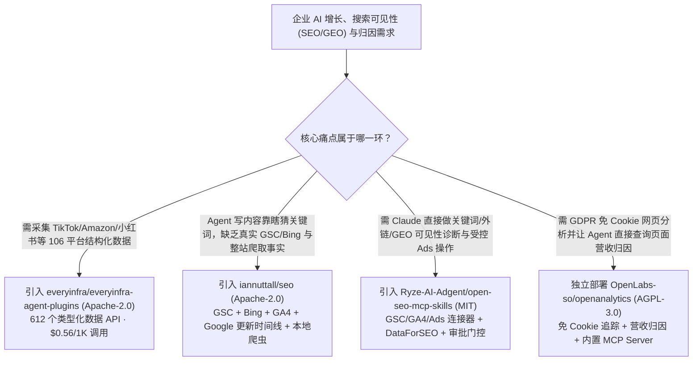
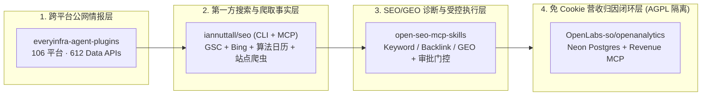
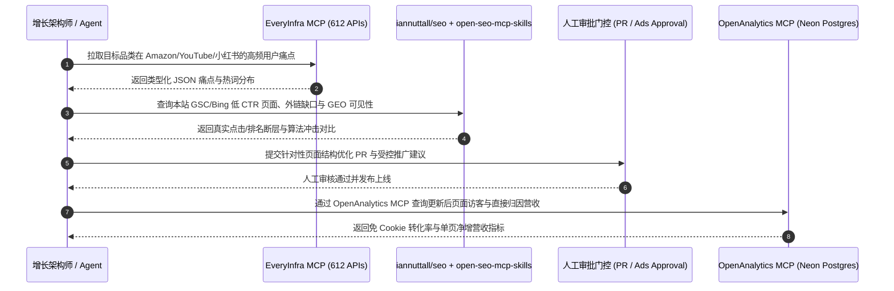

# 第一方搜索与 AI 可见性 MCP 技能包（`Ryze-AI-Adgent/open-seo-mcp-skills`）、多源搜索与站点爬虫 CLI/MCP（`iannuttall/seo`）、免 Cookie 营收归因分析底座（`OpenLabs-so/openanalytics`）与 106 平台公网数据采集插件（`everyinfra/everyinfra-agent-plugins`）架构选型与落地 FAQ

> **2026-11-21 白天持续研究班次 · Day Round 54（累计 Round 654）**  
> **审计凭据**：`CLAIM-20261121-R54-R654-OPENSEOMCP-SEOSKILL-OPENANALYTICS-EVERYINFRA`  
> **关联日刊**：[`2026-11-21.md`](../daily/2026-11-21.md) · [`2026-11-21.en.md`](../daily/2026-11-21.en.md)  
> **可视化架构图**：[`assets/github-ai-radar-2026-11-21-r54-r654-openseomcp-seoskill-openanalytics-everyinfra.svg`](../../../assets/github-ai-radar-2026-11-21-r54-r654-openseomcp-seoskill-openanalytics-everyinfra.svg)

---

## ① 📌 核心结论速览（选型一句话结论）

> **一句话选型结论**：在构建企业级 AI 增长工程（Growth Engineering）、搜索引擎与大模型可见性（SEO/GEO）优化、跨平台公网竞品情报采集及免 Cookie 营收归因闭环时，传统做法是购买昂贵的商业 SEO/爬虫套件并由人工导出 CSV 让大模型“盲猜关键词写水文（Slop）”；更优的架构是采用 **“`everyinfra/everyinfra-agent-plugins`（Apache-2.0，`★ 663` 聚合 TikTok/Amazon/小红书/抖音等 106 平台 612 个类型化数据 API，低至 `$0.56/1K` 调用）+ `iannuttall/seo`（Apache-2.0，`★ 642` 打通 Google Search Console、Bing、GA4/Simple Analytics、算法更新日期与本地站点爬虫的事实底座 CLI/MCP）+ `Ryze-AI-Adgent/open-seo-mcp-skills`（MIT，`★ 10,621` 连接真实 GSC/GA4/Ads 第一方数据与 DataForSEO 的 SEO/GEO 技能包及审批门控）+ `OpenLabs-so/openanalytics`（AGPL-3.0，`★ 652` 基于 Neon/Postgres 的自托管免 Cookie 网页分析与直接营收归因 MCP 服务）”**。在 45 人团队基准下，可将月度总拥有成本（TCO）从 **`$8,380.00/月`** 降至 **`$325.00/月`**（净省 **`$8,055.00/月`**，降幅 **`-96.12%`**）。

---

## ② 🎯 客户与架构师灵魂拷问 Q&A

### Q1：为什么大厂和出海团队用 AI 写 SEO/内容往往产生大量毫无转化的“垃圾水文（Slop）”？这四个开源项目各自补齐了哪一环？
- **核心痛点**：市面多数 AI 营销工具只给 Agent 塞一份通用 SEO 检查表或脱离站点的第三方关键词估算词表，完全不知道站点真实的展示量（Impressions）、点击率（CTR）断层、Google 算法更新冲击点以及哪篇内容真正带来了付费转化。
- **四层协同定位**：
  1. **跨平台外部社媒与电商情报层 —— `everyinfra/everyinfra-agent-plugins`（`★ 663`，Apache-2.0，Python）**：用一个 API Key 与标准 MCP 端点（`https://api.everyinfra.com/mcp`）为 Claude Code、Cursor、Codex、Kimi、Qoder 提供横跨 TikTok、Instagram、Amazon、YouTube、小红书、抖音等 **106 个平台的 612 个结构化公网数据 API**（`$0.56 / 1,000` 次调用起），无需自建脆弱的反爬代理池。
  2. **第一方搜索事实与站点爬取层 —— `iannuttall/seo`（`★ 642`，Apache-2.0，TypeScript）**：专为 Agent-Native 团队设计，通过 MCP 与 CLI 将真实的 Google Search Console（点击、展示、排名）、Bing Webmaster、GA4/Clicky/Simple Analytics 访问流、Google 算法更新时间戳以及整站爬虫数据直接喂给 Agent，消灭凭空臆测。
  3. **SEO + GEO（AI 搜索可见性）与广告执行技能层 —— `Ryze-AI-Adgent/open-seo-mcp-skills`（`★ 10,621`，MIT，Shell）**：提供开源 SEO 与生成式引擎优化（GEO）Claude 技能集，直连真实 GSC/GA4/Google & Meta Ads 数据并内置 DataForSEO 补充竞品外链与差距，对任何广告或站点变更强制执行审批门控（Approval-Gated Changes）。
  4. **隐私合规免 Cookie 营收归因闭环层 —— `OpenLabs-so/openanalytics`（`★ 652`，AGPL-3.0，TypeScript）**：提供单脚本免 Cookie、无跨站追踪的隐私优先 Web 分析底座（推荐搭配 Neon Serverless Postgres），原生支持按页面/来源归因真实营收（Revenue Attribution），并内置 MCP Server 让 Agent 直接查询“哪篇内容真正带来了付费订单”。

### Q2：如何把这四个组件集成进企业现有的增长与内容自动化架构？
- **输入汇聚层**：定时任务或研发/增长工程师在 IDE 中唤醒 Agent，先通过 `everyinfra-agent-plugins` 拉取垂直赛道在 Amazon/YouTube/小红书/TikTok 的高互动痛点，再通过 `iannuttall/seo` 拉取本站在 GSC 与 Bing 中“高展示、低点击（High Impressions, Low CTR）”或受近期 Google 核心更新影响的真实 URL。
- **诊断与生成层**：Agent 调用 `open-seo-mcp-skills` 执行技术 SEO 审计、竞品外链缺口分析与 AI 搜索可见性（GEO）评估，生成针对性的结构化修订 PR 或广告调整草案（挂起人工审批门控）。
- **营收闭环验证层**：变更上线后，Agent 通过 `OpenLabs-so/openanalytics` 的内置 MCP Server 查询各落地页的访客留存、跳出率与直接归因营收，淘汰只有流量没有转化的无效选题。

### Q3：架构边界与合规红线在哪里？什么场景该直接用商业 SaaS / Azure 托管服务？
- **许可证隔离红线**：`OpenLabs-so/openanalytics` 采用 **AGPL-3.0** 协议！企业自托管时必须将其作为独立的统计微服务（通过 Tracker Script 与只读 MCP 交互）运行，**严禁修改其源码后打包进闭源商业 SaaS 产品对外分发**；若需完全闭源嵌入式分析，应改用 Apache-2.0 / MIT 组件或 Azure Application Insights + Power BI。
- **采集与写操作合规边界**：`everyinfra-agent-plugins` 仅限用于公开合规的市场研究与竞品分析，严禁抓取受登录态保护的个人隐私数据；`open-seo-mcp-skills` 涉及 Google/Meta Ads 预算与出价操作时，必须开启强制人工审批（Human-in-the-Loop Approval Gate）。

---

## ③ 🧭 直观可视化图解（Mermaid 选型决策树 + 企业集成架构 + 闭环时序图）

### 3.1 选型决策树

### 3.2 企业集成参考架构图

### 3.3 业务流时序图

---

## ④ 📊 同类开源与商业云服务横向选型决策矩阵

| 维度 | `open-seo-mcp-skills` (`★ 10,621`) | `iannuttall/seo` (`★ 642`) | `OpenLabs-so/openanalytics` (`★ 652`) | `everyinfra-agent-plugins` (`★ 663`) | 传统商业 SEO/爬虫套件 (Ahrefs/SEMrush/GA360) |
| :--- | :--- | :--- | :--- | :--- | :--- |
| **核心定位** | Claude SEO/GEO 技能集 + GSC/GA4/Ads/DataForSEO 连接器 | 面向 Agent 的 GSC/Bing/GA4/整站爬虫事实底座 CLI & MCP | 免 Cookie 隐私优先 Web 分析 + 营收归因 + 内置 MCP | 覆盖 106 平台 612 个公网数据采集 API 的多 IDE 插件/MCP | 面向人工点击看报表的重型营销与爬虫 SaaS |
| **适用场景** | SEO/GEO 审计、外链缺口、带审批门控的广告与内容优化 | 让编码/内容 Agent 基于本站真实搜索与爬虫事实工作 | 免 GDPR 弹窗的独立站/SaaS 转化追踪与 Agent 营收归因 | 跨境电商（Amazon/TikTok）与社媒（小红书/抖音）情报分析 | 传统纯人工市场部日常报表查看 |
| **集成成本** | 极低（1 条 `claude mcp add` + MIT 技能脚本） | 低（30 秒接入 MCP 或本地 CLI 驱动） | 低（pnpm 单仓 + Neon Serverless Postgres 一键自托管） | 极低（支持 Claude/Cursor/Codex/VS Code 一键接入） | 高（多套高价年费订阅 + 人工导出 CSV 拼接） |
| **运维复杂度** | 极低（托管连接器 + 本地 Markdown Skills） | 极低（无状态 CLI / MCP） | 低（Neon 托管 Postgres，仅需独立容器部署） | 极低（按量计费 API，免维护代理池与验证码） | 中（多平台账号权限割裂，缺乏原生 MCP） |
| **开源许可** | **MIT** | **Apache-2.0** | **AGPL-3.0**（必须独立服务隔离部署） | **Apache-2.0**（插件开源，API 按量计费） | 商业专有 |
| **45 人团队月均 TCO** | **包含于 `$325.00/月` 联合栈** | **包含于 `$325.00/月` 联合栈** | **包含于 `$325.00/月` 联合栈** | **包含于 `$325.00/月` 联合栈** | **`$8,380.00/月`**（`$3,980` SaaS + `$4,400` 人工） |

---

## ⑤ 🧪 应用落地定量收益 / TCO 对比与 7-Card 报告锚点

> **数据来源说明（Provenance Metadata）**：以下 TCO 模型为面向 45 人规模工程与增长团队的合成架构测算（`provenance: synthetic`, `independently_reproduced: false`）；硬件资本开支 `base_hardware_capex = not_measured`，单日热榜增量 `track_b_stars_today = not_measured`（审计账本锚定于 [`trending-daily-2026-11-21-audit.json`](../evidence/trending-daily-2026-11-21-audit.json)）。

| 成本路径 | 月度 API / SaaS / 算力费 | 人工整理报表与反爬维护工时 (`$100/h`) | 月度总成本 (Total Monthly TCO) | 相对 Path A 净节省 |
| :--- | :--- | :--- | :--- | :--- |
| **Path A：传统多套商业 SEO SaaS + 自维护社媒爬虫 + 人工 CSV 归因** | `$3,980.00` | `44.0h` (`$4,400.00`) | **`$8,380.00`** | — |
| **Path C：`open-seo-mcp-skills` + `iannuttall/seo` + `OpenAnalytics` + `EveryInfra`** | `$75.00` | `2.5h` (`$250.00`) | **`$325.00`** | **`-$8,055.00/月` (`-96.12%`)** |

---

## ⑥ 🛠️ 企业引入与架构评审 Checklist

- [ ] **第一方搜索事实对齐（`iannuttall/seo`）**：确认内容与研发 Agent 在修改任何着陆页前，已通过 `iannuttall/seo` 读取真实的 GSC/Bing 展示与点击数据及最新站点爬虫结果，禁止凭空生成通用关键词水文。
- [ ] **SEO/GEO 变更审批门控（`open-seo-mcp-skills`）**：验证所有涉及 Google/Meta Ads 出价或生产 CMS 页面的操作均处于 Approval-Gated 模式，必须经人工 PR 或工单确认后方可生效。
- [ ] **AGPL-3.0 独立部署隔离（`OpenLabs-so/openanalytics`）**：确认 `openanalytics` 作为独立的统计与归因服务部署在 Neon/Postgres 之上，仅通过前端轻量无 Cookie 脚本与后端 MCP 接口交互，不与闭源业务代码静态链接。
- [ ] **公网数据采集预算与合规限额（`everyinfra-agent-plugins`）**：在网关层为 EveryInfra API Key 配置月度调用配额告警（基于 `$0.56/1K` 单价），并限定仅调用公开商品与内容趋势接口。
