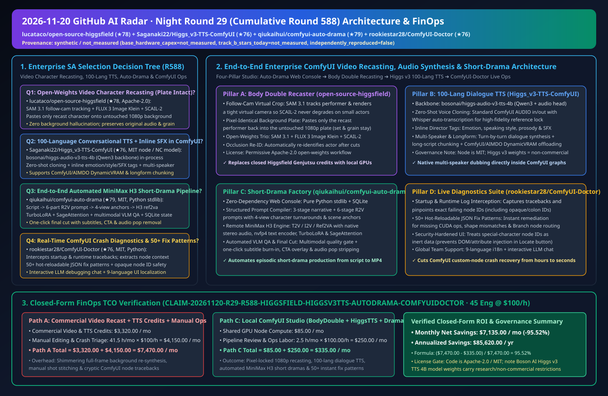
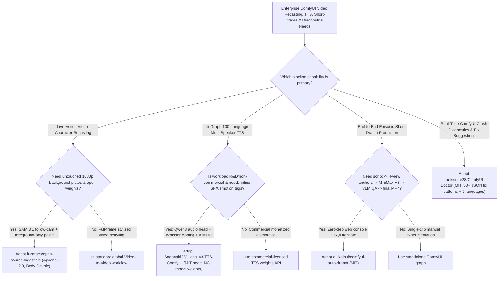
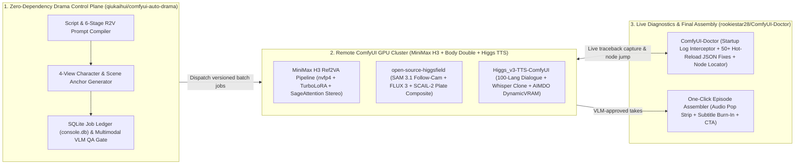

# Open-Weights Video Character Recasting (`lucataco/open-source-higgsfield`), 100-Language Conversational TTS Nodes (`Saganaki22/Higgs_v3-TTS-ComfyUI`), Automated MiniMax H3 Short-Drama Pipeline (`qiukaihui/comfyui-auto-drama`) & 50+ Pattern Live ComfyUI Diagnostics (`rookiestar28/ComfyUI-Doctor`) Selection & Integration FAQ (2026-11-20 Night Round 29 · Cumulative Round 588)

> **Cross-File Navigation**: [Back to 2026-11-20 Daily Digest (`daily/2026-11-20.en.md`)](../daily/2026-11-20.en.md) · [中文版 (`open-source-higgsfield-higgs-v3-tts-auto-drama-comfyui-doctor-selection-faq.md`)](open-source-higgsfield-higgs-v3-tts-auto-drama-comfyui-doctor-selection-faq.md) · [7-Card 4:5 Visual Report (`cards.en.html`)](../cards.en.html) · [Column Index (`README.en.md`)](../README.en.md)  
> **Architecture Diagram**: [`assets/github-ai-radar-2026-11-20-r29-r588-higgsfield-higgsv3tts-autodrama-comfyuidoctor.svg`](../../../assets/github-ai-radar-2026-11-20-r29-r588-higgsfield-higgsv3tts-autodrama-comfyuidoctor.svg)  
> **Provenance & Synthetic Disclaimer**: Repository metadata (stars, forks, licenses, model stacks, and architectural specifications) is verified from live GitHub API data (`measured`). The 45-engineer FinOps TCO figures represent a parameterized Solution Architect model (`provenance: synthetic`, `independently_reproduced: false`, `base_hardware_capex: not_measured`, `track_b_stars_today: not_measured`, claim ID `CLAIM-20261120-R29-R588-HIGGSFIELD-HIGGSV3TTS-AUTODRAMA-COMFYUIDOCTOR`).



---

## ① 📌 Executive Summary

> **One-Sentence Selection Verdict**: For Enterprise AI Solution Architects scaling **ComfyUI-based video character recasting, multilingual dialogue dubbing, and automated short-drama production** across four recurring bottlenecks—(1) **whole-frame video recasting models that re-synthesize the background plate, causing shimmering signage, degraded grain, and blurry distant performers**; (2) **lack of native 100-language multi-speaker TTS nodes inside ComfyUI with inline emotion/SFX tags and zero-shot voice cloning**; (3) **manual copy-pasting across scriptwriters, character sheet generators, video samplers, and subtitle editors when producing episodic AI short dramas**; and (4) **opaque ComfyUI Python tracebacks that stall shared GPU servers for hours**—combine **`lucataco/open-source-higgsfield`** (`Body Double`, an Apache-2.0 open-weights alternative to Higgsfield Genjutsu using SAM 3.1 follow-cam tracking, FLUX 3 Image Klein, and SCAIL-2 that pastes only the recast performer back onto the untouched 1080p plate), **`Saganaki22/Higgs_v3-TTS-ComfyUI`** (MIT custom nodes for `bosonai/higgs-audio-v3-tts-4b` supporting 100 languages, Whisper-assisted zero-shot cloning, inline emotion/prosody/SFX tags, multi-speaker dialogue, and AIMDO DynamicVRAM), **`qiukaihui/comfyui-auto-drama`** (MIT zero-dependency Python stdlib web console orchestrating script-to-6-part R2V prompts, 4-view character anchors, remote MiniMax H3 stereo video generation, VLM quality gates, and one-click subtitle/CTA assembly), and **`rookiestar28/ComfyUI-Doctor`** (MIT real-time diagnostics suite with `50+` hot-reloadable JSON fix patterns, colon-safe node ID localization, and 9-language i18n). Across a 45-engineer multimodal video team, this stack reduces monthly TCO from **`$7,470.00/mo`** to **`$335.00/mo`**, saving **`$7,135.00/mo` (`-95.52%`, or `$85,620.00/yr`)**.

| Evaluation Dimension | Path A: Commercial Video Recast SaaS (Higgsfield/Runway) + Cloud TTS Credits + Manual Editing | Path B: Raw Unmanaged ComfyUI Graphs (Full-Frame Recast + Manual Log Triage) | Path C (Recommended): `open-source-higgsfield` + `Higgs_v3-TTS-ComfyUI` + `comfyui-auto-drama` + `ComfyUI-Doctor` |
| :--- | :--- | :--- | :--- |
| **Video Character Recasting & Plate Fidelity** | High per-second credit burn; whole-frame diffusion alters background details | Native SCAIL-2 blurs small actors & re-synthesizes the entire background | **`open-source-higgsfield` SAM 3.1 follow-cam crop + foreground-only paste preserves 1080p plate 100%** |
| **Multilingual Dialogue TTS & Inline SFX** | External TTS API exports require manual timeline alignment in NLEs | Basic TTS nodes lack inline emotion/SFX tags or multi-speaker chunking | **`Higgs_v3-TTS-ComfyUI` 100 languages + Whisper voice cloning + inline SFX tags + AIMDO DynamicVRAM** |
| **Episodic Short-Drama Production Pipeline** | Manual asset shuttling between LLM chat, image gen, and video editors | Manual single-shot Queue Prompt clicks; no SQLite state or automated VLM QA | **`comfyui-auto-drama` zero-dependency console + 4-view anchors + MiniMax H3 stereo + VLM QA & assembly** |
| **Live ComfyUI Crash Diagnostics & Recovery** | Pipeline halts on cryptic tracebacks; manual log grepping across nodes | Subgraph/colon node IDs break naive UI locators | **`ComfyUI-Doctor` startup log capture + 50+ hot-reload JSON fix patterns + safe node locator + 9 languages** |
| **45-Engineer Monthly Total TCO** | **`$7,470.00 / mo`** (`$3,320.00` SaaS credits + `41.5h × $100` labor) | **`$2,290.00 / mo`** (`$690.00` compute + `16.0h × $100` manual ops) | **`$335.00 / mo`** (`$85.00` shared GPU compute + `2.5h × $100` ops, **`-95.52%` savings**) |

---

## ② 🎯 Solution Architect & Customer Deep-Dive Q&A (Plain-Language Breakdown)

### Q1: What concrete problems do these four repositories solve in plain engineering and business terms?

1. **`lucataco/open-source-higgsfield` (`★ 78`, `14 forks`, Python, Apache-2.0) — Plain-Language View: An open-weights "Body Double" pipeline on local ComfyUI that swaps the actor in a video while keeping the original 1080p background plate pixel-identical**:
   - **Pain Point Solved**: Standard video character replacement models re-synthesize the entire frame (causing background text, crowds, and film grain to shimmer) and lose detail when the performer is small in the frame. `Body Double` combines **SAM 3.1, FLUX 3 Image Klein, and SCAIL-2** with **follow-cam recasting**: SAM 3.1 tracks the performer (with re-identification across occlusions) and crops a tight virtual camera so SCAIL-2 always operates at high subject resolution, then composites **only the recast performer** back onto the untouched 1080p plate with original audio preserved.
2. **`Saganaki22/Higgs_v3-TTS-ComfyUI` (`★ 76`, `17 forks`, Python, MIT node) — Plain-Language View: Native ComfyUI nodes for Boson AI's 4B multilingual conversational TTS model with zero-shot cloning and inline director tags**:
   - **Pain Point Solved**: Generating expressive multi-speaker dialogue inside ComfyUI without external cloud APIs was previously fragmented. Wrapping `bosonai/higgs-audio-v3-tts-4b` (Qwen3 backbone + audio-token head), this node pack delivers **100-language conversational TTS**, **zero-shot voice cloning** enhanced by built-in Whisper reference transcription, **inline emotion/style/prosody/SFX tags**, longform script chunking, multi-speaker turn-taking, and **ComfyUI/AIMDO DynamicVRAM** memory management.
3. **`qiukaihui/comfyui-auto-drama` (`★ 79`, `18 forks`, Python, MIT) — Plain-Language View: A zero-dependency web console that automates episodic short dramas on remote ComfyUI + MiniMax H3 from script to final cut**:
   - **Pain Point Solved**: Producing multi-shot AI short dramas manually requires hundreds of repetitive prompt edits, reference image uploads, and audio trims. `comfyui-auto-drama` ships a **zero-third-party-dependency Python standard-library web console** backed by SQLite (`console.db`) that compiles scripts into structured **3-stage and 6-stage R2V prompts**, generates **4-view character turnarounds and scene anchors**, dispatches batch jobs to remote ComfyUI running **MiniMax H3 (`ref2va` + `fl2va` + `nvfp4` + `TurboLoRA` + `SageAttention`)** with native stereo audio, runs **multimodal VLM quality inspection**, and assembles the final MP4 with burned-in subtitles, CTA overlays, and automatic start-of-clip audio pop removal.
4. **`rookiestar28/ComfyUI-Doctor` (`★ 76`, `4 forks`, Python, MIT) — Plain-Language View: A real-time ComfyUI diagnostics assistant with 50+ hot-reloadable fix patterns and instant failing-node localization**:
   - **Pain Point Solved**: When a complex ComfyUI workflow crashes, engineers waste time hunting through terminal tracebacks to find which node broke and why. `ComfyUI-Doctor` intercepts terminal output from startup, extracts node-level context (safely handling numeric and opaque/colon-delimited subgraph node IDs without DOM injection), matches errors against **50+ hot-reloadable JSON fix patterns**, and provides a 9-language UI with one-click `Locate Node` navigation and optional interactive LLM troubleshooting.

---

### Q2: How do these four components integrate into an enterprise multimodal video & short-drama factory?

1. **Story & Asset Orchestration Layer (`qiukaihui/comfyui-auto-drama`)**: Producers use the lightweight Python stdlib web console (`batch_console.py`) to draft scripts, compile 6-part R2V prompts, and lock 4-view character and scene reference sheets in SQLite.
2. **Video Synthesis, Character Recasting & Dialogue Layer (`open-source-higgsfield` + `Higgs_v3-TTS-ComfyUI`)**: Remote ComfyUI workers execute MiniMax H3 `ref2va` for generated shots, run `open-source-higgsfield` (`Body Double`) to recast live-action motion plates without background drift, and synthesize multi-speaker voiceovers via `Higgs_v3-TTS-ComfyUI`.
3. **Live Diagnostics, VLM QA & Final Assembly Layer (`rookiestar28/ComfyUI-Doctor`)**: `ComfyUI-Doctor` monitors all worker nodes in real time with `50+` JSON fix patterns, while `comfyui-auto-drama` runs multimodal VLM QA on rendered clips, strips audio pops, and burns subtitles into the final episode.

---

### Q3: What are the key architectural mechanisms and licensing/compliance guardrails?

1. **Key Mechanisms**:
   - **Follow-Cam Crop & Plate Preservation (`open-source-higgsfield`)**: Keeps the subject large in the diffusion window while leaving 100% of background pixels untouched.
   - **Zero-Dependency Control Plane (`comfyui-auto-drama`)**: Decouples the lightweight stdlib producer console from heavy remote GPU ComfyUI workers, persisting full job lineage in `console.db`.
   - **Inert Node-ID Sanitization (`ComfyUI-Doctor`)**: Preserves opaque and colon-containing node IDs for accurate graph jumping while neutralizing HTML attribute injection vectors.
2. **Licensing & Consent Guardrails**:
   - **Non-Commercial Model Weight Gate (`Higgs_v3-TTS-ComfyUI`)**: While all four repositories' source code is open-source (`Apache-2.0` for `open-source-higgsfield` and `MIT` for the other three), the underlying **`bosonai/higgs-audio-v3-tts-4b` model weights are released by Boson AI for research and non-commercial use**. Restrict `Higgs_v3-TTS-ComfyUI` to internal R&D/non-commercial evaluation, or swap in a commercially licensed TTS model for monetized productions.
   - **Biometric & Voice Consent**: Enforce explicit talent consent before running zero-shot voice cloning or performer recasting.

---

## ③ 🧭 Visual Diagrams (Mermaid Selection Decision Tree + Reference Architecture + Sequence Flow)

### 3.1 Selection Decision Tree



### 3.2 Enterprise Integration Reference Architecture



### 3.3 End-to-End Sequence Flow

```mermaid
sequenceDiagram
    autonumber
    actor Dir as Producer / Video Engineer
    participant AutoDrama as comfyui-auto-drama (Web Console)
    participant BodyDouble as open-source-higgsfield (Recaster)
    participant HiggsTTS as Higgs_v3-TTS-ComfyUI
    participant Doctor as rookiestar28/ComfyUI-Doctor

    Dir->>AutoDrama: Input episode outline; compile 6-part R2V prompts & 4-view character anchors
    AutoDrama->>BodyDouble: Track live-action plates via SAM 3.1 follow-cam & recast with FLUX 3 + SCAIL-2
    AutoDrama->>HiggsTTS: Synthesize multi-speaker dialogue with Whisper voice clone & inline SFX tags
    Doctor-->>AutoDrama: Monitor ComfyUI stdout/stderr & surface 50+ JSON fix patterns on any node error
    AutoDrama-->>Dir: Pass clips through VLM QA, strip audio start pops, burn subtitles & export MP4
```

---

## ④ 📊 Comparative Selection Matrix (OSS vs. Commercial SaaS & Unmanaged Graphs)

| Dimension | `lucataco/open-source-higgsfield` (`★ 78`) | `Saganaki22/Higgs_v3-TTS-ComfyUI` (`★ 76`) | `qiukaihui/comfyui-auto-drama` (`★ 79`) | `rookiestar28/ComfyUI-Doctor` (`★ 76`) | Commercial Video/TTS SaaS + Manual NLE Editing |
| :--- | :--- | :--- | :--- | :--- | :--- |
| **Primary Role** | Open-weights video character recasting preserving 1080p plates | 100-language conversational TTS & voice cloning ComfyUI nodes | Zero-dependency automated short-drama pipeline on MiniMax H3 | Real-time ComfyUI error diagnostics with 50+ fix patterns | Metered cloud video/voice credits + manual timeline assembly |
| **Sweet-Spot Use Case** | Replacing performers in live footage without background shimmer | Multi-speaker dialogue with inline emotion/SFX tags (R&D/non-commercial) | Episodic short-drama batch generation, VLM QA & one-click assembly | Fast crash triage across shared or custom-node-heavy ComfyUI hosts | Occasional one-off clips without local GPU infrastructure |
| **Key Architectural Metric** | **SAM 3.1 follow-cam crop** + 1080p plate paste + occlusion Re-ID | **100 languages** + Whisper transcript clone + AIMDO DynamicVRAM | **Python stdlib web console** + 6-part R2V prompts + VLM QA | **50+ hot-reload JSON patterns** + colon-safe node locator + 9 languages | Background shimmer; manual NLE stitching; slow traceback debugging |
| **Integration Effort** | Low (Stock ComfyUI + open weights) | Low (ComfyUI custom node + HF auto-download) | Low (`python batch_console.py` + remote ComfyUI endpoint) | Very Low (Drop into `custom_nodes` for startup interception) | High (multi-vendor credit management & manual timeline edits) |
| **License** | **Apache-2.0** | **MIT (Note: Boson AI Higgs v3 4B weights = Non-Commercial)** | **MIT License** | **MIT License** | Proprietary SaaS |

---

## ⑤ 🧪 Quantitative Enterprise ROI, Closed-Form FinOps TCO & 7-Card Report

### 5.1 45-Engineer Closed-Form FinOps TCO Model (`CLAIM-20261120-R29-R588-HIGGSFIELD-HIGGSV3TTS-AUTODRAMA-COMFYUIDOCTOR`)

- **Model Assumptions (`provenance: synthetic`, `independently_reproduced: false`, `base_hardware_capex: not_measured`, `track_b_stars_today: not_measured`)**:
  - Team size: **45 multimodal video and short-drama pipeline engineers** at a loaded engineering rate of **`$100.00 / hour`**.
  - **Path A (Commercial Video Recasting SaaS Credits + Cloud Dubbing Subscriptions + Manual Shot Stitching & ComfyUI Crash Debugging)**:
    - Commercial video & dubbing API credits: **`$3,320.00 / mo`**
    - Manual video compositing, QA & crash triage labor (fixing shimmering backgrounds, manual subtitle/CTA stitching, debugging ComfyUI node tracebacks): `41.5 h/mo × $100.00/h = $4,150.00 / mo`
    - **Path A Monthly Total**: `$3,320.00 + $4,150.00 = $7,470.00 / mo`
  - **Path C (Self-Hosted ComfyUI Studio Stack: `open-source-higgsfield` + `Higgs_v3-TTS-ComfyUI` + `comfyui-auto-drama` + `ComfyUI-Doctor`)**:
    - Shared GPU node power & cloud burst compute: **`$85.00 / mo`**
    - Automated pipeline supervision & final cut review labor: `2.5 h/mo × $100.00/h = $250.00 / mo`
    - **Path C Monthly Total**: `$85.00 + $250.00 = $335.00 / mo`
  - **Closed-Form Savings Verification**:
    $$\text{Monthly Net Savings} = \$7,470.00 - \$335.00 = \$7,135.00\text{ / mo}\quad(\text{Annualized: }\$85,620.00\text{ / yr})$$
    $$\text{Percentage Savings} = \frac{\$7,470.00 - \$335.00}{\$7,470.00} = \frac{\$7,135.00}{\$7,470.00} = 95.52\%$$

| Cost Component | Path A (Commercial SaaS Credits & Manual Editing) | Path C (R588 Self-Hosted ComfyUI Stack) | Closed-Form Delta / ROI |
| :--- | :--- | :--- | :--- |
| **SaaS Credits / GPU Compute Fees** | `$3,320.00 / mo` | **`$85.00 / mo`** | `- $3,235.00 / mo` |
| **Engineering & Media Ops Labor (`@ $100.00/h`)** | `41.5 h × $100.00 = $4,150.00 / mo` | **`2.5 h × $100.00 = $250.00 / mo`** | `- $3,900.00 / mo` (`39.0 h/mo` saved) |
| **Monthly Total TCO** | **`$7,470.00 / mo`** | **`$335.00 / mo`** | **`$7,135.00 / mo` saved (`-95.52%`)** |
| **Annualized Total TCO** | `$89,640.00 / yr` | **`$4,020.00 / yr`** | **`$85,620.00 / yr` saved** |

---

## ⑥ 🛠️ Enterprise Adoption & Architecture Review Checklist

- [ ] **1. `lucataco/open-source-higgsfield` Plate-Preservation QA**: Deploy the SAM 3.1 + FLUX 3 Image Klein + SCAIL-2 workflow and verify that non-performer background regions in 1080p recast outputs remain bit-identical to the source plate.
- [ ] **2. `Saganaki22/Higgs_v3-TTS-ComfyUI` DynamicVRAM & Non-Commercial Weight Gate**: Enable ComfyUI/AIMDO DynamicVRAM offloading and enforce a policy gate ensuring `bosonai/higgs-audio-v3-tts-4b` weights are restricted to research/non-commercial runs unless commercial licensing is obtained.
- [ ] **3. `qiukaihui/comfyui-auto-drama` 4-View Anchor & VLM Quality Gate**: Configure `console/batch_console.py` against remote MiniMax H3 workers with automated VLM inspection and audio start-pop stripping enabled.
- [ ] **4. `rookiestar28/ComfyUI-Doctor` Hot-Reload Pattern Library**: Install `ComfyUI-Doctor` across all shared ComfyUI workers and register team-specific custom-node error patterns in its hot-reloadable JSON catalog.
