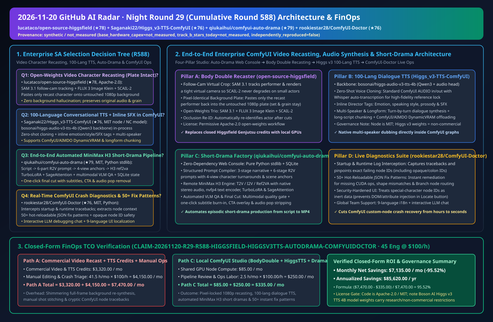
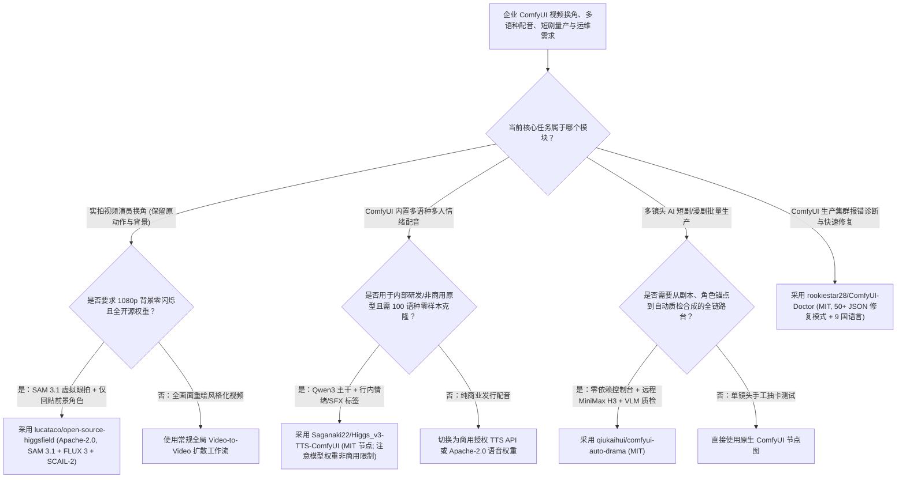
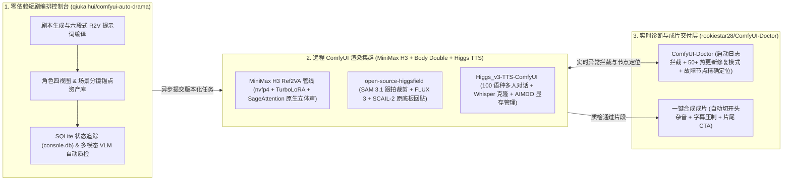
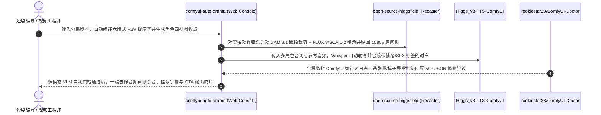

# 开源背景零损视频换角引擎（`lucataco/open-source-higgsfield`）、100 语种情绪对话语音节点（`Saganaki22/Higgs_v3-TTS-ComfyUI`）、MiniMax H3 自动化短剧生产流水线（`qiukaihui/comfyui-auto-drama`）与 50+ 模式实时诊断套件（`rookiestar28/ComfyUI-Doctor`）架构选型与集成 FAQ（2026-11-20 Night Round 29 · 累计 Round 588）

> **跨文件导航**：[返回 2026-11-20 当日全景日报 (`daily/2026-11-20.md`)](../daily/2026-11-20.md) · [English Version (`open-source-higgsfield-higgs-v3-tts-auto-drama-comfyui-doctor-selection-faq.en.md`)](open-source-higgsfield-higgs-v3-tts-auto-drama-comfyui-doctor-selection-faq.en.md) · [查看 7-Card 4:5 评测报告 (`cards.html`)](../cards.html) · [返回专栏主索引 (`README.md`)](../README.md)  
> **本轮架构大图**：[`assets/github-ai-radar-2026-11-20-r29-r588-higgsfield-higgsv3tts-autodrama-comfyuidoctor.svg`](../../../assets/github-ai-radar-2026-11-20-r29-r588-higgsfield-higgsv3tts-autodrama-comfyuidoctor.svg)  
> **数据溯源与口径声明（Provenance & Synthetic Disclaimer）**：本报告中实时采集的 GitHub 仓库元数据（Stars、Forks、License、模型组合与 README 架构规范）为 `measured`；针对 45 人企业多模态视频与短剧工业化团队的 FinOps TCO 测算参数属于架构师参数化测算模型（`provenance: synthetic`，`independently_reproduced: false`，`base_hardware_capex: not_measured`，`track_b_stars_today: not_measured`，审计契约号 `CLAIM-20261120-R29-R588-HIGGSFIELD-HIGGSV3TTS-AUTODRAMA-COMFYUIDOCTOR`）。

---

## ① 📌 核心结论速览（Executive Summary）

> **一句话选型结论**：面向企业 AI 解决方案架构师（SA）在建设**基于 ComfyUI 的工业化视频换角、多语种对话配音与自动化短剧/漫剧生产线**时的四大工程痛点——① **传统视频换人方案（或 SCAIL-2 原生替换模式）会把整张画面重新合成导致背景建筑与胶片颗粒闪烁变形，且远景小人物换角画质崩坏**；② **ComfyUI 工作流缺乏内嵌的 100 语种多人对话、零样本音色克隆与行内音效/情绪标签（SFX/Prosody）合成节点**；③ **AI 短剧从剧本、角色四视图锚点、批量视频生成到质检与字幕合成全靠人工在多个界面间来回搬运**；④ **复杂的 ComfyUI 工作流一旦遇到节点报错，终端数十行 Python Traceback 难以定位具体故障节点 ID**——建议采用 **`lucataco/open-source-higgsfield`**（Higgsfield Genjutsu 的 Apache-2.0 全开源权重替代方案 `Body Double`，通过 SAM 3.1 虚拟跟拍相机放大人物 + FLUX 3 Image Klein + SCAIL-2 重绘并仅将新角色贴回 1080p 原片背景，实现背景像素级零闪烁）、**`Saganaki22/Higgs_v3-TTS-ComfyUI`**（集成 `bosonai/higgs-audio-v3-tts-4b` 的 MIT 节点，支持 100 语种对话、Whisper 自动转写参考音色克隆、行内情绪/音效标签与 AIMDO 动态显存卸载）、**`qiukaihui/comfyui-auto-drama`**（零第三方依赖 Python 标准库控制台 + 远程 ComfyUI MiniMax H3 `ref2va` 自动化短剧流水线，含三段/六段式提示词、多模态质检与一键去杂音合成成片）与 **`rookiestar28/ComfyUI-Doctor`**（内置 50+ 热更新 JSON 修复模式、支持带冒号复杂节点 ID 精确定位与 9 国语言的 ComfyUI 实时诊断助手）。在 45 人多模态视频工程团队模型下，该组合可将月度总拥有成本（TCO）从 **`$7,470.00/月`** 降至 **`$335.00/月`**，净省 **`$7,135.00/月`（`-95.52%`，年省 `$85,620.00`）**。

| 评估维度 | 方案 A：商业闭源视频换角 SaaS（Higgsfield/Runway）+ 商业配音 API + 人工剪辑排障 | 方案 B：裸跑基础 ComfyUI 节点（无跟拍裁剪、无工作流控制台、人工查日志） | 方案 C（推荐）：`open-source-higgsfield` + `Higgs_v3-TTS-ComfyUI` + `comfyui-auto-drama` + `ComfyUI-Doctor` |
| :--- | :--- | :--- | :--- |
| **实拍视频角色替换与背景保真度** | 按秒高价扣费；或全画幅重绘导致背景路人、字牌与噪点闪烁失真 | 直接跑 SCAIL-2 对远景小人物严重糊脸，全图重绘破坏原始布景 | **`open-source-higgsfield` SAM 3.1 虚拟跟拍放大 + 仅贴回重绘角色，1080p 原片背景像素级 100% 不变** |
| **多角色多语种情绪配音与音效** | 外部调用 ElevenLabs 后手工对齐时间轴导入剪辑软件 | 基础 TTS 节点不支持行内情绪/音效标签或长文本分块与多人轮流对话 | **`Higgs_v3-TTS-ComfyUI` 100 语种 + Whisper 零样本克隆 + 行内情绪/SFX 标签 + AIMDO 动态显存管理** |
| **短剧/漫剧端到端工业化编排** | 编剧、抽卡师、剪辑师在多套工具间手动传图传视频，返工率高 | 仅能单次手动点 Queue Prompt，无 SQLite 状态追踪与自动质检 | **`comfyui-auto-drama` 零依赖 Web 控制台 + 四视图锚点 + MiniMax H3 立体声生成 + VLM 自动质检合成** |
| **生产环境工作流故障定位与自愈** | 节点报错导致整晚批处理中断，工程师逐行翻找终端 Traceback | 特殊字符或子图冒号节点 ID 无法点击定位 | **`ComfyUI-Doctor` 启动即拦截日志 + 50+ JSON 修复模式热加载 + 精确跳转故障节点 + 9 国语言** |
| **45 人团队月度总成本（TCO）** | **`$7,470.00 / 月`**（`$3,320.00` 商业点数 + `41.5h × $100` 人工） | **`$2,290.00 / 月`**（`$690.00` 算力 + `16.0h × $100` 人工排障与剪辑） | **`$335.00 / 月`**（`$85.00` 共享 GPU 算力 + `2.5h × $100` 巡检，**净省 `95.52%`**） |

---

## ② 🎯 客户与架构师灵魂拷问 Q&A（通俗解构）

### Q1：这四个开源项目各自解决什么痛点？用大白话怎么向业务方和工程团队解释？

1. **`lucataco/open-source-higgsfield`（`★ 78`，`14 forks`，Python，Apache-2.0）——用大白话讲：它是商业闭源工具 Higgsfield Genjutsu 的全开源替代品（代号 `Body Double`），能把实拍视频里的演员换成任意 AI 新角色，同时保证背景一像素都不变**：
   - **解决什么痛点**：很多团队想把一段实拍街舞或产品演示视频里的真人换成品牌虚拟 IP 形象，但如果直接用普通视频重绘模型（包括原生 SCAIL-2），有两个致命伤：一是演员离镜头较远时脸部和肢体直接糊成一团；二是模型把整个背景也重画了一遍，导致背景里的招牌和胶片颗粒疯狂闪烁。`Body Double` 串联了三大开源权重模型（**SAM 3.1 + FLUX 3 Image Klein + SCAIL-2**），独创了**虚拟跟拍相机（Follow-cam recasting）**：先用 SAM 3.1 锁定演员并裁出一个始终保持高分辨率的特写虚拟镜头送入 SCAIL-2 重绘，最后**只把重绘好的新角色精准贴回未受任何触碰的 1080p 原片底板（Plate）上**，而且就算演员中途被柱子挡住也能自动重识别（Re-identification）！
2. **`Saganaki22/Higgs_v3-TTS-ComfyUI`（`★ 76`，`17 forks`，Python，MIT 节点）——用大白话讲：它是把 Boson AI 的 4B 多模态语音大模型直接装进 ComfyUI 里的“100 语种多人广播剧配音台”**：
   - **解决什么痛点**：以前在 ComfyUI 里做视频，声音往往是短板，很难在一个工作流里同时搞定多角色对话、语气停顿和环境音效。该节点基于 `bosonai/higgs-audio-v3-tts-4b`（Qwen3 主干 + 音频 Token 头），直接在 ComfyUI 进程内原生推理，支持 **100 种语言**、接上一段参考音频即可通过内置 Whisper 自动转写完成**高保真零样本音色克隆**、在台词里直接写**行内情绪/语调/音效标签（Inline emotion/prosody/SFX tags）**、支持长文本自动切块与多人轮流对话，并原生适配 **ComfyUI / AIMDO DynamicVRAM** 动态显存卸载。
3. **`qiukaihui/comfyui-auto-drama`（`★ 79`，`18 forks`，Python，MIT）——用大白话讲：它是“从写剧本、锁角色四视图、调远程 MiniMax H3 批量生视频、多模态自动质检到加字幕去杂音一键出成片”的零依赖短剧流水线**：
   - **解决什么痛点**：做一集 AI 短剧要生几十个镜头，手动在 ComfyUI 里改提示词、拖参考图、听音频开头有没有爆音，效率极低。`comfyui-auto-drama` 提供了一个**零第三方依赖（纯 Python 标准库 + SQLite `console.db`）的 Web 控制台**：自动把剧本拆解为规范的**三段式 + R2V 自动六段式提示词**，先生成角色四视图与场景分镜锚点图保持跨镜头一致性，再提交给远程 ComfyUI 跑 **MiniMax H3（`ref2va` + `fl2va` + 官方 `nvfp4` 编码器 + `TurboLoRA` + `SageAttention`）** 生成带原生立体声的视频，随后调用本地/云端多模态视觉模型**自动质检**，最后一键合成字幕、片尾 CTA 并自动切除音频开头杂音！
4. **`rookiestar28/ComfyUI-Doctor`（`★ 76`，`4 forks`，Python，MIT）——用大白话讲：它是 ComfyUI 的“全天候急诊室医生——一旦工作流报错，不仅秒级标出是哪个节点崩了，还直接给出 50 多种常见故障的修复方案”**：
   - **解决什么痛点**：企业共用一台 ComfyUI 渲染服务器时，经常因为缺少算子、张量维度不匹配或子图（Subgraph）里带冒号的复杂节点 ID 报错而卡死。`ComfyUI-Doctor` 从启动瞬间就自动拦截终端输出，提取崩溃节点的完整上下文（安全处理数字与带特殊字符/冒号的不透明节点 ID，防止 HTML 属性注入），内置 **50+ 种支持热重载的 JSON 修复模式（Hot-reloadable fix patterns）** 与 **9 国语言界面**，一键点击 `Locate Node` 即可高亮定位故障节点并启动交互式排障对话。

---

### Q2：这四个项目在企业多模态视频与短剧生产架构里怎么串成一条流水线？

1. **编排与资产锚定层（`comfyui-auto-drama` Web 控制台）**：内容编导在零依赖 Web 控制台中输入分集大纲，由本地 LM Studio / oMLX 或云端 LLM 生成剧本与六段式 R2V 提示词，并生成角色四视图与场景锚点图存入 `console.db`。
2. **多语种对话配音与实拍换角层（`Higgs_v3-TTS-ComfyUI` + `open-source-higgsfield`）**：
   - 对于原创动画/短剧镜头，提交至远程 ComfyUI 运行 MiniMax H3 `ref2va` 节点，并由 `Higgs_v3-TTS-ComfyUI` 合成带情绪与音效标签的多角色多语种对白；
   - 对于需要复用实拍动作素材的镜头，走 `open-source-higgsfield`（SAM 3.1 跟拍 + FLUX 3 Image Klein + SCAIL-2）管线，在保留 1080p 原片布景与光影的前提下完成虚拟角色换装换角。
3. **自动质检、成片合成与实时运维保障层（`ComfyUI-Doctor` + VLM QA）**：整个远程 ComfyUI 集群挂载 `ComfyUI-Doctor` 实时监控节点健康度；生成的视频片段经多模态模型自动质检通过后，由 `comfyui-auto-drama` 自动切除音频首帧杂音、压制字幕与 CTA 合成最终成片。

---

### Q3：这套架构的核心机制亮点与上线前必须注意的版权/合规边界是什么？

1. **核心机制亮点**：
   - **`open-source-higgsfield` 的“局部跟拍重绘 + 原底板回贴”**：彻底解决了视频生成模型“改一个人毁掉整张背景”的痛点，让 1080p 背景保持 100% 原始像素。
   - **`comfyui-auto-drama` 的“零依赖标准库控制台 + 远程 GPU 解耦”**：编导人员的笔记本电脑无需安装 PyTorch 或 CUDA，直接用 Python 标准库启动轻量 Web 控制台，将重算力任务异步派发给远端 H3 渲染机。
   - **`ComfyUI-Doctor` 的“不透明节点 ID 安全隔离”**：针对包含冒号或特殊字符的复杂子图节点 ID 做纯数据隔离渲染，既防止误改其他节点，又杜绝了前端 DOM 注入风险。
2. **上线前必须严守的许可证与合规红线（License & Consent Gate）**：
   - **Higgs Audio v3 权重非商用限制**：虽然 `Saganaki22/Higgs_v3-TTS-ComfyUI` 节点代码本身是 **MIT 协议**，但其底层调用的 **`bosonai/higgs-audio-v3-tts-4b` 模型权重由 Boson AI 按研究与非商业用途（Research and Non-Commercial Use）发布**！因此企业可将该节点用于内部原型研发与非商用评测；若用于商业付费短剧发行，需向 Boson AI 申请商业授权或将配音节点替换为 Apache-2.0/MIT 商用许可的语音模型。
   - **音色克隆与肖像授权红线**：严禁在未获真人明确书面授权的情况下使用 `Higgs_v3-TTS-ComfyUI` 克隆他人声音或使用 `open-source-higgsfield` 替换未经授权的真人肖像。

---

## ③ 🧭 直观可视化图解（Mermaid 选型决策树 + 集成架构图 + 业务时序图）

### 3.1 选型决策树（Selection Decision Tree）

### 3.2 企业集成参考架构图（Enterprise Reference Architecture）

### 3.3 端到端业务流时序图（End-to-End Sequence Flow）

---

## ④ 📊 同类开源与商业云服务横向选型决策矩阵

| 对比维度 | `lucataco/open-source-higgsfield` (`★ 78`) | `Saganaki22/Higgs_v3-TTS-ComfyUI` (`★ 76`) | `qiukaihui/comfyui-auto-drama` (`★ 79`) | `rookiestar28/ComfyUI-Doctor` (`★ 76`) | 商业闭源 SaaS（Higgsfield / ElevenLabs）+ 人工剪辑排障 |
| :--- | :--- | :--- | :--- | :--- | :--- |
| **核心功能定位** | 基于 SAM 3.1 + FLUX 3 + SCAIL-2 的背景零损视频换角管线 | `higgs-audio-v3-tts-4b` 的 100 语种多人对话 ComfyUI 节点 | 基于 ComfyUI + MiniMax H3 的零依赖自动化短剧生产系统 | 内置 50+ 修复模式与节点精确定位的 ComfyUI 实时诊断套件 | 按秒计费的云端视频/语音 SaaS + 人工剪辑与日志排错 |
| **最佳适用场景** | 实拍视频替换虚拟主播/角色且要求 1080p 背景绝对不闪烁 | 多语种广播剧、角色零样本音色克隆与带情绪/音效标签配音（内部/非商用） | 短剧/漫剧批量分镜锚定、H3 立体声视频生成与自动质检合片 | 多人共用或复杂自定义节点 ComfyUI 环境的秒级排障 | 偶发单条短视频制作、无本地 GPU 算力的轻量团队 |
| **关键性能/架构指标** | **Follow-cam 虚拟放大** + 1080p 原底板回贴 + 遮挡重识别 | **100 语种** + Whisper 参考转写 + AIMDO DynamicVRAM | **Python 标准库零依赖控制台** + 六段式提示词 + VLM 自动质检 | **50+ JSON 修复模式热重载** + 冒号/特殊节点 ID 安全定位 + 9 国语言 | 全局重绘导致背景闪烁；多工具手工导片耗时；报错排查慢 |
| **集成与运维复杂度** | 低（标准 ComfyUI + 开源权重下载） | 低（ComfyUI Custom Node + HuggingFace 权重自动拉取） | 低（本地 `python batch_console.py` + 远程 ComfyUI 地址配置） | 极低（放入 `custom_nodes` 即自动拦截启动与运行时日志） | 高（多平台充值、API 限流与手工音画对齐） |
| **开源协议（License）** | **Apache-2.0** | **MIT（注意：底层 Higgs v3 4B 模型权重仅限非商用）** | **MIT License** | **MIT License** | 商业专有协议 |

---

## ⑤ 🧪 应用落地定量收益 / 闭式 FinOps TCO 对比与 7-Card 报告

### 5.1 45 人多模态视频与短剧工程团队闭式 FinOps TCO 模型（`CLAIM-20261120-R29-R588-HIGGSFIELD-HIGGSV3TTS-AUTODRAMA-COMFYUIDOCTOR`）

- **测算基准设定（`provenance: synthetic`，`independently_reproduced: false`，`base_hardware_capex: not_measured`，`track_b_stars_today: not_measured`）**：
  - 团队规模：**45 名多模态视频算法与短剧生产工程师**，综合人力工时成本 **`$100.00 / 小时`**。
  - **方案 A（商业视频换角 SaaS 点数 + 商业多语种配音订阅 + 人工分镜拼接与 ComfyUI 报错排障）**：
    - 商业视频生成与配音 API 额度费：**`$3,320.00 / 月`**
    - 人工剪辑返工与工作流排障工时（修复背景闪烁废片、手工逐段对齐字幕与切开头爆音、排查 ComfyUI 节点崩溃）：`41.5 小时/月 × $100.00/小时 = $4,150.00 / 月`
    - **方案 A 月度总计**：`$3,320.00 + $4,150.00 = $7,470.00 / 月`
  - **方案 C（开源自建工作站组合：`open-source-higgsfield` + `Higgs_v3-TTS-ComfyUI` + `comfyui-auto-drama` + `ComfyUI-Doctor`）**：
    - 共享 GPU 渲染节点电费与折旧分摊：**`$85.00 / 月`**
    - 自动化流水线巡检与成片抽检人工工时：`2.5 小时/月 × $100.00/小时 = $250.00 / 月`
    - **方案 C 月度总计**：`$85.00 + $250.00 = $335.00 / 月`
  - **闭式净节省验算**：
    $$\text{Monthly Net Savings} = \$7,470.00 - \$335.00 = \$7,135.00\text{ / 月}\quad(\text{Annualized: }\$85,620.00\text{ / 年})$$
    $$\text{Percentage Savings} = \frac{\$7,470.00 - \$335.00}{\$7,470.00} = \frac{\$7,135.00}{\$7,470.00} = 95.52\%$$

| 成本分项 | 方案 A（商业视频/配音 SaaS 与人工剪辑排障） | 方案 C（本轮 R588 开源四件套） | 闭式差额 / 收益 |
| :--- | :--- | :--- | :--- |
| **SaaS 点数 / 共享算力费用** | `$3,320.00 / 月` | **`$85.00 / 月`** | `- $3,235.00 / 月` |
| **工程与后期人工成本（`@ $100.00/h`）** | `41.5 h × $100.00 = $4,150.00 / 月` | **`2.5 h × $100.00 = $250.00 / 月`** | `- $3,900.00 / 月`（节省 `39.0 h/月`） |
| **月度总拥有成本（Monthly Total TCO）** | **`$7,470.00 / 月`** | **`$335.00 / 月`** | **净省 `$7,135.00 / 月`（`-95.52%`）** |
| **年度总拥有成本（Annualized TCO）** | `$89,640.00 / 年` | **`$4,020.00 / 年`** | **年省 `$85,620.00 / 年`** |

---

## ⑥ 🛠️ 企业引入与架构评审 Checklist

- [ ] **1. `lucataco/open-source-higgsfield` 虚拟跟拍与背景回贴验收**：在本地 ComfyUI 部署 SAM 3.1 + FLUX 3 Image Klein + SCAIL-2 管线，对包含远景人物与遮挡物的 1080p 实拍素材进行换角测试，确认未遮挡背景区域与原片像素差为零。
- [ ] **2. `Saganaki22/Higgs_v3-TTS-ComfyUI` 模型权重非商用门禁与显存策略**：启用 ComfyUI/AIMDO DynamicVRAM 选项避免 4B 语音模型与视频模型争抢显存；在网关侧建立模型许可证标签，确保 `bosonai/higgs-audio-v3-tts-4b` 仅用于非商业研究/内部评测，商业发行自动切换至商用授权语音引擎。
- [ ] **3. `qiukaihui/comfyui-auto-drama` 四视图锚定与多模态质检闭环**：通过零依赖 `console/batch_console.py` 编排剧本至远程 MiniMax H3 节点，开启 VLM 视觉质检自动重抽崩坏镜头，并启用成片合成阶段的开头爆音自动切除。
- [ ] **4. `rookiestar28/ComfyUI-Doctor` 50+ 修复规则库热更新挂载**：在所有共享 ComfyUI 实例安装 `ComfyUI-Doctor`，将团队内部高频自定义节点报错补充进 JSON 规则库实现免重启热加载。
